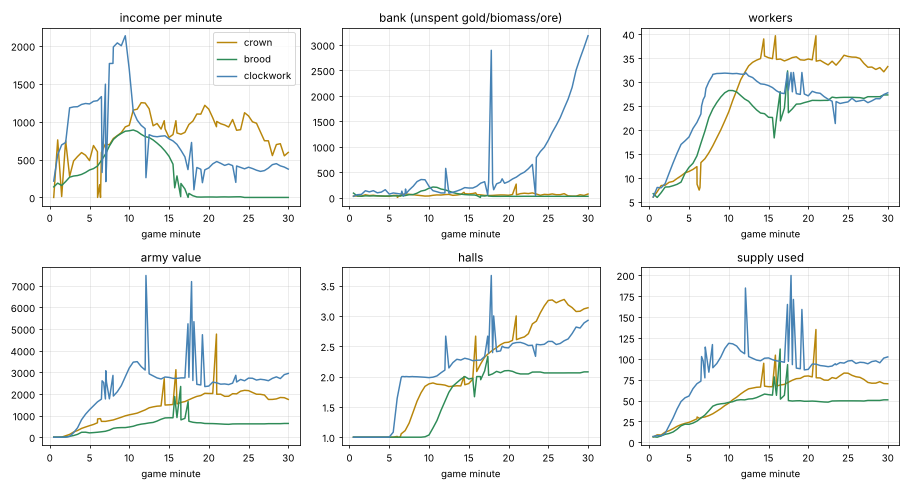
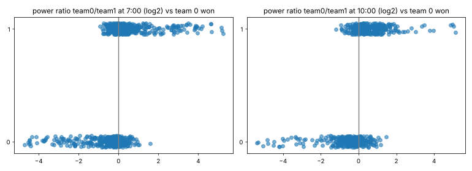

# AI balance study: Hard AI against Hard AI in all six matchups

**Interim report, stage 11: 950 of 1,080 planned games done (158 to 159 per matchup); the batch is still running.** The data and this report are refreshed at each stage; numbers will still move a little. Data as of 2026-10-26 21:40:02 (UTC).

> **Read this first: which game this measures.** Every game ran on the study build, **v0.14.1** (branch `wt-study`, made from
> main at `e6deec6`), so that the whole sample measures one version of the code. Main has moved on since (0.14.27 when this was
> written) and nothing from main was merged here. The changes that touch these results:
> - **The Clockwork was rebuilt** (0.14.14 to 0.14.23, "gear mode", on by default): Cog Presses and cogs instead of Ore Crushers
>   and ore, no energy (no Boiler, Charging Pylon, Engine Hall, Capacitor Works), the Movement Works and Clock Soldier instead of the
>   Assembly Works and Wind-up Soldier, the Ratchet Turret, Mainspring and Tension, the Escapement and Jack, air units, the Pendulum
>   and Netter. **Every Clockwork number below is about the old ore-and-energy Clockwork**, which main has shelved.
> - **Workers and income**: Crown games no longer start with every Labourer hauling and the first Farm unworked (0.14.19);
>   every faction's workers take primary-resource jobs first (0.14.24); workers sent to a spent Farm, Mill or Feeding Pit go to
>   fresh land instead of standing idle (0.14.17).
> - **BOMBARD** (fire at a spot) and **the Brood's harvest** at 1.25 essence per supply of a body instead of 1 (0.14.26).
>
> So: read the Brood and Crown findings as likely still true on main but worth one re-run, the Clockwork findings as history,
> and the AI-behaviour faults (section 10) as true of the AI code unless that code has changed. Section 13 says how to re-run.

## Summary

**The five headline findings** (sample sizes and intervals in the sections named):

1. **The Brood cannot beat the other two factions on Hard AI.** It won 0 of 316
   cross-faction side-games: the Crown beat it 158-0, the Clockwork 158-0, with every plan it has (Balanced, Rush,
   Extreme rush, Timing attack). Its army is worth about 300 from 4:00 to 7:00 while the others' armies double. The Clockwork's
   first two waves erase that army by 6:00 (median game: about 8 minutes); the Crown's Musketeers and Horsemen take its
   Feeding Pits and then its Burrow, in a quarter of Balanced games by about 8:30 and in half by about 14:00 (sections 2,
   3 and 4.2). The 95% upper bound on its win rate in these matchups is 1%.
2. **The (old) Clockwork economy ran at about twice the others' pace, and the Clockwork beat the Crown 116-42
   (73% [66%-80%]).** In mirrors, where both sides face the same faction, the median army at 5:00 was worth 1,152
   for the Clockwork, 535 for the Crown and 300 for the Brood; by 2:00 the Clockwork had earned 1,090 ore
   against 760 gold and 356 biomass (section 4.1). The Crown survives on its ramp wall and gate: Clockwork
   waves pull back from a Crown gate in most Crown-Clockwork games (section 7).
3. **The Crown's chances against the Clockwork depend heavily on the map.** On Kestrel Rise, Cinder Steps, Glimmerdeep
   and Frostmere the Crown won 1/51 games against 40/104 on the other eight maps (Fisher p = 1.4e-07). The
   grouping was picked after looking at the per-map results, so it was checked again on the 3 Crown-Clockwork games
   run after it was chosen: there the Crown won 0/2 on those four maps and 1/1 on the rest (p = 0.33).
   The cause is not established (section 9.2).
4. **The AI often neither finishes a won game nor gives up a lost one.** In 7 side-games (crown-clockwork) the
   winner sat at its supply cap with 1,000+ banked and no wave out for 10 minutes or more, its bank growing to as much as
   26,166; the loser never qualified for gg, because the gg rule counts "a hall and a worker" as income even
   when the soil is spent and nothing comes in. Brood mirrors that reach 30:00 are dead economies on both sides (section 10).
5. **Leads start to decide games at about 10 minutes.** Inside mirrors, the side ahead in power at 3:00 won only
   44% [39%-49%] of 347 decided games, and at 5:00 54% [49%-58%] of 422: the early game is open, and an early army bought ahead of the
   opponent is if anything a handicap. At 10:00 a lead of 30% or more won 88% [83%-92%] of 217, at 15:00 97% [93%-98%] of 230, and
   comebacks after 15:00 are rare (section 8).

**What to fix first** (the full ranked list with evidence and the design principle each follows is in section 11):
make an army at the supply cap attack and make the gg rule look at real income (AI faults with clear examples); re-measure
the Brood on main and then give it an early game that can hold against Musketeers, Horsemen and wind-up waves (it is far
behind on every measure here); drop the Crown's random Horse Breeder opening from the Balanced plan (in the Crown mirror the Breeder opening scores 24% [16%-36%] against the Mill's 62% [54%-70%], and the Mill side wins 42/50 = 84% [71%-92%] head to head);
stop the Crown buying production while it is supply-blocked; and look at why the Crown falls apart on four maps.

**What this cannot tell you.** These are computer-against-computer games: a result mixes the faction's strength with how well
the AI plays it. "The Brood loses every game" means the Brood *as the Hard AI plays it* loses to the Crown and Clockwork *as
the Hard AI plays them*. A human Brood may do far better (the owner's own extreme rush is the anchor in
`docs/design_principles.md`). Section 13 lists what else could not be checked.

---

## 1. What was run, and how far to trust it

**Request and what fitted.** 1,000 games of 30 minutes for every matchup was asked for. The agreed plan was the
"overnight study": as many Hard-against-Hard games as fit in about 24 to 36 hours, spread evenly over the six matchups (three
mirrors, three cross pairs), headless, with the game exactly as shipped in v0.14.1 (no game logic, balance number or AI code
touched; only `tools/study/` and this report were added). The first estimate was 20 to 30 games per matchup, because a
30-minute game was expected to take 30 to 45 minutes of real time. It costs far less (below), and most games end well before
30:00, so the runner was set to 180 games per matchup (1,080 in all) and run in stages, with the data
and this report refreshed and committed at each stage.

**Cost of a game, and making it faster.**
- Real time per game: mean 193 s, median 157 s, longest 1046 s; on average a game lasted
  16.6 game minutes, and one game minute cost 11.7 real seconds. In all, 51 hours of game
  processes. The box has 2 cores and was shared with other jobs the whole time (two games at a time until about 930 games, one
  at a time after), so these times are inflated; a quiet core is faster.
- The engine already runs unthrottled under `--fixed-fps 30`. A larger time scale or tick rate would change the simulation
  (the game's step is the physics tick), so it was not used. Hiding the HUD is the one safe saving: on the same seed it took
  60.1 s instead of 67.7 s for 620 game seconds (11% less), so the runner does it (`fast:1`). The rest of the frame is unit logic
  (about 40%), fog and vision (about 15%) and the AI (about 10%, from the match log's own profile), which cannot be skipped
  without changing results.
- **Games do not replay exactly (a finding in itself).** Two runs with the same seed and settings drift apart: the state
  hash at 5:00 differs. Five back-to-back runs of one Crown-Clockwork setup on Greenhold, one at a time, were all won by
  the Clockwork, but they lasted 664 to 928 s and the hashes differed every time (`tools/study/replicates.sh`). A seed fixes the
  map, the start and the AI's coin flips, not the whole game; results are reproducible only as statistics. The cause (time-
  budgeted work such as path queues is a candidate) was not investigated. Worth knowing for anything that relies on lockstep
  determinism.

**Design.**
- Hard AI on both sides, 30 game minutes at most. Slot 0 sits on the first spawn and slot 1 on the second; in every matchup
  the first-named faction alternates between the two spawns, so spawn bias cancels out of the cross-faction numbers (it is
  measured separately, section 2.3).
- Games are scheduled round by round: round n is game n of all six matchups, so every matchup always has (nearly) the same
  sample size.
- **Plans.** A cycle of 11 games per matchup: 7 Balanced against Balanced, 2 where the first-named side opens with Rush (for the
  Brood, Rush and Extreme rush take turns, one cycle each), and 2 where one side plays Timing attack. The plan is the starting
  plan: the AI may change plan by itself (a failed rush turns Balanced), and the plan it ended with is recorded too.
  The split per matchup is in the table below.
- **Maps.** The 12 built-in 1v1 maps in a fixed rotation, the four the owner named first (Greenhold, Frostmere, Ashford
  Crossing, Amberfall Vale), then Kestrel Rise, Glimmerdeep, Hollowfen, Highmoor, Thornwood Maze, Saltmarsh Isles, Twin Fords
  and Cinder Steps. Greenhold, Highmoor and Twin Fords are generated "classic" maps (a new layout for each seed); the rest are
  fixed, hand-made maps. Games per map: greenhold (84), frostmere (84), ashford_crossing (80), amberfall_vale (78), kestrel_rise (78), glimmerdeep (78), hollowfen (78), highmoor (78), thornwood_maze (78), saltmarsh_isles (78), twin_fords (78), cinder_steps (78).
- **How a game ends.** At 30:00; when a side has no buildings left (victory); or when one side has been hopeless by the AI's own
  gg rule (`AIResign.verdict`) for 120 game seconds without a break. That is the 60 s the AI waits before it says gg plus the
  60 s a player has to answer it; a human would have answered, so the game is cut and counted as a win for the other side
  (cause "gg"). In AI-against-AI games the AI never says gg (it only talks to a human), so this is also how "when would it have
  given up" is measured. Games that reach 30:00 are judged by `Game.power` (army value + 50 per worker + 30 per building): a
  lead of more than 25% counts as a win ("timeout_lead"), otherwise a draw ("timeout_even", half a win). Section 2.4 shows this
  rule moves no result by more than a few points.
- **What is recorded.** Per game: setup, result and cause. Per side, every 30 s: gold and second resource banked, income,
  supply and cap, workers and idle workers, army value and idle army, halls, buildings, wall pieces, production buildings and
  idle ones, losses, kills, soil/ground and saltpetre/ore left, whether a wave is out, seconds supply-blocked, seconds with 500
  and 1,000 banked, whether it is hopeless, the plan, and (games from round 155 on) the AI's own attack gate (the army supply
  its next wave waits for, whether an enemy is near one of its buildings, whether a siege plan runs). Per side, once: when each
  building kind was first finished, when each hall went up, units made and lost by kind, kills by unit kind, every attack wave
  (start, end, supply and value sent, composition, enemy value killed, own value lost) and every Crown raiding party, first
  blood, first worker lost, wall times, plan changes. And the full match log of every game.

**The sample.**

| matchup                |   games |   Balanced/Balanced |   with a Rush |   with a Timing attack |   ended by victory |   ended by gg |   reached 30:00 |   failed runs |   maps |
|:-----------------------|--------:|--------------------:|--------------:|-----------------------:|-------------------:|--------------:|----------------:|--------------:|-------:|
| crown vs crown         |     159 |                 102 |            29 |                     28 |                129 |             8 |              22 |             0 |     12 |
| brood vs brood         |     159 |                 102 |            29 |                     28 |                103 |            23 |              33 |             0 |     12 |
| clockwork vs clockwork |     158 |                 102 |            28 |                     28 |                 67 |            74 |              17 |             0 |     12 |
| crown vs brood         |     158 |                 102 |            28 |                     28 |                128 |            30 |               0 |             0 |     12 |
| crown vs clockwork     |     158 |                 102 |            28 |                     28 |                107 |            40 |              11 |             0 |     12 |
| brood vs clockwork     |     158 |                 102 |            28 |                     28 |                154 |             4 |               0 |             0 |     12 |

0 games failed to run (crash or hang); none had to be retried.

**Statistics.** Win rates are given as wins-losses(-draws) with a Wilson 95% interval; a draw counts as half a win. A
matchup with 158-180 games pins a win rate to about +-7 points; a plan inside a matchup (14-32 side-games) only to +-15 to 25
points. "Established" below means the interval excludes 50% (or the effect is far larger than its interval) and the pattern
holds across maps; otherwise it is called a hint. Every number comes from `docs/study_data/` and can be re-derived with
`tools/study/*.py`.

**Currencies are not comparable between factions.** The Crown earns gold, the Brood biomass and the Clockwork ore, and their
units cost different amounts (a Brood Raptor costs 25, a Grub 50). "Earned" and "bank" are compared within a faction, or
side by side with that caveat. **Army value** (the game's own cost-based tally of armed units) is the common yardstick, and
"power" (army value + 50 per worker + 30 per building) is the one used for leads.

---

## 2. Who wins

### 2.1 The win matrix

Each cell is the row faction's record against the column faction (wins-losses-draws, score, 95% interval). All plans:

| faction   | vs crown                | vs brood                 | vs clockwork            | vs both others           |
|:----------|:------------------------|:-------------------------|:------------------------|:-------------------------|
| crown     | (mirror)                | 158-0-0  100% [98%-100%] | 42-116-0  27% [20%-34%] | 316 games  63% [58%-68%] |
| brood     | 0-158-0  0% [0%-2%]     | (mirror)                 | 0-158-0  0% [0%-2%]     | 316 games  0% [0%-1%]    |
| clockwork | 116-42-0  73% [66%-80%] | 158-0-0  100% [98%-100%] | (mirror)                | 316 games  87% [83%-90%] |

Balanced against Balanced only:

| faction   | vs crown               | vs brood                 | vs clockwork           | vs both others           |
|:----------|:-----------------------|:-------------------------|:-----------------------|:-------------------------|
| crown     | (mirror)               | 102-0-0  100% [96%-100%] | 33-69-0  32% [24%-42%] | 204 games  66% [59%-72%] |
| brood     | 0-102-0  0% [0%-4%]    | (mirror)                 | 0-102-0  0% [0%-4%]    | 204 games  0% [0%-2%]    |
| clockwork | 69-33-0  68% [58%-76%] | 102-0-0  100% [96%-100%] | (mirror)               | 204 games  84% [78%-88%] |

The order is the same in both: **Clockwork > Crown > Brood**, and the gaps are large. Crown against Brood (158-0) and
Clockwork against Brood (158-0) are as one-sided as a sample can be. Crown against Clockwork is 42-116 for the Crown
(27% [20%-34%]; Balanced/Balanced 33-69, 32% [24%-42%]): lopsided, but the Crown does win a quarter to a third
of the time, more on some maps than others (section 9).

### 2.2 Plans inside one matchup

How a plan does against Balanced, and how Balanced does against it, inside each matchup (score, 95% interval). These are
small samples (14-32 side-games a cell):

| matchup                         | this side plays   | against   |   n | score         |
|:--------------------------------|:------------------|:----------|----:|:--------------|
| crown vs crown (mirror)         | balanced          | Balanced  | 204 | 50% [43%-57%] |
| crown vs crown (mirror)         | rush              | Balanced  |  29 | 40% [24%-58%] |
| crown vs crown (mirror)         | timing            | Balanced  |  28 | 52% [34%-69%] |
| crown vs crown (mirror)         | balanced          | rush      |  29 | 60% [42%-76%] |
| crown vs crown (mirror)         | balanced          | timing    |  28 | 48% [31%-66%] |
| brood vs brood (mirror)         | balanced          | Balanced  | 204 | 50% [43%-57%] |
| brood vs brood (mirror)         | rush              | Balanced  |  15 | 30% [13%-55%] |
| brood vs brood (mirror)         | xrush             | Balanced  |  14 | 18% [6%-44%]  |
| brood vs brood (mirror)         | timing            | Balanced  |  28 | 39% [24%-58%] |
| brood vs brood (mirror)         | balanced          | rush      |  15 | 70% [45%-87%] |
| brood vs brood (mirror)         | balanced          | xrush     |  14 | 82% [56%-94%] |
| brood vs brood (mirror)         | balanced          | timing    |  28 | 61% [42%-76%] |
| clockwork vs clockwork (mirror) | balanced          | Balanced  | 204 | 50% [43%-57%] |
| clockwork vs clockwork (mirror) | rush              | Balanced  |  28 | 71% [53%-85%] |
| clockwork vs clockwork (mirror) | timing            | Balanced  |  28 | 54% [36%-70%] |
| clockwork vs clockwork (mirror) | balanced          | rush      |  28 | 29% [15%-47%] |
| clockwork vs clockwork (mirror) | balanced          | timing    |  28 | 46% [30%-64%] |
| crown vs clockwork              | balanced          | Balanced  | 102 | 32% [24%-42%] |
| crown vs clockwork              | rush              | Balanced  |  14 | 14% [4%-40%]  |
| crown vs clockwork              | timing            | Balanced  |  14 | 21% [8%-48%]  |
| crown vs clockwork              | balanced          | rush      |  14 | 7% [1%-31%]   |
| crown vs clockwork              | balanced          | timing    |  14 | 21% [8%-48%]  |
| clockwork vs crown              | balanced          | Balanced  | 102 | 68% [58%-76%] |
| clockwork vs crown              | rush              | Balanced  |  14 | 93% [69%-99%] |
| clockwork vs crown              | timing            | Balanced  |  14 | 79% [52%-92%] |
| clockwork vs crown              | balanced          | rush      |  14 | 86% [60%-96%] |
| clockwork vs crown              | balanced          | timing    |  14 | 79% [52%-92%] |

Across all matchups, as the opening plan against a Balanced opponent:

| plan     | faction   | vs Balanced   |   wins |   draws | score [95% CI]   | first attack (median)   |   workers lost (mean) | game length (median)   | plan changed   |
|:---------|:----------|:--------------|-------:|--------:|:-----------------|:------------------------|----------------------:|:-----------------------|:---------------|
| balanced | crown     | n=408         |    233 |       8 | 58% [53%-63%]    | 6:06                    |                  19.8 | 18:10                  | 2/408          |
| balanced | brood     | n=408         |     93 |      18 | 25% [21%-29%]    | 8:43                    |                  20.8 | 14:15                  | 0/408          |
| balanced | clockwork | n=408         |    272 |       2 | 67% [62%-71%]    | 3:42                    |                  14.5 | 17:14                  | 0/408          |
| rush     | crown     | n=57          |     27 |       1 | 48% [36%-61%]    | 2:42                    |                  18.6 | 17:30                  | 44/57          |
| rush     | brood     | n=29          |      4 |       1 | 16% [7%-33%]     | 2:03                    |                  24.7 | 14:34                  | 29/29          |
| rush     | clockwork | n=56          |     47 |       0 | 84% [72%-91%]    | 2:44                    |                   7.1 | 15:47                  | 42/56          |
| xrush    | brood     | n=28          |      2 |       1 | 9% [3%-25%]      | 1:56                    |                  24.4 | 13:31                  | 28/28          |
| timing   | crown     | n=56          |     31 |       1 | 56% [43%-68%]    | 4:29                    |                  21.5 | 18:26                  | 0/56           |
| timing   | brood     | n=56          |      9 |       4 | 20% [11%-32%]    | 4:32                    |                  21.1 | 14:42                  | 0/56           |
| timing   | clockwork | n=56          |     40 |       0 | 71% [59%-82%]    | 4:32                    |                  11.2 | 15:57                  | 0/56           |

- Rush is below Balanced for the Crown and the Brood and above it for the Clockwork (Clockwork mirror Rush
  71% [53%-85%]); Extreme rush is the worst plan the Brood has. Inside the mirrors, only those two (the Clockwork's Rush,
  the Brood's Extreme rush) have intervals that exclude an even result; the rest are hints. (In the lopsided Crown-Clockwork
  matchup, compare each row with the Balanced/Balanced baseline, not with 50%.)
- "Plan changed" counts games where the AI left its opening plan (a failed rush turns Balanced): almost every Brood rush and
  most Crown and Clockwork rushes end that way.
- The Brood loses its cross matchups with every plan: Brood in a cross matchup: 0 wins in 316 side-games (112 with a Rush, Extreme rush or Timing plan on either side).

### 2.3 Spawn side

| sample                 |   n |   spawn 0 |   spawn 1 |   draws | spawn-0 score [95% CI]   |
|:-----------------------|----:|----------:|----------:|--------:|:-------------------------|
| all games              | 950 |       463 |       465 |      22 | 50% [47%-53%]            |
| cross matchups only    | 474 |       241 |       233 |       0 | 51% [46%-55%]            |
| Balanced/Balanced only | 612 |       307 |       291 |      14 | 51% [47%-55%]            |

| mirror    |   n |   spawn 0 wins |   spawn 1 wins |   draws | spawn-0 score [95% CI]   |
|:----------|----:|---------------:|---------------:|--------:|:-------------------------|
| crown     | 159 |             68 |             85 |       6 | 45% [37%-52%]            |
| brood     | 159 |             69 |             75 |      15 | 48% [40%-56%]            |
| clockwork | 158 |             85 |             72 |       1 | 54% [46%-62%]            |

No spawn bias overall. Per map (mirrors only, so the faction cannot matter):

| map              |   all plans: decided mirror games | spawn 0 won           |   Balanced/Balanced only | spawn 0 won           |
|:-----------------|----------------------------------:|:----------------------|-------------------------:|:----------------------|
| amberfall_vale   |                                38 | 21/38 = 55% [40%-70%] |                       24 | 16/24 = 67% [47%-82%] |
| ashford_crossing |                                39 | 25/39 = 64% [48%-77%] |                       26 | 17/26 = 65% [46%-81%] |
| cinder_steps     |                                39 | 28/39 = 72% [56%-83%] |                       27 | 17/27 = 63% [44%-78%] |
| frostmere        |                                40 | 21/40 = 52% [37%-67%] |                       28 | 16/28 = 57% [39%-73%] |
| glimmerdeep      |                                37 | 16/37 = 43% [29%-59%] |                       19 | 10/19 = 53% [32%-73%] |
| greenhold        |                                41 | 20/41 = 49% [34%-64%] |                       30 | 15/30 = 50% [33%-67%] |
| highmoor         |                                37 | 14/37 = 38% [24%-54%] |                       23 | 11/23 = 48% [29%-67%] |
| hollowfen        |                                38 | 12/38 = 32% [19%-47%] |                       20 | 5/20 = 25% [11%-47%]  |
| kestrel_rise     |                                37 | 20/37 = 54% [38%-69%] |                       21 | 13/21 = 62% [41%-79%] |
| saltmarsh_isles  |                                35 | 14/35 = 40% [26%-56%] |                       23 | 10/23 = 43% [26%-63%] |
| thornwood_maze   |                                35 | 13/35 = 37% [23%-54%] |                       25 | 9/25 = 36% [20%-55%]  |
| twin_fords       |                                38 | 18/38 = 47% [32%-63%] |                       26 | 12/26 = 46% [29%-65%] |

Homogeneity of the spawn-0 share across the 12 maps: all plans chi-square 22.9, p = 0.018; Balanced/Balanced only chi-square 16.0, p = 0.142.

Across all plans the maps differ a little more than chance would give (the chi-square test above), driven by a few maps
(Hollowfen and Cinder Steps lean furthest, in opposite directions); with Balanced plans only there is no evidence of it. About
37 decided mirror games per map can only reliably see an imbalance of 20-25 points; section 12 has what it would take to see
smaller ones.

### 2.4 Does the 30:00 rule matter?

| matchup (first side's score)     |   30:00 games | as run (lead of 25%+ wins)   | all 30:00 games drawn   | 30:00 games left out   |
|:---------------------------------|--------------:|:-----------------------------|:------------------------|:-----------------------|
| brood vs brood (spawn 0)         |            33 | 48% [40%-56%]                | 49% [41%-56%]           | 48% [40%-57%]          |
| brood vs clockwork               |             0 | 0% [0%-2%]                   | 0% [0%-2%]              | 0% [0%-2%]             |
| clockwork vs clockwork (spawn 0) |            17 | 54% [46%-62%]                | 55% [48%-63%]           | 56% [48%-64%]          |
| crown vs brood                   |             0 | 100% [98%-100%]              | 100% [98%-100%]         | 100% [98%-100%]        |
| crown vs clockwork               |            11 | 27% [20%-34%]                | 29% [23%-37%]           | 28% [21%-36%]          |
| crown vs crown (spawn 0)         |            22 | 45% [37%-52%]                | 44% [37%-52%]           | 43% [35%-51%]          |

Counting every 30:00 game as a draw, or leaving them out, moves no matchup by more than a few points. The adjudication
does not drive any result.

---

## 3. Game length and time to win

| matchup                |   n | median   | 10th pct   | 90th pct   | decided (victory or gg)   |   reached 30:00 |   first 8 min |
|:-----------------------|----:|:---------|:-----------|:-----------|:--------------------------|----------------:|--------------:|
| crown vs crown         | 159 | 21:18    | 14:17      | 30:00      | 86%                       |              22 |             1 |
| brood vs brood         | 159 | 16:07    | 12:45      | 30:00      | 79%                       |              33 |             1 |
| clockwork vs clockwork | 158 | 19:21    | 14:21      | 30:00      | 89%                       |              17 |             0 |
| crown vs brood         | 158 | 13:40    | 6:03       | 17:05      | 100%                      |               0 |            53 |
| crown vs clockwork     | 158 | 16:54    | 11:17      | 25:37      | 93%                       |              11 |             1 |
| brood vs clockwork     | 158 | 8:19     | 6:44       | 11:50      | 100%                      |               0 |            66 |

| winner    |   wins | median time to win   | mean   |
|:----------|-------:|:---------------------|:-------|
| crown     |    200 | 14:25                | 13:44  |
| clockwork |    274 | 10:17                | 12:16  |

Cross games with the Brood are short (the Clockwork-Brood median is about 8 minutes); mirrors are long, and a fifth of
Brood mirrors reach 30:00 (section 10.3). The Clockwork wins sooner than the Crown when it wins.

---

## 4. Economy

### 4.1 The three economies side by side

Balanced/Balanced mirrors, median per side (army value / resources earned so far / workers). In a mirror both sides meet the
same opponent, so this compares the factions' own pace more fairly than the cross games do:

| at    | crown: army value / earned / workers   | brood: army value / earned / workers   | clockwork: army value / earned / workers   |
|:------|:---------------------------------------|:---------------------------------------|:-------------------------------------------|
| 2:00  | 60 / 760 / 9 (n=204)                   | 0 / 356 / 8 (n=204)                    | 0 / 1090 / 9 (n=204)                       |
| 3:00  | 180 / 1140 / 10 (n=204)                | 75 / 648 / 9 (n=204)                   | 225 / 2270 / 13 (n=204)                    |
| 4:00  | 395 / 1900 / 10 (n=204)                | 300 / 959 / 9 (n=204)                  | 825 / 3438 / 17 (n=204)                    |
| 5:00  | 535 / 2280 / 10 (n=204)                | 300 / 1346 / 15 (n=204)                | 1152 / 4611 / 18 (n=204)                   |
| 7:00  | 742 / 3420 / 13 (n=204)                | 325 / 2560 / 26 (n=204)                | 1465 / 7029 / 26 (n=204)                   |
| 10:00 | 1030 / 5700 / 23 (n=202)               | 615 / 5233 / 28 (n=204)                | 2537 / 12579 / 32 (n=204)                  |
| 15:00 | 1537 / 12040 / 39 (n=174)              | 957 / 9792 / 28 (n=136)                | 1752 / 15476 / 32 (n=190)                  |

- The (old) **Clockwork** earns about twice what the Crown earns at every point up to 10:00 (in its own currency, ore), and
  its army value is about double the Crown's from 4:00 to 10:00. It also builds workers fastest (17 by 4:00).
- The **Crown** is steady but slow, with only 10 workers until after 5:00. On main, 0.14.19 fixed a bug that started every
  Crown game with all four Labourers hauling and the first Farm unworked; that alone may change these early numbers.
- The **Brood** earns least, then drones hard from 4:00 to 7:00 (9 to 26 grubs) while its army value stays flat at about 300.
  That flat army is exactly the window in which the Crown's and the Clockwork's first waves arrive (section 4.2).

All games, per faction, means of the sides still playing (the curves after 15:00 are mostly long games, and the Brood's mostly
mirrors):

| faction   | at    |   n |   workers |   idle workers |   income/min |   bank |   2nd res |   supply |   cap |   halls |   army value |   buildings |   soil % |
|:----------|:------|----:|----------:|---------------:|-------------:|-------:|----------:|---------:|------:|--------:|-------------:|------------:|---------:|
| crown     | 5:00  | 634 |        11 |              0 |          487 |     26 |        26 |       24 |    38 |       1 |          531 |          11 |       75 |
| crown     | 10:00 | 556 |        24 |              0 |          953 |     34 |       112 |       47 |    67 |       2 |         1033 |          19 |       63 |
| crown     | 15:00 | 415 |        35 |              9 |          792 |     74 |       453 |       67 |    91 |       2 |         1495 |          24 |       30 |
| crown     | 20:00 | 228 |        35 |              7 |         1166 |     48 |       820 |       79 |   109 |       3 |         2020 |          29 |       27 |
| crown     | 25:00 | 102 |        35 |              9 |         1076 |     60 |      1013 |       83 |   125 |       3 |         2151 |          34 |       23 |
| brood     | 5:00  | 633 |        12 |              0 |          362 |     35 |         0 |       22 |    28 |       1 |          199 |           6 |       88 |
| brood     | 10:00 | 442 |        28 |              0 |          880 |    186 |        18 |       48 |    63 |       1 |          471 |          13 |       53 |
| brood     | 15:00 | 245 |        23 |              6 |          544 |     56 |        40 |       57 |    81 |       2 |          897 |          15 |       51 |
| brood     | 20:00 |  71 |        26 |             25 |            6 |     27 |        47 |       49 |    88 |       2 |          631 |          16 |       50 |
| brood     | 25:00 |  67 |        27 |             27 |            0 |     27 |        42 |       50 |    88 |       2 |          616 |          16 |       49 |
| clockwork | 5:00  | 632 |        19 |              0 |         1234 |     71 |         2 |       55 |    76 |       1 |         1267 |          14 |       64 |
| clockwork | 10:00 | 502 |        32 |              1 |         1689 |    224 |        26 |      119 |   137 |       2 |         3196 |          28 |       50 |
| clockwork | 15:00 | 370 |        29 |              8 |          774 |    190 |        33 |      101 |   161 |       2 |         2763 |          32 |       43 |
| clockwork | 20:00 | 180 |        27 |              6 |          390 |    315 |        33 |       87 |   163 |       2 |         2360 |          33 |       37 |
| clockwork | 25:00 |  88 |        26 |              9 |          399 |   1126 |        30 |       97 |   168 |       3 |         2729 |          34 |       32 |



Earned so far (median, own currency) at fixed times, all games:

| at    | crown earned (median, n)   | brood earned (median, n)   | clockwork earned (median, n)   |
|:------|:---------------------------|:---------------------------|:-------------------------------|
| 5:00  | 2280 (634)                 | 1279 (634)                 | 4648 (632)                     |
| 10:00 | 6080 (560)                 | 5088 (450)                 | 12906 (502)                    |
| 15:00 | 11660 (428)                | 9638 (259)                 | 16333 (385)                    |
| 20:00 | 17740 (242)                | 10490 (72)                 | 22184 (190)                    |
| 25:00 | 23700 (111)                | 10490 (67)                 | 23658 (98)                     |

### 4.2 The Brood against the other two, minute by minute

Balanced/Balanced games, medians:

| Brood vs   | at    |   games still on | Brood grubs / army value   | crown workers / army value   |   Brood units lost so far | clockwork workers / army value   |
|:-----------|:------|-----------------:|:---------------------------|:-----------------------------|--------------------------:|:---------------------------------|
| crown      | 3:00  |              102 | 8 / 75                     | 8 / 270                      |                         1 | -                                |
| crown      | 4:00  |              102 | 9 / 225                    | 9 / 460                      |                         1 | -                                |
| crown      | 5:00  |              102 | 13 / 300                   | 11 / 570                     |                         2 | -                                |
| crown      | 6:00  |              101 | 15 / 300                   | 12 / 700                     |                         2 | -                                |
| crown      | 7:00  |               85 | 23 / 300                   | 14 / 870                     |                         3 | -                                |
| crown      | 8:00  |               80 | 27 / 345                   | 18 / 975                     |                         3 | -                                |
| crown      | 10:00 |               75 | 37 / 330                   | 25 / 1360                    |                        10 | -                                |
| clockwork  | 3:00  |              102 | 8 / 75                     | -                            |                         1 | 13 / 225                         |
| clockwork  | 4:00  |              102 | 9 / 300                    | -                            |                         1 | 17 / 832                         |
| clockwork  | 5:00  |              102 | 13 / 50                    | -                            |                        16 | 18 / 1490                        |
| clockwork  | 6:00  |              101 | 11 / 0                     | -                            |                        26 | 21 / 1950                        |
| clockwork  | 7:00  |               92 | 8 / 0                      | -                            |                        35 | 27 / 2335                        |
| clockwork  | 8:00  |               64 | 6 / 0                      | -                            |                        45 | 32 / 2767                        |
| clockwork  | 10:00 |               22 | 12 / 37                    | -                            |                        73 | 32 / 4380                        |

Against the Clockwork the Brood's army is gone by 6:00: the first Clockwork wave leaves at about 3:40 with 18 supply (11
Wind-up Soldiers and 3 Arc Throwers on average) and the second at about 6:50 with 39 (section 7.1). Against the Crown the
Brood's army never grows past about 300 while the Crown's passes 1,000 by 10:00; the Crown's first wave (Musketeers, often
with Horsemen) takes the Feeding Pits and then the Burrow. Who did the killing: the Crown's kills of Brood units were made by musketeer 74%, cuirassier 25%; the Clockwork's kills of Brood units were made by windup soldier 57%, arc thrower 27%, thresher 8%, bulwark 6%. Brood workers lost
per game in these matchups: see section 6. Example: `crown-brood_012` (Balanced/Balanced, Greenhold): the Brood scouts
Horsemen at 3:08 and decides "Raptors do little against them, so it keeps its army at home and builds Spitters and Brutes";
the Crown's first wave (4 Horsemen) leaves at 4:02, the Brood loses three Feeding Pits between 5:04 and 5:27 and its Burrow at
6:04, and the game is cut as a gg at 6:17.

### 4.3 Supply, banked resources, idle workers, idle production

Per side-game (all plans):

| faction   |   side-games |   idle worker time % |   idle army time % |   idle production % | supply-blocked s (median / p90)   |   blocked % of game |   gold>500 % of game |   gold>1000 % of game |   peak bank (median) |   peak supply (median) | reached 200 cap   | soil/ground all spent   | median spent at   |
|:----------|-------------:|---------------------:|-------------------:|--------------------:|:----------------------------------|--------------------:|---------------------:|----------------------:|---------------------:|-----------------------:|:------------------|:------------------------|:------------------|
| crown     |          634 |                 10.8 |               47.6 |                 9.5 | 0 / 23                            |                 1.3 |                  0.8 |                   0.1 |                575.0 |                   92.5 | 0/634             | 190/634                 | 15:06             |
| brood     |          634 |                  8.1 |               67.7 |                 2.6 | 5 / 30                            |                 1.1 |                  0.5 |                   0.0 |                484.0 |                   61.0 | 0/634             | 31/634                  | 17:05             |
| clockwork |          632 |                 10.7 |               16.0 |                12.3 | 3 / 62                            |                 2.6 |                  5.2 |                   2.4 |                622.5 |                  143.0 | 197/632           | 192/632                 | 16:06             |

How often a side is supply-capped with something in the bank, from the 30 s samples (the Brood's units cost 25-75, so a bank
of 50 is the threshold here):

| faction   |   samples |   supply-capped with 50+ in the bank (% of 30 s samples) |   within 10% of the cap (%) |   capped at 3:00-8:00 (%) |   capped after 8:00 (%) |
|:----------|----------:|---------------------------------------------------------:|----------------------------:|--------------------------:|------------------------:|
| crown     |     20984 |                                                      1.8 |                         7.8 |                       0.2 |                     2.8 |
| brood     |     15848 |                                                      4.3 |                        19.2 |                       5.9 |                     3.7 |
| clockwork |     17467 |                                                      2.9 |                        12.6 |                       2.0 |                     4.0 |

- **Supply blocks are rare** for all three (1-3% of game time). Blocks of 2 minutes or more happen in about 4% of Crown and
  Clockwork side-games, mostly in Crown mirrors and Clockwork games (section 10.5).
- **Banked resources** are low most of the time; the big banks are almost all a Clockwork at 200/200 that stopped attacking
  (section 10.1). The Crown piles up **powder** late instead: by 20:00 nearly every Crown still playing has 500+ powder banked:

| at    |   Crown sides still playing |   median powder banked | share with 500+ powder   |
|:------|----------------------------:|-----------------------:|:-------------------------|
| 10:00 |                         560 |                     79 | 0%                       |
| 15:00 |                         428 |                    441 | 38%                      |
| 20:00 |                         242 |                    816 | 96%                      |
| 25:00 |                         111 |                   1023 | 98%                      |

- **Idle workers** run at about 8-11% of worker time on average, but they come in lumps: almost all of it is after the land
  is spent. Share of idle worker time taken while a hall's soil (Crown), coal (Clockwork) or the capital's ground (Brood) is
  used up: crown 99%, brood 98%, clockwork 98% (sections 4.4 and 10.4).
- **The 200 cap**: only the Clockwork reaches it (197/632 of its side-games); the Crown and the Brood never do.

### 4.4 Depletion: soil, ground, ore

"Soil/ground all spent" in the table above means every hall the side owns is at 0% (the Crown's farm soil, the Clockwork's
Boiler coal, the Brood's ground). The Crown's and the Clockwork's run out at a median of about 15-16 minutes in the games that
get that far. The Brood's column is misleading: only its capital has ground that its pits draw on, and a second Burrow shows
a full but unused 100%, so "all spent" rarely fires even when the Brood's income has stopped (section 4.6). Depletion forces
expansion, which is the design intent; where it goes wrong is a side that has spent its last field with no money left to
move (section 4.5), and the Brood, whose expansions bring no new ground at all (4.6).

### 4.5 Economies that stop

A side "stalls" when 80% or more of its workers (at least 8) stand idle for 90 s in a row after 7:00:

| faction   |   side-games | economy stalled   | median onset   | ground/soil already spent   | vs (side-games)        | could afford a new hall   | went on to lose   |
|:----------|-------------:|:------------------|:---------------|:----------------------------|:-----------------------|:--------------------------|:------------------|
| crown     |          634 | 73 (12%)          | 16:30          | 85%                         | crown 39, clockwork 34 | 0 of 73                   | 95%               |
| brood     |          634 | 120 (19%)         | 15:30          | 100%                        | brood 107, crown 13    | 0 of 120                  | 28%               |
| clockwork |          632 | 3 (0%)            | 16:00          | 100%                        | clockwork 3            | 0 of 3                    | 100%              |

- The **Crown** stalls in about one game in nine, and nearly always because the soil is spent; not one of those sides had the
  400 gold a new Town Hall costs, and almost all of them lost. Examples: `crown-clockwork_020` (crown side, from 11:00: 29 of 36 workers idle, 365 gold, 1 hall); `crown-clockwork_116` (crown side, from 12:30: 25 of 31 workers idle, 203 gold, 1 hall); `crown-clockwork_070` (crown side, from 13:30: 25 of 31 workers idle, 13 gold, 2 halls); `crown-clockwork_034` (crown side, from 14:00: 24 of 30 workers idle, 17 gold, 1 hall); `crown-clockwork_111` (crown side, from 14:00: 34 of 35 workers idle, 4 gold, 2 halls). This is the "depletion
  should force expansion, not strangle it" problem from `docs/design_principles.md`.
- The **Brood**'s stalls are a different thing: the capital's ground reserve is used up (next section) and the grubs have
  nothing left to do. The "vs" column shows where they happen; in Brood mirrors they end in the stalemates of section 10.3.

### 4.6 The Brood's ground reserve

In v0.14.1 (and on main, unchanged) **every Brood Feeding Pit draws on the capital's ground** (`Game.soil_hall()` returns
the capital for the Brood), and the capital holds one reserve of 10,500 biomass (`Defs.GROUND_RESERVE`). A second Burrow
brings eggs, supply and swamp, but no ground. So the Brood's pit income for a whole game is capped at 10,500 biomass, and once
that is drawn the pits pay nothing:

| Brood side-games vs   |   n | ground spent (earned >= 10,400)   | median time it was spent   | then 80%+ of grubs idle   |   of those, won |   game went to 30:00 |
|:----------------------|----:|:----------------------------------|:---------------------------|:--------------------------|----------------:|---------------------:|
| brood                 | 318 | 146 (46%)                         | 15:30                      | 142 of 146                |              88 |                   66 |
| crown                 | 158 | 17 (11%)                          | 14:00                      | 16 of 17                  |               0 |                    0 |
| clockwork             | 158 | 0 (0%)                            | -                          | 0 of 0                    |               0 |                    0 |

In Brood mirrors 146 of 318 side-games spend the whole reserve (at a median of about 15:30), and then nearly all of
them have 80% or more of their grubs idle. Earned biomass stops at about 10,490 for good (the 20:00 and 25:00 rows of the
"earned" table in 4.1). Against the Crown it gets that far in about one game in nine and against the Clockwork never: it is
usually dead first. The result is a fixed budget per game, and Brood mirrors that are not decided by about 15 minutes freeze (section 10.3). CLAUDE.md lists "one
10,500 ground reserve at the capital" as a decision still to confirm; this is the data for it.

---

## 5. Expansion and tech timings

| faction   |   side-games | 2nd hall median   | 2nd hall reached   | 3rd hall reached   | no 2nd hall by 12:00 (of games lasting 12+ min)   |
|:----------|-------------:|:------------------|:-------------------|:-------------------|:--------------------------------------------------|
| crown     |          634 | 8:05              | 85%                | 46%                | 16/542                                            |
| brood     |          634 | 11:37             | 51%                | 14%                | 232/419                                           |
| clockwork |          632 | 5:57              | 100%               | 47%                | 0/465                                             |

First time each building kind was finished (median, and the share of side-games that built one):

| faction   | barracks    | powder_mill   | horse_breeder   | armoury    | foundry    | church     |
|:----------|:------------|:--------------|:----------------|:-----------|:-----------|:-----------|
| crown     | 1:17 (100%) | 1:12 (100%)   | 2:14 (100%)     | 5:32 (88%) | 5:32 (88%) | 6:05 (87%) |

| faction   | warren      | brood_pen   | gorge_pit   | roost      | clutch_mound   |
|:----------|:------------|:------------|:------------|:-----------|:---------------|
| brood     | 1:24 (100%) | 6:17 (71%)  | 9:18 (65%)  | 8:22 (66%) | 3:09 (99%)     |

| faction   | assembly_works   | engine_hall   | capacitor_works   | spring_tower   | charging_pylon   |
|:----------|:-----------------|:--------------|:------------------|:---------------|:-----------------|
| clockwork | 2:17 (100%)      | 8:31 (86%)    | 8:51 (87%)        | 1:15 (100%)    | 5:23 (99%)       |

Measured openings per plan (median time of the first production building and first attack; workers / army value at
2:00-5:00), to compare with `docs/ai_build_timelines.md`:

| faction   | plan     |   n | production bldg (median)   | first attack (median)   | 2:00 wk/army   | 3:00 wk/army   | 4:00 wk/army   | 5:00 wk/army   |
|:----------|:---------|----:|:---------------------------|:------------------------|:---------------|:---------------|:---------------|:---------------|
| crown     | balanced | 521 | 1:17                       | 6:02                    | 9 / 60         | 9 / 240        | 10 / 400       | 11 / 535       |
| crown     | rush     |  57 | 1:17                       | 2:42                    | 7 / 155        | 7 / 425        | 9 / 385        | 11 / 345       |
| crown     | timing   |  56 | 1:16                       | 4:29                    | 9 / 60         | 9 / 240        | 10 / 400       | 11 / 557       |
| brood     | balanced | 521 | 1:24                       | 8:50                    | 8 / 0          | 9 / 75         | 9 / 300        | 14 / 300       |
| brood     | rush     |  29 | 0:56                       | 2:03                    | 6 / 75         | 9 / 75         | 9 / 200        | 12 / 225       |
| brood     | xrush    |  28 | 0:38                       | 1:56                    | 5 / 150        | 5 / 50         | 8 / 75         | 9 / 187        |
| brood     | timing   |  56 | 1:24                       | 4:32                    | 8 / 0          | 9 / 75         | 9 / 225        | 14 / 62        |
| clockwork | balanced | 520 | 2:17                       | 3:42                    | 9 / 0          | 13 / 225       | 17 / 825       | 18 / 1300      |
| clockwork | rush     |  56 | 2:17                       | 2:44                    | 9 / 0          | 14 / 225       | 16 / 600       | 20 / 1265      |
| clockwork | timing   |  56 | 2:17                       | 4:32                    | 9 / 0          | 13 / 225       | 17 / 825       | 18 / 1490      |

- The Clockwork always expands (100%, median about 6:00), the Crown usually (85%, about 8:00), the Brood in only half its
  games and late (about 11:40); for the Brood a second Burrow brings no new ground anyway (4.6).
- In mirrors, the side that expands first wins about 60% of the time, and a side that is the only one to expand almost always
  wins (but expanding is also a sign of already being ahead):

| mirror    | both expanded: the earlier one won   | only one side expanded: it won   |
|:----------|:-------------------------------------|:---------------------------------|
| crown     | 85/143 = 59% [51%-67%]               | 4/4 = 100% [51%-100%]            |
| brood     | 48/83 = 58% [47%-68%]                | 30/32 = 94% [80%-98%]            |
| clockwork | 90/151 = 60% [52%-67%]               | -                                |

- The measured timelines are close to `docs/ai_build_timelines.md` for the production buildings. Two differences: the
  Clockwork Balanced plan's first attack comes at about 3:40 here (the doc, measured against a Crown that never attacks, has
  5:06), and the Crown Balanced first wave is later here (median about 9:40) than its first "attack" by raiders (6:00).

---

## 6. Armies: composition and trade

Value killed against value lost per matchup ("trade ratio" > 1 means the row faction kills more than it loses):

| faction   | vs        |   side-games |   value killed |   value lost |   trade ratio |   units killed |   units lost |   peak army (median) |   workers lost (mean) |   buildings lost (mean) |
|:----------|:----------|-------------:|---------------:|-------------:|--------------:|---------------:|-------------:|---------------------:|----------------------:|------------------------:|
| crown     | crown     |          318 |        2681490 |      2681490 |          1.00 |          32140 |        32140 |              2800.00 |                 25.97 |                   13.11 |
| crown     | brood     |          158 |         822000 |       162735 |          5.05 |          14232 |         2266 |              2567.50 |                  2.21 |                    0.04 |
| crown     | clockwork |          158 |        1325595 |      1053245 |          1.26 |          22970 |        11853 |              1310.00 |                 25.68 |                   14.47 |
| brood     | crown     |          158 |         162735 |       822000 |          0.20 |           2266 |        14232 |               450.00 |                 31.72 |                   14.32 |
| brood     | brood     |          318 |        1521925 |      1521925 |          1.00 |          39524 |        39524 |              1552.50 |                 17.75 |                    7.66 |
| brood     | clockwork |          158 |         107975 |       411260 |          0.26 |           3470 |         8532 |               300.00 |                 13.14 |                    6.85 |
| clockwork | crown     |          158 |        1053245 |      1325595 |          0.79 |          11853 |        22970 |              5827.50 |                 15.97 |                    7.27 |
| clockwork | brood     |          158 |         411260 |       107975 |          3.81 |           8532 |         3470 |              3310.00 |                  0.86 |                    0.00 |
| clockwork | clockwork |          316 |        3976275 |      3976275 |          1.00 |          68602 |        68602 |              3900.00 |                 18.66 |                   11.71 |

What each faction builds and what each unit does (per side-game; "kills per unit made" counts every kill, workers included):

| faction   | unit           |   per game made | share of value made   |   per game lost |   lost / made |   kills per game |   kills per unit made |
|:----------|:---------------|----------------:|:----------------------|----------------:|--------------:|-----------------:|----------------------:|
| crown     | musketeer      |           53.27 | 44%                   |           35.29 |          0.66 |            77.84 |                  1.46 |
| crown     | labourer       |           42.38 | 29%                   |           19.97 |          0.47 |             0.78 |                  0.02 |
| crown     | cuirassier     |           10.87 | 17%                   |            8.29 |          0.76 |            24.34 |                  2.24 |
| crown     | dismounted     |            3.77 | 4%                    |            2.71 |          0.72 |             0.60 |                  0.16 |
| crown     | mortar         |            0.93 | 2%                    |            0.33 |          0.36 |             0.65 |                  0.70 |
| crown     | cannon         |            0.67 | 2%                    |            0.34 |          0.50 |             3.43 |                  5.11 |
| crown     | missionary     |            0.83 | 1%                    |            0.40 |          0.48 |             0.00 |                  0.00 |
| crown     | powder_wagon   |            0.64 | 1%                    |            0.20 |          0.31 |             1.34 |                  2.09 |
| crown     | balloon        |            0.03 | 0%                    |            0.02 |          0.72 |             0.00 |                  0.00 |
| brood     | raptor         |           97.71 | 47%                   |           68.32 |          0.70 |            49.16 |                  0.50 |
| brood     | grub           |           42.01 | 41%                   |           20.09 |          0.48 |             3.68 |                  0.09 |
| brood     | spitter        |           10.27 | 9%                    |            7.79 |          0.76 |            12.88 |                  1.25 |
| brood     | brute          |            0.67 | 2%                    |            0.53 |          0.79 |             2.61 |                  3.89 |
| brood     | bloater        |            0.78 | 1%                    |            0.71 |          0.92 |             2.50 |                  3.22 |
| brood     | skywing        |            0.25 | 0%                    |            0.22 |          0.89 |             0.30 |                  1.20 |
| brood     | mist_toad      |            0.13 | 0%                    |            0.10 |          0.74 |             0.02 |                  0.15 |
| clockwork | windup_soldier |          153.76 | 32%                   |          114.56 |          0.75 |            41.49 |                  0.27 |
| clockwork | arc_thrower    |           17.82 | 22%                   |           10.86 |          0.61 |            63.11 |                  3.54 |
| clockwork | winder         |           35.68 | 18%                   |           13.54 |          0.38 |             2.97 |                  0.08 |
| clockwork | bulwark        |            7.57 | 11%                   |            4.88 |          0.64 |             7.88 |                  1.04 |
| clockwork | thresher       |            6.83 | 9%                    |            3.35 |          0.49 |            16.59 |                  2.43 |
| clockwork | steam_walker   |            1.89 | 4%                    |            1.11 |          0.59 |             5.26 |                  2.79 |
| clockwork | stormcaller    |            1.75 | 2%                    |            0.94 |          0.54 |             1.02 |                  0.58 |
| clockwork | ornithopter    |            1.09 | 1%                    |            0.62 |          0.57 |             1.27 |                  1.17 |
| clockwork | tesla_cart     |            0.48 | 1%                    |            0.31 |          0.64 |             0.60 |                  1.25 |

- The Crown's army is Musketeers (about 44% of the value it makes) and Cuirassiers/Horsemen (17%). Its artillery is barely
  built (under one Cannon and one Mortar per game), although each Cannon made accounts for about 5 kills, the most of any
  Crown unit: the AI under-uses its best killer. Musketeers make three-quarters of its kills against the Brood.
- The Brood makes about 98 Raptors a game and loses 70% of them; Raptors kill half a unit each. Its heavier units (Brute,
  Bloater, Skywing, Mist Toad) are made less than once per game: the Brood's late tech barely appears.
- The Clockwork makes about 150 Wind-up Soldiers a game; among its units the Arc Throwers do the most killing (3.5 kills
  each).
- Workers are a large share of what everybody loses: about 20 workers per side-game for the Crown and the Brood, 13-14 for the
  Clockwork (table in section 10.9).

---

## 7. Attacks

### 7.1 Waves: who attacked when, with what, and how it went

A **wave** is an attack the AI sends out (its own `_attacking` flag, or a Brood swarm); a **raid** is a Crown raiding party of
riders going for workers. A wave is "good" when it killed at least the value it lost.

| faction   |   waves |   raids |   per side-game |   median supply | first wave median   | waves that killed >= lost   |   value killed / lost |   small waves (<8 supply) after 5:00 |
|:----------|--------:|--------:|----------------:|----------------:|:--------------------|:----------------------------|----------------------:|-------------------------------------:|
| crown     |     613 |    1120 |            0.97 |           23.00 | 6:32                | 65%                         |                  2.01 |                                    2 |
| brood     |     654 |       0 |            1.03 |           32.00 | 7:54                | 50%                         |                  1.74 |                                    0 |
| clockwork |    1018 |       0 |            1.61 |           21.00 | 3:41                | 51%                         |                  1.11 |                                    0 |

The first wave of each plan:

| faction   | plan     |   first waves | start (median)   |   supply sent |   value sent | kinds (avg per wave)                        | killed >= lost   |   value killed / lost |
|:----------|:---------|--------------:|:-----------------|--------------:|-------------:|:--------------------------------------------|:-----------------|----------------------:|
| crown     | balanced |           330 | 9:42             |          22.0 |       1260.0 | musketeer 12, cuirassier 3, missionary 0    | 61%              |                   2.0 |
| crown     | rush     |            56 | 2:42             |           9.0 |        385.0 | cuirassier 3                                | 75%              |                   2.4 |
| crown     | timing   |            47 | 5:54             |          12.0 |        595.0 | musketeer 7, cuirassier 2, cannon 0         | 77%              |                   1.9 |
| brood     | balanced |           255 | 8:50             |          31.0 |        830.0 | raptor 26, spitter 4, brute 0               | 46%              |                   1.3 |
| brood     | rush     |            29 | 2:03             |           6.0 |        150.0 | raptor 6                                    | 52%              |                   1.2 |
| brood     | xrush    |            28 | 1:56             |           6.0 |        150.0 | raptor 6                                    | 50%              |                   1.0 |
| brood     | timing   |            33 | 4:32             |          12.0 |        300.0 | raptor 13, spitter 1, brute 0               | 15%              |                   0.7 |
| clockwork | balanced |           520 | 3:42             |          18.0 |        675.0 | windup_soldier 11, arc_thrower 3, bulwark 0 | 48%              |                   1.1 |
| clockwork | rush     |            56 | 2:44             |           6.0 |        150.0 | windup_soldier 6, arc_thrower 0, thresher 0 | 30%              |                   1.1 |
| clockwork | timing   |            56 | 4:32             |          33.0 |       1315.0 | windup_soldier 17, arc_thrower 4, bulwark 2 | 61%              |                   1.2 |

Waves by their number in the game:

| faction   | wave   |   n | median start   |   median supply | killed >= lost   |   value killed / lost |
|:----------|:-------|----:|:---------------|----------------:|:-----------------|----------------------:|
| crown     | 1st    | 433 | 8:34           |           21.00 | 65%              |                  2.01 |
| crown     | 2nd    | 147 | 14:32          |           37.00 | 66%              |                  2.11 |
| crown     | 3rd+   |  33 | 19:29          |           53.00 | 64%              |                  1.73 |
| brood     | 1st    | 345 | 8:27           |           30.00 | 44%              |                  1.29 |
| brood     | 2nd    | 200 | 11:43          |           39.00 | 55%              |                  1.93 |
| brood     | 3rd+   | 109 | 13:54          |           52.00 | 62%              |                  2.40 |
| clockwork | 1st    | 632 | 3:42           |           18.00 | 47%              |                  1.09 |
| clockwork | 2nd    | 263 | 6:49           |           39.00 | 51%              |                  1.06 |
| clockwork | 3rd+   | 123 | 11:05          |           68.00 | 68%              |                  1.41 |

- The Clockwork attacks first and most often (a first wave at about 3:40 even on Balanced), the Brood last (about 8:30-8:50
  on Balanced). Clockwork waves trade about even overall; they win games by coming again and again with more.
- Crown waves are rarer and later, and kill about twice what they lose; the Crown also sends many raiding parties.
- Later waves are bigger. For the Brood each later wave does better than the one before; for the Clockwork the third and
  later waves do.

### 7.2 Rushes, timing attacks and the Crown's wall

|   Crown side-games |   built a ramp wall | wall finished (median)   |   Horse Breeder opening |
|-------------------:|--------------------:|:-------------------------|------------------------:|
|                634 |                 634 | 0:37                     |                     237 |

Every Crown side walls its ramp: its first Cottage is laid across the ramp at about 0:23 and stands at a median of 0:37.
The Crown as defender, by the attacker's opening plan (any faction):

| attacker plan   | Crown defender               |   games |   Crown won |   Crown workers lost (mean) | game length (median)   |
|:----------------|:-----------------------------|--------:|------------:|----------------------------:|:-----------------------|
| rush            | walled before the first blow |      50 |          25 |                        22.8 | 18:25                  |
| xrush           | walled before the first blow |       7 |           7 |                         1.9 | 7:20                   |

A walled Crown held every Brood Extreme rush in this sample and lost about two workers to it, so the "a rush must lose to a
proper defence" anchor in `docs/design_principles.md` section 5 holds for the AI (on a small sample). Against the
Clockwork the wall and gate hold the early waves on most maps; the attacker's siege logic decides how often it pulls back
from the gate:

| matchup                |   games | games with a pull-back   |   pull-backs in all |   30:00 games |   of those with a pull-back | median minutes from the last pull-back to the end (30:00 games)   |
|:-----------------------|--------:|:-------------------------|--------------------:|--------------:|----------------------------:|:------------------------------------------------------------------|
| brood vs brood         |     159 | 0 (0%)                   |                   0 |            33 |                           0 | -                                                                 |
| brood vs clockwork     |     158 | 0 (0%)                   |                   0 |             0 |                           0 | -                                                                 |
| clockwork vs clockwork |     158 | 0 (0%)                   |                   0 |            17 |                           0 | -                                                                 |
| crown vs brood         |     158 | 2 (1%)                   |                   2 |             0 |                           0 | -                                                                 |
| crown vs clockwork     |     158 | 135 (85%)                |                 265 |            11 |                          11 | 18                                                                |
| crown vs crown         |     159 | 105 (66%)                |                 158 |            22 |                          15 | 23                                                                |

Most frequent pull-back messages: 223 x Clockwork pulls back from the gate: it can't get through under N dps of fire (N dps on it); 91 x Crown pulls back from the gate: it can't get through under N dps of fire (N dps on it); 67 x Crown pulls back from the gate: down in ~N s, too dear under N dps of fire (N dps on it); 42 x Clockwork pulls back from the gate: down in ~N s, too dear under N dps of fire (N dps on it).

### 7.3 Scouting

The scout's "rush" verdict against a foe who actually played Balanced, and why it fired:

| foe (playing Balanced)   |   side-games | scout said 'rush'   | median time   | first reason                                              |
|:-------------------------|-------------:|:--------------------|:--------------|:----------------------------------------------------------|
| crown                    |          521 | 458 (88%)           | 4:06          | an early army 291, fast units seen (Horsemen) 167         |
| brood                    |          521 | 463 (89%)           | 1:14          | a Spawning Den seen before 2:20 463                       |
| clockwork                |          520 | 463 (89%)           | 4:00          | an early army 284, an Assembly Works seen before 1:40 179 |

The scout calls "rush" on almost every Balanced foe of every faction, so the verdict carries little information. Against
the Brood it is mechanical: `AIScout.EARLY_PROD` counts a Spawning Den seen before 2:20 (and an Assembly Works before 1:40) as
rush evidence, and the Brood's Balanced opening finishes its Den at about 1:20. A "rush" verdict puts the AI in a defensive
posture for 210 s (army first, expansion slower). It does not seem to cost much: in the Crown mirror, 35 games where only one side got a 'rush' verdict by 4:00, that side won 25/35 = 71% [55%-84%]; in the Brood mirror, 1 game where only one side got a 'rush' verdict by 4:00, that side won 1/1 = 100% [21%-100%]; in the Clockwork mirror, 51 games where only one side got a 'rush' verdict by 4:00, that side won 23/51 = 45% [32%-59%]. Verdict accuracy by
the foe's real plan:

| scouting side   | verdict 'rush' when foe really rushes   | verdict 'rush' when foe plays Timing   | verdict 'rush' when foe plays Balanced   |
|:----------------|:----------------------------------------|:---------------------------------------|:-----------------------------------------|
| crown           | 43/57 = 75%                             | 29/56 = 52%                            | 279/521 = 54%                            |
| brood           | 49/57 = 86%                             | 45/56 = 80%                            | 322/521 = 62%                            |
| clockwork       | 41/56 = 73%                             | 32/56 = 57%                            | 279/520 = 54%                            |

---

## 8. Snowball and comebacks

"Power" = army value + 50 per worker + 30 per building. For decided games still running 30 s later: when one side led at a
given time, how often did the leader win?

All games (inflated by the one-sided Brood matchups):

| at    | lead         |   games | leader went on to win   |   comebacks |
|:------|:-------------|--------:|:------------------------|------------:|
| 3:00  | any lead     |     812 | 576 (71%) [68%-74%]     |         236 |
| 3:00  | lead of 30%+ |     284 | 271 (95%) [92%-97%]     |          13 |
| 3:00  | lead of 2x+  |       7 | 7 (100%) [65%-100%]     |           0 |
| 5:00  | any lead     |     894 | 655 (73%) [70%-76%]     |         239 |
| 5:00  | lead of 30%+ |     427 | 382 (89%) [86%-92%]     |          45 |
| 5:00  | lead of 2x+  |     227 | 226 (100%) [98%-100%]   |           1 |
| 7:00  | any lead     |     826 | 594 (72%) [69%-75%]     |         232 |
| 7:00  | lead of 30%+ |     419 | 350 (84%) [80%-87%]     |          69 |
| 7:00  | lead of 2x+  |     188 | 186 (99%) [96%-100%]    |           2 |
| 10:00 | any lead     |     723 | 562 (78%) [75%-81%]     |         161 |
| 10:00 | lead of 30%+ |     410 | 355 (87%) [83%-90%]     |          55 |
| 10:00 | lead of 2x+  |     160 | 155 (97%) [93%-99%]     |           5 |
| 15:00 | any lead     |     472 | 424 (90%) [87%-92%]     |          48 |
| 15:00 | lead of 30%+ |     349 | 338 (97%) [94%-98%]     |          11 |
| 15:00 | lead of 2x+  |     224 | 222 (99%) [97%-100%]    |           2 |
| 20:00 | any lead     |     217 | 197 (91%) [86%-94%]     |          20 |
| 20:00 | lead of 30%+ |     172 | 168 (98%) [94%-99%]     |           4 |
| 20:00 | lead of 2x+  |     114 | 114 (100%) [97%-100%]   |           0 |

Mirrors only (the fair test of snowballing, since the factions are equal):

| at    | lead         |   games | leader went on to win   |   comebacks |
|:------|:-------------|--------:|:------------------------|------------:|
| 3:00  | any lead     |     347 | 153 (44%) [39%-49%]     |         194 |
| 3:00  | lead of 30%+ |       9 | 6 (67%) [35%-88%]       |           3 |
| 5:00  | any lead     |     422 | 226 (54%) [49%-58%]     |         196 |
| 5:00  | lead of 30%+ |      41 | 27 (66%) [51%-78%]      |          14 |
| 5:00  | lead of 2x+  |       1 | 1 (100%) [21%-100%]     |           0 |
| 7:00  | any lead     |     442 | 269 (61%) [56%-65%]     |         173 |
| 7:00  | lead of 30%+ |     126 | 95 (75%) [67%-82%]      |          31 |
| 7:00  | lead of 2x+  |       9 | 9 (100%) [70%-100%]     |           0 |
| 10:00 | any lead     |     448 | 333 (74%) [70%-78%]     |         115 |
| 10:00 | lead of 30%+ |     217 | 191 (88%) [83%-92%]     |          26 |
| 10:00 | lead of 2x+  |      55 | 53 (96%) [88%-99%]      |           2 |
| 15:00 | any lead     |     339 | 297 (88%) [84%-91%]     |          42 |
| 15:00 | lead of 30%+ |     230 | 222 (97%) [93%-98%]     |           8 |
| 15:00 | lead of 2x+  |     146 | 144 (99%) [95%-100%]    |           2 |
| 20:00 | any lead     |     172 | 153 (89%) [83%-93%]     |          19 |
| 20:00 | lead of 30%+ |     130 | 127 (98%) [93%-99%]     |           3 |
| 20:00 | lead of 2x+  |      83 | 83 (100%) [96%-100%]    |           0 |



What a lead at a given time predicts, inside mirrors (share of games where the side ahead on that measure won; n = games where
the two sides differed):

| sample                    | at    |   games | power       | workers     | army_value   | halls       | buildings   | supply      | gold        |
|:--------------------------|:------|--------:|:------------|:------------|:-------------|:------------|:------------|:------------|:------------|
| mirrors                   | 3:00  |     454 | 44% (n=347) | 53% (n=272) | 36% (n=233)  | -           | 47% (n=161) | 47% (n=301) | 50% (n=432) |
| mirrors                   | 5:00  |     454 | 54% (n=422) | 63% (n=369) | 47% (n=353)  | 0% (n=1)    | 60% (n=204) | 51% (n=388) | 47% (n=442) |
| mirrors                   | 7:00  |     453 | 61% (n=442) | 61% (n=397) | 59% (n=403)  | 43% (n=7)   | 64% (n=300) | 59% (n=432) | 57% (n=448) |
| mirrors                   | 10:00 |     449 | 74% (n=448) | 72% (n=279) | 73% (n=447)  | 82% (n=39)  | 75% (n=372) | 73% (n=443) | 55% (n=444) |
| mirrors                   | 15:00 |     341 | 88% (n=339) | 87% (n=259) | 86% (n=341)  | 84% (n=157) | 86% (n=326) | 87% (n=336) | 65% (n=335) |
| Balanced/Balanced mirrors | 3:00  |     292 | 44% (n=217) | 54% (n=163) | 35% (n=138)  | -           | 41% (n=103) | 49% (n=181) | 52% (n=277) |
| Balanced/Balanced mirrors | 5:00  |     292 | 54% (n=263) | 62% (n=233) | 45% (n=198)  | 0% (n=1)    | 61% (n=130) | 50% (n=238) | 46% (n=280) |
| Balanced/Balanced mirrors | 7:00  |     292 | 60% (n=282) | 61% (n=248) | 56% (n=248)  | 50% (n=6)   | 67% (n=174) | 57% (n=275) | 56% (n=289) |
| Balanced/Balanced mirrors | 10:00 |     291 | 75% (n=290) | 74% (n=173) | 74% (n=289)  | 86% (n=22)  | 77% (n=235) | 73% (n=288) | 52% (n=290) |
| Balanced/Balanced mirrors | 15:00 |     221 | 88% (n=219) | 86% (n=161) | 86% (n=221)  | 87% (n=98)  | 87% (n=206) | 87% (n=218) | 64% (n=218) |

Read against the anti-snowball principles in `docs/design_principles.md`:
- **The early game is open.** In mirrors a power lead at 3:00 wins only 44% [39%-49%] of 347, and a lead at 5:00 little more
  (54% [49%-58%] of 422). The side with the bigger *army* at 3:00 does worst of all (it wins about a third of the time, the
  "army_value" column above): an early army costs workers, and in a mirror that costs the game more often than it wins it.
  Small early leads do not decide games. Good, by the anti-snowball principles; it also fits the plans table, where rushing is
  below Balanced for the Crown and the Brood.
- **From about 10:00, leads stick.** Any lead at 10:00 wins 74% [70%-78%] of 448; a lead of 30% or more 88% [83%-92%] of 217; at 15:00
  97% [93%-98%] of 230. Halls at 10:00 (the side with more halls wins 84-86%) and army value are the best predictors. A lead at
  10-15 minutes is close to decisive, and there are few comebacks after that.
- **Closing out is slow for the Clockwork.** Once a side holds 3x the other's power without a break, the Crown and the Brood
  finish in about 1.5 minutes (median), the Clockwork in about 3, and about ten Clockwork wins took 15 minutes or more from that
  point: some are the armies that stop at the cap, others long sieges where a wave stays out for 10+ minutes without
  finishing (both in section 10.1):

| winner    |   decided games with a sustained 3x power lead |   median s to the end |   90th pct s |   10+ minutes of lead before the end |
|:----------|-----------------------------------------------:|----------------------:|-------------:|-------------------------------------:|
| crown     |                                            341 |                    99 |          159 |                                    0 |
| brood     |                                            129 |                    88 |          178 |                                    3 |
| clockwork |                                            422 |                   193 |          325 |                                   10 |

- **The defender's advantage does not fade for the Crown.** The ramp wall and gate are built by 0:40 and still make attackers
  pull back late in the game (section 7.2), which is part of why Crown mirrors and Crown-Clockwork games can drag on.

---

## 9. Maps

### 9.1 Per map

Spawn 0's wins in decided games, average length, and each faction's wins in its cross games (wins/decided):

| map              |   games | spawn 0 won   | avg length   | crown   | brood   | clockwork   |
|:-----------------|--------:|:--------------|:-------------|:--------|:--------|:------------|
| amberfall_vale   |      78 | 41/77         | 17:12        | 17/26   | 0/26    | 22/26       |
| ashford_crossing |      80 | 45/78         | 17:28        | 20/26   | 0/26    | 19/26       |
| cinder_steps     |      78 | 48/78         | 15:29        | 13/26   | 0/26    | 26/26       |
| frostmere        |      84 | 43/82         | 16:54        | 15/28   | 0/28    | 27/28       |
| glimmerdeep      |      78 | 36/76         | 15:42        | 13/26   | 0/26    | 26/26       |
| greenhold        |      84 | 41/83         | 16:18        | 20/28   | 0/28    | 22/28       |
| highmoor         |      78 | 31/76         | 15:43        | 18/26   | 0/26    | 21/26       |
| hollowfen        |      78 | 31/77         | 17:36        | 21/26   | 0/26    | 18/26       |
| kestrel_rise     |      78 | 39/76         | 13:52        | 13/26   | 0/26    | 26/26       |
| saltmarsh_isles  |      78 | 34/74         | 19:17        | 17/26   | 0/26    | 22/26       |
| thornwood_maze   |      78 | 36/74         | 17:23        | 17/26   | 0/26    | 22/26       |
| twin_fords       |      78 | 38/77         | 15:52        | 16/26   | 0/26    | 23/26       |

The Brood loses on every map. The Clockwork's results against the Crown vary most by map.

### 9.2 Crown against Clockwork: four maps where the Crown (almost) never wins

Map by map:

| map              | all plans: Crown won   | Balanced/Balanced only: Crown won   |
|:-----------------|:-----------------------|:------------------------------------|
| amberfall_vale   | 4/13 = 31% [13%-58%]   | 4/8 = 50% [22%-78%]                 |
| ashford_crossing | 7/13 = 54% [29%-77%]   | 5/9 = 56% [27%-81%]                 |
| cinder_steps     | 0/13 = 0% [0%-23%]     | 0/9 = 0% [0%-30%]                   |
| frostmere        | 1/14 = 7% [1%-31%]     | 0/10 = 0% [0%-28%]                  |
| glimmerdeep      | 0/13 = 0% [0%-23%]     | 0/7 = 0% [0%-35%]                   |
| greenhold        | 6/14 = 43% [21%-67%]   | 6/10 = 60% [31%-83%]                |
| highmoor         | 5/13 = 38% [18%-64%]   | 4/8 = 50% [22%-78%]                 |
| hollowfen        | 8/13 = 62% [36%-82%]   | 6/7 = 86% [49%-97%]                 |
| kestrel_rise     | 0/13 = 0% [0%-23%]     | 0/7 = 0% [0%-35%]                   |
| saltmarsh_isles  | 4/13 = 31% [13%-58%]   | 3/9 = 33% [12%-65%]                 |
| thornwood_maze   | 4/13 = 31% [13%-58%]   | 3/9 = 33% [12%-65%]                 |
| twin_fords       | 3/13 = 23% [8%-50%]    | 2/9 = 22% [6%-55%]                  |

Homogeneity of the Crown's result across the 12 maps: all plans chi-square 33.2, p < 0.001 (the maps differ); Balanced/Balanced only chi-square 33.3, p < 0.001 (the maps differ).

The four maps at the bottom share one base layout in `scripts/map_data.gd`: the main's ramp opens to the south, at about
(9-12, 24), and the natural sits below it and to the west, 4.5 to 7 tiles from the ramp foot. (Hollowfen, Thornwood Maze and
Saltmarsh Isles have their natural as close to the ramp, but their ramp opens to the east; Ashford Crossing and Amberfall
Vale have the natural 13-18 tiles away; Greenhold, Highmoor and Twin Fords are generated.) Grouping the four:

| maps                                                                 |   games | Crown won (all plans)   | Crown won (Balanced/Balanced)   | median game length   | first Crown building lost (median)   | army value at 9:00, Crown / Clockwork (median)   |
|:---------------------------------------------------------------------|--------:|:------------------------|:--------------------------------|:---------------------|:-------------------------------------|:-------------------------------------------------|
| south-ramp maps (Kestrel Rise, Cinder Steps, Glimmerdeep, Frostmere) |      53 | 1/53 = 2% [0%-10%]      | 0/33 = 0% [0%-10%]              | 14:47                | 8:15                                 | 665 / 2680                                       |
| the other 8 maps                                                     |     105 | 41/105 = 39% [30%-49%]  | 33/69 = 48% [36%-59%]           | 18:18                | 10:12                                | 990 / 2385                                       |

Fisher exact test, Crown wins on the south-ramp maps against the other maps: all plans p = 6.7e-08; Balanced/Balanced p = 1.3e-07 (post hoc grouping).

**This grouping was chosen after looking at the per-map table**, so its p-value overstates the evidence. To check it honestly,
the Crown-Clockwork games that started after the grouping was written down (round 155 on) are counted separately:

| games                                              | Crown won on the 4 south-ramp maps   | Crown won on the other 8 maps   | Fisher p (two-sided)   |
|:---------------------------------------------------|:-------------------------------------|:--------------------------------|:-----------------------|
| rounds 0-154 (the games the grouping was found in) | 1/51 = 2% [0%-10%]                   | 40/104 = 38% [30%-48%]          | p = 1.4e-07            |
| rounds 155 on (run after it was chosen)            | 0/2 = 0% [0%-66%]                    | 1/1 = 100% [21%-100%]           | p = 0.33               |

What is different on those maps, Crown against Clockwork (Clockwork's first three waves):

| maps             | Clockwork wave   |   waves | median start   |   median supply |   value it killed (mean) |   value it lost (mean) |   killed per value lost |
|:-----------------|:-----------------|--------:|:---------------|----------------:|-------------------------:|-----------------------:|------------------------:|
| south-ramp maps  | #1               |      53 | 3:40           |              18 |                      516 |                    548 |                     0.9 |
| south-ramp maps  | #2               |      46 | 6:37           |              46 |                     3009 |                   1608 |                     1.9 |
| south-ramp maps  | #3               |      27 | 8:56           |              60 |                     4338 |                   2528 |                     1.7 |
| the other 8 maps | #1               |     105 | 3:42           |              18 |                      762 |                   1245 |                     0.6 |
| the other 8 maps | #2               |      90 | 6:41           |              45 |                     3571 |                   5274 |                     0.7 |
| the other 8 maps | #3               |      42 | 9:59           |              67 |                     3459 |                   3665 |                     0.9 |

- On the four maps the Clockwork's second and third waves kill about twice the value they lose; on the other maps they lose
  more than they kill. The Crown loses a Town Hall in every game there (median about 10:00) against 60% of games elsewhere,
  and its second hall falls sooner after it goes up (median about 2.5 minutes against 4).
- What it is not: map size alone (Frostmere is large; Kestrel Rise and Cinder Steps are the two smallest), the scout dying
  (the Crown's scouting Labourer is killed by enemy workers at about 1:15 on the small maps, which costs one worker and some
  information but happens to every faction there), or the Crown's opening (it fails with the Mill and the Breeder alike).
- Candidate causes, not tested: on this layout the Crown's natural, right under a south ramp, may sit on the path every
  Clockwork wave takes into the main, so the second hall is the first thing hit; or the AI's wall and gate placement on that
  layout leaves the gate poorly covered. Neither explains why the east-ramp maps with an equally close natural do better. The
  quickest check is to watch two or three Crown-Clockwork games on Kestrel Rise with the AI's gate and expansion choices
  drawn.

---

## 10. AI behaviour faults, with examples

Each fault: what was measured, how often, concrete games (id and game time; logs in `/home/claude/study_runs/logs/<id>.log`
on the study box), the likely cause in the code, and whether main has changed it.

### 10.1 Armies that sit at the supply cap and never attack

| faction   |   side-games |   capped with 1,000+ banked and no wave out for 5+ min |   for 10+ min |   of the 10+ min ones, side won | longest (min)   |
|:----------|-------------:|-------------------------------------------------------:|--------------:|--------------------------------:|:----------------|
| crown     |          634 |                                                      0 |             0 |                               0 | 1.5             |
| brood     |          634 |                                                      0 |             0 |                               0 | -               |
| clockwork |          632 |                                                      8 |             7 |                               7 | 17.5            |

- `crown-clockwork_140` clockwork side (won): at the cap with 1,000+ banked and no wave out for 17.5 minutes from 13:00, bank up to 24270, army value about 6790; the game ended by timeout_lead
- `crown-clockwork_088` clockwork side (won): at the cap with 1,000+ banked and no wave out for 16.0 minutes from 14:30, bank up to 17936, army value about 7270; the game ended by timeout_lead
- `crown-clockwork_073` clockwork side (won): at the cap with 1,000+ banked and no wave out for 15.0 minutes from 15:30, bank up to 26166, army value about 7040; the game ended by timeout_lead
- `crown-clockwork_129` clockwork side (won): at the cap with 1,000+ banked and no wave out for 15.0 minutes from 15:30, bank up to 11288, army value about 7530; the game ended by timeout_lead
- `crown-clockwork_141` clockwork side (won): at the cap with 1,000+ banked and no wave out for 14.0 minutes from 16:30, bank up to 12945, army value about 7155; the game ended by timeout_lead
- `crown-clockwork_105` clockwork side (won): at the cap with 1,000+ banked and no wave out for 12.5 minutes from 18:00, bank up to 10025, army value about 7520; the game ended by timeout_lead

Only the Clockwork does this, and only against the Crown. The clearest example, `crown-clockwork_140` (Saltmarsh Isles):
from 12:49 to 30:00 the Clockwork sits at 199/200 supply with an army worth 6,790 (74 Wind-up Soldiers, 14 Arc Throwers, 10
Bulwarks and more) and its bank climbs from 1,092 to 22,569 ore; it kills nothing after 13:33. The Crown meanwhile has
18 gold, 0% soil and 0% saltpetre, 28 idle Labourers and an army worth 430. Its last attack pulled back from the Crown's
gate at 11:29 ("it can't get through under 36 dps of fire").

Why the army waits, from `scripts/ai.gd` `_army()`: a wave goes out only when (a) no enemy unit is within 330 px of any of
the AI's buildings (`_threat()`; any enemy, armed or not, counts, and if one is near, the army defends and `_army()` returns
before the wave logic), and (b) the army's supply reaches `_attack_at`. Two ways the gate can lock shut:
- **The threshold rises out of reach.** A failed wave raises `_attack_at` to 1.4x that wave's supply with no upper bound
  (`_wave_end()`), and a pull-back at a gate to at least min(1.4x, +40) (`_siege_plan()`); only a launched wave caps it at 70,
  and nothing ever lowers it. A Clockwork with 32 Winders can field at most 168 supply of army. Rebuilt from the logged waves:
  5 of 2285 waves ended with a next-wave threshold (rebuilt) above 200 minus the side's workers, in 5 games: `crown-clockwork_009` (clockwork, wave of 128 supply at 11:55, threshold 180, room 168, timeout_lead), `crown-clockwork_088` (clockwork, wave of 122 supply at 12:46, threshold 171, room 168, timeout_lead), `crown-clockwork_135` (clockwork, wave of 146 supply at 18:56, threshold 205, room 168, victory), `crown-clockwork_145` (clockwork, wave of 167 supply at 20:53, threshold 234, room 168, gg), `crown-clockwork_142` (clockwork, wave of 125 supply at 30:00, threshold 175, room 168, timeout_lead). That covers some of the stalls but not `crown-clockwork_140` (its last wave left with 49 supply, so its
  threshold stayed near 70).
- **A permanent "threat".** With five or six Clockwork halls spread over the map and 28 Crown Labourers and loose horses
  still alive, some enemy unit may always be within 330 px of some Clockwork building, which would keep the army in
  "defend" forever without a target it can reach. 

The Crown never does this (its army rarely reaches the cap), and the Brood never reaches its cap.

**The other kind of slow finish: a wave that stays out.** 270 waves stayed out 10 minutes or more in 181 games:

| attacker   | matchup                |   waves out 10+ min |   median minutes | attacker won   |   game reached 30:00 |
|:-----------|:-----------------------|--------------------:|-----------------:|:---------------|---------------------:|
| clockwork  | clockwork vs clockwork |                 225 |               15 | 123 of 225     |                   30 |
| clockwork  | crown vs clockwork     |                  28 |               13 | 12 of 28       |                    3 |
| crown      | crown vs crown         |                  11 |               13 | 6 of 11        |                    6 |
| clockwork  | brood vs clockwork     |                   5 |               11 | 5 of 5         |                    0 |
| crown      | crown vs clockwork     |                   1 |               17 | 1 of 1         |                    0 |

Most of these are Clockwork mirrors, where the attack flag simply stays on for 10-15 minutes at a time: the two Clockworks
keep pressing each other without a pause, so one "wave" there is a stretch of constant pressure, not a stall. The
Crown-Clockwork ones are sieges: the army is attacking the whole time but does not break the defence. Example:
`crown-clockwork_115` (Saltmarsh Isles), one Clockwork wave out from 7:10 to 30:00 against a Crown whose Missionary raises a
fallen Musketeer or Guardsman again and again (21 times in the log). That is closer to a real siege than to a fault, but it
is part of why Crown-Clockwork games run long.

### 10.2 No gg when the game is lost

| faction   |   losing side-games | AI would say gg (hopeless 60 s)   | median time of the gg   |   of those, ended by victory not gg |   median s from gg-time to the end (victory only) |   hopeless flag flipped back (mean) |
|:----------|--------------------:|:----------------------------------|:------------------------|------------------------------------:|--------------------------------------------------:|------------------------------------:|
| crown     |                 269 | 77%                               | 17:33                   |                                 171 |                                                24 |                                   0 |
| brood     |                 460 | 65%                               | 13:16                   |                                 243 |                                                17 |                                   0 |
| clockwork |                 199 | 87%                               | 18:09                   |                                  86 |                                                31 |                                   0 |

0 of 928 winning side-games had been flagged hopeless at some time (0 of them for 60 s or more).

- The gg rule (`AIResign.verdict`, used by the harness to cut games) is never wrong in this sample: no winner was ever
  flagged hopeless. It is late rather than wrong.
- **It misses the broke.** "Broken" needs the army under 10% of the enemy's *and* no way to rebuild, and "a way to rebuild"
  counts any hall with any worker as income (`income := halls > 0 and workers > 0`). A side whose soil is spent, with no gold,
  no army and 28 idle workers, as in `crown-clockwork_140` above, therefore never counts as hopeless, and the game runs to
  30:00. The losers of the stalled games in 10.1 are all like this.
- Some losers flip in and out of "hopeless" (for example `crown-clockwork_046`: hopeless for 60 s at 19:19, when the AI would
  have offered gg to a human, then not, then out at 28:09).

Longest gaps between the AI's gg time and the end of a game that ended by victory:

- `crown-clockwork_046` crown side: hopeless by the AI's own rule from 19:19, but the game went on until 28:10 (530 s)
- `crown-clockwork_108` crown side: hopeless by the AI's own rule from 21:17, but the game went on until 22:55 (98 s)
- `crown-clockwork_147` crown side: hopeless by the AI's own rule from 9:21, but the game went on until 10:20 (58 s)
- `clockwork-clockwork_084` clockwork side: hopeless by the AI's own rule from 16:41, but the game went on until 17:39 (58 s)
- `crown-clockwork_134` crown side: hopeless by the AI's own rule from 18:33, but the game went on until 19:31 (57 s)
- `crown-clockwork_130` crown side: hopeless by the AI's own rule from 13:00, but the game went on until 13:57 (57 s)

### 10.3 Dead-economy stalemates

Why the 30:00 games got there (income of both sides in the last 5 minutes, army sizes, siege pull-backs):

| pair                |   dead economy on both sides (nobody can rebuild) |   even armies, both still fighting |   one side 3x+ bigger after a siege pull-back at a gate |   one side 3x+ bigger, no siege decision logged |
|:--------------------|--------------------------------------------------:|-----------------------------------:|--------------------------------------------------------:|------------------------------------------------:|
| brood-brood         |                                                33 |                                  0 |                                                       0 |                                               0 |
| clockwork-clockwork |                                                 4 |                                  2 |                                                       0 |                                              11 |
| crown-clockwork     |                                                 1 |                                  0 |                                                      10 |                                               0 |
| crown-crown         |                                                 0 |                                 12 |                                                       6 |                                               4 |

- **Every Brood mirror that reaches 30:00 is a dead economy on both sides**: both have spent the capital's ground reserve,
  earn under 150 in the last 5 minutes, and stand still (section 4.6). Neither can rebuild; nobody attacks.
- Crown-Clockwork 30:00 games are one side 3x bigger after a pull-back at a gate (10.1).
- Crown mirrors that reach 30:00 are mostly two live armies still trading (a real game), plus some stalls at walls.

### 10.4 Idle workers

The worst moments and the worst side-games:

- `brood-brood_026` at 14:30: brood side had 40 of 40 workers idle (bank 40)
- `brood-brood_027` at 14:30: brood side had 40 of 40 workers idle (bank 16)
- `brood-brood_148` at 18:30: brood side had 40 of 40 workers idle (bank 36)
- `crown-brood_009` at 18:30: brood side had 40 of 40 workers idle (bank 11)
- `crown-brood_044` at 14:00: brood side had 40 of 40 workers idle (bank 27)
- `crown-brood_065` at 14:00: brood side had 40 of 40 workers idle (bank 69)

- `crown-clockwork_142` crown side: 72% of worker-time idle over 30:00
- `crown-clockwork_088` crown side: 68% of worker-time idle over 30:00
- `brood-brood_026` brood side: 67% of worker-time idle over 30:00
- `brood-brood_122` brood side: 64% of worker-time idle over 30:00
- `brood-brood_146` brood side: 63% of worker-time idle over 30:00
- `brood-brood_146` brood side: 63% of worker-time idle over 30:00

Idle workers are mostly a depletion problem: the Brood's 40-of-40 idle grubs are after the ground reserve is spent, and the
Crown's long idle stretches after the soil is gone with no money for a new hall (4.5). Main 0.14.17 sends workers whose site is
spent to fresh land, which may cut the Crown's share; it cannot help a Brood with no ground left anywhere.

### 10.5 Supply blocks, and buying production while blocked

| faction   |   side-games | blocked 120 s or more (supply at the cap, 100+ gold)   |   median production buildings added during the block |   median peak gold in the block |
|:----------|-------------:|:-------------------------------------------------------|-----------------------------------------------------:|--------------------------------:|
| crown     |          634 | 27 (4%)                                                |                                                    5 |                            1085 |
| brood     |          634 | 2 (0%)                                                 |                                                    0 |                             317 |
| clockwork |          632 | 23 (4%)                                                |                                                    2 |                            1522 |

- `crown-crown_065` crown side: supply-blocked 528 s between 10:30 and 20:00; 6 production buildings added in that span (3 of 11 idle at its end), gold up to 1494
- `crown-clockwork_132` crown side: supply-blocked 464 s between 11:30 and 25:30; 5 production buildings added in that span (4 of 10 idle at its end), gold up to 2085
- `crown-crown_011` crown side: supply-blocked 397 s between 12:30 and 21:00; 8 production buildings added in that span (13 of 13 idle at its end), gold up to 1428
- `crown-crown_074` crown side: supply-blocked 334 s between 14:30 and 21:30; 6 production buildings added in that span (10 of 13 idle at its end), gold up to 944
- `crown-crown_131` crown side: supply-blocked 297 s between 13:00 and 28:00; 2 production buildings added in that span (3 of 6 idle at its end), gold up to 1314

Long supply blocks (2+ minutes at the cap with 100+ gold) are rare, but when the Crown has one it usually keeps buying
production buildings rather than Cottages (median 5 added during the block), and most of them then stand idle. Example:
`crown-crown_011`, blocked for 397 s between 12:30 and 21:00 at 76/76, adds 8 production buildings, all 13 idle at the end,
with up to 1,428 gold in hand.

### 10.6 Banked resources

- `crown-clockwork_140` clockwork side: 1021 s with more than 1000 banked (first at 13:00; peak 24270 at 30:00, supply 199/200)
- `crown-clockwork_088` clockwork side: 929 s with more than 1000 banked (first at 14:30; peak 17936 at 30:00, supply 199/200)
- `crown-clockwork_129` clockwork side: 897 s with more than 1000 banked (first at 15:30; peak 11288 at 30:00, supply 199/200)
- `crown-clockwork_115` clockwork side: 896 s with more than 1000 banked (first at 15:30; peak 8511 at 30:00, supply 200/200)
- `crown-clockwork_073` clockwork side: 874 s with more than 1000 banked (first at 15:30; peak 26166 at 29:00, supply 199/200)
- `clockwork-clockwork_107` clockwork side: 853 s with more than 1000 banked (first at 16:00; peak 6626 at 30:00, supply 200/200)

All of the biggest banks are Clockwork armies at 200/200 that stopped attacking (10.1). The Crown's powder bank (section 4.3)
is the other pile: powder is not a constraint for the Crown late in the game.

### 10.7 Waves that trickle in, and waves that fail again and again

Small waves (under 10 supply) after 4:00 that lost more than they killed:

- `crown-crown_083` crown wave at 9:44-11:35: 9 supply (value 595) lost 940 and killed 735
- `crown-brood_149` crown wave at 4:32-5:38: 9 supply (value 515) lost 225 and killed 125
- `crown-brood_105` crown wave at 4:34-5:24: 7 supply (value 460) lost 170 and killed 75
- `crown-clockwork_017` crown wave at 6:18-6:22: 7 supply (value 410) lost 75 and killed 0

Side-games with three or more failed waves in a row: 40; the first ones:

| game            |   team | faction   |   failed waves in a row | first at   |
|:----------------|-------:|:----------|------------------------:|:-----------|
| brood-brood_018 |      0 | brood     |                       3 | 4:32       |
| brood-brood_042 |      1 | brood     |                       3 | 8:03       |
| brood-brood_062 |      0 | brood     |                       3 | 4:32       |
| brood-brood_066 |      1 | brood     |                       3 | 11:15      |
| brood-brood_068 |      1 | brood     |                       3 | 8:07       |
| brood-brood_097 |      1 | brood     |                       3 | 8:17       |
| brood-brood_128 |      0 | brood     |                       3 | 8:10       |
| brood-brood_128 |      1 | brood     |                       4 | 4:32       |
| brood-brood_135 |      0 | brood     |                       3 | 8:03       |
| brood-brood_139 |      1 | brood     |                       3 | 4:32       |
| brood-brood_157 |      0 | brood     |                       3 | 8:39       |
| brood-brood_157 |      1 | brood     |                       3 | 8:08       |

Trickling is rare: the AI waits for a threshold before each wave, and a failed wave raises it. Repeated failures are almost
all Brood mirrors (swarms that keep losing at the other side's swarm).

### 10.8 No expansion

Sides still on one hall at 12:00 while the game went on: 281 (almost all Brood; Crown and Clockwork rarely,
section 5). The first few:

- `brood-brood_000` brood side: still one hall at 12:00 (bank 324, supply 71/76, soil 35%)
- `brood-brood_004` brood side: still one hall at 12:00 (bank 336, supply 48/52, soil 37%)
- `brood-brood_004` brood side: still one hall at 12:00 (bank 55, supply 57/64, soil 39%)
- `brood-brood_005` brood side: still one hall at 12:00 (bank 317, supply 39/52, soil 39%)
- `brood-brood_005` brood side: still one hall at 12:00 (bank 115, supply 71/76, soil 40%)
- `brood-brood_006` brood side: still one hall at 12:00 (bank 426, supply 56/76, soil 36%)
- `brood-brood_006` brood side: still one hall at 12:00 (bank 247, supply 45/88, soil 30%)
- `brood-brood_007` brood side: still one hall at 12:00 (bank 438, supply 34/40, soil 31%)

### 10.9 Lost workers and wiped economies

| faction   |   side-games |   workers lost (mean) |   p90 |   lost >= 20 workers |   min workers after 3:00 <= 3 | first worker lost (median)   |
|:----------|-------------:|----------------------:|------:|---------------------:|------------------------------:|:-----------------------------|
| crown     |          634 |                  20.0 |  50.7 |                  263 |                           219 | 2:20                         |
| brood     |          634 |                  20.1 |  43.0 |                  242 |                           416 | 1:42                         |
| clockwork |          632 |                  13.5 |  40.0 |                  194 |                           177 | 2:04                         |

Sides down to 2 or fewer workers before 10:00 (after having 8+):

| faction   |   side-games |   down to 2 or fewer workers before 10:00 |
|:----------|-------------:|------------------------------------------:|
| crown     |          634 |                                        24 |
| brood     |          634 |                                       157 |
| clockwork |          632 |                                         0 |

- `crown-brood_004` brood side at 4:00: workers down to 2 or fewer (peak 9), army value 0
- `crown-brood_015` brood side at 4:00: workers down to 2 or fewer (peak 8), army value 0
- `crown-brood_037` brood side at 4:00: workers down to 2 or fewer (peak 8), army value 0
- `crown-brood_081` brood side at 4:00: workers down to 2 or fewer (peak 9), army value 0
- `crown-brood_059` brood side at 4:00: workers down to 2 or fewer (peak 9), army value 0
- `crown-brood_070` brood side at 4:00: workers down to 2 or fewer (peak 9), army value 0

Sides down to 2 or fewer workers after 4:00 (first few):

- `brood-brood_000` brood side: 1 workers left at 14:30 (peak 29, bank 42, army value 50)
- `brood-brood_001` brood side: 2 workers left at 15:00 (peak 28, bank 2, army value 0)
- `brood-brood_002` brood side: 1 workers left at 14:30 (peak 32, bank 0, army value 0)
- `brood-brood_003` brood side: 0 workers left at 15:30 (peak 29, bank 18, army value 0)
- `brood-brood_004` brood side: 0 workers left at 17:00 (peak 28, bank 13, army value 0)
- `brood-brood_005` brood side: 0 workers left at 13:30 (peak 35, bank 10, army value 50)

Workers are what everyone loses most of. The Brood's wiped economies are its cross games (section 4.2). The owner's backlog
item about a Crown that lost all its workers at about 6:00 to Raptors does not show up in AI-against-AI games: Crown
economies wiped before 10:00 number 24 (19 against the Clockwork, 5 against the Crown), and 0 of them were against the Brood. If that
backlog game had a human Brood, this study cannot speak to it; the Hard Brood AI never does this to the Crown here.

### 10.10 Units standing still during a wave

- `brood-brood_000` brood side at 12:00: wave out but 26 of 40 army units idle
- `brood-brood_001` brood side at 12:30: wave out but 25 of 39 army units idle
- `brood-brood_002` brood side at 12:30: wave out but 31 of 36 army units idle
- `brood-brood_003` brood side at 13:00: wave out but 47 of 60 army units idle
- `brood-brood_004` brood side at 15:30: wave out but 36 of 47 army units idle
- `brood-brood_005` brood side at 12:00: wave out but 31 of 40 army units idle

These are Brood swarms in the middle of an attack with most of their units standing. Example: `brood-brood_003` at 13:00,
the winning side's swarm of 60 is razing the other side's Clutch Mounds and Feeding Pits while 47 of its units stand idle.
It does not change who wins, but it slows the finish. Overall idle army time (the table in 4.3) also counts armies waiting at
home for their next wave, which is the AI's intent.

### 10.11 Build sites placed and dropped again

| faction   | site         |   drops |   games with any | worst game                |   drops per side-game |
|:----------|:-------------|--------:|-----------------:|:--------------------------|----------------------:|
| brood     | Clutch Mound |    6230 |              286 | brood-brood_148 (149)     |                   9.8 |
| brood     | Feeding Pit  |    1869 |              233 | brood-clockwork_066 (93)  |                   2.9 |
| crown     | Farm         |     919 |              164 | crown-crown_031 (68)      |                   1.4 |
| crown     | Cottage      |     804 |              108 | crown-clockwork_125 (100) |                   1.3 |
| crown     | Town Hall    |     397 |              130 | crown-crown_049 (22)      |                   0.6 |
| crown     | Barracks     |     299 |              113 | crown-clockwork_107 (15)  |                   0.5 |
| crown     | Powder Mill  |     224 |               64 | crown-crown_047 (40)      |                   0.4 |
| crown     | Church       |     181 |               30 | crown-clockwork_157 (30)  |                   0.3 |
| brood     | Brood Pen    |     175 |               64 | crown-brood_096 (19)      |                   0.3 |
| clockwork | Clocktower   |     127 |               29 | crown-clockwork_129 (24)  |                   0.2 |

| site         | reason                        | faction   |   drops | side-games with any   | most in one game         |
|:-------------|:------------------------------|:----------|--------:|:----------------------|:-------------------------|
| Clutch Mound | nobody was coming (abandoned) | brood     |    6228 | 365 of 634            | brood-brood_148 (149)    |
| Feeding Pit  | nobody was coming (abandoned) | brood     |    1869 | 236 of 634            | brood-clockwork_066 (93) |
| Farm         | nobody was coming (abandoned) | crown     |     666 | 166 of 634            | crown-clockwork_088 (30) |
| Cottage      | nobody was coming (abandoned) | crown     |     563 | 83 of 634             | crown-clockwork_125 (99) |
| Town Hall    | nobody was coming (abandoned) | crown     |     376 | 125 of 634            | crown-crown_049 (22)     |
| Farm         | spot blocked                  | crown     |     253 | 29 of 634             | crown-crown_031 (67)     |
| Cottage      | spot blocked                  | crown     |     241 | 41 of 634             | crown-clockwork_152 (40) |
| Barracks     | nobody was coming (abandoned) | crown     |     222 | 97 of 634             | crown-clockwork_107 (15) |
| Church       | nobody was coming (abandoned) | crown     |     181 | 31 of 634             | crown-clockwork_157 (30) |
| Brood Pen    | nobody was coming (abandoned) | brood     |     118 | 20 of 634             | crown-brood_096 (19)     |

Bursts (5+ drops of one kind within 30 s): 847; the worst:

- `brood-brood_148` brood: 35 drops of a Clutch Mound within 30 s from 14:50
- `brood-brood_016` brood: 35 drops of a Clutch Mound within 30 s from 9:46
- `brood-brood_083` brood: 30 drops of a Clutch Mound within 30 s from 8:49
- `brood-brood_148` brood: 28 drops of a Clutch Mound within 30 s from 17:09
- `brood-brood_148` brood: 27 drops of a Clutch Mound within 30 s from 11:23
- `brood-brood_124` brood: 27 drops of a Clutch Mound within 30 s from 8:21

The Brood places a Clutch Mound (its supply building) and drops it again because no grub comes ("nobody was coming"), over and
over: in the worst game 149 times, in bursts of 35 within 30 s. It goes with losing: in Brood mirrors the loser drops about
three times as many mounds as the winner:

| Brood mirror side   |   side_games |   mound_drops_mean |   pit_drops_mean |   peak_supply_mean |
|:--------------------|-------------:|-------------------:|-----------------:|-------------------:|
| loser               |          144 |               18.6 |              6.8 |               65.3 |
| winner              |          144 |                6.8 |              0.2 |              107.5 |

The Crown does the same with Farms, Cottages and Town Halls, less often.

### 10.12 Siege pull-backs at gates

See section 7.2. Pull-backs at a Crown gate happen in most Crown-Clockwork games and in two-thirds of Crown mirrors, and every
Crown-Clockwork 30:00 game has one. "It can't get through" is the usual reason given, sometimes with the army's damage on the
gate several times the fire it takes.

### 10.13 The Crown's random Horse Breeder opening

Inside the Balanced plan, the Crown opens with a Horse Breeder instead of a Powder Mill in 30% of games, at random
(`ai.gd`: `opening = "breeder"` when `randf() < 0.3`).

| Crown vs   | opening   |   Balanced/Balanced side-games | score         |
|:-----------|:----------|-------------------------------:|:--------------|
| crown      | mill      |                            138 | 62% [54%-70%] |
| crown      | breeder   |                             66 | 24% [16%-36%] |
| clockwork  | mill      |                             76 | 37% [27%-48%] |
| clockwork  | breeder   |                             26 | 19% [9%-38%]  |

Head to head in the Balanced/Balanced Crown mirror (one Mill opening against one Breeder opening): the Mill side won 42/50 = 84% [71%-92%].

The Breeder opening does much worse in the mirror and against the Clockwork. It is a coin flip inside the AI that loses.

---

## 11. Recommended fixes, ranked

Ranked by how much each would change the game's balance and the AI's quality, against how sure the evidence is. "Strong" =
large effect, interval clear of chance, seen across maps and in many games; "moderate" = clear in the data but a mechanism or
a sample still open; "weak" = a hint.

| # | What to change | Kind | Evidence | Strength | Principle |
|---|---|---|---|---|---|
| 1 | Re-measure the Brood on main with this harness, then give it an early game that holds: its army must be able to meet a Crown wave of Musketeers and Horsemen at 4:00-6:00 and a Clockwork wave of 18 supply at 3:40, without giving up its economy (cheaper early defence, a faster first Spawning Den army curve, or Raptors that do something against Horsemen) | balance | 0 wins in 316 cross side-games; army value flat at about 300 from 4:00 to 7:00 (4.1, 4.2) | strong | 1. fairness and counterplay |
| 2 | Make an army at its supply cap attack: cap `_attack_at` at what the army can field (200 minus workers, minus a margin) in `_wave_end()` and `_siege_plan()`, and/or attack when capped with a bank for a minute; count only armed (or reachable) enemies in `_threat()` | AI | 7 side-games capped with a bank and no wave for 10+ min, bank up to 26,166 (10.1) | strong (effect); moderate (which gate) | 2. a big bank must not be a win button; the winner must be able to finish |
| 3 | Make the gg rule look at real income: "can rebuild" only if the side earned something in the last minute or two (or has the money for a hall), not "has a hall and a worker" | AI | losers of every cap stall never hopeless; `crown-clockwork_140` (10.2) | strong | 4. respect the player's time |
| 4 | The Brood's single ground reserve: every pit draws on the capital's 10,500 and a new Burrow brings no ground, so a game's pit income is fixed. Give later Burrows ground of their own (or let the capital's ground recover slowly), so that expanding pays, then teach the AI to expand before the reserve runs out | economy + AI | 46% of Brood mirror sides spend it (median 15:30), then 80%+ of grubs idle; every 30:00 Brood mirror is a dead stalemate (4.6, 10.3); same rule on main | strong | 2. economy forces expansion, does not strangle |
| 5 | Measure the gear-mode Clockwork with this harness before tuning it. The old Clockwork out-earned both others about 2:1 and beat the Crown 116-42; keep the new one's early income in line with the Crown's | balance | mirror medians (4.1); win matrix (2.1) | strong for the old Clockwork; unknown for the new | 1. fairness |
| 6 | Drop the Crown's random 30% Horse Breeder opening from the Balanced plan (keep it for Rush), or fix what makes it lose | AI | in the Crown mirror the Breeder opening scores 24% [16%-36%] against the Mill's 62% [54%-70%], and the Mill side wins 42/50 = 84% [71%-92%] head to head (10.13) | strong | 4. the player is the strategist: the AI should not throw games by coin flip |
| 7 | When the Crown's soil runs low, save 400 gold for the next Town Hall before it is spent; on main check whether 0.14.17 already helps | AI + economy | 11% of Crown sides stall with spent soil and none could afford a hall; 96% of them lose (4.5) | strong | 2. depletion should force expansion, not strangle it |
| 8 | Look at the four maps where the Crown cannot beat the Clockwork (natural at the ramp foot?) | map / AI | Crown 1/53 there against 41/105 elsewhere; out-of-sample check 0/2 against 1/1 (9.2) | moderate (effect); weak (cause) | 1. fairness across maps |
| 9 | Crown supply blocks: build Cottages first when blocked, not more production buildings | AI | median 5 production buildings added during 2+ min blocks; most idle after (10.5) | moderate (rare, but clear) | 3. buildings with a purpose |
| 10 | The Brood's Clutch Mound site loop: do not re-place a site no grub can or will reach (back off, or pick another spot) | AI | 6,000+ drops, bursts of 35 in 30 s; losers drop 3x more (10.11) | moderate | (AI quality) |
| 11 | The Crown's defender's advantage at the gate does not fade mid-game: consider making gates and palisades weaker against big armies later, or have the attacker commit when its army is much bigger | balance + AI | pull-backs in most Crown-Clockwork and Crown mirror games, also late (7.2, 10.12) | moderate | 2. defender's advantage early, fading mid-game |
| 12 | Retune `AIScout.EARLY_PROD` so the Brood's standard opening and the Clockwork's Assembly Works are not read as a rush | AI | "rush" on about 89% of Balanced foes; no measured cost (7.3) | weak (low impact) | (AI quality) |
| 13 | Find why games do not replay from a seed | engineering | state hashes differ on identical runs (1) | strong (fact); unknown (cause) | (testing, online play) |

---

## 12. What a bigger sample would decide

| question                                                            | now                                               | half-width now   | CI excludes 50%   | games for +-5 pts   | games for +-3 pts   | games to tell it from 50% (80% power)   |
|:--------------------------------------------------------------------|:--------------------------------------------------|:-----------------|:------------------|:--------------------|:--------------------|:----------------------------------------|
| Crown against Clockwork: how lopsided?                              | 27% [20%-34%] in 158 games (score)                | 6.8 pts          | yes               | 300                 | 840                 | 28 (met)                                |
| Does the first spawn win more often (all matchups)?                 | 50% [47%-53%] in 928 decided games                | 3.2 pts          | no                | 390 (met)           | 1070                | more than 5,000                         |
| Can the Brood beat the other two at all?                            | 0 wins in 316 side-games (95% upper bound 1%)     | -                | yes               | 0 more              | 0 more              | 0 more                                  |
| crown mirror: is the rush plan better or worse than Balanced?       | 40% [24%-58%] in 29 side-games (score)            | 16.8 pts         | no                | 370                 | 1020                | 176                                     |
| crown mirror: is the timing plan better or worse than Balanced?     | 52% [34%-69%] in 28 side-games (score)            | 17.4 pts         | no                | 380                 | 1070                | more than 5,000                         |
| brood mirror: is the rush plan better or worse than Balanced?       | 30% [13%-55%] in 15 side-games (score)            | 21.1 pts         | no                | 320                 | 900                 | 42                                      |
| brood mirror: is the xrush plan better or worse than Balanced?      | 18% [6%-44%] in 14 side-games (score)             | 19.1 pts         | yes               | 230                 | 630                 | 12 (met)                                |
| brood mirror: is the timing plan better or worse than Balanced?     | 39% [24%-58%] in 28 side-games (score)            | 17.0 pts         | no                | 370                 | 1020                | 164                                     |
| clockwork mirror: is the rush plan better or worse than Balanced?   | 71% [53%-85%] in 28 side-games (score)            | 15.9 pts         | yes               | 320                 | 870                 | 35                                      |
| clockwork mirror: is the timing plan better or worse than Balanced? | 54% [36%-70%] in 28 side-games (score)            | 17.3 pts         | no                | 380                 | 1060                | 1531                                    |
| Does one map favour one spawn by 15 points (65:35)?                 | 35 to 41 decided mirror games per map (median 38) | 15 pts per map   | -                 | -                   | -                   | 80 per map                              |

- **Settled now:** the matchup order and the size of the gaps (Brood against anyone; Crown against Clockwork to about +-7
  points); no overall spawn bias; the early game is open in mirrors; the AI faults in section 10, each seen in many games.
- **Not settled:** which plan is best inside a matchup (each cell has 14-32 side-games, so +-15-25 points; a +-5 point answer
  needs 300-400 side-games per plan and matchup); whether any single map favours one spawn by 10-15 points (about 80 decided
  mirror games per map for a 15-point imbalance; there are about 37); the cause of the four-map effect (a direct look at the
  games will decide it faster than more games).
- **Better than more of the same:** run this harness on main (the Clockwork changed completely), and add targeted games:
  a Crown against Clockwork series on Kestrel Rise, the Brood with a changed early game against the Crown, and long
  Crown-Clockwork games with the attack gate logged (section 10.1).

---

## 13. What could not be verified, and how to re-run

**Not verified, or only partly:**
- Faction strength and AI skill cannot be separated with AI-against-AI games (see the Summary).
- The mechanism of the cap stalls (10.1): the effect is clear; which of the two gates locks is not settled.
- The four-map effect (9.2): the cause is a hypothesis.
- Why games do not replay from a seed (1).
- The harness reads the AI's own state for waves (`_attacking`, swarm phase, raiders) and parses the match log for events
  (walls, siege decisions, dropped sites, scouting). An attack the AI does not flag, or a log line that changes its wording,
  is missed.
- "Idle" units are units whose order is `idle`; an army waiting at home for its threshold counts as idle, by design.
- The box was shared with other jobs, so real-time costs are upper bounds.
- The study build is v0.14.1; see the note at the top for what main has changed.

**Files.** In `docs/study_data/`: `games.csv` (one row per game), `sides.csv` (one row per game and side),
`timeseries.csv.gz` (one row per game, side and 30 s), `waves.csv` (one row per wave or raid), `events.csv.gz` (key match
log lines), `tables.json` (every table in this report, by key), `STATUS.json` (progress), `figs/`. The match logs themselves
are not committed (about 50 MB); they stay in `/home/claude/study_runs/logs/` on the study box.

**Re-run on another build:**
```
nohup python3 tools/study/run_study.py --out <runs dir> --games 30 --workers 1 > run.out 2>&1 &   # resumable: re-run to continue
tools/study/stage.sh <runs dir>          # aggregate, tables, figures, STATUS.json
python3 tools/study/report.py            # this report
```
`tools/study/study_game.gd` plays one game; `tools/study/replicates.sh` replays one setup N times; `tools/study/diag_army.gd`
logs what holds an AI's army back every 5 s.
