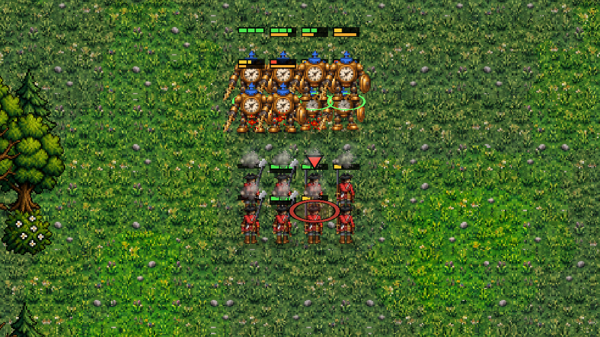
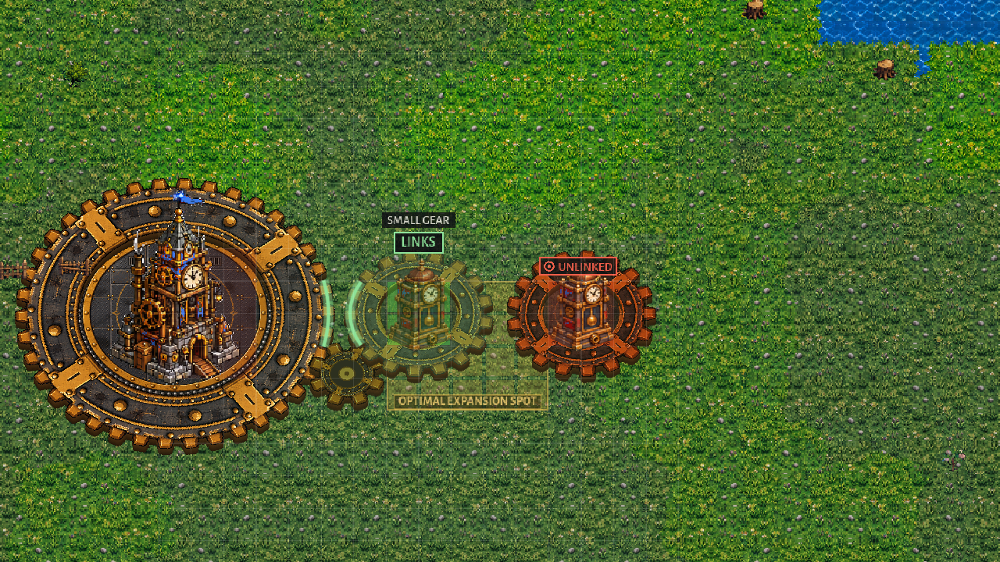
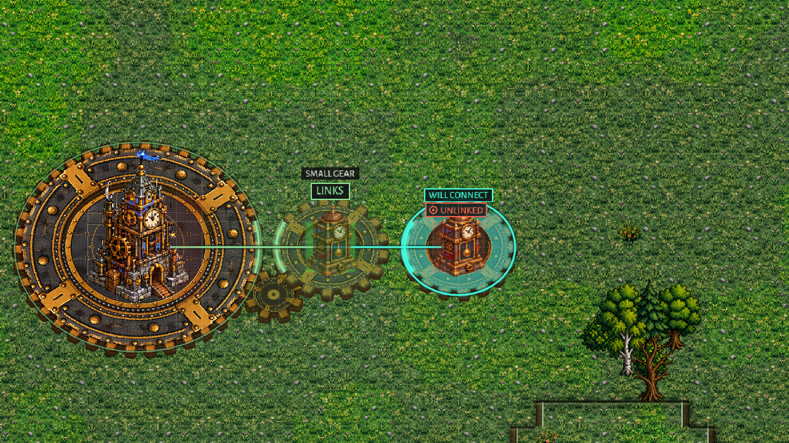
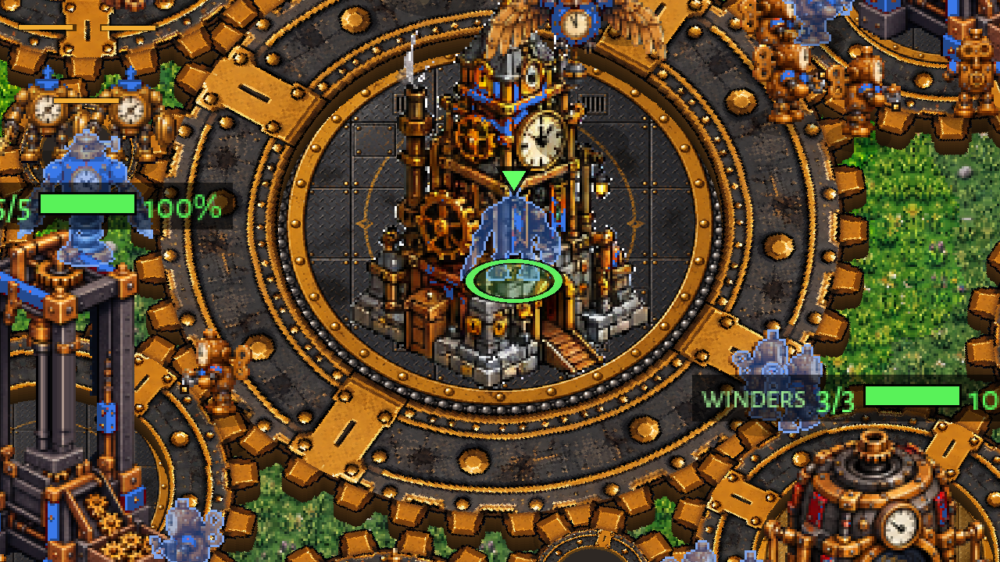
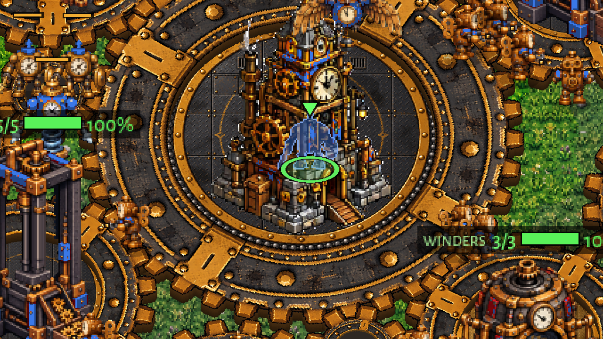

# Bars, the gear ghost's WILL CONNECT, silhouettes (0.25.2)

The owner's playtest notes of 2026-10-31, three items. Pictures before and after in `docs/shots/bars_ghost_sil/`
(`tools/shot_bars_ghost_sil.gd`, in the Clockwork Lab; run it with a prefix, e.g. `after_`).

## 1. Bars (StarCraft 2 style)

- Health bar: 3 px tall (4 px on a bar wider than 60 px, i.e. buildings), a 1 px dark outline, and cut into BOXES by
  1 px dark gaps (`Entity.draw_health`, `Entity.hp_box`).
- Box size chosen by max health: 25 hp a box up to 300 hp, 50 up to 800, 100 up to 2,000, 250 above. If a box would be
  under 3 px wide on that bar, the box size doubles until it isn't. Examples: a 100 hp unit has 4 boxes, a 250 hp
  one 10, a 1,500 hp building 15.
- Unit bars are a little narrower: `max(radius * 2, 16)` px (was `radius * 2.4`).
- Secondary bars (reload / gun setting up, Clockwork charge, the powder wagon's powder) are 2 px, flush under the health
  bar, sharing its outline (`Entity.draw_sub_bar`); at most two (reload and charge). Each shows only when not full.
  When the health bar is hidden they take its place.
- New setting, Settings > DISPLAY > HEALTH BARS: DAMAGED OR SELECTED (default) or ALWAYS (`Settings.health_bars`, saved,
  reset with RESET SETTINGS). Before there was no setting: bars showed only when hurt. Now a selected unit or building
  shows its bar too.
- Still cheap: units redraw only through their draw key (the setting is part of it); buildings at their 6 Hz.
- Not changed: the Brood's own bars drawn by `BroodNew.draw` (eggs, growth; another job is in those files), the
  morph / moult bars above the health bar.

## 2. WILL CONNECT on the placement ghost

- `GearNet.will_connect(team, kind, cell, big)`: your finished buildings whose ring would mesh with the ghost's ring at
  this cell (same rules as linking: gap within the link slack, same level, the meeting point on that level), and every
  OFF building the ghost would bring onto the field, directly or through a chain of off rings. Only when the ghost
  itself would link (or is a Clocktower). Cached; worked out again only when the cell, the gear size or the buildings
  change.
- Drawn: a link line from the ghost (or the off ring it comes through) to each; a thin green outline on a linked ring;
  an off ring washed bright teal, a teal outline, its meeting teeth glowing teal, and a WILL CONNECT mark over the
  building (on the overlay, above the UNLINKED badge). Uses the ghost's chosen gear size.

 

## 3. Silhouettes only when really hidden

- `OccludedLook` now checks pixels: the unit must sort behind the coverer (feet above its base line, as before) AND the
  coverer's opaque pixels must lie over at least 30% of the unit's opaque pixels (1-bit alpha masks of both textures,
  made once per texture, sampled on a 6 x 8 grid, 10 times a second).
- Only the covered part is drawn: each silhouette is a pooled Sprite2D (up to 64) whose shader keeps a pixel only where
  the coverer's picture is opaque at that spot.
- Ground things (gear rings, floor plates, brass plates) were never coverers and are not now; the old trouble was the
  whole texture rectangle of a building counting, empty corners included.
- A rooted Brood creature as coverer has no plain sprite: it stays a rectangle test and the whole unit shows.
- Result in the Lab: Winders at a Cog Press, 1 silhouette before, 0 after; a soldier behind the Clocktower still shows.

 

## Open

- In headless runs textures can't be read, so the mask counts as fully opaque there (tests behave as the old rect test).
- The ghost's long link line to a linked Clocktower runs to its centre; it could stop at the ring edge if it reads as
  clutter.
