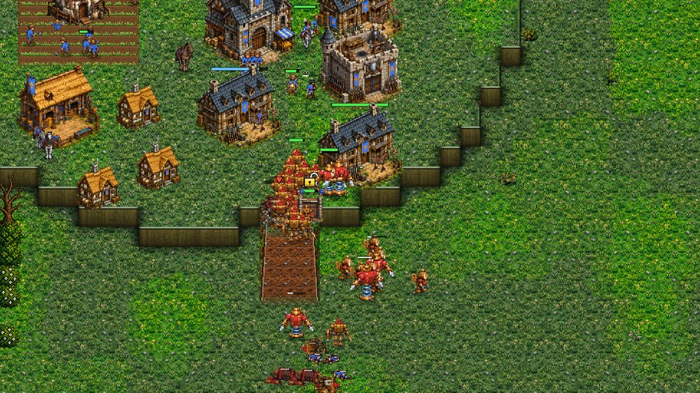
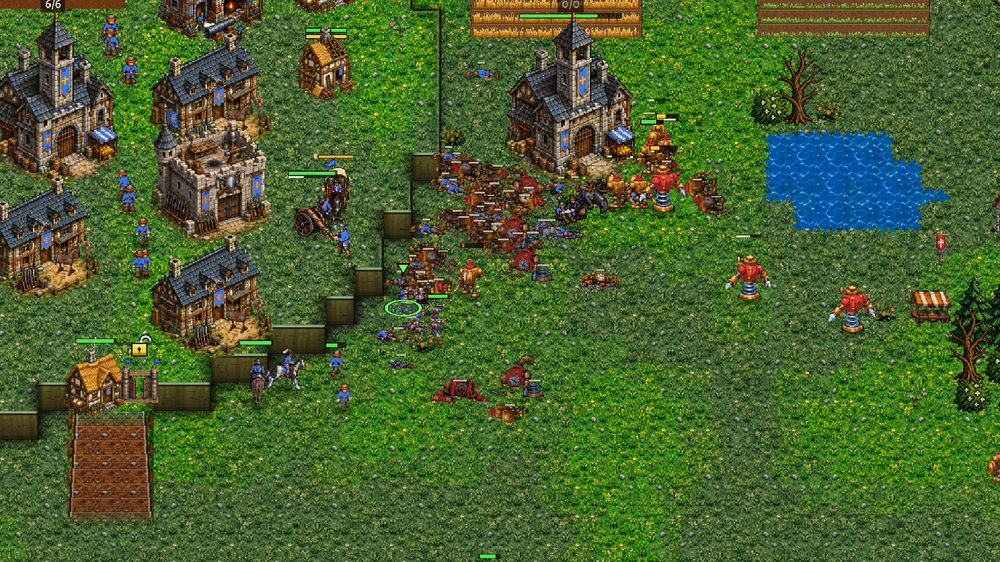
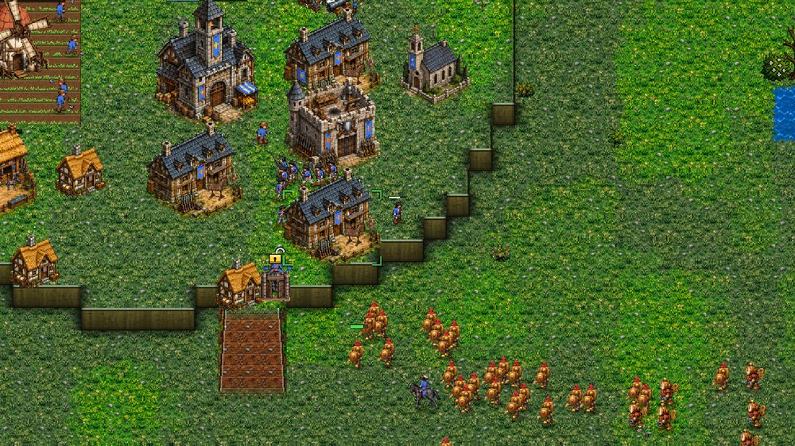
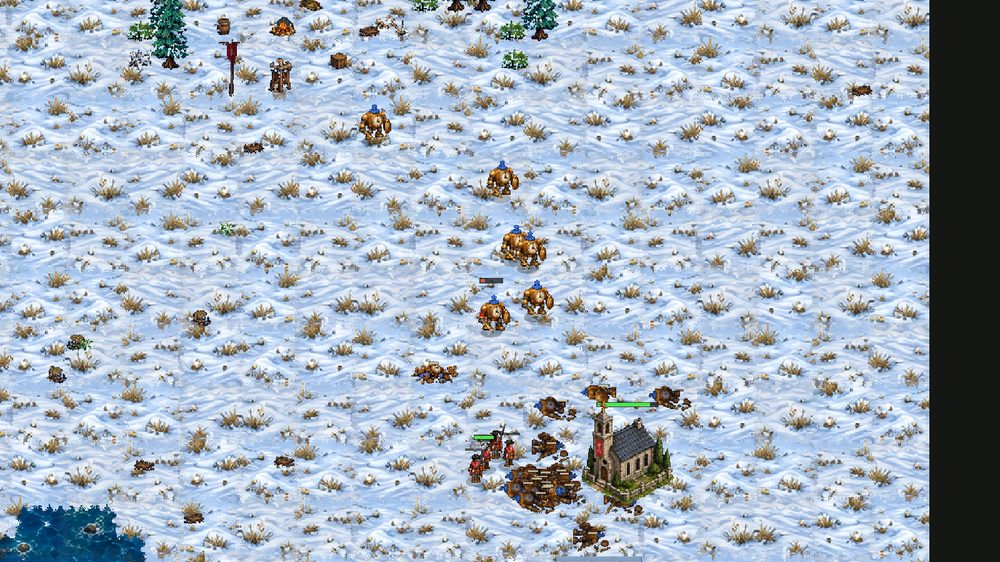
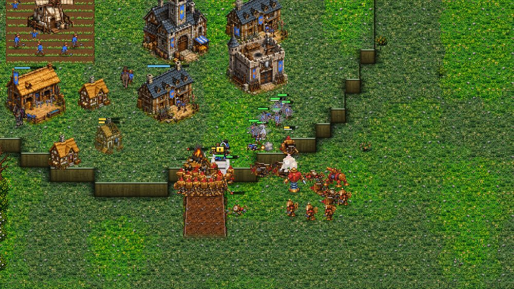

# The Clockwork computer (branch clockwork-ai, 0.14.79)

The Jack has been called the Springer in the game since 0.14.75. The code, and this page, still say Jack.
While this job ran, main got the Crown computer's coaching (0.14.73) and the pathfinding work (0.14.74).
The branch was merged with main, and the last round of games was played against the coached Crown: see "Against the coached Crown" below.

Short sentences, to be read aloud. The owner asked on 2026-10-27: "we need the AI to play better, it plays very badly".
Repair was not to be nerfed: "it is the only thing keeping the Crown from losing, it can be dealt with".
No unit, building, repair or cost number was changed.
Everything here is the gear-mode Clockwork computer in `scripts/ai.gd`, except one bug fix in `scripts/unit.gd`.

## The short version

Before, the Clockwork computer lost to the Crown computer almost every time.
In 8 filmed games it won 1, lost 5, and 2 ran out of time.
It killed 368 Crown units and lost 1,347: about one for every four.

Now it wins most of them.
In the same 8 games it won 5, lost none, and 3 ran out of time.
It killed 625 Crown units and lost 557: a little better than one for one.

Its tech now comes on time, its army has shooters, and its sieges kill the workers who mend the wall.

## What was wrong

1. Tech came late or never.
   The Mainspring came at 4:21 to 14:22, or never.
   The Escapement came at 7:16 to 16:26, or never.
   In four games of eight, no Jack was ever made.
   The money went on Clock Soldiers instead.
   Saving for tech stopped whenever any enemy was near the base, even one Horseman.
   And the army only paused for the saving once it was over 21 supply at 5:00.
2. When the Escapement did stand, no Movement Works could make Jacks.
   A Works makes Jacks only if its gear ring meshes with a Mainspring's.
   The computer often had no such Works, and never built one.
3. In one game the Escapement was never placed.
   The Mainspring was put where only the Aviary had room, not the Escapement.
4. Tension sat at its cap for minutes, with nothing to spend it on.
5. Melee waves walked into a walled ramp under Musketeers on the high ground.
   The workers mended the gate as fast as the Clock Soldiers hit it.
6. A wave that was called off walked to a spot just out of reach, often the foot of the ramp, and packed in there, on a plain move order.
   It did not fight back, and the Musketeers came out of the gate and shot it to pieces.
7. Attacks never ended.
   A group of six walked in every half minute and died.
   On 0.14.72 Frostmere one attack ran from 5:00 to 11:30.
   In an early run of this branch, before the pull-back below, one ran for thirteen minutes and lost 171 units for 70.

## A bug found on the way: a new order skipped the reload

A unit given any order while its blow was landing skipped its whole reload.
The Netter's reload is 14 seconds.
A Netter given an order about every second fired a net about every second.
In a test it fired 200 nets in 40 seconds instead of 3.
This was in `Unit._reset_work`: it cleared the attack phase before the reload was set.
Now the reload is set first.
This fix is for every unit and every player, not only the computer.
`tools/test_cw_tier3.gd` now clears the follow-through before it forces a fresh net.

## What the computer does now

### Tech on time

On Hard the tier-2 tech starts at about 2:50 by the clock.
Against a walled enemy it starts 40 seconds sooner on Normal and Hard.
A scout report of a "rush" no longer delays it.
The gold for the Mainspring and the Escapement is held back even under attack, as long as the army holds the line.
The army pauses for it from 6 supply on Hard.
The Mainspring goes where the Escapement itself has room.
The Escapement is laid as soon as the Mainspring's site is, so the room by the spring is not taken meanwhile.
Then it makes sure some Works may make Jacks.
It builds a Mainspring right beside a Works, or a new Works beside a Mainspring.
It wants one such Works at first, two once the Escapement works, and three on Hard with money in the bank.
New Works are placed by a Mainspring until three may make Jacks.

Times in the 8 games, before and after (Hard):

| | before | after |
|---|---|---|
| Mainspring | 4:21 to 14:22, or never (1 of 8) | 2:49 to 2:56 |
| Escapement | 7:16 to 16:26, or never (2 of 8) | 3:06 to 4:01, and once 12:20 |
| first Jack | 7:59 to 12:35, or never (4 of 8) | 3:51 to 5:37, and once 13:23 |
| first Netter | 10:13 to 15:27, or never (5 of 8) | 4:44 to 5:27, and once 13:26 |
| SHIELD WALL | 9:45 to 14:55, or never (5 of 8) | 4:27 to 8:31, and once 11:22 |
| HIGH LEAP | never | 7:17 to 9:46 in 6 games, once 15:32, once never |
| Tension at its cap, after 6:00 | 27 of 97 minute marks | 6 of 81, 5 of them in the slow game |

The slow game is Kestrel Rise, seed 14.
Its main is cramped in a corner, and there was no room for the Escapement by the Mainspring for nine minutes.
After that game, the computer looks for a Mainspring spot with room for the Escapement by any building of its own, not only by a Works or the Clocktower.
That fix came after the 8 games were played.

### A balanced army that spends its Tension

About one Jack for every one and a half Clock Soldiers.
Netters from 8 units in the army, one for every seven others, at most three.
A Pendulum at the big-gear Works for every six others, at most four, once three Jacks are out.
A Works goes onto its big gear only once three Jacks are out and two Works may make them, or six Jacks with one.
When Tension piles up to 60% of what the Mainsprings store, Tension units come first.
A Works that may make a Jack waits for the cogs, instead of spending them on another Clock Soldier.
SHIELD WALL is researched once it meets three shooters.
HIGH LEAP comes after SHIELD WALL, once it has five Jacks and the enemy has walls or stands on high ground.
Their cogs and Tension are held back from the army meanwhile.

### Sieges that work

The Jacks, Netters and other shooters in a siege no longer shoot the gate first.
From where they stand, they shoot the workers mending a wall piece first.
Then a worker standing by the piece, then the shooters on the edge.
No more than enough Jacks go on one Labourer; the next Jack takes another one.
A Netter nets a mending worker: no mending for its four seconds.
The melee still hit the piece.
The siege simulation counts this.
It knows the menders, and that more workers come to take a fallen mender's place, one every seven seconds.
Its shooters kill menders before they hit the wall, and each Netter keeps a mender in a net part of the time.
So a gate that is mended as fast as it is hit is now worth breaking, if the Jacks can kill the menders.
The first attack on a walled enemy waits for its kit: four Jacks on Hard, two on Normal, until 8:00 at the latest.
SHIELD FORWARD is used: the Clock Soldiers raise their shields walking up under musket fire.
It needs the SHIELD WALL research, which now comes at about 5:00.

#### Checking the siege calls

The owner's experiment, on 0.14.72, Greenhold: 27 or 28 Clock Soldiers against 13 Musketeers at the ramp gate.
With the Labourers mending the gate, the wave lost 25 and killed 1.

The same experiment now, same seed: a wave of 30, that is 25 Clock Soldiers, 4 Jacks and a Netter, against 12 Musketeers, a Horseman and a Cuirassier.
The Jacks shot the menders. The gate fell. All 14 defenders and all 16 workers died. The wave lost 13.

To check the go-or-pull-back call, every siege was forced to play out to the end (`noretreat:1`, from the start).
Every wave went for the main hall (`noopen:1`), so that there was a siege to watch.
The log says what the simulation would have done: "breaks in", or "would pull back".
A call is right when it said go and the wave broke in and won (the gate fell, at least half the defenders died and at least 30% of the wave lived), or when it said pull back and the wave lost.

First run, 10 sieges: the simulation said go 9 times and pull back once.
The pull back was right: that wave of 14 lost 12 and killed 1.
Of the 9 go calls, 4 broke in and won.
One more broke in, killed 8 of 9 defenders and every worker, but lost 19 of its 24.
In the other 4 the wave was lost.
On Frostmere, the men never reached the gate in time: the Crown's expansion stood in front of the ramp, and the experiment's switch made them walk past it into a fight.
On Kestrel Rise, the gate looked bare, and a dozen Musketeers came to it 20 seconds later.
Midway through, the simulation did say "would pull back" in two of them, but late.

Three changes came from this:
the race now counts the army behind the wall, seen lately, as coming to the face;
a siege 25 seconds in, where the wave has lost a third and the piece a sixth or less, is called off;
and a man in the siege's reserve fights an enemy that comes out to him, instead of standing and taking it.

Second run of the four that went wrong, with those changes: 3 of 4 go calls were right.
Frostmere seed 12: the gate fell, all 12 defenders died, the wave kept 12 of 27.
Frostmere seed 22: the gate fell, all 6 defenders died, the wave kept 31 of 36.
Kestrel Rise seed 14: the gate fell, all 6 defenders died, the wave kept 18 of 23.
Frostmere seed 32 is still wrong: the wave never reached the gate.
There, the expansion in front of the ramp is in the way, as above, and in a real game the wave goes for that expansion first.

In the 8 games, the computer weighed up a siege in 6.
It broke the gate in 4 of them. On Hollowfen seed 13 it went in and the gate held; on Kestrel Rise seed 14 it pulled back.
In the other 2 games the gate fell to the units on the way, with no siege weighed up.

### Jacks leap up

With HIGH LEAP, two or more ready Jacks below a cliff or a walled ramp may JUMP UP onto the high ground.
Only when it wins.
There must be enemy workers or shooters up there that our side sees.
And the armed enemies near the landing must be worth less than the Jacks that land.
Up there, they shoot the workers first, then the shooters.
Before, no Jack ever jumped up. Now it happens in about one game in three, up to five times in a game.

### Better targets

A walled main with Musketeers on the high ground is the last thing it goes for now.
First it looks for a target it can walk up to without breaking a wall.
The Crown's expansion first, then its farms and mills, then any outlying building.
It leaves out buildings that are part of the wall, like the ramp Cottage.
It leaves out a spot under a walled plateau's guns.
A Crown expansion right under its main's cliff drew wave after wave into the fire from above.

### Pulling back

A wave that keeps losing far more than it kills pulls back.
Over 30 seconds, it lost more than 300, and more than 2.2 times what it killed.
That spot is left alone for two and a half minutes, and the next wave must be bigger.
A siege the simulation weighs up is left to the simulation.
A wave that pulls back walks all the way to the rally, by its escort.
On Hard, it also pulls back from a fight where the enemy close by is worth one and a half times more.

### Expanding in time

Against the coached Crown, which now expands every 16 Labourers, the Clockwork sat on two halls with 32 Winders while its main ran dry.
Now, once its Escapement is laid (or from 6:00), it wants a fresh Clocktower for every 15 Winders, three at most, on Normal and Hard.
Before the Escapement it does not: saving for a hall pauses everything else, and an expansion at 2:50 put the Escapement off by up to ten minutes.
A Clocktower of its own that is razed leaves its spot alone for four minutes. It had laid five on one far spot and lost each one.
The Clockwork needs ore for a new Clocktower, and on some maps there is none left near: then it cannot expand, whatever it wants.

### The kit, used well (Hard)

A Netter that has picked a worker nets the most dangerous fighter in reach instead.
A gun or a rider counts for one and a half times.
In a siege, a mending worker is the point, so there it nets the worker.
A Pendulum that is not already at a blow walks into the thickest knot of enemy foot soldiers close by.
Three or more together, on its own level.
A Clock Soldier under a third of its health in a fight steps back to the nearest escort Winder.
It goes back in once it is mended, or after twenty seconds.

## Pictures

Before: Clock Soldiers at the foot of the cliff, Musketeers on the high ground above them (Greenhold, 7:02).

Before: soldiers walking in one by one, and the pile they make (Frostmere, 7:44).

After: a siege at the ramp gate. Clock Soldiers at the gate face, Jacks behind, Musketeers on the high ground in nets (Greenhold, 7:04).

## The numbers, game by game

Hard Crown against Hard Clockwork, balanced plans. The owner's four games, and four more seeds on the same maps.
"kills / losses" are the Clockwork's.
The 8 games after the change were played on the code just before the last small fix (the Mainspring spot in a cramped base).

| game | before: winner | before: kills / losses | after: winner | after: kills / losses | after: Escapement, first Jack |
|---|---|---|---|---|---|
| Greenhold, seed 11, swap 0 | Crown at 17:41 | 37 / 182 | Clockwork at 10:30 | 56 / 22 | 3:06, 3:51 |
| Frostmere, seed 12, swap 1 | Crown at 19:45 | 43 / 213 | Clockwork at 18:57 | 120 / 81 | 3:19, 5:23 |
| Hollowfen, seed 13, swap 0 | nobody by 20:00 | 66 / 146 | nobody by 20:00 | 74 / 161 | 3:15, 5:01 |
| Kestrel Rise, seed 14, swap 1 | Crown at 14:09 | 33 / 154 | nobody by 20:00 | 109 / 149 | 12:20, 13:23 |
| Greenhold, seed 21, swap 1 | Crown at 19:31 | 42 / 217 | Clockwork at 10:17 | 46 / 18 | 4:01, 5:37 |
| Frostmere, seed 22, swap 0 | Crown at 17:38 | 41 / 189 | Clockwork at 12:10 | 66 / 7 | 3:06, 3:54 |
| Hollowfen, seed 23, swap 1 | nobody by 20:00 | 60 / 217 | nobody by 20:00 | 126 / 105 | 3:06, 3:52 |
| Kestrel Rise, seed 24, swap 0 | Clockwork at 12:47 | 46 / 29 | Clockwork at 9:15 | 28 / 14 | 3:20, 4:18 |

Before: Crown 5, Clockwork 1, no winner 2. Kills and losses 368 / 1,347.
After: Clockwork 5, no winner 3, Crown 0. Kills and losses 625 / 557.
An earlier round of the same 8 games, a few changes before the last, went: Clockwork 6, no winner 2, Crown 0; 619 / 552.
Runs of the same seed are not identical, so these are 16 games, not 8 played twice.
Hollowfen is still a draw both times: its waves are pulled back again and again.

## Normal and Easy

The same two games, Greenhold seed 11 and Frostmere seed 12, against the Hard Crown.

| Clockwork | Greenhold 11 | Frostmere 12 | Escapement |
|---|---|---|---|
| Hard | won at 10:30, 56 / 22 | won at 18:57, 120 / 81 | 3:06, 3:19 |
| Normal | won at 13:39, 63 / 18 | no winner, 49 / 165 | never, 9:49 |
| Easy | lost at 11:55, 8 / 97 | lost at 13:32, 19 / 126 | never, 10:55 |

Easy starts its tech at about 9:20, Normal at about 5:00 (4:20 against a wall), Hard at about 2:50.
Easy has no leaps, open targets or pull-backs; Normal has them; only Hard has the kit's micro and the extra Works.
On Greenhold the Normal computer won without an Escapement.
Its first attack waited for two Jacks until 8:00, and went out with 41 supply against 11 Musketeers.

## Against the Brood, and against itself

Against the Hard Brood (Greenhold seed 11): it won at 9:31, 47 / 6. Frostmere seed 12: won at 11:24, 34 / 17.
Before the change it won the Greenhold game too, at 7:29, 37 / 3: the Brood is not walled, and the Clockwork already beat it.
Hard Clockwork against Hard Clockwork, Greenhold seed 11: one won at 12:06.
No script errors in any of the games filmed for this.
`tools/test_gear_ai.gd vs:brood minutes:9` passes.

## Tests

All pass on the last commit:
`test_gear_ai` (passive, and `vs:crown minutes:11`, and `vs:brood minutes:9`), `test_cw_ai`, `test_cw_tier3`, `test_cw_tier3_ai`, `test_cw_air_ai`,
`test_ai_army_response`, `test_ai_wall_vs_rush`, `test_ai_rush`, `test_ai_worker_safety`,
`test_ai_scout`, `test_ai_scout_defence`, `test_ai_scout_sentry`, `test_ai_scout_threat`.

Two tests changed, for reasons, not to make them pass:
`test_cw_tier3` forced a fresh net right after a net, by setting the reload to zero mid-swing; the new order no longer skips the reload, so it also ends the swing.
`test_cw_tier3_ai` expected a Works on its big gear before any Jack was out; the Jacks now come first, so six Jacks stand by in it.

`test_determinism` drifts between two runs from the first 20 to 30 seconds, on this branch and on main alike, Crown against Brood and Crown against Clockwork.
It now takes `a:` and `b:` factions.

## What is left

1. The Crown computer now loses most games to the Hard Clockwork. In the 16 games it won none.
   In the games looked at closely, it earns about two thirds of the Clockwork's income, and its army is worth about half.
   It builds an expansion right under its own cliff, and it lets its gate fall to 25 Clock Soldiers and 4 Jacks.
   Reading design principle 1, fairness, this is now a Crown computer question, not a Clockwork one.
2. Hollowfen ends with no winner. Its waves are pulled back again and again for bad trades.
3. In some sieges the men do not reach the gate face (Frostmere). That is the path code, for the pathfinding job.
4. The Jack's 170 reach is under the Musketeer's 190. Jacks lose a straight shoot-out at range, so they are kept behind the Clock Soldiers. No number was changed.
5. The siege simulation still does not foresee Horsemen riding out of the gate.
6. The forming-up wait before a siege is still up to 15 seconds.
7. The air (the Clock Aviary, Swifts, Ticking Owls) was not looked at.
8. The reload fix changes play for everyone: a Netter, or any unit, ordered about in mid-blow no longer fires early.

## Tools

`tools/shot_ai_match.gd` writes `ai.txt` now: every 30 seconds, the Clockwork's cogs and Tension, its Works (how many may make Jacks, and why the first one may not), its Mainsprings and Escapement, its army by kind, its nets and jumps, the wave and the siege.
It takes `da:` and `db:` for the computers' difficulty.
`noopen:1` makes every wave go for the main hall (for siege experiments).
`noretreat:1` now holds from the start, so a siege the computer would call off at once plays out too.
It shoots `leap_MMSS.png` when Jacks leap up, and `siege_MMSS.png` eight seconds into a siege.
`tools/test_determinism.gd` takes `a:` and `b:` factions.
