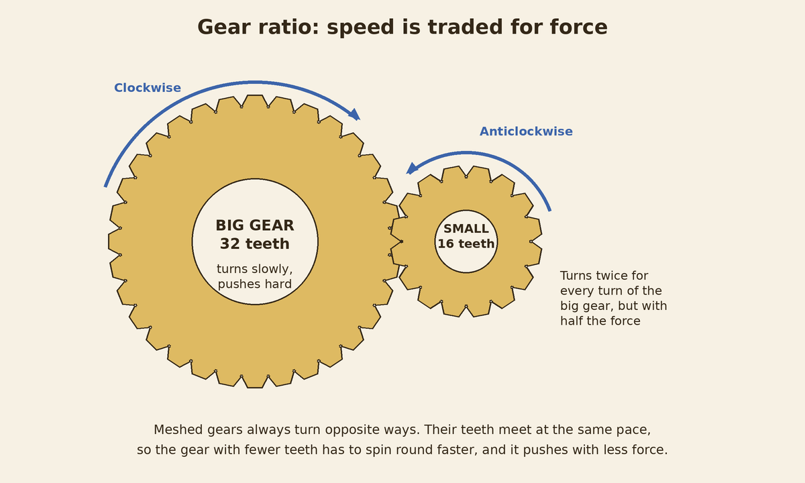
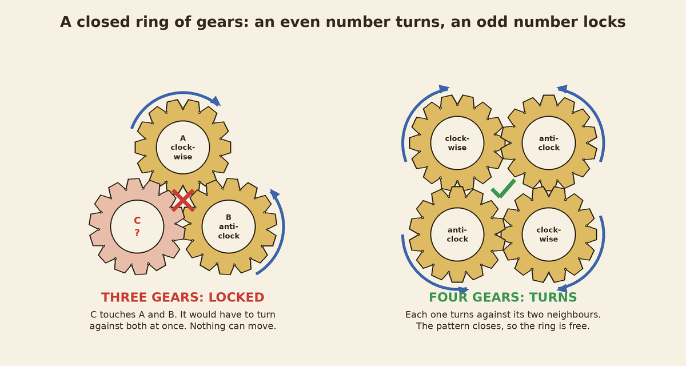
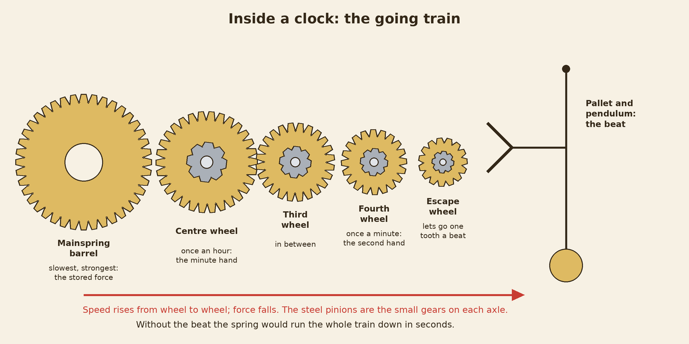
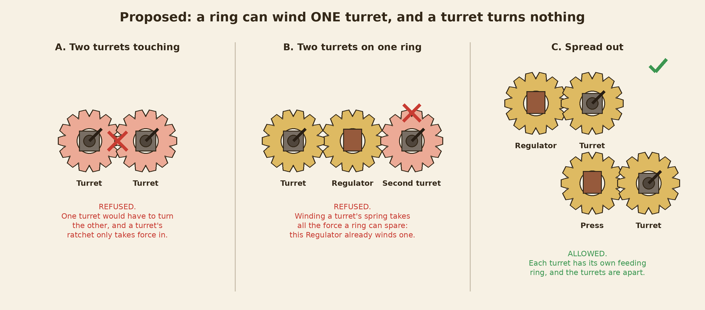
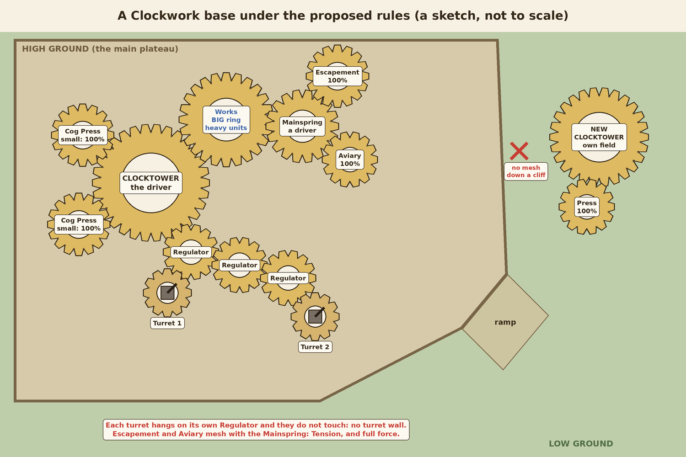

# Clockwork gears: how they work, and base-building rules from them (study, 2026-10-27)

This is a study. Nothing in the game was changed. Every rule below is Claude's suggestion. The owner decides.

The owner's request, in his words: "Do a study about the gears, the speed the gears turn. It shouldn't be the same speed. How do gears actually work? Clockwork should have something to do with building placement. For example, you can't place two static defences side by side. There should be a lore reason that has to do with the gears. Different speeds, different efficiencies, different buildings."

Read with docs/design_principles.md, docs/clockwork_ground_up.md, docs/clockwork_gear_prototype.md and docs/clockwork_economy_study.md.

## The short version

Three facts about real gears matter most for the game.

First. Two gears that touch always turn opposite ways. One goes clockwise, the other anticlockwise.

Second. Speed is traded for force. A small gear driven by a big one spins faster but pushes with less force. A big gear driven by a small one turns slower but pushes harder. In a plain chain of gears, each gear's speed depends only on its own size compared with the driver. The gears in between do not change it.

Third. A closed ring of gears turns only if it has an even number of gears. Three gears all touching each other lock solid.

The best lore reason for "no two turrets side by side": winding a Ratchet Turret's firing spring takes all the force a ring can spare, and a turret's ratchet only lets force in, never out. So one ring can wind only one turret, and a turret cannot turn anything, not even another turret. Two turrets touching would mean one turret turning the other. That cannot happen, so they jam.

The proposed system has five rules. Size sets the tempo. Force fades along the train. Springs feed only their neighbours. One turret per ring. Flat gears stay on one level. Three of these already exist. The new ones are the turret rule and giving every ring size a meaning.

## 1. What exists today

Every Clockwork building sits on its own gear ring on the ground. The Clocktower has the biggest ring. Every other building has a small ring or a big ring, and the player can swap it for 25 cogs and 4 seconds.

All teeth are the same size. So a bigger ring simply has more teeth. A small ring on a 3 by 3 building has 21 teeth, a big one 30, and the Clocktower 38. A 2 by 2 building has 17 or 26. The Movement Works has 23 or 32.

How fast the rings turn. The Clocktower turns by itself. Every other ring is turned by the ring it hangs on in the field. The teeth pass the meeting point at 1.4 teeth a second everywhere. That is exactly how real gears behave: the teeth of two meshing gears move together, so the gear with fewer teeth turns faster. The Clocktower takes about 27 seconds for one turn. A small 3 by 3 ring takes about 15 seconds, a big one about 21. A small 2 by 2 ring takes about 12 seconds, a big one about 19. The Works takes 16 seconds small and 23 big. Neighbours turn opposite ways. Where two rings have a gap between them, the game puts a free little idler cog in the gap, and then the two rings turn the same way.

Does speed mean anything in play? Not directly. The spin is a picture. What the ring size does mean today is this. A small Cog Press is full with 6 Winders and makes 8 cogs a second. A big one needs 12 Winders and makes 10.5. A small Mainspring needs 3 Winders, winds 2 Tension a second and stores 200. A big one needs 6, winds 2.6 and stores 400. The Pendulum can only be made at a Works on its big gear. And a bigger ring reaches farther, so it has room for more neighbours. For buildings with no crew, like the Escapement or the Clock Aviary, only the ring's reach changes.

Drive, the efficiency. The Clocktower and every Mainspring drive the field. A building whose ring meshes with one of them works at full speed. Each ring farther out loses a tenth: 90, then 80, then 70 percent at most. An idler is free. Drive slows cogs, Tension, training and research. It does not touch the Regulator's supply, the Ratchet Turret's fire, building or repair. Drive does not slow the picture: a ring at 70 percent spins as fast as one at 100.

The rules for where things may go. A new building's ring must touch your connected field. Rings may not cut into each other by more than a quarter of a tile. A building that is not connected stops and shows UNLINKED. The Tension rule: anything paid in Tension is made only at a building whose ring meshes with a Mainspring's ring, one step, an idler counts. The Escapement and the Clock Aviary stand idle without one. The level rule: rings mesh only on the same ground level, never across a cliff and never along a ramp, and the point where they meet must be on that level too.

What is not there. There is no rule about turrets at all. Ratchet Turrets may stand side by side. Nothing checks which way a ring turns. Nothing checks closed loops: three rings that all touch each other are allowed, and the drawing quietly only meshes each ring with the one it hangs on. The known gaps list already says two touching rings that are not parent and child can show tooth on tooth. The Mainspring drives in the economy but not in the picture: only Clocktowers spin by themselves. And the Clockwork has no wall and no gate in its build list. Its only static defence is the Ratchet Turret.

## 2. How real gears work, plainly

Gear ratio. When two gears mesh, their teeth meet one by one. So in the same time, the same number of teeth pass on both. A gear with 16 teeth meshing with one of 32 teeth must turn twice for each turn of the big one. This is the gear ratio, here two to one. The force goes the other way. The small gear turns twice as fast but pushes with half the force. The big gear turns at half the speed but pushes twice as hard. Engineers call that turning force torque. Speed is traded for torque, never gained for free. (Sources 1 and 2.)

Direction. Two gears that touch on their outsides always turn opposite ways. One clockwise, the next anticlockwise, the next clockwise again. (Source 2.)

The idler. A gear placed between two others to fill a gap. It changes the direction, so the two outer gears turn the same way. It does not change the ratio at all: the outer gears turn just as if they touched. (Source 1.)

The plain train. In a chain of single gears, each gear's speed depends only on its own teeth compared with the driver's teeth. The gears in the middle do not matter. A small gear at the end of a long chain spins exactly as fast as a small gear right beside the driver.

The compound gear. Two gears of different sizes fixed on one axle, so they turn together. A big gear drives the small one on an axle. The big one on that same axle then drives the next small one. Now the ratios multiply. This is the only way a chain makes things faster and faster, or slower and slower, along its length. Every real gearbox works this way. (Source 1.)

The closed loop. If gears form a ring, each one turns against its two neighbours. With four gears the pattern closes: clockwise, anti, clockwise, anti. With three it cannot. The third gear would have to turn against both others at once. An odd loop locks solid and nothing in it can move. (Source 3.)

Losses. Every mesh loses a little force to friction, turned into heat and noise. A good, oiled pair of plain gears passes about 96 to 99 percent of the force. The losses multiply: three meshes at 97 percent give about 91 percent. (Source 4.)

Backlash. A small gap between the teeth so that they do not bind. When the drive changes direction, the gears move a little before the teeth meet again. That is lost motion, a knock, and wear. (Source 5.)

Driver and load. The driver is what puts the force in: a hand, a weight, a spring, an engine. The loads are what take force out: a mill, a pump, a clock's hands. A driver can push only so hard. Too much load and the whole train slows or stalls.

The flywheel. A heavy wheel that keeps turning by its own weight. It stores motion. It smooths out bumps, and it keeps a machine turning for a while after the drive stops.

The ratchet and pawl. A toothed wheel and a hinged catch. The wheel turns freely one way. The other way, the catch drops into a tooth and stops it dead. In clocks the catch is called the click. It is what stops a mainspring from unwinding backwards while you wind it. (Sources 6 and 7.)

The clutch. Two parts with teeth that can be pushed together or pulled apart. Pushed together, they turn as one. Pulled apart, one turns and the other stands still. (Source 8.)

The differential. A clever set of gears that lets two outputs turn at different speeds while both are driven. It is why a car's outer wheel can turn faster than the inner one in a bend. (Source 9.)

The worm gear. A screw that turns a toothed wheel. One turn of the screw moves the wheel by only one tooth, so a 20 tooth wheel gives a 20 to 1 reduction in one step: very slow, very strong. Many worm gears are self-locking. The wheel cannot turn the screw back, so a load hung on it stays put without a brake. They lose more force to friction than plain gears. (Source 10.)

The mainspring. A coiled steel strip. Winding it stores force. As it unwinds it turns the wheels. It pushes hardest when fully wound and weaker as it runs down. Clockmakers fix that with a stop that uses only the middle part of the spring, or with a cone-shaped pulley called a fusee. (Source 7.)

The escapement. Without it, a mainspring would spin the whole clock down in seconds. The escapement holds the last wheel, the escape wheel, and lets it go one small step at each swing of the pendulum or balance wheel. Each step gives the pendulum a tiny push, so it keeps swinging. The pendulum sets the beat. The beat sets the speed of everything. (Sources 11 and 12.)

How a clock is laid out. The going train runs from the mainspring to the escapement. First the mainspring barrel, the slowest and strongest wheel. Then the centre wheel, which turns once an hour and carries the minute hand. Then the third wheel. Then the fourth wheel, which turns once a minute and carries the second hand. Then the escape wheel, ticking at the pendulum's beat. Each wheel drives a small pinion on the next axle. So the speed rises from wheel to wheel and the force falls. The slow, strong spring at one end. The fast, light tick at the other. (Source 11.)

## 3. The ideas, one by one

For each idea: the rule in one line, the lore reason, the real gear behind it, what it does for play, how a player sees it, the risks, and a verdict.

### a. Speed by position in the train

The rule: buildings farther from the driver turn faster, or slower, and speed means something.

The lore: the base is one great clock. Near the Clocktower is the slow, strong end. Far out is the quick, light end.

The real gears: this only happens with compound gears, a gearbox stage at each step. In a plain chain, which is what the game draws, the position does not change the speed. Only the ring's own size does.

For play: it would make the shape of a base matter. But it overlaps with drive, which already makes far rings weaker, and it would need a picture of which rings are compound.

On screen: hard. The player would need to see each ring's speed and guess what it means.

Risks: a second distance rule on top of drive. Easy to get wrong, hard to read on a phone.

Verdict: no, as a rule about distance. Use the honest version instead: speed comes from the ring's size. See idea h. A gearbox building that steps up or down everything beyond it is a possible later idea, idea j.

### b. Static defences not side by side

The owner's example. Four explanations were looked at.

One: identical ratchets. Every Ratchet Turret is a copy of the same blueprint, its ratchet cut the same way, so every turret turns clockwise. Two touching rings always turn opposite ways. So two turrets touching would both need to turn clockwise. Impossible, so they jam. This is mechanically true and fits the lore of mindless copies. But on its own it only forbids touching. Put a little gap between two turrets, an idler fills it, the idler flips the direction, and both turn clockwise happily. A turret wall with idlers would still be legal.

Two: the odd loop. Two turrets that both mesh with one building and with each other make a triangle, and a triangle locks. True, but it only catches that one shape and it is hard to explain.

Three: recoil. Each shot kicks the ring back through the backlash, and a touching turret's aim is jolted. Real, but it gives a penalty, not a clear "no".

Four: the torque budget with a ratchet. This is the recommended one.

The rule: a ring can wind only one turret, and a turret turns nothing. In plain words: two turrets may never touch each other, and may never touch the same ring.

The lore: a Ratchet Turret fires big screws from a spring. Its ring winds that spring all the time. Winding a spring that strong takes all the force a ring can spare, so one ring can wind only one turret. And the turret holds its spring with a ratchet, a one-way catch: force goes in and never comes out. So a turret cannot pass drive on. Nothing can hang on a turret, not even another turret.

The real gears: a strong spring needs a lot of torque to wind, and a driver can give only so much. A ratchet lets motion through one way only. Both are true.

For play: no turret walls and no turret nests. Every turret needs its own feeding building. A defence line becomes turret, Regulator, gap, turret, Press. That mixes soft buildings into the line, costs more, and asks where to put each feeding ring. It also stops turret creep: you cannot chain turrets forward to push your field toward the enemy, because nothing hangs on a turret.

On screen: while placing a turret, its ghost ring turns red where the rule bites. The ring that already winds a turret glows red too, and the other turret flashes. The ghost text says ONE TURRET PER RING, or TURRETS JAM. On a phone that is one red ring and one line of text, the same as the existing CLASH and NO LINK.

Risks. The Clockwork has no walls, so turrets are its only static defence. This rule makes the Clockwork's early defence against a rush harder to build: two turrets at a ramp now need two feeding buildings. Design principle 5 asks for a Clockwork answer to the owner's extreme rush; this must be checked against it. The computer must obey it: it looks for turret spots through the same placement check, so it would obey by itself, but on a cramped plateau it may find no second spot. Old saves with turrets side by side should be left alone.

Verdict: recommend. It is one sentence, it holds up mechanically, it needs no direction tracking, and it is easy to show.

### c. Direction as a rule

The rule: some buildings must turn one way, so they must sit an even or odd number of steps from the driver.

The lore: anything with a ratchet, a turret or a Mainspring, can turn only one way.

The real gears: true. Touching gears alternate direction, and a ratchet only turns one way.

For play: it would turn the field into a checkerboard. All rings touching one ring turn the same way, so each ring's neighbours are all "clockwise spots" or all "anticlockwise spots". An idler flips it. A ring touching both kinds at once is an odd loop and locks.

On screen: an arrow on every ring, green or red on the ghost.

Risks: a lot to keep in your head, mostly invisible until it bites. The game puts idlers in by itself where rings have gaps, so whether a spot turns the right way would depend on a gap of a few pixels. On a phone that is frustrating. And making odd loops lock for real would break most layouts, because today almost any ring within two tiles counts as touching, so triangles are everywhere.

Verdict: no, as a rule. Keep direction as a picture: the rings already counter-rotate, and that is lovely to watch. Use the identical-ratchet jam only as the flavour line for why two turrets touching jam. For loops, the lore can say the copies always set an idler where a loop would close odd, because one idler turns a triangle into a loop of four, which is free to turn.

### d. Losing force along long chains

The rule: every ring between a building and its driver costs a tenth of its work.

The lore: every mesh loses a little force to friction, heat and squeal. A long train is a tired train.

The real gears: true, though real losses are smaller, 1 to 4 percent a mesh. The game makes it bigger so it can be seen.

For play: this is the existing drive. It already makes long chains a trade-off and gives the Mainspring a second job as a local driver. It is a quiet anti-snowball brake: a sprawling base works worse, so you expand with a new Clocktower instead of an endless chain.

On screen: the percent over each building, on its card, and on the placement ghost. Already built.

Risks: in reality an idler is a mesh too and would lose force. The game keeps idlers free so the player is not punished for a gap of a few pixels. That is the right call.

Verdict: recommend, keep as it is. One improvement: let the picture show it. A ring at 70 percent could turn a little sluggishly, or its teeth could carry a faint grey. This is only a look; the real speed of a ring must not change, because the speed comes from its size.

### e. Load and a torque budget

The rule: each driver can turn only so much. Heavy buildings slow the whole train.

The lore: the Clocktower's spring can push only so hard.

The real gears: true. Overload a driver and the train slows or stalls.

For play: a reason not to cram everything on one Clocktower.

On screen: a gauge on each Clocktower and Mainspring, filling up as loads hang on it.

Risks: when the budget is passed, every building in that field slows at once, and it is not clear which building caused it. That is a sharp, global punishment, the kind design principles 2 and 4 warn about. The computer would need to count loads too. And the field's size is already limited by drive, by the plateau's room, and by two presses per Clocktower.

Verdict: maybe, later, and only in a local form. The turret rule in idea b is exactly that local form: a turret is a heavy load on its one ring.

### f. Flywheels, clutches, escapements, worm gears, differentials

The flywheel. Rule: a Flywheel, as an upgrade researched once or as a small building, keeps a cut-off district turning for a while. Lore: a heavy wheel keeps spinning by its own weight. Real: true. Play: when a raid kills the link building in a chain, the buildings beyond it work on for about 15 to 20 seconds, a guess, giving time to rebuild the link. It softens a sharp punishment and matches the owner's rule that the clock must never punish harshly. On screen: the cut-off rings keep turning but slow down visibly, with a little bar. Risks: one more thing to show; it also softens raids, which are healthy. Verdict: maybe, a later upgrade, probably at the Regulator or the Escapement.

The clutch. Rule: a DISENGAGE button stops a building drawing force. Lore: pull the teeth apart. Real: true. Play: useful only if there were a load budget, idea e. Verdict: no, for now.

The escapement. It already exists as the tech building, and its picture already ticks. Rule idea: a building whose ring meshes with an Escapement works at a steady 100 percent whatever its drive. Lore: the escapement keeps a clock's rate steady whatever the spring's force. Real: true, that is its whole job. Play: a far district could be steadied by an Escapement instead of a Mainspring. Risks: it overlaps the Mainspring as a second driver. Verdict: maybe. If kept, the Escapement becomes a hub, which fits a tech building that already wants room round a Mainspring.

The worm gear. Rule idea: the Clockwork's wall gate is a Worm Gate: slow to open, and nothing can force it open, because a worm cannot be turned backwards. Lore and real: self-locking is a true worm property. Play: the Clockwork has no wall or gate today, and the owner wants walls to matter and to be broken, not bypassed. A Clockwork wall of iron with worm gates is a natural fit. Verdict: maybe, as a separate design job for the Clockwork's walls. Not part of the gear rules.

The differential. Rule idea: a building that shares one driver between two districts at different speeds. Real: true, but nothing in the game needs two outputs at different speeds. Verdict: no.

### g. The Tension rule and the level rule, in the same gear story

The Mainspring is a second driver. A wound spring pushes its own ring. Tension is not money in a bank: it is the spring's push, and a spring can hand its push only to a ring that touches it. So anything paid in Tension is made only at a building whose ring meshes with a Mainspring. One step, because the push is spent where the teeth meet. An idler counts, because an idler only fills a gap and adds no ratio. This is exactly the rule in the game today.

The level rule. Real gears of this kind mesh only when they lie flat in the same plane. A ring on the plateau and a ring below the cliff are at different heights: their teeth would pass over each other. A real machine would need angled gears and an upright shaft to go down a cliff. The Clockwork's copies only know flat ground gears, so a plateau's field ends at its cliff, and the low ground needs its own Clocktower. This is exactly the rule in the game today.

### h. Size sets the tempo (Claude's idea)

The rule: every ring size means something. A small ring turns fast: the building works quick and light. A big ring turns slow: the building works heavy and strong.

The lore: speed is traded for force. A small ring spins fast but cannot push hard. A big ring turns slowly but can drive heavy work.

The real gears: this is the gear ratio, the most basic fact of all.

For play: the choice already exists for the Cog Press and the Mainspring, and for the Pendulum at the Works. This idea extends it to every building with a ring, so the swap button is always a real choice. Suggested, all numbers are guesses. A Works on its small ring trains 15 percent faster but makes only light units. On its big ring it trains 15 percent slower but can make the heavy ones: the Pendulum today, the Spring Ballista later. A Ratchet Turret on its small ring fires quick light screws, about 11 damage every 1.2 seconds. On its big ring it fires slow heavy screws, about 21 damage every 2.2 seconds: about the same damage a second, but much better against armour, because armour takes the same amount off every hit. The Escapement and the Clock Aviary on a small ring research and train 10 percent faster; on a big ring they are slower but their wider ring reaches more neighbours. And a big ring always takes more room on the plateau.

On screen: you can already see it. Small rings visibly spin fast, big rings slowly. The card says the trade in one line, for example "Small gear: works 15% faster. Light units only."

Risks: more numbers to balance. The turret's big ring must not out-range the Crown's guns. The computer must learn to choose; for a start it can keep small rings except where it needs heavy units, as it does now.

Verdict: recommend.

### i. Closed loops as a real danger (Claude's look)

The rule: a placement that would close an odd loop is refused, with the warning LOOP LOCKS.

The lore and real gears: true and striking.

Risks: as said under idea c, triangles are everywhere today, so this would forbid the flower layout round the Clocktower and most crowded plateaus. It would need the game to tell "touching" apart from "near", which it does not do today.

Verdict: no, as a rule. Keep it as the explanation for why the Clockwork always puts idlers between rings.

### j. A gearbox building (Claude's idea)

The rule: a Gearbox is a compound gear. Everything driven through it turns one step faster and works quicker, or one step slower and works stronger.

The real gears: this is how real speed changes happen along a train.

Verdict: no, for now. Size already gives the choice per building, which is simpler. Keep the idea in case the owner wants districts with their own tempo later.

### k. Backlash as flavour (Claude's look)

Backlash fits two things that already exist: the 4 second pause while a ring is swapped, and the turret's head clicking round in steps. Verdict: flavour only, no rule. A small knock sound when a ring starts or stops would sell it.

## 4. The proposed system

The lore paragraph that ties it together:

The Clockwork is one great clock that keeps copying itself. The Clocktower is its mainspring barrel: the slow, strong heart that drives every ring around it. Every building is a wheel in that clock. A small wheel spins fast and does quick, light work. A big wheel turns slowly and does heavy work. Every mesh loses a little force to friction, so the farther a wheel is from a driver, the weaker it works, and the machine must build new drivers to grow: a Mainspring in the field, or a new Clocktower on new ground. A Mainspring's stored push can only be handed to the wheels that touch it. The machine knows only flat gears, so its field never crosses a cliff. And a Ratchet Turret is a spring gun with a one-way catch. Winding it takes all a wheel can spare, and nothing comes back out of it. So every turret needs a wheel of its own, and two turrets can never touch.

The five rules, one line each:

Rule 1, size sets the tempo. A small ring works fast and light; a big ring works slow and heavy. New for the Works, the turret, the Escapement and the Aviary. Numbers in idea h, all guesses.

Rule 2, force fades along the train. Each ring away from a Clocktower or a Mainspring works a tenth less, down to 70 percent; idlers are free. Exists.

Rule 3, springs feed only their neighbours. Anything paid in Tension is made only at a building whose ring meshes with a Mainspring's. Exists.

Rule 4, one turret per ring. Two Ratchet Turrets may never touch each other, and may never touch the same ring. New. If it is ever needed, the same rule would cover any future static defence.

Rule 5, flat gears stay on one level. Exists.

How each looks on screen. Rule 1: you see the spin, and the card says the trade. Rule 2: the percent over every building and on the ghost. Rule 3: NEEDS MAINSPRING and MESHES MAINSPRING. Rule 4: a red ghost ring, the blocking ring glowing red, and ONE TURRET PER RING. Rule 5: NO LINK: OTHER LEVEL.

What to build first, in order:

First, rule 4, the turret rule. It is the owner's direct request, small in code, and the computer obeys it through the same placement check it already uses. Then test it against the owner's extreme rush: can a Clockwork player still hold the ramp at about 2:00 with two turrets on two feeders? If not, the turret's price or the Regulator's price may need a look, not the rule.

Second, rule 1 for the Ratchet Turret: small ring quick and light, big ring slow and heavy. It gives the turret a real choice and an answer to armour.

Third, rule 1 for the Works, the Escapement and the Aviary.

Later, maybe: a flywheel upgrade, the Escapement as a steadier, and a worm gate as part of a Clockwork wall design.

## 5. Open questions for the owner

1. The turret rule: the strict form, no shared ring and no touching, or the mild form, only no touching? The mild form allows a nest of about four turrets round one Regulator.

2. Should the turret rule cover other future static defences too, or the Ratchet Turret only?

3. Does the Clockwork need more early defence once turrets must spread out? For example a cheaper turret, or a cheap feeding post, or a worm-gate wall.

4. Size sets the tempo: do you like small rings working faster for every building? And the turret's big ring as the anti-armour choice?

5. Drive: keep the ring's spin the same at every percent, with only a grey tint far out? Or no picture change at all?

6. The flywheel: a later upgrade that keeps a cut-off district working for about 15 to 20 seconds. Yes, no, or later?

7. The Escapement as a steadier, so its neighbours always work at 100 percent: yes or no?

8. A Clockwork wall with worm gates, as its own design job: worth doing?

## Sources

1. Gear train, Wikipedia: speed and torque ratio, idlers, compound gears. https://en.wikipedia.org/wiki/Gear_train
2. Gear Train Mechanism Explained, FIRGELLI: each external mesh reverses the direction; compound ratios multiply. https://www.firgelliauto.com/blogs/mechanisms/gear-train
3. Gears, Complex Projective 4-Space: an odd number of gears in a flat loop cannot turn. https://cp4space.hatsya.com/2014/02/28/gears/
4. Gear Train Efficiency Multistage Calculator, FIRGELLI: plain spur gears 96 to 99 percent a stage; the losses multiply. https://www.firgelliauto.com/blogs/calculators/gear-train-efficiency-multistage-calculator
5. What is backlash in gears, Accu: the gap between teeth when direction reverses; lost motion, noise, wear. https://accu-components.com/p/455-what-is-backlash-in-gears
6. Ratchet (device), Wikipedia: motion one way only; in clocks the pawl is called the click. https://en.wikipedia.org/wiki/Ratchet_(device)
7. Mainspring, Wikipedia: stored energy, force falling as it unwinds, stopwork and fusee, the click. https://en.wikipedia.org/wiki/Mainspring
8. Dog Clutch, MathWorks: toothed parts slide together to lock two shafts, apart to free them. https://mathworks.com/help//releases/R2021a/physmod/sdl/ref/dogclutch.html
9. How do differential gears work, How It Works: two driven wheels turning at different speeds. https://www.howitworksdaily.com/how-do-differential-gears-work/
10. Worm drive, Wikipedia: large reduction in one step, self-locking, more friction. https://en.wikipedia.org/wiki/Worm_drive
11. Wheel train, Wikipedia: the going train from mainspring to escape wheel; the centre wheel once an hour, the fourth wheel once a minute. https://en.wikipedia.org/wiki/Wheel_train
12. Escapement Mechanism Explained, FIRGELLI: the escapement meters the train and pushes the pendulum. https://www.firgelliauto.com/blogs/mechanisms/escapement

## Pictures

All in docs/shots/gear_study/, drawn with Python and PIL for this study (the script is not kept in the repo; the pictures are explanations, not game art).

- gear_ratio.png: a big gear driving a small one, the directions and the trade of speed for force.
- odd_loop.png: three gears in a ring lock; four turn.
- clock_train.png: a clock's going train from the mainspring barrel to the escape wheel and pendulum.
- turrets_one_per_ring.png: the proposed turret rule: two turrets touching, two on one ring, spread out.
- base_layout.png: a sketch of a Clockwork base under the proposed rules.

## Where this lives in the code

- The gear field: scripts/gear.gd, class GearNet. Ring size: ring_n, ring_r, b_n, b_r (pad per small, big, tower from Defs.GEAR "pad"; teeth from "pitch" 25 px). The connection graph: solve (a search from finished Clocktowers; rings link when the gap is within Defs.GEAR "slack", 2 tiles; Tension users linked last and hung on a Mainspring; fills linked, parent_of, spring_of, drive_of, idler_of). Spin: _spin (a root turns at Defs.GEAR "teeth_rate", 1.4 teeth a second, divided by its teeth; every other ring is set from its parent each frame by mesh_phase; only Clocktowers are roots). Idlers: idler_for, idler_spots, idler_teeth. The level rule: foot_level, b_level, level_at, joint_ok, level_ok. Placement: placement_problem and candidate (states ok, clash, far, tower; the Tension user's spring), spring_problem, ghost_text, draw_ghost, draw_ghost_label. Work speed: speed_mult. Drawing: _draw, draw_ring, draw_plate, _draw_top.
- The economy rules: scripts/gear_econ.gd, class GearEcon. drive_steps and drive_factor (Defs.GEAR "drive" 1.0, 0.9, 0.8, 0.7), work_mult, DRIVE_FREE (Clocktower, Regulator, Ratchet Turret, Spring Tower), spring_info, tension_cap, wind, spends_tension, spend_problem, efficiency, card_text, card_info, preview_steps, ghost_note, would_feed, room_spot (the computer keeps room round a ring).
- Numbers: scripts/defs.gd, the GEAR block (pitch, pad, slack, overlap, mesh_tol, idler_min, teeth_rate, swap_cost, swap_time, press, mainspring, drive), TENSION_USERS (escapement, cuckoo_house), TURRET and CW_TURRET, build_list (the Clockwork's buildings in gear mode: no wall, no gate), and the BUILDINGS entries (sizes: Clocktower 5 by 4, Works 4 by 3, Cog Press, Mainspring and Escapement 3 by 3, Aviary, Regulator and Ratchet Turret 2 by 2).
- A building's gear: scripts/building.gd, gear_big, gear_swap_t, gear_swap_to; crew_max and the press and spring rates read the gear size. The swap: Game.swap_gear and Game.gear_swap_problem in scripts/game.gd. The general placement check: Game.placement_problem in scripts/game.gd, which calls GearNet.placement_problem for Clockwork buildings.
- The Pendulum's big-gear rule: scripts/pendulum.gd, gear_problem and swap_problem.
- The turret: scripts/ratchet_turret.gd (head, aim, fire). The computer's turrets: AI._turrets in scripts/ai.gd; its gear-aware spots: AI._drive_spot, AI._spring_spot, GearNet.ring_spot, GearEcon.room_spot.
- Where the proposed turret rule would go: a new check in GearNet.candidate (a turret whose ring would touch another turret's ring, or touch a ring that already touches a turret, gets a new state, for example "turret"), its message in GearNet.placement_problem and ghost_text, and a red glow on the blocking ring in draw_ghost. Rule 1 for the turret would read gear_big in scripts/ratchet_turret.gd and Defs.TURRET; for the Works, in the training speed through GearNet.speed_mult or GearEcon.work_mult.
- Tests to extend: tools/test_gear_placement.gd, tools/test_ratchet_turret.gd, tools/test_gear_ai.gd.
