# The Crown turtle, and the Toad's tongue on the Field Cannon (a study)

The owner asked on 2026-10-29: "We need a comparison with StarCraft 2's Viper abducting the Siege Tank, so we can decide whether the Toad can tongue (pull) the Field Cannon or only stagger it. ... We also need to test the Crown turtle: set up a game with an entrenched Crown position and see if Clockwork and Brood can break it."

This is a study. No game number was changed. The variants were set inside the tool, on the spawned units only.

The study ran on 0.15.25. While it ran, 0.15.26 made the Brute the wall-breaker (x2.5 against buildings) and gave the Spitter 170 range. So I ran the Brood's key rows again on 0.16.1 (section 3e). Where the two disagree, the 0.16.1 numbers are the ones to use. The films and the Clockwork rows are from 0.15.25.

## The short answer

- The Crown turtle at its main ramp is very hard to break. At equal cost it held in every fight: 8 of 8 against the Clockwork, the old Brood and the new Brood, with or without Toads, with two cannons or a cannon and a Mortar, on two maps, on both versions.
- The Clockwork never broke it head-on, even at twice the cost. Only a patient siege of eight Ballistas, at 1.5 times the cost, broke it twice in 8.
- The Brood breaks it with a lead. On 0.16.1, at 1.5 times the cost: 4 times in 8 with Toads, whether the TONGUE pulls the gun or only staggers it; never without Toads. At twice the cost: 6 of 8 with the pull, 7 of 8 with the stagger, 3 of 8 with no Toads.
- So the Toad is what breaks the turtle. Whether it pulls the gun hardly changes that. With stagger-only, the Toads tongue the Labourers off the gate instead, and that works as well.
- What the pull does change is the Crown's counterplay. The Toad must stand inside musket range, and a Crown that answers the warning shoots it in its 3 seconds (16 of 16 at equal cost). Against the stagger rule, answering the warning saves the turtle at 1.5 times (0 breaks in 8 instead of 4). Against the pull rule it does not (4 breaks either way): the guns that are pulled before the Toad dies are lost.
- The Horseman's charge never stopped a windup in time (0 of 64 tries over both versions). It needs a 2-second gallop first. So the Spitter escort changed little.
- My advice: only stagger the Field Cannon and the Mortar, as StarCraft did with the Siege Tank. The Brood loses nothing against the turtle, and the Crown's answer to the warning starts to matter. And make the line on HOLD shoot a Toad that marks one of its own. Details in section 5.

## 1. StarCraft 2: the Viper, the Siege Tank and the Ghost

What this section says comes from Blizzard's patch notes and one news story. I give no numbers I cannot source.

- The Viper is the Zerg's flying caster. Its ABDUCT pulls one enemy unit to the Viper.
- Terran's turtle is the sieged Siege Tank behind walls. Sieged, it outranges almost everything on the ground. Abduct was the Zerg's way to break such a position: pull a tank out of the line into the Zerg army, where it dies.
- Terran's answers to the Viper are the Ghost's EMP, which drains a caster's energy, and its sniping. Protoss has the High Templar's Feedback. So a player who fears the Viper has a unit that answers it.
- Patch 5.0.15 let Abduct target sieged tanks. A TechSpot story on that patch says some fans reacted strongly to it.
- The 5.0.17 notes (PTR, then live) say: "Abduct can no longer be cast on Siege Tanks." The same notes say most balance changes of 5.0.16 were rolled back to 5.0.15. For the Ghost's Steady Targeting the same notes say: "Cancels upon taking damage."
- The notes give no reason for the Abduct line. My reading: a pull that takes the turtle's key piece, with only one narrow counter, was judged too strong. That is a reading, not Blizzard's words.

Sources:
- https://news.blizzard.com/en-us/article/24309308/ (StarCraft II 5.0.17 patch notes)
- https://news.blizzard.com/en-us/article/24301513/starcraft-ii-5-0-17-ptr-patch-notes
- https://techspot.com/news/112633-fans-call-starcraft-ii-first-major-patch-nearly.html

### Mapped to our game

The Mist Toad is our Viper. Its TONGUE is our Abduct. The Field Cannon is our Siege Tank.

- The Toad's TONGUE reaches 224. FOG also reaches 224. The Musketeer reaches 190. The Field Cannon reaches 430, but sees only 8 tiles (256): other units must spot for it.
- So a Toad that tongues a gun 85 px behind the Musketeer line stands about 140 px in front of that line. It is inside musket range. It cannot tongue a gun from safety, unless the line is fogged or gone.
- When the windup starts, the Crown is told: "A Mist Toad is aiming its tongue at your Field Cannon: move it away or stun the Toad!", with a red ping. The windup lasts 3 seconds.
- What breaks the windup (Unit._tongue_tick): the Toad is stunned; the Toad is moved more than 12 px; the target is gone or cannot be tongued; the target gets beyond 1.5 times the range (336 px); the Toad is killed. Damage alone does not break it. The owner wants it so: cancel on damage would be too harsh, as with the Ghost's Steady Targeting.
- So the Crown's real answers in those 3 seconds are: kill the Toad (90 health), or stun it with a Horseman's charge (Cavalry Charge: the first blow after a gallop stuns 0.6 s, and a stun breaks the windup).
- A gun cannot get away, as the owner wants: limbering up, a deployed Field Cannon first moves at 2.6 s, far too late to get 336 px from the Toad by 3 s (tools/study_crown_turtle.gd group L).
- The Crown has no Ghost: no unit that drains or silences a caster. The Observation Balloon sees 14 tiles, so it lets the cannon (430) see and shoot a Toad long before the Toad reaches 224. Musketeers in a balloon reach 35% further (256).
- The Clockwork has no Toad and no pull. Its long reach is the Spring Ballista (300, under the cannon's 430). Its Springers (170) and Netter (180) are under the Musketeer's 190.

## 2. The setup

The tool is tools/study_crown_turtle.gd. tools/study_crown_turtle.sh runs each fight setting in its own process, two at a time. tools/study/crown_turtle_table.py makes the tables. The raw results are in docs/crown_turtle/ (one folder a version), one line of JSON a fight.

### The turtle

- Greenhold, the Crown's main ramp. The wall is the Crown computer's own plan (AI.plan_cottage_wall): a Cottage, a Gate and one palisade piece. 175 gold.
- 16 Musketeers with the mid-game kit: Matchlock, Socket Bayonet and Shot Pouch (20 shots). 71 gold and 10 powder each. Two ranks of 8, on HOLD, about 90 px behind the wall.
- Two Field Cannons, 85 px behind the line. 210 gold each with the horse. The Mortar variant has one cannon and one Mortar (185 gold and 20 powder).
- Two Horsemen behind the gate, on HOLD. Cavalry Charge is researched. 155 gold each with the horse.
- A Powder Wagon behind the guns (110 gold and 30 powder with the horse). A Powder Mill and a Barracks by the Town Hall. Two Labourers are haulers at the Town Hall.
- Four Labourers by the wall mend it, as the Crown computer does (AI._repair_safe decides when it is safe), but with up to three at once, and they mend the guns too. A piece is mended below 85% of its health, a gun below 70%.
- Worth 1,976 gold, 190 powder and the 175 wall: 2,341 at face value. The six Labourers (300) are not counted in it, but their losses are.

### The second map

Every map's main plateau and main ramp are the same shape. Highmoor, Frostfang, Twin Fords, Ashfall and Mirewood all gave the very same wall cells and line. So "Highmoor" is the same turtle; only the ground below the ramp differs. I ran it anyway, as a second sample.

### The attackers

The attackers are worth the turtle's 2,341 times 1.0, 1.5 or 2.0. Essence, powder and Tension count at face value.

- Clockwork: a Spring Ballista, a Great Winder, a Pendulum, a Netter, 4 Springers, 2 Winders, and Clock Soldiers for the rest (12 at equal cost). At 1.5 and 2.0: two Ballistas, two Pendulums, 8 Springers. SHIELD WALL and HIGH LEAP are researched.
- Old Brood: 2 Brutes, 10 Spitters, 2 Mist Toads at full energy (150: a Toad that waited, so two spells), and Raptors for the rest (51 at equal cost). At 1.5 and 2.0: 4 Brutes and 20 Spitters. With no Toads, their cost goes to Raptors.
- New Brood: the same creatures. The Tyrannosaur fathers Raptors, Brutes, Spitters and Toads. I took the Tyrannosaur himself out of the wave: in the first runs he stood 370 px from the gate on his attack order and never reached it, and a player keeps him at the Mother anyway. With the same creatures, the new Brood's fights came out exactly the same as the old Brood's, seed for seed. So the tables show them once.

### How the attackers play (the coaching)

- The whole army gathers at the ramp's foot, 300 px down from the gate, out of the line's sight. Then it goes in together. The slow ones set off first, so that all reach the gate at about the same time.
- Clockwork: the Ballista bombards the gate from the foot while the army gathers. The assault goes in when the gate is under 75%, or after 25 s. The Clock Soldiers raise their shields by the computer's own rule (ShieldWall.think) and hit the gate. The Springers and the Netter shoot the menders first, then the shooters on the edge (the Clockwork computer's own siege pick, AI._siege_prey). Springers may leap up by the computer's own rule (AI._springer_leaps). The Winders and the Great Winder stay behind and mend.
- A "patient siege" variant for the Clockwork: four Ballistas (eight at 1.5) bombard the Musketeer line from 290 px, for up to two minutes, before the rest goes in.
- Brood: Brutes and Raptors go for the gate. Spitters walk to the wall's foot and spit over it. The first Toad lays FOG on the Musketeer line when the swarm reaches the gate. The second Toad goes up with the wave and tongues. Then each Toad casts whatever its energy allows.
- TONGUE rule "pull": the Toad tongues a gun first. The gun is pulled to the Toad's feet, and the nearest 8 Raptors and Brutes are sent onto it.
- TONGUE rule "stagger": the guns are only staggered, so the Toad tongues a man instead: a mender at the wall, a Horseman, or a front-rank Musketeer.
- Three Spitters escort each Toad. When a Horseman rides at a Toad, or comes within 170 px of it, they all shoot that rider.

### How the Crown plays

- "p", passive: everything on HOLD. The menders mend. Nothing else.
- "r", a good player: the guns fire at any Toad they can reach, before it marks anything. When a windup starts, every Musketeer that reaches the marked Toad shoots it, and the Horsemen ride at it (a charge stuns it and breaks the windup).
- "rwarn", the warning only: the guns do not hunt Toads. Only the warning sets off the answer: the shots on the marked Toad and the Horsemen's charge.

### What counts

- Held: the attack is spent (under a tenth of it left and the wall standing, or only the Ballistas and Netters left out of reach), and the Crown army stands.
- Broken: the Crown's Musketeers, guns and Horsemen are all dead.
- Time out: both still fighting at 300 s.
- Each setting ran on 8 seeds.

## 3. Results: does the turtle hold?

Times are seconds from the start of the fight. The army gathers first: the assault goes in at about 10 to 13 s for the Brood, and at about 17 s for the Clockwork. "Crown lost" is gold / powder, plus the wall pieces lost. "Attacker lost" is biomass / essence, or cogs / Tension. Sections 3a to 3d ran on 0.15.25; 3e runs the Brood rows again on 0.16.1. The trade is what the attacker lost divided by what the Crown lost, all at face value: above 1, the Crown traded better.

### 3a. Greenhold, two cannons, the Crown on HOLD (passive)

| fight | broken | gate fell (avg time) | time to break | Crown lost | attacker lost | trade |
|---|---|---|---|---|---|---|
| Clockwork, equal cost | 0 of 8 | 0 | - | 43 / 2 | 1,531 / 194 | 38 |
| Clockwork, 1.5x | 0 of 8 | 8 (28 s) | - | 258 / 28, wall 62 | 2,372 / 369 | 7.9 |
| Clockwork, 2x | 0 of 8 | 8 (27 s) | - | 329 / 29, wall 50 | 3,565 / 375 | 9.7 |
| Clockwork, equal, no repair | 0 of 8 | 7 (35 s) | - | 124 / 18, wall 44 | 1,552 / 188 | 9.4 |
| Clockwork, Ballista siege, equal | 0 of 8 | 0 | - | 0 | 1,699 / 291 | (no loss) |
| Clockwork, Ballista siege, 1.5x | 2 of 8 | 5 (46 s) | 160 s | 768 / 58, wall 106 | 2,444 / 428 | 3.1 |
| Brood, equal, no Toads | 0 of 8 | 6 (13 s) | - | 130 / 18, wall 38 | 2,247 / 64 | 12.5 |
| Brood, equal, TONGUE pulls guns | 0 of 8 | 4 (19 s) | - | 149 / 18, wall 25 | 2,164 / 113 | 11.9 |
| Brood, equal, TONGUE staggers guns | 0 of 8 | 3 (19 s) | - | 197 / 8, wall 19 | 2,056 / 94 | 9.6 |
| Brood, 1.5x, no Toads | 0 of 8 | 6 (14 s) | - | 451 / 60, wall 41 | 3,322 / 126 | 6.3 |
| Brood, 1.5x, pull | 1 of 8 | 7 (20 s) | 46 s | 540 / 49, wall 56 | 3,182 / 171 | 5.2 |
| Brood, 1.5x, stagger | 2 of 8 | 8 (21 s) | 47 s | 1,056 / 94, wall 66 | 3,119 / 152 | 2.7 |
| Brood, 2x, no Toads | 1 of 8 | 8 (12 s) | 26 s | 795 / 85, wall 84 | 4,371 / 114 | 4.7 |
| Brood, 2x, pull | 6 of 8 | 8 (20 s) | 34 s | 1,610 / 125, wall 112 | 2,804 / 46 | 1.5 |
| Brood, 2x, stagger | 3 of 8 | 8 (20 s) | 34 s | 1,137 / 99, wall 69 | 3,687 / 113 | 2.9 |

The new Brood fought with the same creatures, and its rows came out the same as the old Brood's, seed for seed (G_NB rows in the full table).

What the table says:

- At equal cost the turtle holds every time, against everything. The Clockwork loses about 38 times what it kills. The Brood loses about 10 to 12 times.
- At 1.5 times the cost it still holds 6 to 8 times in 8.
- At 2 times the cost, the TONGUE decides it. With the pull, the Brood breaks the turtle 6 times in 8. With only a stagger, 3 times. With no Toads at all, once.
- The Clockwork never breaks it head-on, even at 2 times the cost. At 1.5 and 2 times the gate falls at about 27 s. But the Clock Soldiers die in the gap, under the line and two cannons, and the Crown loses about 300 gold.
- Repair matters against the Clockwork: with repair, the equal-cost gate never fell. Without it, it fell in 7 of 8, at 35 s. The Springers and the Netter shoot the menders, but at equal cost they die before they get many.
- The patient Ballista siege did not work at equal cost. The Ballista reaches 300, and the line sees 256, so a Ballista that can hit the line stands about where the line's spotters see it, and the cannons (430) kill it. At 1.5 times (eight Ballistas) it broke the turtle twice in 8, after 160 s.
- The Brood breaks the gate faster than the Clockwork: about 13 s with no Toads (a Raptor flood), about 20 s with Toads (the swarm waits for them).

### 3b. The other turtles

| fight | broken | gate fell | Crown lost | attacker lost | trade |
|---|---|---|---|---|---|
| Mortar variant: Clockwork, equal | 0 of 8 | 0 | 88 / 6 | 1,478 / 188 | 17.6 |
| Mortar variant: Brood, equal, no Toads | 0 of 8 | 5 (13 s) | 115 / 16, wall 31 | 2,222 / 61 | 14.0 |
| Mortar variant: Brood, equal, pull | 0 of 8 | 1 (20 s) | 101 / 12, wall 6 | 2,097 / 108 | 18.4 |
| Mortar variant: Brood, equal, stagger | 0 of 8 | 0 | 164 / 4 | 1,926 / 74 | 11.9 |
| Highmoor: Clockwork, equal | 0 of 8 | 0 | 6 / 0 | 1,496 / 188 | (huge) |
| Highmoor: Brood, equal, no Toads | 0 of 8 | 8 (14 s) | 133 / 19, wall 50 | 2,275 / 65 | 11.6 |
| Highmoor: Brood, equal, pull | 0 of 8 | 4 (20 s) | 107 / 9, wall 25 | 2,144 / 109 | 16.0 |
| Highmoor: Brood, equal, stagger | 0 of 8 | 4 (19 s) | 205 / 11, wall 25 | 2,072 / 94 | 9.0 |

- A Mortar in place of one cannon makes no difference at equal cost: the turtle holds every time. The Mortar's shell bursts on the swarm at the gate.
- Highmoor gives the same answer as Greenhold. (Its main is the same shape.)

### 3c. The TONGUE, and how the Crown answers it

The Brood's two Toads, over 8 fights in each row. "Marks" are windups started. "Toad killed in windup" means the Crown shot it in its 3 seconds. "Pulled guns killed" are guns that died after the pull.

| fight | broken | marks | guns pulled | men pulled | Toad killed in windup | pulled guns killed | Crown lost | Horsemen lost a fight |
|---|---|---|---|---|---|---|---|---|
| equal, pull, passive | 0 of 8 | 17 | 7 | 0 | 9 | 0 | 192 | 0.0 |
| equal, pull, good player | 0 of 8 | 0 | 0 | 0 | 0 | 0 | 136 | 0.4 |
| equal, pull, answers the warning | 0 of 8 | 15 | 0 | 0 | 15 | 0 | 186 | 0.1 |
| 1.5x, pull, passive | 1 of 8 | 22 | 19 | 0 | 3 | 4 | 646 | 0.4 |
| 1.5x, pull, good player | 0 of 8 | 0 | 0 | 0 | 0 | 0 | 750 | 1.1 |
| 1.5x, pull, answers the warning | 1 of 8 | 17 | 3 | 0 | 14 | 2 | 902 | 1.1 |
| 2x, pull, passive | 6 of 8 | 23 | 13 | 1 | 1 | 9 | 1,848 | 1.5 |
| 2x, pull, good player | 5 of 8 | 1 | 1 | 0 | 0 | 1 | 1,838 | 1.8 |
| 2x, pull, answers the warning | 6 of 8 | 20 | 8 | 0 | 8 | 8 | 1,836 | 1.5 |
| equal, stagger, passive | 0 of 8 | 24 | 0 | 23 | 0 | 0 | 223 | 0.0 |
| equal, stagger, good player | 0 of 8 | 11 | 0 | 1 | 9 | 0 | 132 | 0.4 |
| equal, stagger, answers the warning | 0 of 8 | 19 | 0 | 3 | 14 | 0 | 258 | 0.5 |
| 1.5x, stagger, passive | 2 of 8 | 24 | 0 | 18 | 0 | 0 | 1,215 | 0.8 |
| 1.5x, stagger, good player | 1 of 8 | 8 | 0 | 0 | 7 | 0 | 658 | 1.1 |
| 1.5x, stagger, answers the warning | 1 of 8 | 18 | 0 | 3 | 13 | 0 | 672 | 0.5 |
| 2x, stagger, passive | 3 of 8 | 24 | 0 | 13 | 0 | 0 | 1,305 | 0.8 |
| 2x, stagger, answers the warning | 8 of 8 | 22 | 0 | 8 | 2 | 0 | 2,301 | 2.0 |

What it says:

- A pulled gun dies. At 2 times the cost, 9 of 13 pulled guns were destroyed, most within a second or two of landing among the Raptors.
- The Toad has to stand inside musket range to tongue a gun. So the Crown's own fire is a counter. Even a passive line killed 9 of 17 Toads in their windup at equal cost.
- Answering the warning works at equal cost and at 1.5 times: the line shot the marked Toad in 15 of 15 windups, and in 14 of 17. Only 3 guns of 34 were pulled.
- The "good player" goes further: the guns fire on any Toad they reach, before it marks anything. Then the Toads hardly ever get to mark a gun: 0 marks at equal cost and at 1.5 times, 1 at 2 times.
- At 2 times the cost, nothing saves the line. The swarm reaches the line, the line is busy, and the Toads get through. Answering the warning there costs as much as ignoring it. With only a stagger, the answer even made it worse (8 of 8 broken against 3 of 8): the Horsemen ride out at the Toads and die, and the line turns away from the swarm.
- With only a stagger, the Toads tongue men instead. They pulled 18 to 23 men a run, mostly the Labourers mending the gate. That breaks the gate almost as well as pulling a gun. At 1.5 times, stagger broke the turtle twice, pull once.

### 3d. The Horseman's charge, and the Spitters' escort

The owner asked how often the windup survives the charge, with and without three Spitters escorting each Toad.

| fight | marks | guns pulled | Toad killed in windup | charge stuns in a windup | Spitter orders on a rider | Horsemen lost a fight | Crown lost |
|---|---|---|---|---|---|---|---|
| equal, pull, Horsemen only answer, with escort | 16 | 4 | 11 | 0 | 58 | 0.5 | 180 |
| equal, pull, Horsemen only answer, no escort | 16 | 4 | 12 | 0 | 0 | 0.0 | 186 |
| equal, pull, answers the warning, with escort | 15 | 0 | 15 | 0 | 48 | 0.1 | 186 |
| equal, pull, answers the warning, no escort | 16 | 0 | 16 | 0 | 0 | 0.0 | 278 |
| equal, pull, good player, with escort | 0 | 0 | 0 | 0 | 40 | 0.4 | 136 |
| equal, pull, good player, no escort | 0 | 0 | 0 | 0 | 0 | 0.2 | 164 |
| equal, stagger, answers the warning, with escort | 19 | 0 | 14 | 0 | 65 | 0.5 | 258 |
| equal, stagger, answers the warning, no escort | 21 | 0 | 12 | 0 | 0 | 0.1 | 256 |

- In 32 windups with the Horsemen riding at the Toad, not one charge stun landed in time. The charge needs 2 s of gallop first (Defs.CHARGE "run"). The Horsemen wait behind the gate, about 250 px from where a Toad tongues. By the time a charge is ready, the Toad is already dead from the line's shots, or the tongue has landed.
- So the escort changes little to the windup. With it, the Spitters shoot the riders, and the Crown loses about half a Horseman more a fight. The windups end the same way: 4 guns pulled in 16 marks, with or without it.
- The line's fire, not the charge, is what kills a Toad in its windup. A Horseman's charge is a real counter only if the rider is already moving, or waits out in front of the line.

### 3e. The Brood again, on 0.16.1 (the Brute breaks walls, the Spitter reaches 170)

The same fights, the same coaching, on today's main. Greenhold, two cannons.

| fight | broken | gate fell (avg time) | time to break | Crown lost | attacker lost | trade | marks | guns pulled | men pulled | Toad killed in windup | pulled guns killed |
|---|---|---|---|---|---|---|---|---|---|---|---|
| equal, no Toads | 0 of 8 | 7 (13 s) | - | 119 / 15, wall 44 | 2,252 / 64 | 13.0 | - | - | - | - | - |
| equal, pull | 0 of 8 | 6 (19 s) | - | 160 / 16, wall 38 | 2,180 / 112 | 10.7 | 18 | 11 | 0 | 7 | 1 |
| equal, stagger | 0 of 8 | 5 (19 s) | - | 328 / 25, wall 34 | 2,108 / 99 | 5.7 | 24 | 0 | 16 | 0 | 0 |
| 1.5x, no Toads | 0 of 8 | 8 (14 s) | - | 729 / 91, wall 66 | 3,375 / 130 | 4.0 | - | - | - | - | - |
| 1.5x, pull | 4 of 8 | 8 (20 s) | 44 s | 1,233 / 102, wall 66 | 2,794 / 132 | 2.1 | 23 | 19 | 0 | 1 | 10 |
| 1.5x, stagger | 4 of 8 | 8 (20 s) | 46 s | 1,549 / 138, wall 84 | 2,798 / 122 | 1.6 | 24 | 0 | 17 | 1 | 0 |
| 2x, no Toads | 3 of 8 | 8 (12 s) | 31 s | 1,408 / 129, wall 112 | 4,074 / 91 | 2.5 | - | - | - | - | - |
| 2x, pull | 6 of 8 | 8 (21 s) | 36 s | 1,743 / 134, wall 125 | 2,985 / 49 | 1.5 | 24 | 17 | 0 | 1 | 14 |
| 2x, stagger | 7 of 8 | 8 (20 s) | 42 s | 1,932 / 151, wall 138 | 3,404 / 64 | 1.6 | 24 | 0 | 12 | 0 | 0 |
| equal, pull, answers the warning | 0 of 8 | 8 (19 s) | - | 116 / 10, wall 50 | 2,225 / 115 | 13.3 | 16 | 0 | 0 | 16 | 0 |
| equal, stagger, answers the warning | 0 of 8 | 7 (19 s) | - | 220 / 14, wall 47 | 2,214 / 114 | 8.3 | 21 | 0 | 4 | 15 | 0 |
| 1.5x, pull, answers the warning | 4 of 8 | 8 (20 s) | 40 s | 1,381 / 119, wall 75 | 2,754 / 130 | 1.8 | 18 | 5 | 0 | 12 | 5 |
| 1.5x, stagger, answers the warning | 0 of 8 | 8 (20 s) | - | 981 / 104, wall 66 | 3,325 / 180 | 3.0 | 18 | 0 | 6 | 11 | 0 |
| 2x, pull, answers the warning | 8 of 8 | 8 (21 s) | 37 s | 2,066 / 160, wall 112 | 2,790 / 41 | 1.2 | 18 | 10 | 0 | 5 | 10 |
| 2x, stagger, answers the warning | 5 of 8 | 8 (20 s) | 32 s | 1,799 / 150, wall 88 | 3,351 / 95 | 1.7 | 20 | 0 | 6 | 10 | 0 |
| equal, pull, Horsemen only, with escort | 0 of 8 | 7 (19 s) | - | 248 / 15, wall 50 | 2,208 / 114 | 7.4 | 15 | 7 | 0 | 8 | 0 |
| equal, pull, Horsemen only, no escort | 0 of 8 | 8 (19 s) | - | 194 / 18, wall 53 | 2,225 / 115 | 8.8 | 17 | 7 | 0 | 10 | 0 |

What changed with the new Brute and Spitter:

- The Brood got much stronger at the wall. At 1.5 times the cost it now breaks the turtle 4 times in 8 with Toads (it was 1 or 2). At twice the cost, 6 or 7 times in 8 with Toads, and 3 times without.
- At equal cost the turtle still holds every time.
- Pull and stagger now come out the same when the Crown only holds: 4 and 4 breaks at 1.5 times, 6 and 7 at twice the cost.
- But when the Crown answers the warning, the rule matters. With stagger-only, the answer saves the turtle at 1.5 times (0 breaks in 8). With the pull, it does not (4 breaks), because 5 guns were pulled before their Toads died, and all 5 were lost.
- The pull costs the Crown its guns: 10 of 19 pulled guns died at 1.5 times, 14 of 17 at twice the cost. With the stagger, the Crown loses Labourers and Musketeers instead.
- The charge still never stopped a windup (0 stuns in 32 marks).

### 3f. Time each attacker needs

- The Brood breaks the gate about 13 s after the start with a Raptor flood (the assault goes in at about 10 s), and about 20 s with Toads.
- When the Brood breaks the whole turtle (0.15.25), it is over at 26 to 47 s: about half a minute of fighting.
- The Clockwork breaks the gate at about 27 s at 1.5 and 2 times the cost (the assault goes in at 17 s), at 35 s without repair. It never got through the gap.
- The Clockwork's Ballista siege needed 160 s, in the 2 fights of 8 where it worked.
- On 0.16.1 the Brood's times are the same: the gate at about 20 s with Toads, the turtle broken at 31 to 46 s.

## 4. The filmed games

Four fights, filmed with the same tool and the same coaching, on Greenhold. A frame every half second. The GIFs play at double speed. Times are from the start of the fight. A filmed run is not always the same as the headless run of the same seed.

The turtle before the fight: the gate and the Cottage at the top of the ramp, the two ranks behind, the guns, the Barracks and the Powder Mill behind them.

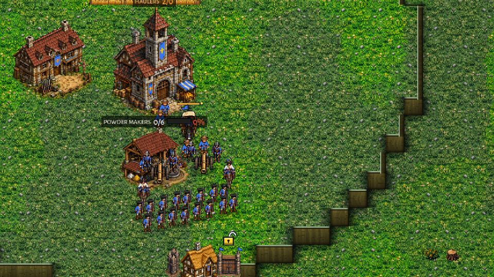

### Game 1. Clockwork at 2 times the cost, against the passive turtle

- 0:17.5. The army has gathered at the ramp's foot. The two Ballistas have brought the gate to 70%. The assault goes in.
- 0:23. The Clock Soldiers fill the ramp in a column, shields up. The guns and the line fire into the column. The Springers behind aim at the Labourers mending the gate; two of them die in this fight.
- 0:26. The gate is down.
- 0:30. The Clock Soldiers crowd into the gap, and die there, under the line and the guns.
- 0:43. Over. All 32 Clock Soldiers, both Pendulums and all 8 Springers are dead. The Crown lost 3 Musketeers and 2 Labourers. The two Ballistas still stand at the foot, out of reach.

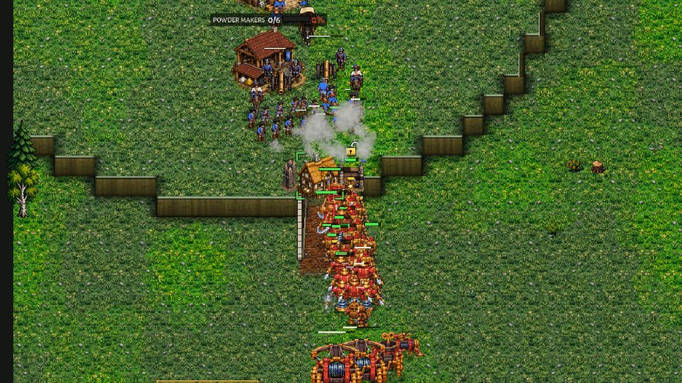

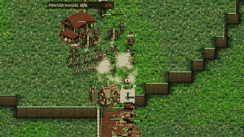

### Game 2. Old Brood at 2 times the cost, TONGUE pulls the gun, passive turtle

- 0:13. The swarm goes in: 4 Brutes and 112 Raptors first, 20 Spitters behind, two Toads.
- 0:17.5. The first Toad is sent to lay FOG on the line. The bank is down at 0:22.5.
- 0:20.5. The gate is down. A Raptor is inside at 0:21.
- 0:23.5 and 0:25. The second and the first Toad mark the two Field Cannons, from 224 px. The crosshairs go up.
- 0:26.5 and 0:28.5. Both cannons are pulled out of the line to the Toads' feet.
- 0:30 and 0:31. Both pulled guns are destroyed by the Raptors.
- 0:38.5. The line is gone. Broken. The Brood lost 111 Raptors for the whole turtle.

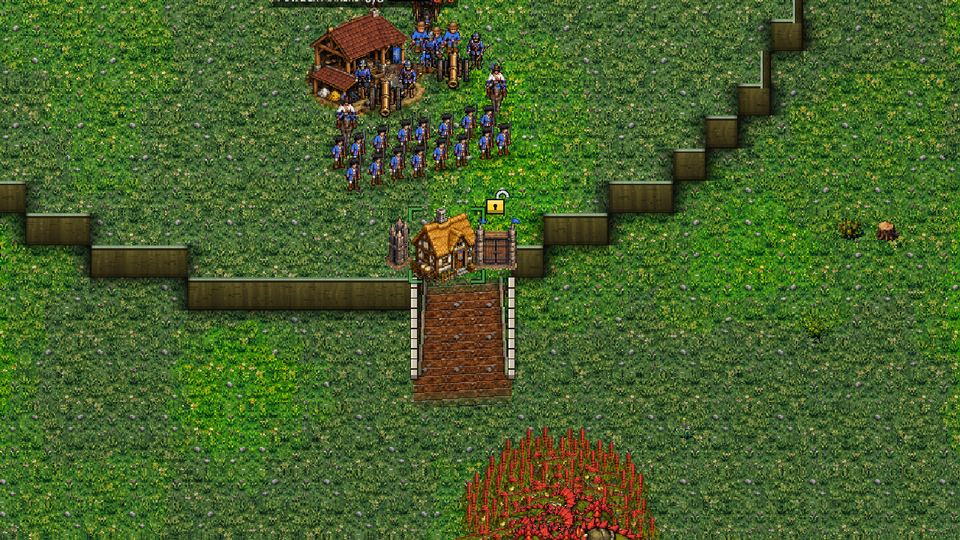

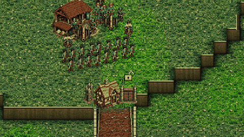

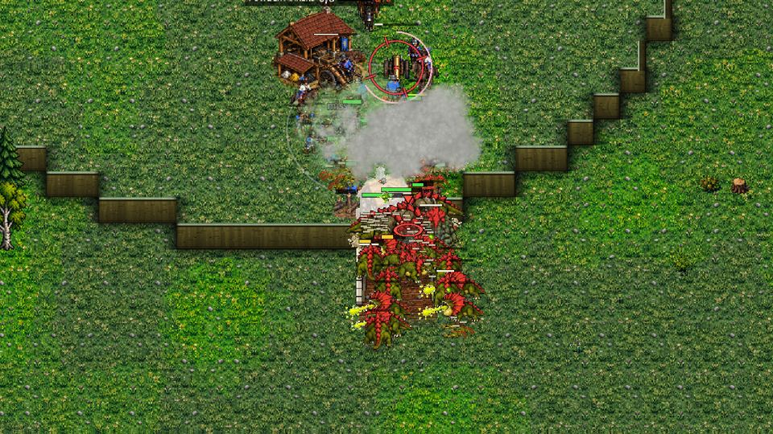

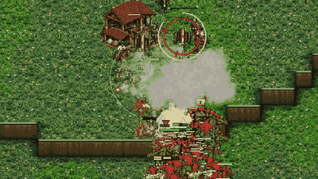

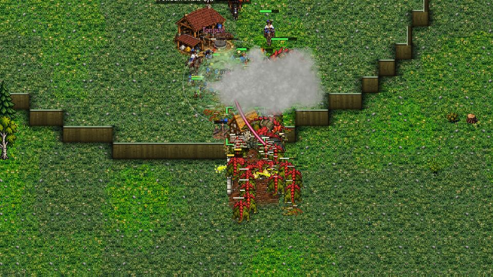

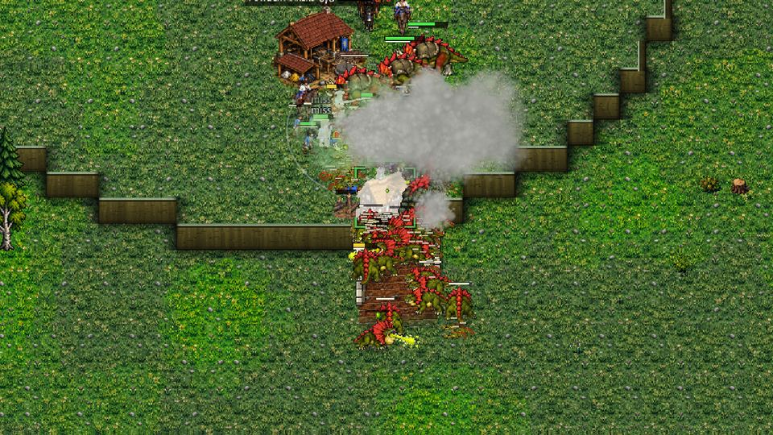

### Game 3. Old Brood at equal cost, TONGUE pulls, the Crown answers the warning

- 0:10. The swarm goes in.
- 0:15.5. A Toad goes to fog the line. The bank is down at 0:19.5.
- 0:20. The gate is down. A Toad marks a Field Cannon from 223 px.
- 0:21.5. The second Toad marks the other cannon. The first is shot dead in its windup.
- 0:22. The second Toad is shot dead in its windup too. No gun was pulled.
- 0:34.5. Held. The Brood lost everything. The Crown lost one Horseman, who rode out at a Toad.

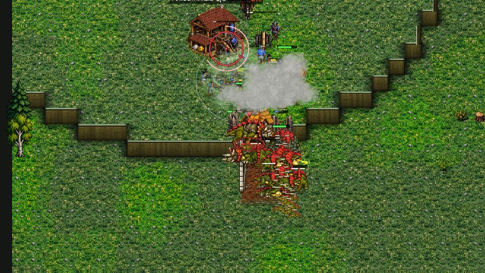

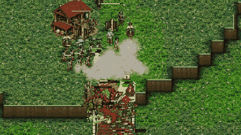

### Game 4. New Brood at 1.5 times the cost, TONGUE pulls, passive turtle

- 0:12. The swarm goes in: 4 Brutes, 65 Raptors, 20 Spitters, two Toads.
- 0:16.5. A Toad goes to fog the line. The bank is down at 0:21.
- 0:20. The gate is down.
- 0:22. A Toad marks a cannon. A Labourer mending the wall is killed at 0:24.
- 0:25, 0:28 and 0:29.5. Three pulls: one cannon is pulled twice.
- But here the swarm was already thin. The pulled guns survived, and the line shot the Raptors around them.
- 0:40. Held. The Crown lost one Musketeer and one Labourer. The Brood lost all of its 91 creatures.

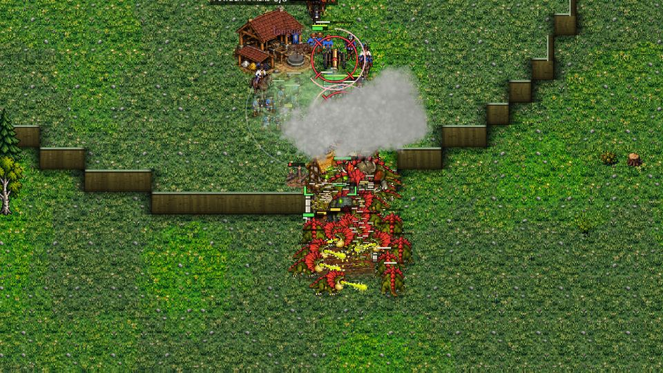

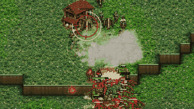

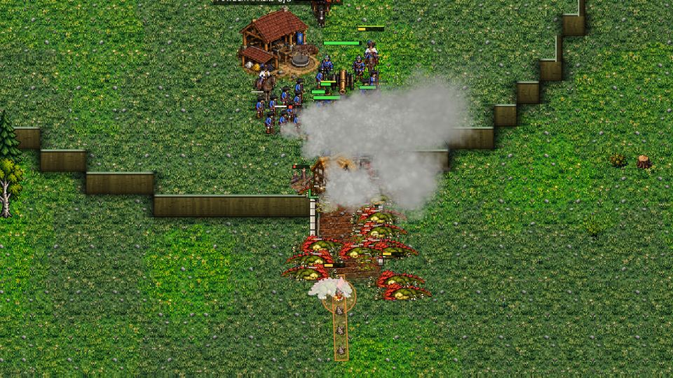

## 5. Recommendation, for the owner to decide

### Pull the cannon, or only stagger it?

My advice: only stagger the Field Cannon and the Mortar. Keep the pull for everything else.

Why:

1. On today's build the pull does not decide whether the turtle falls. Against a Crown that only holds, pull and stagger break it equally often: 4 times in 8 at 1.5 times the cost, 6 and 7 times at twice the cost. With stagger-only, the Toads tongue the Labourers off the gate and the men off the line instead.
2. The pull takes away the Crown's counterplay. Against stagger-only Toads, a Crown that answers the warning holds at 1.5 times the cost, 8 times in 8. Against pulling Toads, the same answer still loses 4 times in 8: the guns pulled before their Toad dies are gone (5 pulled, 5 lost). That is the "no true counter" the owner feared, and the numbers show it.
3. The punishment then matches the mistake (design principle 1). A Crown that lets a Toad stand in musket range for 3 seconds loses a Labourer or a Musketeer, not its 210-gold gun.
4. It is StarCraft's choice too: 5.0.17 took the Siege Tank off Abduct's list.
5. The turtle still falls to a big Brood lead: 7 times in 8 at twice the cost with stagger-only Toads. So design principle 2 (the defender's advantage must fade) is kept.

How: tag the Field Cannon and the Mortar "massive" in Defs. That is exactly this study's "stagger" rule, and the TONGUE card already says "heavy engines are only staggered".

On 0.15.25, before the Brute became the wall-breaker, the pull did matter at twice the cost (6 breaks in 8 against 3 with stagger). With the new Brute that gap is gone.

### A real counter for the Crown, instead of a Ghost

The Crown has no Ghost, but it does have a counter: shooting the Toad in its 3 seconds, because the Toad must stand inside musket range. What it lacks is a way to do that without perfect hands. Ideas, from the data:

1. Gun crews and Musketeers on HOLD shoot a Toad that marks one of their own, first. The warning already exists; this makes the line act on it. In the study, the line answering the warning killed 16 Toads of 16 in their windup at equal cost. Mild, readable, and no new unit.
2. The guns fire at Toads first whenever they reach one (cannon priority on Toads). In the study this stopped almost every mark at equal and 1.5 times the cost. But at twice the cost it pulled the guns' fire off the swarm, and the line still fell. So keep it to marked Toads.
3. The Observation Balloon as the "detector": it sees 14 tiles, so the cannons (430) can hit a Toad long before it reaches 224. That already works today.
4. The Horseman's charge is not a working answer now. Over both versions, in 64 windups with the Horsemen riding at the Toad, no charge stun landed in time: the charge needs 2 seconds of gallop first, and the Horsemen started behind the gate. If the owner wants cavalry to be a counter, a charge from a standing start (or a shorter gallop against a Toad in its windup) would make it one. The Spitter escort would then have a job; today it only costs the Crown about half a Horseman a fight.

### Can each faction break the Crown turtle without the pull?

- The Brood: yes, with a lead. On 0.16.1 with stagger-only Toads: 4 times in 8 at 1.5 times the cost, 7 times in 8 at twice the cost. Without any Toads: 3 times in 8 at twice the cost. At equal cost: never.
- The Clockwork: almost never. Head-on it never broke it, even at twice the cost. Its gate falls at about 27 s, and the soldiers die in the gap. Only a patient siege of eight Ballistas (1.5 times the cost) broke it, twice in 8, after 160 s. The Clockwork has nothing that outranges the cannon (430) once a Musketeer spots for it. This deserves its own look: the Clockwork computer's own siege numbers (docs/clockwork_ai.md) tell the same story.

## 6. Limits

- One turtle shape. Every map's main ramp is the same template, so Highmoor is the same shape as Greenhold.
- The attackers are coached by script, not played by hand. A human would scout, wait for the Toads' energy, and pull back from a lost assault. Every assault here was fought to the end.
- The Toads were put at full energy (two spells each). A Toad fresh from its egg has one.
- The Crown's answers are scripted too. The Horsemen wait behind the gate; a player might keep them moving in front.
- The new Brood fought without its Tyrannosaur. Sent with the wave, he stood 370 px from the gate on his attack order and never reached it. That may be a path problem for a big creature on a 3-tile ramp; I did not look further.
- The Toads could mark a gun the Brood did not see yet (the tool knows where the guns are). In practice they marked it from 224 px, where the Toad sees it anyway.
- Bodies, the Missionary and resurrection, research and economy were not part of these fights.

## 7. How to run it

    godot --headless --import
    GODOT=godot JOBS=2 tools/study_crown_turtle.sh /tmp/ct 8 G M H
    python3 -I tools/study/crown_turtle_table.py /tmp/ct/*.jsonl

One fight on film:

    xvfb-run -a godot --rendering-driver opengl3 --resolution 1280x720 --fixed-fps 30 --script res://tools/study_crown_turtle.gd -- only:G_OB_x20_pull_p seeds:1 cap:90 zoom:1.35 film:/tmp/film
    python3 -I tools/study/crown_turtle_gif.py /tmp/film G_OB_x20_pull_p docs/shots/crown_turtle still:NAME:SECONDS gif:NAME:FROM:TO

Config names: group (G Greenhold, M the Mortar variant, H Highmoor), attacker (CW, OB, NB), cost (x10, x15, x20), TONGUE rule (pull, stagger, none), and the Crown's play (p passive, r good player, rwarn the warning only, rcav the Horsemen only; "noesc": no Spitter escort). G_CW_x10_norepair has no menders; *_bsiege is the patient Ballista siege. Group L is the limber test. `from:N` starts at seed N, `map:` and `mseed:` change the map.

## 8. The full tables

Every setting, averaged over its 8 seeds (tools/study/crown_turtle_table.py). The raw fights are in docs/crown_turtle/v0.15.25/ and docs/crown_turtle/v0.16.1/. Fight time runs to 5:00 where only a Ballista or a Netter was left out of reach; those count as held.

### On 0.15.25

| fight | seeds | held | broken | time out | gate fell (avg time) | first inside | fight time | Crown lost | attacker lost | trade | wall lost | repair gold |
|---|---|---|---|---|---|---|---|---|---|---|---|---|
| G_CW_x10 | 8 | 8 | 0 | 0 | 0 | 0 | 3:20 | 45 | 1724 | 38.1 | 0 | 88 |
| G_CW_x10_bsiege | 8 | 8 | 0 | 0 | 0 | 0 | 2:21 | 0 | 1989 | 1989.4 | 0 | 95 |
| G_CW_x10_norepair | 8 | 8 | 0 | 0 | 7 of 8 (0:35) | 0 | 4:26 | 185 | 1740 | 9.4 | 43 | 0 |
| G_CW_x15 | 8 | 8 | 0 | 0 | 8 of 8 (0:27) | 0 | 5:00 | 347 | 2740 | 7.9 | 62 | 12 |
| G_CW_x15_bsiege | 8 | 5 | 2 | 1 | 5 of 8 (0:45) | 3 (2:20) | 2:51 | 932 | 2872 | 3.1 | 106 | 105 |
| G_CW_x20 | 8 | 8 | 0 | 0 | 8 of 8 (0:27) | 3 (0:30) | 5:00 | 407 | 3940 | 9.7 | 50 | 40 |
| G_NB_x10_none_p | 8 | 8 | 0 | 0 | 6 of 8 (0:13) | 1 (0:13) | 0:22 | 185 | 2310 | 12.5 | 37 | 15 |
| G_NB_x10_pull_p | 8 | 8 | 0 | 0 | 4 of 8 (0:19) | 2 (0:19) | 0:31 | 191 | 2277 | 11.9 | 25 | 32 |
| G_NB_x10_stagger_p | 8 | 8 | 0 | 0 | 3 of 8 (0:18) | 2 (0:19) | 0:31 | 223 | 2149 | 9.6 | 18 | 15 |
| G_NB_x15_none_p | 8 | 8 | 0 | 0 | 6 of 8 (0:13) | 5 (0:13) | 0:28 | 551 | 3448 | 6.3 | 40 | 33 |
| G_NB_x15_pull_p | 8 | 7 | 1 | 0 | 7 of 8 (0:20) | 7 (0:21) | 0:39 | 645 | 3353 | 5.2 | 56 | 81 |
| G_NB_x15_stagger_p | 8 | 6 | 2 | 0 | 8 of 8 (0:20) | 7 (0:21) | 0:42 | 1215 | 3271 | 2.7 | 65 | 30 |
| G_OB_x10_none_p | 8 | 8 | 0 | 0 | 6 of 8 (0:13) | 1 (0:13) | 0:22 | 185 | 2310 | 12.5 | 37 | 15 |
| G_OB_x10_pull_p | 8 | 8 | 0 | 0 | 4 of 8 (0:19) | 2 (0:19) | 0:31 | 191 | 2277 | 11.9 | 25 | 32 |
| G_OB_x10_pull_r | 8 | 8 | 0 | 0 | 6 of 8 (0:18) | 2 (0:20) | 0:27 | 136 | 2291 | 16.8 | 37 | 8 |
| G_OB_x10_pull_rcav | 8 | 8 | 0 | 0 | 5 of 8 (0:18) | 3 (0:20) | 0:30 | 180 | 2264 | 12.5 | 31 | 18 |
| G_OB_x10_pull_rcavnoesc | 8 | 8 | 0 | 0 | 5 of 8 (0:18) | 4 (0:20) | 0:30 | 185 | 2279 | 12.3 | 31 | 24 |
| G_OB_x10_pull_rnoesc | 8 | 8 | 0 | 0 | 7 of 8 (0:18) | 5 (0:19) | 0:31 | 163 | 2312 | 14.1 | 43 | 14 |
| G_OB_x10_pull_rwarn | 8 | 8 | 0 | 0 | 5 of 8 (0:18) | 4 (0:19) | 0:32 | 185 | 2261 | 12.2 | 31 | 13 |
| G_OB_x10_pull_rwarnnoesc | 8 | 8 | 0 | 0 | 5 of 8 (0:20) | 2 (0:20) | 0:31 | 277 | 2276 | 8.2 | 31 | 15 |
| G_OB_x10_stagger_p | 8 | 8 | 0 | 0 | 3 of 8 (0:18) | 2 (0:19) | 0:31 | 223 | 2149 | 9.6 | 18 | 15 |
| G_OB_x10_stagger_r | 8 | 8 | 0 | 0 | 6 of 8 (0:18) | 3 (0:19) | 0:28 | 132 | 2291 | 17.3 | 37 | 9 |
| G_OB_x10_stagger_rnoesc | 8 | 8 | 0 | 0 | 6 of 8 (0:19) | 0 | 0:28 | 143 | 2294 | 16.0 | 37 | 12 |
| G_OB_x10_stagger_rwarn | 8 | 8 | 0 | 0 | 8 of 8 (0:18) | 6 (0:19) | 0:33 | 257 | 2340 | 9.1 | 50 | 8 |
| G_OB_x10_stagger_rwarnnoesc | 8 | 8 | 0 | 0 | 7 of 8 (0:19) | 4 (0:20) | 0:33 | 256 | 2315 | 9.0 | 43 | 10 |
| G_OB_x15_none_p | 8 | 8 | 0 | 0 | 6 of 8 (0:13) | 5 (0:13) | 0:28 | 551 | 3448 | 6.3 | 40 | 33 |
| G_OB_x15_pull_p | 8 | 7 | 1 | 0 | 7 of 8 (0:20) | 7 (0:21) | 0:39 | 645 | 3353 | 5.2 | 56 | 81 |
| G_OB_x15_pull_r | 8 | 8 | 0 | 0 | 8 of 8 (0:20) | 8 (0:21) | 0:39 | 750 | 3505 | 4.7 | 59 | 31 |
| G_OB_x15_pull_rwarn | 8 | 7 | 1 | 0 | 8 of 8 (0:20) | 7 (0:22) | 0:40 | 901 | 3326 | 3.7 | 65 | 32 |
| G_OB_x15_stagger_p | 8 | 6 | 2 | 0 | 8 of 8 (0:20) | 7 (0:21) | 0:42 | 1215 | 3271 | 2.7 | 65 | 30 |
| G_OB_x15_stagger_r | 8 | 7 | 1 | 0 | 8 of 8 (0:20) | 7 (0:21) | 0:34 | 657 | 3410 | 5.2 | 56 | 19 |
| G_OB_x15_stagger_rwarn | 8 | 7 | 1 | 0 | 8 of 8 (0:20) | 7 (0:21) | 0:38 | 672 | 3435 | 5.1 | 59 | 25 |
| G_OB_x20_none_p | 8 | 7 | 1 | 0 | 8 of 8 (0:12) | 8 (0:13) | 0:28 | 964 | 4485 | 4.7 | 84 | 30 |
| G_OB_x20_pull_p | 8 | 2 | 6 | 0 | 8 of 8 (0:20) | 8 (0:20) | 0:35 | 1847 | 2850 | 1.5 | 112 | 17 |
| G_OB_x20_pull_r | 8 | 3 | 5 | 0 | 8 of 8 (0:20) | 8 (0:20) | 0:35 | 1838 | 3523 | 1.9 | 71 | 32 |
| G_OB_x20_pull_rwarn | 8 | 2 | 6 | 0 | 8 of 8 (0:20) | 8 (0:20) | 0:34 | 1836 | 2857 | 1.6 | 93 | 25 |
| G_OB_x20_stagger_p | 8 | 5 | 3 | 0 | 8 of 8 (0:20) | 8 (0:20) | 0:37 | 1304 | 3799 | 2.9 | 68 | 18 |
| G_OB_x20_stagger_rwarn | 8 | 0 | 8 | 0 | 8 of 8 (0:20) | 8 (0:20) | 0:36 | 2301 | 2828 | 1.2 | 87 | 32 |
| H_CW_x10 | 8 | 8 | 0 | 0 | 0 | 0 | 0:32 | 6 | 1683 | 269.4 | 0 | 9 |
| H_NB_x10_none_p | 8 | 8 | 0 | 0 | 8 of 8 (0:13) | 2 (0:13) | 0:22 | 201 | 2340 | 11.6 | 50 | 14 |
| H_NB_x10_pull_p | 8 | 8 | 0 | 0 | 4 of 8 (0:19) | 3 (0:20) | 0:32 | 140 | 2253 | 16.0 | 25 | 45 |
| H_NB_x10_stagger_p | 8 | 8 | 0 | 0 | 4 of 8 (0:18) | 2 (0:20) | 0:35 | 241 | 2166 | 9.0 | 25 | 16 |
| H_OB_x10_none_p | 8 | 8 | 0 | 0 | 8 of 8 (0:13) | 2 (0:13) | 0:22 | 201 | 2340 | 11.6 | 50 | 14 |
| H_OB_x10_pull_p | 8 | 8 | 0 | 0 | 4 of 8 (0:19) | 3 (0:20) | 0:32 | 140 | 2253 | 16.0 | 25 | 45 |
| H_OB_x10_stagger_p | 8 | 8 | 0 | 0 | 4 of 8 (0:18) | 2 (0:20) | 0:35 | 241 | 2166 | 9.0 | 25 | 16 |
| M_CW_x10 | 8 | 8 | 0 | 0 | 0 | 0 | 0:35 | 94 | 1665 | 17.6 | 0 | 12 |
| M_NB_x10_none_p | 8 | 8 | 0 | 0 | 5 of 8 (0:13) | 2 (0:13) | 0:23 | 162 | 2283 | 14.0 | 31 | 16 |
| M_NB_x10_pull_p | 8 | 8 | 0 | 0 | 1 of 8 (0:19) | 1 (0:20) | 0:31 | 120 | 2205 | 18.4 | 6 | 33 |
| M_NB_x10_stagger_p | 8 | 8 | 0 | 0 | 0 | 0 | 0:40 | 167 | 1999 | 11.9 | 0 | 20 |
| M_OB_x10_none_p | 8 | 8 | 0 | 0 | 5 of 8 (0:13) | 2 (0:13) | 0:23 | 162 | 2283 | 14.0 | 31 | 16 |
| M_OB_x10_pull_p | 8 | 8 | 0 | 0 | 1 of 8 (0:19) | 1 (0:20) | 0:31 | 120 | 2205 | 18.4 | 6 | 33 |
| M_OB_x10_stagger_p | 8 | 8 | 0 | 0 | 0 | 0 | 0:40 | 167 | 1999 | 11.9 | 0 | 20 |

Tongues (totals over the seeds): marks on a gun; guns pulled; guns staggered; men pulled; Toads killed in the windup; windups broken (stunned or moved); guns killed after the pull; fogs laid (average); escort focus orders on a rider (total)

| fight | gun marked | gun pulled | gun staggered | men pulled | Toad killed in windup | windup broken | pulled guns killed | charge stuns in windup | fogs a fight | Spitter focus on riders | Crown dead (avg by kind) |
|---|---|---|---|---|---|---|---|---|---|---|---|
| G_NB_x10_none_p | 0 | 0 | 0 | 0 | 0 | 0 | 0 | 0 | 0.0 | 0 | labourer 0.1, musketeer 1.8 |
| G_NB_x10_pull_p | 17 | 7 | 0 | 0 | 9 | 0 | 0 | 0 | 1.0 | 6 | labourer 0.5, musketeer 1.8 |
| G_NB_x10_stagger_p | 0 | 0 | 0 | 23 | 0 | 1 | 0 | 0 | 1.0 | 12 | labourer 2.9, musketeer 0.8 |
| G_NB_x15_none_p | 0 | 0 | 0 | 0 | 0 | 0 | 0 | 0 | 0.0 | 0 | labourer 0.5, musketeer 6.0 |
| G_NB_x15_pull_p | 22 | 19 | 0 | 0 | 3 | 0 | 4 | 0 | 1.0 | 35 | cannon 0.5, cuirassier 0.4, labourer 0.6, musketeer 4.9 |
| G_NB_x15_stagger_p | 0 | 0 | 0 | 18 | 0 | 6 | 0 | 0 | 1.1 | 71 | cannon 0.5, cuirassier 0.8, labourer 3.4, musketeer 9.4 |
| G_OB_x10_none_p | 0 | 0 | 0 | 0 | 0 | 0 | 0 | 0 | 0.0 | 0 | labourer 0.1, musketeer 1.8 |
| G_OB_x10_pull_p | 17 | 7 | 0 | 0 | 9 | 0 | 0 | 0 | 1.0 | 6 | labourer 0.5, musketeer 1.8 |
| G_OB_x10_pull_r | 0 | 0 | 0 | 0 | 0 | 0 | 0 | 0 | 0.1 | 40 | cuirassier 0.4, musketeer 0.5 |
| G_OB_x10_pull_rcav | 16 | 4 | 0 | 0 | 11 | 0 | 0 | 0 | 1.0 | 58 | cuirassier 0.5, labourer 0.6, musketeer 0.5 |
| G_OB_x10_pull_rcavnoesc | 16 | 4 | 0 | 0 | 12 | 0 | 0 | 0 | 1.0 | 0 | labourer 0.2, musketeer 1.8 |
| G_OB_x10_pull_rnoesc | 0 | 0 | 0 | 0 | 0 | 0 | 0 | 0 | 0.6 | 0 | cuirassier 0.2, musketeer 1.0 |
| G_OB_x10_pull_rwarn | 15 | 0 | 0 | 0 | 15 | 0 | 0 | 0 | 1.0 | 48 | cuirassier 0.1, labourer 0.9, musketeer 1.1 |
| G_OB_x10_pull_rwarnnoesc | 16 | 0 | 0 | 0 | 16 | 0 | 0 | 0 | 1.0 | 0 | labourer 0.9, musketeer 2.5 |
| G_OB_x10_stagger_p | 0 | 0 | 0 | 23 | 0 | 1 | 0 | 0 | 1.0 | 12 | labourer 2.9, musketeer 0.8 |
| G_OB_x10_stagger_r | 0 | 0 | 0 | 1 | 9 | 1 | 0 | 0 | 0.4 | 66 | cuirassier 0.4, labourer 0.1, musketeer 0.4 |
| G_OB_x10_stagger_rnoesc | 0 | 0 | 0 | 1 | 8 | 1 | 0 | 0 | 0.2 | 0 | cuirassier 0.2, labourer 0.1, musketeer 0.8 |
| G_OB_x10_stagger_rwarn | 0 | 0 | 0 | 3 | 14 | 2 | 0 | 0 | 1.0 | 65 | cuirassier 0.5, labourer 0.4, musketeer 1.4 |
| G_OB_x10_stagger_rwarnnoesc | 0 | 0 | 0 | 5 | 12 | 4 | 0 | 0 | 1.0 | 0 | cuirassier 0.1, labourer 0.6, musketeer 2.0 |
| G_OB_x15_none_p | 0 | 0 | 0 | 0 | 0 | 0 | 0 | 0 | 0.0 | 0 | labourer 0.5, musketeer 6.0 |
| G_OB_x15_pull_p | 22 | 19 | 0 | 0 | 3 | 0 | 4 | 0 | 1.0 | 35 | cannon 0.5, cuirassier 0.4, labourer 0.6, musketeer 4.9 |
| G_OB_x15_pull_r | 0 | 0 | 0 | 0 | 0 | 0 | 0 | 0 | 0.4 | 51 | cuirassier 1.1, musketeer 6.4 |
| G_OB_x15_pull_rwarn | 17 | 3 | 0 | 0 | 14 | 0 | 2 | 0 | 1.1 | 54 | cannon 0.2, cuirassier 1.1, labourer 1.2, musketeer 6.8 |
| G_OB_x15_stagger_p | 0 | 0 | 0 | 18 | 0 | 6 | 0 | 0 | 1.1 | 71 | cannon 0.5, cuirassier 0.8, labourer 3.4, musketeer 9.4 |
| G_OB_x15_stagger_r | 0 | 0 | 0 | 0 | 7 | 0 | 0 | 0 | 0.4 | 52 | cannon 0.2, cuirassier 1.1, musketeer 4.6 |
| G_OB_x15_stagger_rwarn | 0 | 0 | 0 | 3 | 13 | 2 | 0 | 0 | 1.0 | 72 | cannon 0.2, cuirassier 0.5, labourer 0.8, musketeer 5.5 |
| G_OB_x20_none_p | 0 | 0 | 0 | 0 | 0 | 0 | 0 | 0 | 0.0 | 0 | cannon 0.2, cuirassier 0.2, labourer 2.0, musketeer 8.5 |
| G_OB_x20_pull_p | 20 | 13 | 0 | 1 | 1 | 8 | 9 | 0 | 1.0 | 24 | cannon 1.5, cuirassier 1.5, labourer 3.5, musketeer 12.5 |
| G_OB_x20_pull_r | 1 | 1 | 0 | 0 | 0 | 0 | 1 | 0 | 0.4 | 50 | cannon 1.2, cuirassier 1.8, labourer 2.4, musketeer 13.8 |
| G_OB_x20_pull_rwarn | 20 | 8 | 0 | 0 | 8 | 4 | 8 | 0 | 1.0 | 69 | cannon 1.5, cuirassier 1.5, labourer 3.2, musketeer 12.8 |
| G_OB_x20_stagger_p | 0 | 0 | 0 | 13 | 0 | 11 | 0 | 0 | 1.0 | 32 | cannon 0.8, cuirassier 0.8, labourer 3.2, musketeer 9.9 |
| G_OB_x20_stagger_rwarn | 0 | 0 | 0 | 8 | 2 | 12 | 0 | 0 | 1.0 | 90 | cannon 2.0, cuirassier 2.0, labourer 3.8, musketeer 16.0 |
| H_NB_x10_none_p | 0 | 0 | 0 | 0 | 0 | 0 | 0 | 0 | 0.0 | 0 | musketeer 1.9 |
| H_NB_x10_pull_p | 22 | 14 | 0 | 0 | 8 | 0 | 1 | 0 | 1.0 | 17 | cannon 0.1, labourer 0.4, musketeer 0.9 |
| H_NB_x10_stagger_p | 0 | 0 | 0 | 20 | 0 | 3 | 0 | 0 | 1.0 | 15 | labourer 2.5, musketeer 1.1 |
| H_OB_x10_none_p | 0 | 0 | 0 | 0 | 0 | 0 | 0 | 0 | 0.0 | 0 | musketeer 1.9 |
| H_OB_x10_pull_p | 22 | 14 | 0 | 0 | 8 | 0 | 1 | 0 | 1.0 | 17 | cannon 0.1, labourer 0.4, musketeer 0.9 |
| H_OB_x10_stagger_p | 0 | 0 | 0 | 20 | 0 | 3 | 0 | 0 | 1.0 | 15 | labourer 2.5, musketeer 1.1 |
| M_NB_x10_none_p | 0 | 0 | 0 | 0 | 0 | 0 | 0 | 0 | 0.0 | 0 | musketeer 1.6 |
| M_NB_x10_pull_p | 14 | 4 | 0 | 0 | 9 | 0 | 0 | 0 | 1.0 | 0 | labourer 0.2, musketeer 1.2 |
| M_NB_x10_stagger_p | 0 | 0 | 0 | 20 | 0 | 3 | 0 | 0 | 1.0 | 0 | labourer 2.8, musketeer 0.4 |
| M_OB_x10_none_p | 0 | 0 | 0 | 0 | 0 | 0 | 0 | 0 | 0.0 | 0 | musketeer 1.6 |
| M_OB_x10_pull_p | 14 | 4 | 0 | 0 | 9 | 0 | 0 | 0 | 1.0 | 0 | labourer 0.2, musketeer 1.2 |
| M_OB_x10_stagger_p | 0 | 0 | 0 | 20 | 0 | 3 | 0 | 0 | 1.0 | 0 | labourer 2.8, musketeer 0.4 |

| fight | attacker army | Crown turtle |
|---|---|---|
| G_CW_x10 | 1 ballista, 12 clock_soldier, 1 great_winder, 1 netter, 1 pendulum, 4 springer, 2 winder = 1990 + 350 | 1976 + 190, wall 175 |
| G_CW_x10_bsiege | 4 ballista, 10 clock_soldier, 1 great_winder, 4 springer, 2 winder = 1975 + 375 | 1976 + 190, wall 175 |
| G_CW_x10_norepair | 1 ballista, 12 clock_soldier, 1 great_winder, 1 netter, 1 pendulum, 4 springer, 2 winder = 1990 + 350 | 1976 + 190, wall 175 |
| G_CW_x15 | 2 ballista, 15 clock_soldier, 1 great_winder, 1 netter, 2 pendulum, 8 springer, 2 winder = 2950 + 575 | 1976 + 190, wall 175 |
| G_CW_x15_bsiege | 8 ballista, 15 clock_soldier, 1 great_winder, 4 springer, 2 winder = 2925 + 575 | 1976 + 190, wall 175 |
| G_CW_x20 | 2 ballista, 32 clock_soldier, 1 great_winder, 1 netter, 2 pendulum, 8 springer, 2 winder = 4140 + 575 | 1976 + 190, wall 175 |
| G_NB_x10_none_p | 2 brute, 61 raptor, 10 spitter = 2275 + 65 | 1976 + 190, wall 175 |
| G_NB_x10_pull_p | 2 brute, 2 mist_toad, 51 raptor, 10 spitter = 2225 + 115 | 1976 + 190, wall 175 |
| G_NB_x10_stagger_p | 2 brute, 2 mist_toad, 51 raptor, 10 spitter = 2225 + 115 | 1976 + 190, wall 175 |
| G_NB_x15_none_p | 4 brute, 75 raptor, 20 spitter = 3375 + 130 | 1976 + 190, wall 175 |
| G_NB_x15_pull_p | 4 brute, 2 mist_toad, 65 raptor, 20 spitter = 3325 + 180 | 1976 + 190, wall 175 |
| G_NB_x15_stagger_p | 4 brute, 2 mist_toad, 65 raptor, 20 spitter = 3325 + 180 | 1976 + 190, wall 175 |
| G_OB_x10_none_p | 2 brute, 61 raptor, 10 spitter = 2275 + 65 | 1976 + 190, wall 175 |
| G_OB_x10_pull_p | 2 brute, 2 mist_toad, 51 raptor, 10 spitter = 2225 + 115 | 1976 + 190, wall 175 |
| G_OB_x10_pull_r | 2 brute, 2 mist_toad, 51 raptor, 10 spitter = 2225 + 115 | 1976 + 190, wall 175 |
| G_OB_x10_pull_rcav | 2 brute, 2 mist_toad, 51 raptor, 10 spitter = 2225 + 115 | 1976 + 190, wall 175 |
| G_OB_x10_pull_rcavnoesc | 2 brute, 2 mist_toad, 51 raptor, 10 spitter = 2225 + 115 | 1976 + 190, wall 175 |
| G_OB_x10_pull_rnoesc | 2 brute, 2 mist_toad, 51 raptor, 10 spitter = 2225 + 115 | 1976 + 190, wall 175 |
| G_OB_x10_pull_rwarn | 2 brute, 2 mist_toad, 51 raptor, 10 spitter = 2225 + 115 | 1976 + 190, wall 175 |
| G_OB_x10_pull_rwarnnoesc | 2 brute, 2 mist_toad, 51 raptor, 10 spitter = 2225 + 115 | 1976 + 190, wall 175 |
| G_OB_x10_stagger_p | 2 brute, 2 mist_toad, 51 raptor, 10 spitter = 2225 + 115 | 1976 + 190, wall 175 |
| G_OB_x10_stagger_r | 2 brute, 2 mist_toad, 51 raptor, 10 spitter = 2225 + 115 | 1976 + 190, wall 175 |
| G_OB_x10_stagger_rnoesc | 2 brute, 2 mist_toad, 51 raptor, 10 spitter = 2225 + 115 | 1976 + 190, wall 175 |
| G_OB_x10_stagger_rwarn | 2 brute, 2 mist_toad, 51 raptor, 10 spitter = 2225 + 115 | 1976 + 190, wall 175 |
| G_OB_x10_stagger_rwarnnoesc | 2 brute, 2 mist_toad, 51 raptor, 10 spitter = 2225 + 115 | 1976 + 190, wall 175 |
| G_OB_x15_none_p | 4 brute, 75 raptor, 20 spitter = 3375 + 130 | 1976 + 190, wall 175 |
| G_OB_x15_pull_p | 4 brute, 2 mist_toad, 65 raptor, 20 spitter = 3325 + 180 | 1976 + 190, wall 175 |
| G_OB_x15_pull_r | 4 brute, 2 mist_toad, 65 raptor, 20 spitter = 3325 + 180 | 1976 + 190, wall 175 |
| G_OB_x15_pull_rwarn | 4 brute, 2 mist_toad, 65 raptor, 20 spitter = 3325 + 180 | 1976 + 190, wall 175 |
| G_OB_x15_stagger_p | 4 brute, 2 mist_toad, 65 raptor, 20 spitter = 3325 + 180 | 1976 + 190, wall 175 |
| G_OB_x15_stagger_r | 4 brute, 2 mist_toad, 65 raptor, 20 spitter = 3325 + 180 | 1976 + 190, wall 175 |
| G_OB_x15_stagger_rwarn | 4 brute, 2 mist_toad, 65 raptor, 20 spitter = 3325 + 180 | 1976 + 190, wall 175 |
| G_OB_x20_none_p | 4 brute, 122 raptor, 20 spitter = 4550 + 130 | 1976 + 190, wall 175 |
| G_OB_x20_pull_p | 4 brute, 2 mist_toad, 112 raptor, 20 spitter = 4500 + 180 | 1976 + 190, wall 175 |
| G_OB_x20_pull_r | 4 brute, 2 mist_toad, 112 raptor, 20 spitter = 4500 + 180 | 1976 + 190, wall 175 |
| G_OB_x20_pull_rwarn | 4 brute, 2 mist_toad, 112 raptor, 20 spitter = 4500 + 180 | 1976 + 190, wall 175 |
| G_OB_x20_stagger_p | 4 brute, 2 mist_toad, 112 raptor, 20 spitter = 4500 + 180 | 1976 + 190, wall 175 |
| G_OB_x20_stagger_rwarn | 4 brute, 2 mist_toad, 112 raptor, 20 spitter = 4500 + 180 | 1976 + 190, wall 175 |
| H_CW_x10 | 1 ballista, 12 clock_soldier, 1 great_winder, 1 netter, 1 pendulum, 4 springer, 2 winder = 1990 + 350 | 1976 + 190, wall 175 |
| H_NB_x10_none_p | 2 brute, 61 raptor, 10 spitter = 2275 + 65 | 1976 + 190, wall 175 |
| H_NB_x10_pull_p | 2 brute, 2 mist_toad, 51 raptor, 10 spitter = 2225 + 115 | 1976 + 190, wall 175 |
| H_NB_x10_stagger_p | 2 brute, 2 mist_toad, 51 raptor, 10 spitter = 2225 + 115 | 1976 + 190, wall 175 |
| H_OB_x10_none_p | 2 brute, 61 raptor, 10 spitter = 2275 + 65 | 1976 + 190, wall 175 |
| H_OB_x10_pull_p | 2 brute, 2 mist_toad, 51 raptor, 10 spitter = 2225 + 115 | 1976 + 190, wall 175 |
| H_OB_x10_stagger_p | 2 brute, 2 mist_toad, 51 raptor, 10 spitter = 2225 + 115 | 1976 + 190, wall 175 |
| M_CW_x10 | 1 ballista, 12 clock_soldier, 1 great_winder, 1 netter, 1 pendulum, 4 springer, 2 winder = 1990 + 350 | 1951 + 210, wall 175 |
| M_NB_x10_none_p | 2 brute, 61 raptor, 10 spitter = 2275 + 65 | 1951 + 210, wall 175 |
| M_NB_x10_pull_p | 2 brute, 2 mist_toad, 51 raptor, 10 spitter = 2225 + 115 | 1951 + 210, wall 175 |
| M_NB_x10_stagger_p | 2 brute, 2 mist_toad, 51 raptor, 10 spitter = 2225 + 115 | 1951 + 210, wall 175 |
| M_OB_x10_none_p | 2 brute, 61 raptor, 10 spitter = 2275 + 65 | 1951 + 210, wall 175 |
| M_OB_x10_pull_p | 2 brute, 2 mist_toad, 51 raptor, 10 spitter = 2225 + 115 | 1951 + 210, wall 175 |
| M_OB_x10_stagger_p | 2 brute, 2 mist_toad, 51 raptor, 10 spitter = 2225 + 115 | 1951 + 210, wall 175 |

### On 0.16.1 (the Brood rows again)

| fight | seeds | held | broken | time out | gate fell (avg time) | first inside | fight time | Crown lost | attacker lost | trade | wall lost | repair gold |
|---|---|---|---|---|---|---|---|---|---|---|---|---|
| G_OB_x10_none_p | 8 | 8 | 0 | 0 | 7 of 8 (0:13) | 3 (0:13) | 0:23 | 177 | 2316 | 13.0 | 43 | 17 |
| G_OB_x10_pull_p | 8 | 8 | 0 | 0 | 6 of 8 (0:19) | 2 (0:19) | 0:33 | 214 | 2292 | 10.7 | 37 | 28 |
| G_OB_x10_pull_rcav | 8 | 8 | 0 | 0 | 7 of 8 (0:19) | 5 (0:19) | 0:30 | 312 | 2322 | 7.4 | 50 | 24 |
| G_OB_x10_pull_rcavnoesc | 8 | 8 | 0 | 0 | 8 of 8 (0:19) | 8 (0:20) | 0:31 | 264 | 2340 | 8.8 | 53 | 17 |
| G_OB_x10_pull_rwarn | 8 | 8 | 0 | 0 | 8 of 8 (0:19) | 3 (0:19) | 0:32 | 176 | 2340 | 13.3 | 50 | 11 |
| G_OB_x10_stagger_p | 8 | 8 | 0 | 0 | 5 of 8 (0:18) | 4 (0:20) | 0:36 | 387 | 2206 | 5.7 | 34 | 13 |
| G_OB_x10_stagger_rwarn | 8 | 8 | 0 | 0 | 7 of 8 (0:18) | 7 (0:19) | 0:33 | 280 | 2328 | 8.3 | 46 | 13 |
| G_OB_x15_none_p | 8 | 8 | 0 | 0 | 8 of 8 (0:13) | 8 (0:14) | 0:32 | 886 | 3505 | 4.0 | 65 | 29 |
| G_OB_x15_pull_p | 8 | 4 | 4 | 0 | 8 of 8 (0:20) | 7 (0:20) | 0:42 | 1400 | 2926 | 2.1 | 65 | 66 |
| G_OB_x15_pull_rwarn | 8 | 4 | 4 | 0 | 8 of 8 (0:20) | 8 (0:20) | 0:40 | 1574 | 2884 | 1.8 | 75 | 24 |
| G_OB_x15_stagger_p | 8 | 4 | 4 | 0 | 8 of 8 (0:20) | 7 (0:20) | 0:45 | 1770 | 2919 | 1.6 | 84 | 44 |
| G_OB_x15_stagger_rwarn | 8 | 8 | 0 | 0 | 8 of 8 (0:20) | 8 (0:21) | 0:46 | 1150 | 3505 | 3.0 | 65 | 38 |
| G_OB_x20_none_p | 8 | 5 | 3 | 0 | 8 of 8 (0:12) | 8 (0:12) | 0:39 | 1649 | 4164 | 2.5 | 112 | 56 |
| G_OB_x20_pull_p | 8 | 2 | 6 | 0 | 8 of 8 (0:20) | 8 (0:21) | 0:37 | 2002 | 3034 | 1.5 | 125 | 21 |
| G_OB_x20_pull_rwarn | 8 | 0 | 8 | 0 | 8 of 8 (0:20) | 8 (0:21) | 0:36 | 2338 | 2831 | 1.2 | 112 | 18 |
| G_OB_x20_stagger_p | 8 | 1 | 7 | 0 | 8 of 8 (0:20) | 8 (0:21) | 0:42 | 2220 | 3467 | 1.6 | 137 | 17 |
| G_OB_x20_stagger_rwarn | 8 | 3 | 5 | 0 | 8 of 8 (0:20) | 8 (0:20) | 0:40 | 2036 | 3446 | 1.7 | 87 | 37 |

Tongues (totals over the seeds): marks on a gun; guns pulled; guns staggered; men pulled; Toads killed in the windup; windups broken (stunned or moved); guns killed after the pull; fogs laid (average); escort focus orders on a rider (total)

| fight | gun marked | gun pulled | gun staggered | men pulled | Toad killed in windup | windup broken | pulled guns killed | charge stuns in windup | fogs a fight | Spitter focus on riders | Crown dead (avg by kind) |
|---|---|---|---|---|---|---|---|---|---|---|---|
| G_OB_x10_none_p | 0 | 0 | 0 | 0 | 0 | 0 | 0 | 0 | 0.0 | 0 | labourer 0.2, musketeer 1.5 |
| G_OB_x10_pull_p | 18 | 11 | 0 | 0 | 7 | 0 | 1 | 0 | 1.1 | 16 | cannon 0.1, labourer 0.4, musketeer 1.6 |
| G_OB_x10_pull_rcav | 15 | 7 | 0 | 0 | 8 | 0 | 0 | 0 | 1.0 | 98 | cuirassier 0.8, labourer 0.5, musketeer 1.5 |
| G_OB_x10_pull_rcavnoesc | 17 | 7 | 0 | 0 | 10 | 0 | 0 | 0 | 1.0 | 0 | cuirassier 0.2, labourer 0.6, musketeer 1.8 |
| G_OB_x10_pull_rwarn | 16 | 0 | 0 | 0 | 16 | 0 | 0 | 0 | 1.0 | 45 | cuirassier 0.2, labourer 0.1, musketeer 1.0 |
| G_OB_x10_stagger_p | 0 | 0 | 0 | 16 | 0 | 7 | 0 | 0 | 1.0 | 21 | cuirassier 0.1, labourer 2.6, musketeer 2.5 |
| G_OB_x10_stagger_rwarn | 0 | 0 | 0 | 4 | 15 | 2 | 0 | 0 | 1.0 | 59 | cuirassier 0.6, labourer 0.5, musketeer 1.4 |
| G_OB_x15_none_p | 0 | 0 | 0 | 0 | 0 | 0 | 0 | 0 | 0.0 | 0 | labourer 1.6, musketeer 9.1 |
| G_OB_x15_pull_p | 23 | 19 | 0 | 0 | 1 | 1 | 10 | 0 | 1.1 | 57 | cannon 1.2, cuirassier 1.0, labourer 1.8, musketeer 10.2 |
| G_OB_x15_pull_rwarn | 18 | 5 | 0 | 0 | 12 | 1 | 5 | 0 | 1.0 | 66 | cannon 1.1, cuirassier 1.5, labourer 1.4, musketeer 11.9 |
| G_OB_x15_stagger_p | 0 | 0 | 0 | 17 | 1 | 6 | 0 | 0 | 1.2 | 58 | cannon 1.0, cuirassier 1.2, labourer 3.4, musketeer 13.8 |
| G_OB_x15_stagger_rwarn | 0 | 0 | 0 | 6 | 11 | 1 | 0 | 0 | 1.0 | 70 | cuirassier 1.4, labourer 0.6, musketeer 10.4 |
| G_OB_x20_none_p | 0 | 0 | 0 | 0 | 0 | 0 | 0 | 0 | 0.0 | 0 | cannon 0.8, cuirassier 1.1, labourer 3.2, musketeer 12.9 |
| G_OB_x20_pull_p | 23 | 17 | 0 | 0 | 1 | 6 | 14 | 0 | 1.0 | 33 | cannon 1.8, cuirassier 1.5, labourer 3.9, musketeer 13.4 |
| G_OB_x20_pull_rwarn | 18 | 10 | 0 | 0 | 5 | 2 | 10 | 0 | 1.1 | 93 | cannon 2.0, cuirassier 2.0, labourer 4.0, musketeer 16.0 |
| G_OB_x20_stagger_p | 0 | 0 | 0 | 12 | 0 | 12 | 0 | 0 | 1.0 | 52 | cannon 1.8, cuirassier 1.9, labourer 4.0, musketeer 15.1 |
| G_OB_x20_stagger_rwarn | 0 | 0 | 0 | 6 | 10 | 4 | 0 | 0 | 1.0 | 89 | cannon 1.2, cuirassier 1.9, labourer 3.6, musketeer 15.0 |

| fight | attacker army | Crown turtle |
|---|---|---|
| G_OB_x10_none_p | 2 brute, 61 raptor, 10 spitter = 2275 + 65 | 1976 + 190, wall 175 |
| G_OB_x10_pull_p | 2 brute, 2 mist_toad, 51 raptor, 10 spitter = 2225 + 115 | 1976 + 190, wall 175 |
| G_OB_x10_pull_rcav | 2 brute, 2 mist_toad, 51 raptor, 10 spitter = 2225 + 115 | 1976 + 190, wall 175 |
| G_OB_x10_pull_rcavnoesc | 2 brute, 2 mist_toad, 51 raptor, 10 spitter = 2225 + 115 | 1976 + 190, wall 175 |
| G_OB_x10_pull_rwarn | 2 brute, 2 mist_toad, 51 raptor, 10 spitter = 2225 + 115 | 1976 + 190, wall 175 |
| G_OB_x10_stagger_p | 2 brute, 2 mist_toad, 51 raptor, 10 spitter = 2225 + 115 | 1976 + 190, wall 175 |
| G_OB_x10_stagger_rwarn | 2 brute, 2 mist_toad, 51 raptor, 10 spitter = 2225 + 115 | 1976 + 190, wall 175 |
| G_OB_x15_none_p | 4 brute, 75 raptor, 20 spitter = 3375 + 130 | 1976 + 190, wall 175 |
| G_OB_x15_pull_p | 4 brute, 2 mist_toad, 65 raptor, 20 spitter = 3325 + 180 | 1976 + 190, wall 175 |
| G_OB_x15_pull_rwarn | 4 brute, 2 mist_toad, 65 raptor, 20 spitter = 3325 + 180 | 1976 + 190, wall 175 |
| G_OB_x15_stagger_p | 4 brute, 2 mist_toad, 65 raptor, 20 spitter = 3325 + 180 | 1976 + 190, wall 175 |
| G_OB_x15_stagger_rwarn | 4 brute, 2 mist_toad, 65 raptor, 20 spitter = 3325 + 180 | 1976 + 190, wall 175 |
| G_OB_x20_none_p | 4 brute, 122 raptor, 20 spitter = 4550 + 130 | 1976 + 190, wall 175 |
| G_OB_x20_pull_p | 4 brute, 2 mist_toad, 112 raptor, 20 spitter = 4500 + 180 | 1976 + 190, wall 175 |
| G_OB_x20_pull_rwarn | 4 brute, 2 mist_toad, 112 raptor, 20 spitter = 4500 + 180 | 1976 + 190, wall 175 |
| G_OB_x20_stagger_p | 4 brute, 2 mist_toad, 112 raptor, 20 spitter = 4500 + 180 | 1976 + 190, wall 175 |
| G_OB_x20_stagger_rwarn | 4 brute, 2 mist_toad, 112 raptor, 20 spitter = 4500 + 180 | 1976 + 190, wall 175 |
