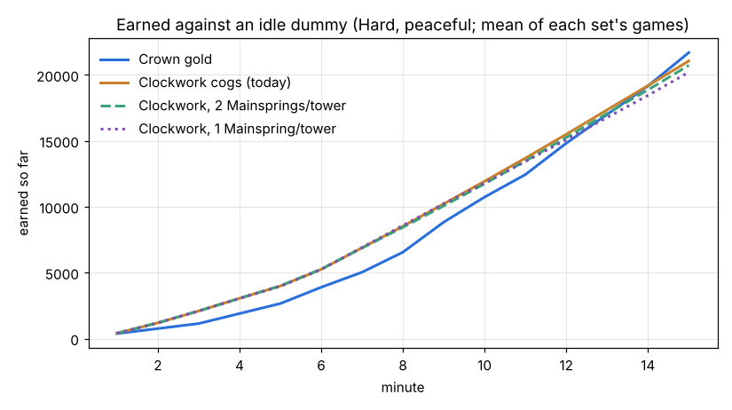
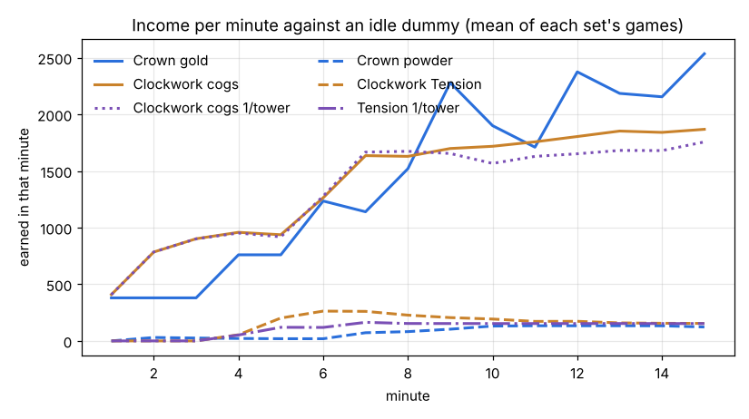
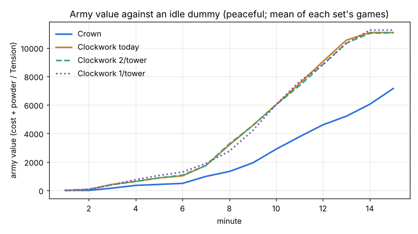

# Clockwork v Crown economy study (branch cw-economy-study, 2026-10-30)

A STUDY. No balance number or rule was changed. The proposals at the end are for the owner to decide.

The owner (2026-10-30 11:06): "Check on Clockwork vs Crown economy. Currently there is an oddity that Clockwork has
access to 2 Mainsprings per tower; I think it should be 1, but we need numbers. Also the cog influx needs to be
studied." Added at 11:26: "why is the Crown's economy stronger late game?" (the Brood keeps pace to about 10:00 and
then the Crown pulls ahead, docs/brood_eco.md).

Read with docs/design_principles.md (fairness, anti-snowball, the economy forces expansion and is depletable),
docs/clockwork_economy_study.md, docs/clockwork_gear_study.md, docs/gear_rules.md, docs/great_winder.md and
docs/brood_eco.md. Measured on 0.22.8 (main). Boilers, Ore Crushers, Ore Drills, batteries, coal and the Line are
retired: they are not part of this study except to check that none of them still pays (none does, section 2).

## The short version

1. **There is no "2 Mainsprings per tower" rule.** The game limits COG PRESSES to 2 per Clocktower
   (`Defs.FACTIONS.clockwork.econ`); Mainsprings have NO limit at all (any number, anywhere in the gear field). The
   Hard computer builds 3 to 5 of them by 15:00 on 3 or 4 Clocktowers, so in practice it is about 1 to 1.5 per tower.
2. **Mainsprings do not make cogs.** Every cog the Clockwork earns comes from its Cog Presses (100.0% in every game
   against the dummy; the Great Winder's sweep gave 0 to 12 cogs a game). A Mainspring's only effect on cogs is as a
   DRIVER (a press beside one works at 100%). Capping Mainsprings at 1 per Clocktower changed cogs by -4% at 15:00
   and army value by -3% at 12:00. It cut Tension by about 40% at 8:00 and 25% at 15:00, delayed the Heavy Works
   by about 2 minutes and cost about 30% of the Springers. **It is a Tension (tech) brake, not an economy brake.** A cap
   of 2 per tower changes nothing measurable (the computer seldom builds more).
3. **The Clockwork's lead is an OPENING lead.** Against a passive dummy (pure economy) the Hard Clockwork has earned
   1.84x the Hard Crown by 3:00, 1.3x by 6:00 to 8:00, 1.1x by 10:00 and the SAME by 15:00 (about 21,000 each).
   Its income per minute runs at about 900 from its third minute (the Crown: 380) and then levels off at about
   1,800 from 7:00, while the Crown climbs in steps to 2,300 to 2,500.
4. **Why the Clockwork opens so fast.** Per worker the two economies are close (a Winder adds 1.13 cogs/s to a small
   press, a Labourer 1.01 gold/s to a Farm), but (a) the Clockwork opens with TWO presses at once and fills them with
   12 Winders by 3:00, while the Crown computer lives on ONE farm with 3 to 4 hands for three minutes (380 gold a
   minute, paid in 380-gold lumps), sending its next hands to the Mill, the Cottage, the wall and the Barracks; (b)
   the Clockwork's first soldier needs only cogs and a Works, while the Crown's Musketeer needs a Mill with 6 hands for
   powder; (c) a full Clockwork base needs 15 workers (2 presses x 6 + a Mainspring's 3) for 960 cogs and 120 Tension a
   minute; a full Crown base needs 22 (2 farms x 8 + a Mill's 6) for 1,140 gold and 120 powder: **per worker a full
   Clockwork base pays about 26% more** (72 against 57 a minute).
5. **The army gap is bigger than the income gap.** At 10:00 the peaceful Clockwork stands at about 6,200 of army, the
   Crown at about 3,000, on similar income. The Crown spends more of its money on things that are not soldiers: horses
   (about 1,200 by 15:00), Cottages (8 supply for 100, against the Regulator's 10 for 100), 7 to 9 Barracks and 3
   Foundries, armour kits and Armoury research.
6. **The cog influx is not limited by the land in 15 minutes.** Each Clocktower holds 11,400 raw brass; the computer
   spreads 17 to 21 Winders over 8 presses on 3 to 4 towers and still has about 55% of its brass left at 15:00. Once a
   tower's brass is spent its presses keep paying A QUARTER FOREVER (`GEAR.spent` 0.25), where the Crown's spent soil
   and saltpetre pay nothing. **Tension has no land at all**: a Mainspring winds forever. Those two are the economy's
   only non-depletable parts and they are both Clockwork's.
7. **Why the Crown grows late.** Its income rises in steps, one for each new Town Hall (the computer has 4 to 5 halls by
   15:00 even against a dummy): every hall brings 9,000 fresh soil, 2 more Farms and the FARM TRICKLE: a Farm with nobody
   on it still grows at 15% speed, about 85 gold a minute for nothing. At 15:00 the Crown's 9 to 10 Farms pay about 850
   of its about 2,500 a minute that way, with 40 Labourers. The Brood's Rootmaws have no trickle (every bite is a grub's
   trip, 36 to 47 food a grub a minute) and its income is capped by grubs and by Rootmaw ground (3,000, spent at about
   12 minutes). The Clockwork has the same trickle on its presses (72 cogs a minute each), but the Hard computer stops
   at 32 Winders and 3 to 4 towers, so it levels off.
8. **The owner decided at 14:13 (section 0 has the numbers to implement it).** The proposals made before that
   (section 9): keep Mainsprings uncapped or cap them at 2 (the owner's call: 1 per tower is a fair
   tech brake if the Clockwork's Springers and tier 3 come too early, but it does not touch the cog gap); give the
   Mainspring LAND like the Mill (a Tension reserve per Clocktower); spent brass to pay nothing, like spent soil;
   the press crew to 8 like a Farm (or the full rate 8 -> 7); lower the empty-building trickle for Farms and presses
   alike (0.15 -> 0.05); and a Crown computer opening with its second Farm earlier.

## 0. The owner's decisions (2026-10-30 14:13) and the numbers to implement them

The owner, after the draft findings:
1. **Exhausted means exhausted: no free trickle for anyone.** An idle Farm or Cog Press grows nothing; spent brass pays
   0, not a quarter.
2. **Mainsprings exhaust too:** a Tension reserve that runs down, named for what a spring does when it loses its working
   force.
3. **The Clockwork keeps FEWER Winders per resource than the Crown** (Winders are needed at the front: escorts, repairs),
   but income should stay as balanced as possible.
4. **2 Cog Presses and 1 Mainspring per Clocktower**, both exhaustible.

The numbers proposed for the implementation job (estimates from the model of section 4, which matches the measured
Clockwork within 3%; to be checked with tools/study/cw_economy_run.sh once built):

| What | Today | Proposed | Why |
|---|---|---|---|
| `Defs.FARM_BASE` (a Farm with nobody on it) | 0.15 | **0** | decision 1 |
| `GEAR.press.base` (a press with nobody on it) | 0.15 | **0** | decision 1 |
| `GEAR.spent` (spent brass) | 0.25 | **0** (barren like spent soil: crew let go, `Building.barren` true for a press on spent brass) | decision 1 |
| `GEAR.press.small` | full 8.0, crew 6 (1.33 cogs/s a Winder at full crew) | **full 7.2, crew 5** (1.44 a Winder) | decision 3: a Winder pays 1.2x a Labourer (1.19 gold/s), a full tower needs 10 Winders where a full hall needs 16 Labourers |
| `GEAR.press.big` | full 10.5, crew 12 | **full 10.0, crew 8** (1.25 a Winder) | the big gear stays "slow and strong": more cogs a press for more hands, less per hand |
| `UNITS.winder.cost` | 50 | **60** | balance for decision 3: a worker then pays back in the same time on both sides (60 / 1.44 = 42 s; a Labourer 50 / 1.19 = 42 s), so a Winder earning more does not compound into the opening lead |
| `LODE.clocktower` (raw brass) | 11,400 | **9,000** | the Crown's soil (9,000 a hall): the same money in the ground for the same 400; lasts 10.4 min at a full tower (864 a minute), the Crown's 7.9 min at a full hall |
| `GEAR.mainspring.base` | 0.15 | **0** | decision 1 |
| `GEAR.mainspring` rates | small 2.0/s at 3, big 2.6/s at 6 | unchanged | 120 Tension a minute from 3 Winders already takes half the hands the Crown's Mill takes for its 119 powder (6) |
| **Tension reserve per Clocktower (new)** | none (winds forever) | **1,320** (the Crown's saltpetre, 1,320 a hall); drawn by that tower's Mainspring (the nearest Clocktower, like `LODE_FOR`); spent: the Mainspring stops | decision 2; 11 min of a full small Mainspring, the Mill's 11 min. Kept by the Clocktower's ground, not the spring: a new Mainspring at the same tower starts on what is left |
| Its name | | the spring **TAKES A SET** (the spring-maker's term: a spring worked past its life keeps a permanent bend and loses its working force; "spring fatigue" is the engineering word for the cause). Card: `Spring life 840 / 1,320`; spent: `TAKEN A SET: expand to a new Clocktower` | |
| `FACTIONS.clockwork.econ` | `{boiler 2, ore_crusher 2, ore_drill 2, cog_press 2}` | **`{cog_press: 2, mainspring: 1}`** (the retired kinds out) | decision 4; the Mainspring then must stand within 14 tiles of a Clocktower (the econ rule), like the Mill |
| The Clockwork computer | plans up to 4 Mainsprings anywhere | must plan ONE per Clocktower (`AI._tier2`, `_tier3`, `_springer_works`, `_jw_find`: with the cap they try to place springs that are refused) and put the Escapement, the Works and the Heavy Works round it | in the capped games the Heavy Works came about 2 min later: its room round the only spring is the new puzzle |
| The Crown computer | 3 to 4 hands on one Farm for 3 min | fill the first Farm (8) before the Mill's crew, second Farm by about 1:30 | without the trickle a half-crewed Farm pays only its hands' share: the opening matters more (below) |

**What it does to the incomes (model; the Hard computers' crews as measured):**

| | 3:00 | 6:00 | 10:00 | 14:00 |
|---|---|---|---|---|
| Crown today (measured, a minute) | 380 | 1,045 to 1,235 | 1,900 to 2,000 | 2,150 to 2,300 |
| Crown, no trickle (each Labourer on a Farm adds 71 instead of 61) | about 285 (its 4 hands on one Farm: -25%) | about 1,140 (16 hands) | about 1,850 (26 hands, -6%) | about 1,700 to 2,100 (24 to 30 hands, -10 to -20%) |
| Crown, no trickle, first Farm filled first | about 570 | about 1,140 | about 1,850 | about 1,700 to 2,100 |
| Clockwork today (measured) | 900 to 960 | 1,260 | 1,720 | 1,850 |
| Clockwork, proposed (10 Winders a tower at 86 a minute, Winders at 60) | about 860 (10 Winders on 2 presses; fewer by 3:00 at 60 each: about 750 to 860) | about 1,350 (18 Winders on 4 presses, two of them just built) | about 1,630 (19 on presses) | about 1,720 (20) |

- **Late game: about even.** At 10:00 to 14:00 both land at about 1,650 to 2,100 a minute (the Crown with 24 to 26 Labourers on
  Farms, the Clockwork with 19 to 20 Winders on presses and 12 more free for the front).
- **The Crown's late growth slows**: without the trickle it loses 10 to 20% from 10:00 (about 250 to 450 a minute; the
  empty Farms' share, less what its hands gain: a Labourer adds 71 a minute instead of 61). Its soil lasts longer (the
  trickle was drawing it) and a hall is worth exactly what its hands can work, which brings it closer to the Brood's late
  income (docs/brood_eco.md: about 1,000 to 1,700 a minute at 12:00).
- **Early game: the rules make it closer, the computer's opening decides the rest.** Without the trickle the Crown
  computer's first 3 minutes (4 hands on one Farm) drop to about 285 a minute, against the Clockwork's 750 to 860: still
  2.5 to 3x. With its first Farm filled first (8 hands, 570 a minute) it is 1.3 to 1.5x, and the Clockwork's dearer
  Winders cost it about 10% of its 3:00 income. No rule number closes the first three minutes alone without starving the
  Clockwork later; the Crown's opening is half of it (its Musketeers need a Mill crew early, its harvests come in lumps).
  Check after building: by 3:00 and 6:00, the Clockwork should be within 1.3x and 1.15x of the Crown.
- **Tension**: with 1 Mainspring a tower and 1,320 a tower the Hard Clockwork would have wound about 600 by 8:00 and about
  1,700 by 15:00 (the capped games), within the reserves of its 3 to 4 towers (3,960 to 5,280); the main's spring takes a
  set at about 11 to 12 minutes of full work, so the late game's Tension comes from the expansions, as the Crown's powder
  does.

## 1. How the two economies work today (from the code, gear mode)

Every number below is in `scripts/defs.gd` (`GEAR`, `LODE`, `FARM_*`, `SOIL_*`, `MILL_RATE`, `FACTIONS`) and
`scripts/building.gd` (`press_rate`, `spring_rate`, `farm_speed`), `scripts/game.gd` (`harvest`, `draw_lode`).

| | The Crown | The Clockwork |
|---|---|---|
| Start | Town Hall, 1 Farm, 4 Labourers, 300 gold | Clocktower, 1 Cog Press, 4 Winders, 300 cogs |
| Hall | Town Hall 400 | Clocktower 400 |
| Main income building, limit | Farm, 100 gold, **2 per Town Hall**, crew 8 | Cog Press, 140 cogs, **2 per Clocktower**, crew 6 (small gear) / 12 (big) |
| Full rate | a 380-gold harvest every 40 s = 9.5 gold/s (570 a minute), paid in lumps | 8 cogs/s (480 a minute) small, 10.5 big, paid every tick |
| With nobody on it (the TRICKLE) | grows at 15% speed: 85 gold a minute | 15% of full: 72 cogs a minute |
| Each worker adds | 1.01 gold/s (61 a minute) | 1.13 cogs/s (68 a minute) small, 0.74 big |
| Its land | 9,000 SOIL per Town Hall, shared by its Farms (7.9 min of two full Farms) | 11,400 RAW BRASS per Clocktower, shared by its presses (11.9 min of two full small presses) |
| Spent land | pays NOTHING (`SOIL_TIRED` 0): barren, crew let go | pays **A QUARTER, FOREVER** (`GEAR.spent` 0.25) |
| Second resource | POWDER: Powder Mill 100, **1 per Town Hall**, crew 6, 0.33 powder/s a hand (2/s, 119 a minute) | TENSION: Mainspring 140, **NO LIMIT**, crew 3 (small) / 6 (big), 2.0/s (120 a minute) small, 2.6 big; 15% alone |
| Its land | 1,320 SALTPETRE per Town Hall (11 min of a full Mill); spent: nothing | **none**: a Mainspring winds forever. It stops only while the pool is full (each Mainspring stores 200, big 400) |
| What needs it | Musketeers (10 powder + their refills), cannon and mortar shot, research | Springers 25, Netters 50, Pendulums 75, Ballistas 50, Great Winders 75, Swifts 15, Owls 50, the Clock Aviary 50, research |
| Other income | none (Haulers lead horses and carry powder: logistics, no income; no research raises income) | the Great Winder's SWEEP: a wreck of its own side gives 30% of its cog price |
| A full base | 22 workers (16 on Farms, 6 at the Mill): 1,140 gold + 119 powder a minute = **57 a worker** | 15 workers (12 on presses, 3 on a Mainspring): 960 cogs + 120 Tension a minute = **72 a worker** |
| Supply building | Cottage, 100 gold for 8 supply (12.5 a supply) | Regulator, 100 cogs for 10 supply (10 a supply) |
| Hard computer's workers | up to 40 | up to 32 |

So, per worker on the main resource the two are within 12% (68 against 61 a minute). The difference is in the
SECOND resource (Tension costs half the workers powder does, and never runs out) and in SPENT LAND (a Clocktower's
presses never stop; a Town Hall's Farms do).

## 2. "2 Mainsprings per tower", and the retired code

**There is no Mainspring limit in the game.** `Game.econ_limit` counts only the kinds in
`Defs.FACTIONS[faction]["econ"]`; for the Clockwork that dictionary is `{"boiler": 2, "ore_crusher": 2,
"ore_drill": 2, "cog_press": 2}`: in gear mode only the COG PRESS is live, 2 per Clocktower. The Mainspring is not in
it, so a player may build any number anywhere in his gear field (it need not even be near a Clocktower). The "2"
the owner remembers is probably the Cog Press's (or the old Boilers', which were 2 per Clocktower). The Hard computer
builds its Mainsprings for Tension users (a Works that may make Springers, the Escapement, the Heavy Works, the Aviary)
up to 4 (`AI._tier3`), and in these games had 3 to 5 at 15:00 on 3 to 4 Clocktowers.

To measure a cap without changing the game, this branch adds a TEST-ONLY override, `Defs.econ_test` (empty in every
real match; only tools/measure_economy.gd sets it) read through `Defs.econ_per_hall`. With it a Mainspring counts as
an economy building (N per Clocktower, within 14 tiles of one), exactly as the game would enforce a real cap; the
computer was not taught about the cap (it already checks `econ_limit` before it lays economy buildings, and it simply
fails to place a Mainspring beyond the cap).

**Retired code: nothing pays.** In every game the cogs earned equal the Cog Presses' own counters plus the Great
Winder's sweep, to the cog ("other" = 0 against the dummy). The Clocktower fills no batteries in gear mode
(`Building._process` checks `Defs.gear_mode`), Boilers and Ore Crushers are off the build list, `Unit` "to_crusher"
and the trains are unreachable. Leftovers that do nothing but should go when the old code is cleared:
`Building.reserve()` still returns the old COAL reserve for a Clocktower (its "soil"; nothing draws on it since the
Boilers went), `Defs.CREW_TIER` still lists "boiler", the Clockwork's `econ` dictionary still lists the three retired
kinds, and the non-gear Clocktower tooltip mentions Boilers (gear mode shows `GEAR_TIPS`, correct).

## 3. Measured: the two computers, pure economy

tools/measure_economy.gd, Hard computer (Balanced, peaceful: it builds its economy and its army but never attacks)
against an idle dummy, 15 minutes: Greenhold and Highmoor, seeds 1 and 2 (4 games for each of the Crown, today's
Clockwork, and the Clockwork capped at 1 and at 2 Mainsprings per tower). The plan was Dune Sea too, but the machine
was shared with other studies (load 17 to 22 on 2 cores), the Dune Sea games ran at a tenth of their speed and died
before 15:00; the games are almost deterministic (the seeds of a map differ by 1 to 5%, the two maps by under 5%), so
they were left out. The fights: Greenhold seeds 1 and 2 and Highmoor seed 1, each with and without the cap (6 games;
the Highmoor seed 2 fights passed the 40-minute timeout and are left out). "Earned" is GROSS income (the Clockwork's presses plus
its sweep; the game's own "gold earned" statistic for the Clockwork is net of its repairs, section 10).

**Earned against an idle dummy (mean (min-max); games: {'cr_idle': 4, 'cw_idle_ms0': 4, 'cw_idle_ms1': 4, 'cw_idle_ms2': 4, 'hvh_ms0': 3, 'hvh_ms1': 3})**

| | 3:00 | 5:00 | 6:00 | 8:00 | 10:00 | 12:00 | 15:00 |
|---|---|---|---|---|---|---|---|
| Crown gold | 1,140 (1,140-1,140) | 2,660 (2,660-2,660) | 3,895 (3,800-4,180) | 6,555 (6,080-7,220) | 10,735 (10,640-11,020) | 14,820 (14,440-15,200) | 21,695 (20,780-22,420) |
| Clockwork cogs (today) | 2,095 (2,091-2,102) | 3,991 (3,979-4,006) | 5,254 (5,216-5,298) | 8,520 (8,443-8,583) | 11,936 (11,698-12,088) | 15,498 (15,294-15,579) | 21,059 (20,845-21,251) |
| Clockwork cogs, 2 Mainsprings/tower | 2,095 (2,089-2,102) | 4,001 (3,989-4,013) | 5,267 (5,246-5,280) | 8,441 (8,381-8,483) | 11,744 (11,676-11,779) | 15,257 (15,126-15,367) | 20,729 (20,512-21,012) |
| Clockwork cogs, 1 Mainspring/tower | 2,095 (2,092-2,097) | 3,965 (3,957-3,978) | 5,244 (5,230-5,255) | 8,584 (8,515-8,643) | 11,805 (11,691-11,884) | 15,086 (14,965-15,160) | 20,204 (20,163-20,235) |
| Crown powder | 56 (53-62) | 97 (96-99) | 116 (114-118) | 270 (193-340) | 505 (388-596) | 772 (625-874) | 1,162 (961-1,283) |
| Clockwork Tension (today) | 0 (0-0) | 256 (250-261) | 519 (509-528) | 1,007 (975-1,045) | 1,406 (1,300-1,468) | 1,751 (1,638-1,826) | 2,220 (2,062-2,444) |
| Tension, 2/tower | 0 (0-0) | 253 (247-262) | 515 (499-543) | 1,033 (1,021-1,061) | 1,465 (1,414-1,570) | 1,805 (1,701-1,990) | 2,239 (2,116-2,325) |
| Tension, 1/tower | 0 (0-0) | 172 (167-176) | 291 (265-325) | 609 (582-648) | 916 (891-953) | 1,222 (1,199-1,258) | 1,682 (1,662-1,715) |
| **ratio Clockwork / Crown** | 1.84 | 1.50 | 1.35 | 1.30 | 1.11 | 1.05 | 0.97 |

**Income per minute (mean)**

| | 1 | 2 | 3 | 4 | 5 | 6 | 7 | 8 | 9 | 10 | 11 | 12 | 13 | 14 | 15 |
|---|---|---|---|---|---|---|---|---|---|---|---|---|---|---|---|
| Crown gold | 380 | 380 | 380 | 760 | 760 | 1,235 | 1,140 | 1,520 | 2,280 | 1,900 | 1,710 | 2,375 | 2,185 | 2,155 | 2,535 |
| Crown powder | 0 | 30 | 25 | 22 | 20 | 19 | 72 | 82 | 104 | 131 | 134 | 134 | 134 | 133 | 123 |
| Clockwork cogs | 409 | 784 | 902 | 958 | 937 | 1,264 | 1,636 | 1,629 | 1,698 | 1,718 | 1,757 | 1,804 | 1,852 | 1,841 | 1,868 |
| Clockwork Tension | 0 | 0 | 0 | 54 | 202 | 263 | 261 | 228 | 206 | 193 | 172 | 173 | 159 | 156 | 154 |
| Clockwork cogs 1/tower | 409 | 785 | 901 | 952 | 918 | 1,278 | 1,666 | 1,674 | 1,654 | 1,567 | 1,629 | 1,652 | 1,682 | 1,680 | 1,756 |
| Tension 1/tower | 0 | 0 | 0 | 52 | 120 | 119 | 164 | 154 | 154 | 153 | 153 | 153 | 154 | 153 | 153 |

- **To 3:00 the Clockwork earns 1.84x the Crown**, and its income per minute is 900 to 960 from its third minute,
  the Crown's 380 (the Brood study's 930 against 380 is the same number).
- **From 6:00 to 8:00 1.3x, at 10:00 1.1x, at 15:00 the same.** The Clockwork levels off at about 1,800 a minute from
  7:00 (32 Winders, 6 presses on 3 towers); the Crown climbs in steps to 2,300 to 2,500 with each new hall.
- **The army gap does not close**: peaceful, the Clockwork has about twice the Crown's army value at 8:00 and 10:00
  (and 1.5x at 15:00, when it sits at the 200 supply cap with 3,000 to 4,000 cogs in the bank).

**Workers / halls / army value against the idle dummy (mean)**

| | 3:00 | 5:00 | 6:00 | 8:00 | 10:00 | 12:00 | 15:00 |
|---|---|---|---|---|---|---|---|
| Crown workers | 12 | 19 | 23 | 38 | 40 | 40 | 40 |
| Crown halls | 1 | 1 | 2 | 2 | 4 | 4 | 5 |
| Crown army value | 158 | 420 | 490 | 1,326 | 2,892 | 4,604 | 7,149 |
| Crown bank | 75 | 45 | 14 | 194 | 16 | 266 | 1,510 |
| Clockwork today workers | 16 | 26 | 32 | 32 | 32 | 32 | 32 |
| Clockwork today halls | 1 | 2 | 2 | 3 | 3 | 3 | 4 |
| Clockwork today army value | 420 | 875 | 1,021 | 3,190 | 6,021 | 9,049 | 11,080 |
| Clockwork today bank | 175 | 91 | 70 | 31 | 308 | 448 | 3,959 |
| Clockwork 1/tower workers | 16 | 24 | 32 | 32 | 32 | 32 | 32 |
| Clockwork 1/tower halls | 1 | 2 | 2 | 3 | 3 | 3 | 4 |
| Clockwork 1/tower army value | 402 | 1,050 | 1,286 | 2,749 | 6,020 | 8,822 | 11,255 |
| Clockwork 1/tower bank | 175 | 80 | 161 | 229 | 88 | 103 | 2,649 |

**Where it goes.** By 15:00 the two spend about the same in all (the Crown more: it is never at the supply cap), but the
Crown's soldiers get about half:

**Where the money went by 15:00 against the idle dummy (mean; from what was built and trained, start buildings excluded)**

| | supply | economy | halls | other buildings | workers | horses | army | total counted | the game's own "spent" (all of it: research, kits, repairs too) |
|---|---|---|---|---|---|---|---|---|---|
| Crown (3 games) | 1,800 | 1,367 | 1,600 | 2,158 | 1,950 | 1,227 | 5,278 | 15,380 | 20,647 |
| Clockwork today (2 games) | 1,650 | 1,330 | 1,400 | 1,325 | 1,500 | 0 | 9,530 | 16,735 | 17,155 |
| Clockwork 1/tower (2 games) | 1,700 | 1,400 | 1,200 | 1,325 | 1,500 | 0 | 10,030 | 17,155 | 17,705 |

The Crown's extra: about 1,200 on horses (its cavalry and guns need them, bought at the Horse Breeder), its supply at
12.5 a supply against the Regulator's 10, 7 to 9 Barracks and 3 Foundries, and about 5,000 that the count by kind does
not see (the game's own "spent" statistic: armour kits on its Guardsmen and Cuirassiers, the Armoury's and the
Church's research). Part of that is the computer's choice (9 Barracks), part is the faction (horses, kits).

## 4. The Clockwork's income by source: the cog influx

**Clockwork income by source, against the idle dummy, today's rules (each game)**

| Game | cogs by 15:00 | presses (each, in build order) | sweep | other | Tension (each Mainspring) | pool full (s) | lode left (of) | presses / big / crew at 15 |
|---|---|---|---|---|---|---|---|---|
| cw_idle_ms0 greenhold 1 | 21,251 | 6,103, 4,937, 4,102, 3,049, 1,530, 1,274, 210, 42 | 0 | 0 | 2,062 (1,284, 428, 276, 74) | 0 | 24,348 (45,600) | 8 / 0 / 21 |
| cw_idle_ms0 greenhold 2 | 21,064 | 6,330, 5,020, 3,962, 2,687, 1,452, 1,338, 220, 53 | 0 | -1 | 2,444 (1,376, 385, 559, 125) | 0 | 24,535 (45,600) | 8 / 0 / 20 |
| cw_idle_ms0 highmoor 1 | 21,075 | 5,811, 5,659, 3,922, 2,916, 1,094, 1,365, 241, 64 | 0 | 0 | 2,250 (1,371, 435, 444) | 1 | 24,595 (45,600) | 8 / 0 / 21 |
| cw_idle_ms0 highmoor 2 | 20,845 | 5,946, 4,066, 4,111, 2,830, 2,504, 1,276, 109, 0 | 0 | -1 | 2,126 (1,192, 386, 548) | 0 | 36,154 (57,000) | 7 / 0 / 21 |
| cw_idle_ms2 greenhold 1 | 21,012 | 6,145, 4,905, 4,166, 3,071, 1,115, 1,402, 173, 31 | 0 | 0 | 2,116 (1,193, 409, 444, 71) | 0 | 24,587 (45,600) | 8 / 0 / 21 |
| cw_idle_ms2 greenhold 2 | 20,693 | 5,910, 5,052, 4,359, 2,671, 1,334, 1,142, 185, 36 | 0 | 0 | 2,281 (1,375, 375, 467, 64) | 0 | 24,906 (45,600) | 8 / 0 / 20 |
| cw_idle_ms2 highmoor 1 | 20,512 | 5,584, 4,790, 4,238, 3,182, 1,416, 1,175, 122, 2 | 0 | -1 | 2,325 (1,226, 362, 737) | 74 | 25,087 (45,600) | 8 / 0 / 20 |
| cw_idle_ms2 highmoor 2 | 20,698 | 5,924, 4,560, 4,445, 2,699, 1,637, 1,257, 154, 19 | 0 | -1 | 2,234 (1,376, 397, 462) | 0 | 24,901 (45,600) | 8 / 0 / 20 |
| cw_idle_ms1 greenhold 1 | 20,192 | 5,764, 4,857, 3,293, 3,129, 2,097, 861, 164, 24 | 0 | -1 | 1,662 (1,339, 192, 131) | 14 | 25,407 (45,600) | 8 / 0 / 18 |
| cw_idle_ms1 greenhold 2 | 20,226 | 6,042, 4,974, 3,365, 2,630, 2,016, 921, 220, 53 | 0 | -1 | 1,679 (1,339, 210, 131) | 18 | 25,373 (45,600) | 8 / 0 / 17 |
| cw_idle_ms1 highmoor 1 | 20,163 | 6,824, 3,923, 4,420, 2,956, 1,176, 550, 236, 75 | 0 | 0 | 1,672 (1,326, 231, 116) | 23 | 25,436 (45,600) | 8 / 0 / 17 |
| cw_idle_ms1 highmoor 2 | 20,235 | 5,591, 4,785, 4,252, 3,424, 1,347, 556, 214, 63 | 0 | 0 | 1,715 (1,361, 238, 117) | 5 | 25,364 (45,600) | 8 / 0 / 17 |

- **Every cog comes from the Cog Presses.** The first two presses (the start one and the one bought at 0:00) earn half of
  everything by 15:00 (about 11,000 of 21,000); the third and fourth (the second tower) another 7,000; the rest less.
- **The Great Winder's SWEEP pays nothing in a peaceful game** (no wrecks) and almost nothing in the fights (0 to 12
  cogs a game: the computer builds one Great Winder, late, and its sweeps skip wrecks with enemies near). It is not out
  of line; it is barely in the game.
- **No other cog source exists.** Refunds of cancelled queues and sites give back what was paid (not income).
- **Brass never ran out in 15 minutes.** The computer spreads 17 to 21 Winders over 6 to 8 presses (about 3 a press,
  half a crew), so each tower's brass lasts far longer than 12 minutes; at 15:00 about 55% of all the brass it owned was
  still in the ground. Half-crewed presses also mean a big share of the income is the TRICKLE (an empty press pays 72
  cogs a minute): 25 to 30% of the Clockwork's income from 10:00.

**Late income decomposed (mean against the idle dummy): buildings, crews, the model's trickle + crew, the measured minute**

| minute | Crown halls / Farms / farm crew | Crown trickle + crew = model | Crown measured (that minute, mean of the 3 minutes round it) | Clockwork towers / presses / press crew | Clockwork trickle + crew = model | Clockwork measured |
|---|---|---|---|---|---|---|
| 4:00 | 1.0 / 2.0 / 12 | 171 + 742 = 913 | 633 | 1.0 / 2.0 / 12 | 144 + 816 = 960 | 932 |
| 6:00 | 2.0 / 2.5 / 16 | 214 + 970 = 1,183 | 1,045 | 2.0 / 4.0 / 18 | 288 + 1,190 = 1,478 | 1,279 |
| 8:00 | 2.0 / 4.0 / 30 | 342 + 1,848 = 2,190 | 1,647 | 3.0 / 5.0 / 20 | 360 + 1,326 = 1,686 | 1,654 |
| 10:00 | 3.5 / 5.0 / 26 | 428 + 1,606 = 2,033 | 1,963 | 3.0 / 6.0 / 19 | 432 + 1,292 = 1,724 | 1,725 |
| 12:00 | 4.0 / 7.5 / 30 | 641 + 1,788 = 2,429 | 2,090 | 3.2 / 6.0 / 21 | 432 + 1,411 = 1,843 | 1,805 |
| 14:00 | 5.0 / 8.5 / 24 | 727 + 1,424 = 2,151 | 2,292 | 4.0 / 7.0 / 20 | 504 + 1,377 = 1,881 | 1,854 |

(The model, 72 a press + 68 a Winder on a small press, matches the Clockwork's measured minutes within 3% from 8:00; the
Crown's harvests come in 380-gold lumps, so its measured minutes scatter round the model.)

**What limits the cog influx:** the press limit (2 per Clocktower) and Winders (the Hard computer stops at 32).
Brass does not, in 15 minutes, and once spent it still pays a quarter. **Tension is limited only by the pool's store**:
it stood full for 0 to 74 s in a whole game, so in practice nothing limits it.

## 5. The Mainspring question

The same games with the test-only cap at 1 and at 2 Mainsprings per Clocktower:

**The Mainspring question (against the idle dummy; mean (min-max))**

| | Mainsprings at 15 | Tension by 8 / 15 | pool full, s | Tension spent units / buildings | army 5:00 | army 8:00 | army 12:00 | cogs by 15 | first Escapement | first Heavy Works | first Aviary | Tension units by 15 |
|---|---|---|---|---|---|---|---|---|---|---|---|---|
| today (no cap) | 4 (3-4) | 1,007 (975-1,045) / 2,220 (2,062-2,444) | 0 (0-1) | 1,550 (1,550-1,550) / 25 (0-50) | 875 (875-875) | 3,190 (3,040-3,305) | 9,049 (8,460-9,380) | 21,059 (20,845-21,251) | 3:12 | 6:15 | 11:14 (2/4) | Springer 39.0, Netter 3.0, Pendulum 4.0, Ballista 1.0, Great Winder 1.0 |
| 2 per tower | 4 (3-4) | 1,033 (1,021-1,061) / 2,239 (2,116-2,325) | 18 (0-74) | 1,566 (1,540-1,625) / 25 (0-50) | 875 (875-875) | 3,260 (3,110-3,320) | 8,842 (8,125-9,140) | 20,729 (20,512-21,012) | 3:23 | 6:29 | 11:28 (2/4) | Springer 39.5, Netter 3.0, Pendulum 4.0, Ballista 1.0, Great Winder 1.0, Swift 0.2 |
| 1 per tower | 3 (3-3) | 609 (582-648) / 1,682 (1,662-1,715) | 15 (5-23) | 1,225 (1,200-1,250) / 25 (0-50) | 1,050 (980-1,120) | 2,749 (2,705-2,810) | 8,822 (8,685-8,925) | 20,204 (20,163-20,235) | 3:12 | 8:21 | 11:43 (2/4) | Springer 27.5, Netter 3.0, Pendulum 3.5, Ballista 1.0, Great Winder 1.0 |

- **Cogs:** the cap does not touch the cog economy. 1 per tower: -1% at 10:00, -4% at 15:00 (fewer drivers, so a
  few presses work at 90%, and the bank is fuller with fewer Tension units to buy). 2 per tower: within 2%.
- **Tension:** 1 per tower winds about 40% less by 8:00 and 25% less by 15:00. Not the store (the pool was full at most
  23 s): the computer staffs only its first Mainspring fully (3 Winders) and its later ones run on the trickle, so fewer
  springs means less trickle. 2 per tower: the same as today.
- **The units that need Tension:** with 1 per tower the Heavy Works comes about 2 minutes later (it must mesh with a
  Mainspring and the only one is already crowded), the first Pendulum 2 to 3 minutes later, 30% fewer Springers by
  15:00; the computer builds more Clock Soldiers with the cogs instead, and its army VALUE is the same (5:00 even a
  little higher, 12:00 -3%).
- **Does a Mainspring's other role still work with 1 per tower?** Yes: the Escapement, the Works, the Heavy Works and the
  Aviary each found a Mainspring to mesh with in every game (the Escapement at the same time; the Aviary at about the same
  time). The cost is ROOM: one Mainspring's ring has room for 4 or 5 neighbours, so the Heavy Works waits for the second
  tower's Mainspring. A player who builds his tier 2 round one Mainspring loses nothing but Tension speed.
- **In the fights** (section 6) 1 per tower made no difference to the result (draws), a little less Clockwork army at
  12:00 on two maps of three, and the Crown traded better.

**Verdict:** 1 Mainspring per Clocktower is a fair, clear TECH brake (Tension -25 to -40%, tier 3 about 2 minutes
later) and fits the Crown's 1 Mill per Town Hall. It does not touch the cog lead, which is the real gap.

## 6. Hard Crown v Hard Clockwork (fighting)

**Hard Crown v Hard Clockwork (fighting)**

| Game | Mainsprings | result | Crown earned 6 / 10 / 15 | Clockwork earned 6 / 10 / 15 | army 5 / 8 / 12 (Crown v Clockwork) | Clockwork springs at end | killed (Crown / Clockwork) |
|---|---|---|---|---|---|---|---|
| greenhold 1 | today | Clockwork won 14:43 | 3,800 / 7,220 / 9,000 | 4,879 / 10,704 / 18,588 | 630 v 1,120 / 1,025 v 2,485 / 370 v 6,090 | 4 | 2,230 / 8,765 |
| greenhold 2 | today | draw | 3,800 / 9,500 / 16,600 | 4,847 / 10,622 / 19,898 | 420 v 1,050 / 1,170 v 2,735 / 1,205 v 4,170 | 5 | 5,710 / 3,135 |
| highmoor 1 | today | draw | 3,420 / 9,880 / 20,140 | 4,834 / 10,674 / 19,994 | 560 v 910 / 1,255 v 2,595 / 2,615 v 3,640 | 5 | 7,390 / 3,890 |
| greenhold 1 | 1/tower | draw | 3,420 / 9,880 / 20,400 | 4,870 / 11,733 / 20,509 | 560 v 1,190 / 1,165 v 2,585 / 2,715 v 4,010 | 3 | 9,795 / 4,725 |
| greenhold 2 | 1/tower | draw | 3,420 / 8,740 / 17,740 | 4,847 / 11,174 / 20,426 | 560 v 1,190 / 1,045 v 2,640 / 2,695 v 4,440 | 3 | 6,870 / 3,650 |
| highmoor 1 | 1/tower | draw | 3,420 / 9,880 / 20,020 | 4,818 / 11,168 / 21,276 | 560 v 1,120 / 915 v 2,355 / 2,785 v 2,795 | 2 | 12,345 / 3,470 |

Most games are draws at 15:00: the Crown holds behind its wall and trades well (it killed more than it lost in most
games), the Clockwork out-earns it to 10:00 and has the bigger army all game. In the fighting games the Crown still
earns as much as the Clockwork by 15:00 unless its economy is broken (Greenhold seed 1: the Clockwork won at 14:43).
The AI-against-AI balance studies (docs/ai_balance_study_v2.md) count wins over many games; this table is about income.

## 7. Why the Crown's economy grows late (the owner's second question)

The Crown's income per minute (against the dummy) rises in STEPS: 380 to 3:00, 760 to 5:00, 1,140 to 8:00, about 2,000
at 9:00 to 11:00, 2,300 to 2,500 from 12:00. Each step is a new Farm, and every second step a new Town Hall:

**The Crown's late game against the idle dummy (each game: halls / farms / farm crew / soil left / gold that minute)**

- greenhold 1: 6: 2h 2f 15c soil 14,200 +1,140; 8: 2h 4f 30c soil 11,920 +1,140; 10: 3h 4f 26c soil 16,360 +2,280; 12: 4h 7f 30c soil 21,560 +2,660; 14: 5h 8f 25c soil 26,760 +2,280; 15: 5h 10f 32c soil 23,840 +2,920
- greenhold 2: 6: 2h 2f 15c soil 14,200 +1,140; 8: 2h 4f 29c soil 11,920 +1,140; 10: 3h 4f 25c soil 16,360 +1,900; 12: 4h 7f 30c soil 21,560 +2,280; 14: 5h 8f 16c soil 26,120 +2,540; 15: 5h 9f 29c soil 24,220 +1,900
- highmoor 1: 6: 2h 3f 17c soil 13,820 +1,520; 8: 2h 4f 31c soil 11,160 +1,520; 10: 4h 6f 29c soil 24,980 +1,900; 12: 4h 8f 29c soil 20,800 +2,660; 14: 5h 9f 30c soil 25,240 +1,520; 15: 5h 10f 32c soil 22,580 +2,660
- highmoor 2: 6: 2h 3f 17c soil 14,200 +1,140; 8: 2h 4f 32c soil 10,780 +2,280; 10: 4h 6f 26c soil 25,360 +1,520; 12: 4h 8f 29c soil 20,800 +1,900; 14: 5h 9f 23c soil 25,240 +2,280; 15: 5h 10f 31c soil 22,580 +2,660

What makes it grow:
1. **New halls with fresh land, early.** The Crown computer takes a second hall at about 5:30 (when its soil is under
   65%, `AI.HALL_FIRST_SOIL`) and keeps adding them as its Labourers grow (one fresh hall for every 16 workers, three at
   most); against the dummy it has 4 to 5 halls by 15:00 and still 22,000 to 26,000 soil in the ground. **It expands
   long before its land runs out**, because a hall is cheap for what it brings: 400 gold for 9,000 soil, 1,320
   saltpetre, 2 Farm and 1 Mill slots and 10 supply.
2. **The Farm TRICKLE.** A Farm with nobody on it still ripens at 15% speed (`FARM_BASE`): 85 gold a minute, until its
   hall's soil is spent. 40 Labourers on 10 Farms and 5 Mills (110 crew places) leave every Farm half-staffed: at 15:00
   about 850 of the Crown's 2,300 to 2,500 a minute is trickle. The same is true of the Clockwork's presses (72 a
   minute each), but the Clockwork computer has 6 presses until 13:00, the Crown 8 to 10 Farms.
3. **More hands.** The Hard Crown keeps 40 Labourers, the Hard Clockwork 32 Winders (`AI._workers`), and a Labourer adds
   61 gold a minute.
4. **Nothing else.** No research raises the Crown's income, Haulers earn nothing (they lead horses and carry powder),
   there is no refund or passive income besides the trickle.

**Against the Brood** (docs/brood_eco.md): the Brood keeps pace to 10:00 and then ends at 74 to 96% of the Crown at 15:00.
Its income has none of the three: no trickle (every bite of food is a grub's round trip: 36 food a grub a minute, 47 from
a far Rootmaw), its grubs are capped (54 at most for the computer, and each is an egg the Mother must lay), and a
Rootmaw's ground (3,000) runs out at about 12 minutes. The Crown's late income is mostly hands it already has, put on
more Farms, plus income that needs no hands at all.

**Against the design principles:** expansion is forced and land is depletable (good), but the trickle is income from
buildings without workers ("no permanent safe bonuses": an empty Farm is cheap to defend and pays 85 a minute for
nearly an hour of its soil), and halls bring so much land so cheaply that the Crown expands for SLOTS, not because its
land runs out. Both factions' trickles grow with the number of halls: a quiet snowball for whoever holds more ground.
It is not out of line with the Clockwork (whose trickle is the same size and whose land never runs dry), but it is the
one thing the Brood has no answer to late.

## 8. Against the design principles

| Principle | Crown | Clockwork |
|---|---|---|
| Economy forces expansion | yes: soil and saltpetre run out, spent pays nothing | weakly: brass lasts longer than 15 minutes as played, and spent brass still pays a quarter forever |
| Depletable | soil, saltpetre | brass (to a quarter); **Tension never** |
| Income is exposed (workers, buildings) | Farms and Labourers; the trickle needs no workers | presses and Winders; the trickle needs no workers |
| No permanent safe bonus | the trickle (85 a Farm) | the trickle (72 a press) and spent brass (a quarter, forever) |
| Fairness (no faction auto-wins the economy) | | 1.84x the Crown at 3:00 and 1.3x at 6:00 to 8:00: an opening lead the Crown cannot match with any opening (a full Farm needs 8 hands, its Musketeers need a Mill) |

## 9. Proposals made before the owner decided (kept for the record; section 0 supersedes them)

Numbers are estimates from the measured games and the model in section 4 (72 a press + 68 a Winder; 85 a Farm + 61 a
Labourer); each would want a confirming run of tools/study/cw_economy_run.sh after it is made.

1. **Mainsprings: 1 per Clocktower is fine, but it is a tech decision, not an economy fix.** Effect measured: Tension
   -25 to -40%, Heavy Works and Pendulums about 2 minutes later, Springers -30%, cogs and army value about the same. It
   mirrors the Crown's 1 Powder Mill per Town Hall. If the owner wants it, the Clockwork computer should be taught
   (`AI._tier2`, `AI._tier3` and `AI._springer_works` plan Mainsprings without knowing a cap; in these games the placement
   simply failed and the computer went on, but it may save cogs for a Mainspring it cannot place). A cap of 2 per tower
   changes nothing today.
2. **Give Tension land, like powder** (instead of, or as well as, the cap): each Clocktower holds a reserve of TENSION
   (proposed 1,500, about the Crown's 1,320 saltpetre) that its Mainsprings draw on; spent, nothing. The Hard Clockwork
   winds about 1,000 by 8:00 and 2,300 by 15:00 on 3 to 4 towers, so 1,500 a tower would bite only after about 12
   minutes on the main and push the Clockwork to expand for Tension as the Crown does for powder (principle 2).
3. **Spent brass pays nothing** (`GEAR.spent` 0.25 -> 0), like spent soil and saltpetre. No effect in the first 15
   minutes as the computer plays (its brass lasts), but it removes the one endless income source a late game would
   have (a quarter of 8 x 2 = 4 cogs/s = 240 a minute a tower, forever, for no Winders).
4. **The opening gap: the press crew to 8, like a Farm** (`GEAR.press.small.crew` 6 -> 8; big 12 -> 16; full rates
   unchanged). Two presses with 12 Winders then pay 12.6 cogs/s instead of 16 (-21%), a Winder adds 0.85 cogs/s instead
   of 1.13; a full base needs 16 + 3 workers, like the Crown's 16 + 6. Estimated Clockwork at 3:00: about 1,700 instead of
   2,090 (still 1.5x the Crown computer, whose opening is the other half of the gap, proposal 6). Alternative, simpler
   to read: the small press's full rate 8 -> 7 (-12.5% at every crew).
5. **The trickle, both factions alike: `FARM_BASE` and `GEAR.press.base` 0.15 -> 0.05** (a Farm with nobody on it 28
   gold a minute instead of 85, a press 24 cogs instead of 72). At 15:00 the Crown would lose about 550 a minute (-22%),
   the Clockwork about 380 (-20%); the opening barely changes (the first buildings are crewed). This is the quiet brake on
   holding many halls (principle 2) and the main thing that lets the Crown pull away from the Brood late. Keep the
   Mainspring's trickle (`GEAR.mainspring.base`) in step if proposal 2 is not taken.
6. **The Crown computer's opening** (AI, not rules): it keeps 3 to 4 hands on ONE Farm for the first 3 minutes (380 a
   minute) while it lays the Cottage, Mill, wall and Barracks. A second Farm by about 1:30 and the first Farm full (8)
   first would raise it to about 570 a minute by 2:00 (+50%); it is the cheapest half of the opening gap, but it fights
   the wall-and-Musketeers-by-2:00 timeline that answers the extreme rush (design principles 5). The scripted build
   orders (docs/build_orders_study.md) are where to try it.
7. **Supply prices** (only if the army gap matters more than the income gap): the Cottage 100 for 8 against the
   Regulator 100 for 10 costs the Crown about 400 more for 200 supply; a Cottage of 10, or a Regulator of 8, evens it.

A combined set that brings the Clockwork about even with the Crown, by the model: proposals 4 (crew 8) and 6 (the Crown
opening) for the first 6 minutes (Clockwork about 1.1x at 3:00 and about even by 6:00), 3 and 5 for the late game,
and 1 or 2 for Tension pacing.

## 10. Bugs and loose ends found (reported, not fixed: none blocked the measuring)

- **The Clockwork's "earned" statistic is net of its repairs.** `Unit` repair takes its cost from the player's
  fractional gold (`gold_f`), which the presses' cogs (`Game.add_gold_f`) fill before they reach `stats.gold`. So in a
  fight the end screen's cogs earned is short by what was spent on repairs (66 by 10:00, 288 by 14:00 in one game).
  The Crown is not affected (its harvests use `add_gold`). Fix: count income before the fraction (`stats.gold += v` in
  `add_gold_f`) or keep repairs off `gold_f`.
- **The Powder Mill's card says "saltpetre spent: a quarter"** (hud.gd, the Mill's income line) while spent saltpetre
  pays nothing (`LODE_SPENT` 0, since the total-exhaustion rule).
- `Game.lode_pay` (the preview) ignores the Cog Press's own spent share (`GEAR.spent`); only the Mill uses it, so no
  visible effect.
- Retired leftovers (section 2): the Clocktower's coal reserve, "boiler" in `CREW_TIER`, the retired kinds in the
  Clockwork's `econ`, the old Clocktower tooltip.

## 11. How to run it again

- `tools/measure_economy.gd` (one match; see its header): `godot --headless --fixed-fps 30 --script
  res://tools/measure_economy.gd -- map:greenhold seed:1 a:clockwork b:crown wa:hard wb:idle ms:1 secs:900`.
- `tools/study/cw_economy_run.sh OUT [P] [maps] [seeds]` runs the 36 games (6 a map and seed), P at a time.
- `python3 tools/study/cw_economy_report.py OUT/results.jsonl docs/shots/cw_economy` prints every table here and draws
  the charts. The raw results are in docs/cw_economy/results.jsonl.
- A 15-minute game takes 4 to 10 minutes of wall time on two cores, the fighting ones up to 30.
- Test-only hook: `Defs.econ_test` / `Defs.econ_per_hall` (scripts/defs.gd), used by `Game.econ_limit`. Empty in every
  real match.

