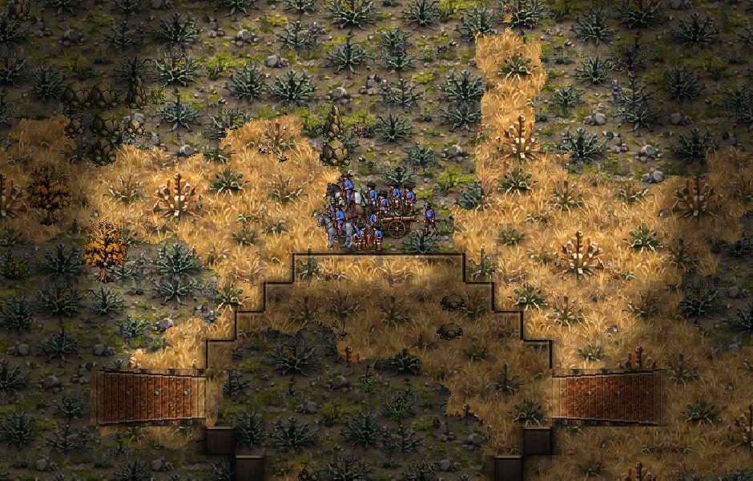
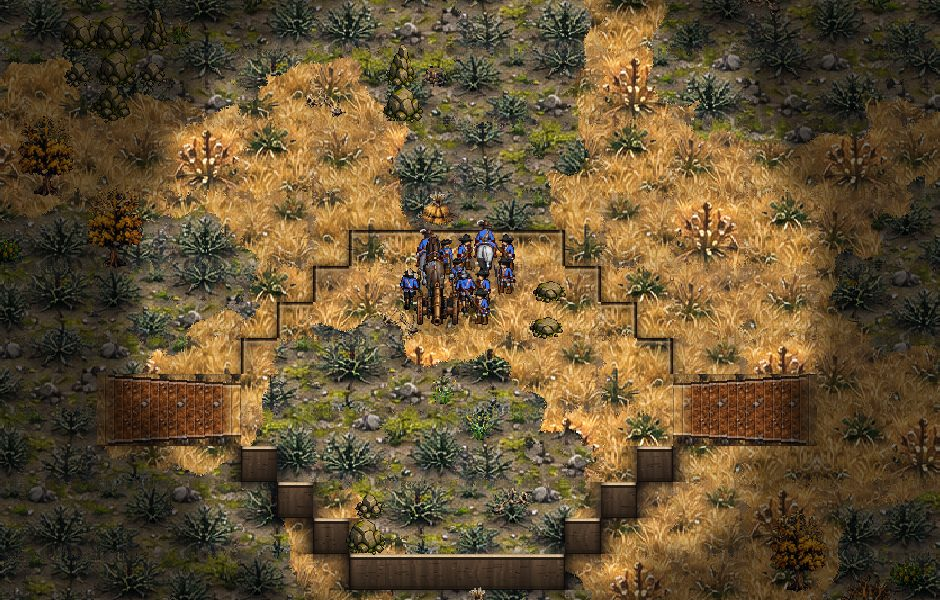
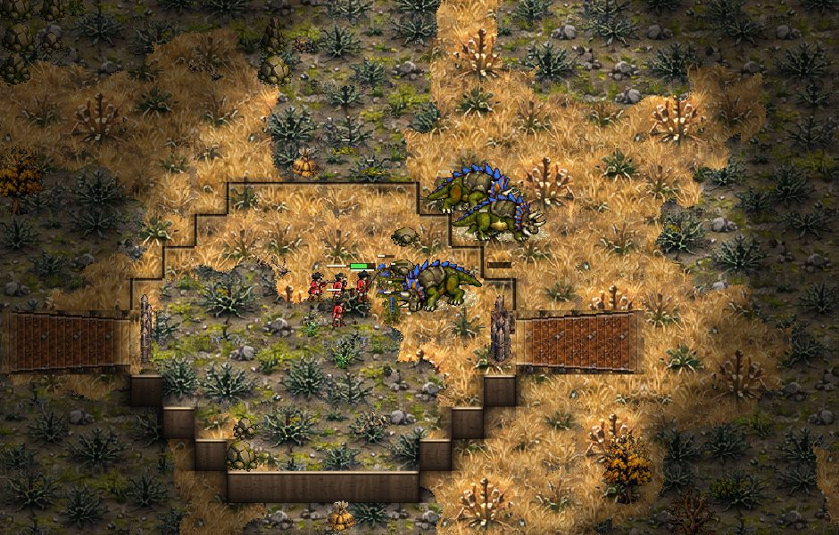
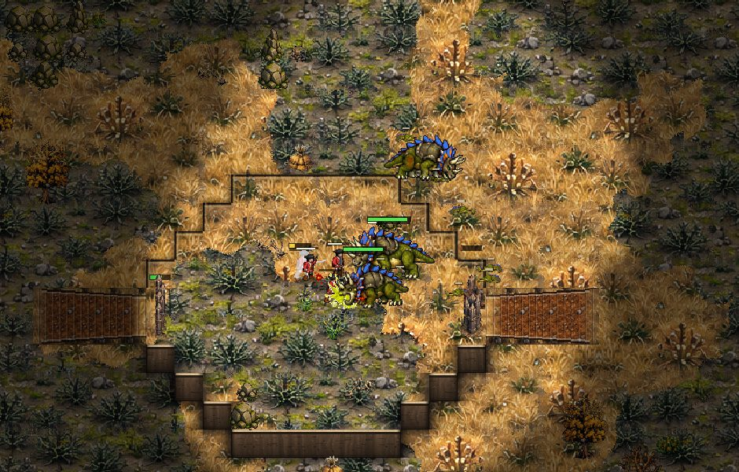

# Pathfinding audit (0.14.73)

The owner asked on 2026-10-27: "Put an agent on pathfinding. Not only for the AI but for everyone. If I do a move on the high ground the units should not bunch up at a cliff, and I am sure there are more cases like this: small corners and other problems that pathfinding always has."

This is what was measured, what was wrong, what was changed, and what is left. It is written to be read aloud.

## What you will notice in play

- Click on the edge of a plateau and your army stays on top. Before, a click on the rim often counted as the low ground under the cliff. The whole group then walked down the ramp and all the way round, to stand in a heap at the foot of the cliff.
- A line drawn with the mouse along a cliff edge puts everybody on the high ground, each man on his own spot. Before, all of them were sent to one spot, sometimes below the cliff.
- A group sent near a cliff, a wall or a building spreads out on the side you clicked. Before, every man whose place in the group fell over the edge was sent to the exact spot you clicked, and they piled up there against the cliff.
- A unit sent where it cannot go (up a cliff with no way round, into a walled base) walks to the nearest place it can reach, and stops. Before, it got there and then kept walking straight into the cliff or the wall, and pushed at it for good. In computer games this was mostly scouts: a Winder or a grub pushing at the cliff under the enemy base for two or three minutes.
- Raptors, Brutes and other melee units no longer run to the foot of a cliff under a man they cannot get at. If a wall or a gate is in the way, they go to it and break it. If nothing at all leads up there, they leave him alone and look for another fight.
- A unit that walks into a corner (a step in a cliff, the corner of a building) slips round it instead of stopping dead. Big units (Horsemen, Brutes, Pendulums, guns and wagons) plan their paths a little further from corners.

Nothing else changes: no unit is faster or slower, no balance number moved.

## How it was measured

Two new tools.

**tools/test_pathing.gd** is the test bed. It loads five real maps: Greenhold, Kestrel Rise, Frostmere, Hollowfen and Thornwood Maze (the maze has the narrow passages). On each map it finds a cliff edge, a ramp and an open field by itself. Then it gives orders the way a player does, and measures each case. There are 28 kinds of case, about 130 in all:

- groups of each faction (Crown: Musketeers, Horsemen and a gun; Brood: Raptors and Brutes; Clockwork: Clock Soldiers and Pendulums) sent from the low ground up onto the high ground, and back down;
- groups sent to a spot right beside a cliff edge, on either level, from either level;
- a click on the rim of the plateau itself, from above and from below;
- a line drawn along the rim;
- a group spread out over the high ground sent to the edge;
- an attack-move up a ramp, and an attack on a Barracks at the top of a ramp;
- guns with their horse teams, Horsemen and a Mortar up a ramp;
- groups through a one-cell gap between two Cottages, including guns, wagons and a crowd of 40;
- 40 men sent into a small spot;
- a walk round our own base, between the hall, the Cottages and the Barracks;
- a mixed army sent across the whole map;
- Brood melee sent at Musketeers on the high ground, with the ramp open, and with the ramp shut by a palisade and a gate.

For every case it records: how many got there, how long it took against the best possible time, the longest any unit stood stuck, how many ended pressed against a cliff or a building, how many ended below the cliff (near in a straight line but far to walk), how many were given the very same spot, and how much they shuffle once they stand. It prints one line per case and fails a case when someone does not arrive, someone is stuck for more than 6 seconds, or someone ends on the wrong level.

**tools/test_pathing_match.gd** watches real games. Two hard computers play for ten minutes. Every second it looks at every unit that has somewhere to go. A unit that has not moved 6 pixels in 2 seconds, while it is not fighting, counts as stuck. It reports the stuck unit-seconds per minute, the time spent stuck at a cliff, every unit stuck for 10 seconds or more, and the worst spots with their path state. With PATH_DUMP=1 it also draws the ground around a unit stuck for 10 seconds.

**tools/shot_pathing.gd** takes pictures of any case of the test bed, at the start and the end. The pictures below are from it.

## The numbers, before and after

The test bed on the five maps (each line adds up the five maps). "Same spot" is how many units were sent to a spot another unit was also sent to. "Below the cliff" is how many ended on the wrong level.

| case | arrived before | after | same spot before | after | below the cliff before | after | failed before | after |
|---|---|---|---|---|---|---|---|---|
| click on the rim, from above | 44/55 | 55/55 | 55 | 0 | 11 | 0 | 1 | 0 |
| click on the rim, from below | 44/55 | 55/55 | 55 | 0 | 11 | 0 | 1 | 0 |
| line along the rim | 30/55 | 55/55 | 55 | 0 | 11 | 0 | 5 | 0 |
| to the edge, on top | 55/55 | 55/55 | 19 | 0 | 0 | 0 | 0 | 0 |
| to the edge, on top, from below | 50/50 | 50/50 | 21 | 0 | 0 | 0 | 0 | 0 |
| spread group to the edge | 50/50 | 50/50 | 20 | 0 | 0 | 0 | 0 | 0 |
| to the foot of the cliff | 55/55 | 55/55 | 18 | 0 | 0 | 0 | 0 | 0 |
| to the foot, from above | 55/55 | 55/55 | 19 | 0 | 0 | 0 | 0 | 0 |
| guns and horses up a ramp | 34/35 | 35/35 | 0 | 0 | 0 | 0 | 1 | 0 |
| every other case (up and down, gaps, crowds, base, across) | all | all | 0 | 0 | 0 | 0 | 0 | 0 |

Melee at Musketeers on the high ground, ramp shut by a palisade and a gate (Kestrel Rise): the time Raptors and Brutes spent pressed against the cliff below the Musketeers, going nowhere, fell from 41 unit-seconds to about 15 (9 to 19 over several runs). With the ramp open it was and stays near zero.

Computer games, ten minutes each, the same six maps and factions before and after (hard against hard):

| game | stuck unit-s a minute before | after | stuck at a cliff before | after | stuck 10 s or more before | after |
|---|---|---|---|---|---|---|
| Greenhold, Crown v Brood | 6.5 | 1.6 | 0 | 2 | 1 | 0 |
| Kestrel Rise, Brood v Clockwork | 4.3 | 5.7 | 21 | 10 | 0 | 0 |
| Hollowfen, Clockwork v Crown | 16.1 | 3.0 | 106 | 1 | 2 | 0 |
| Frostmere, Crown v Clockwork | 14.0 | 4.7 | 93 | 5 | 3 | 1 |
| Thornwood Maze, Brood v Crown | 6.7 | 0.2 | 51 | 0 | 1 | 0 |
| Greenhold, Clockwork v Brood | 3.7 | 3.5 | 2 | 3 | 0 | 0 |
| all six | 8.6 | 3.1 | 273 | 21 | 7 | 1 |

Four more games after the change, on other seeds and on Amberfall Vale, had 1.6 to 3.7 stuck unit-seconds a minute, almost nothing at cliffs, and no unit stuck for 10 seconds. A game is not exactly the same twice (see "Left for later"), so single games move about; the totals are the thing to read.

## The problems, one by one

### 1. A click on the rim meant the low ground

**Cause.** The ring of cells round a plateau is the cliff, and it is solid. The rim on the north, east and west sides is drawn as the edge of the high ground, so that is where a player clicks to stand on the edge. A goal on a solid cell was moved to the nearest free cell by straight distance, and the cell below the cliff is just as near as the one on top. Whichever the search met first won. Game.find_path did this for every unit's path, and the group spots did it too.

**Evidence.** On Kestrel Rise every man of a group clicked onto the rim went to the low ground: 0 of 11 arrived, all 11 below the cliff, all 11 sent to the same spot. The picture shows them in a heap under the north cliff after walking down the ramp and round.

**Fix.** Game.nearest_free_level: a goal on a solid cell goes to the nearest free cell on that cell's own height level (a cliff cell is high ground, so the top). find_path, the group spots and the line spots use it.

### 2. The group piled onto the one spot you clicked

**Cause.** A group keeps its shape when it moves (Game.group_move). Each man's spot is the click plus his place in the group. When that spot landed on blocked ground, or the far side of a cliff, wall or building from the click, he was given the click itself. Near a cliff edge that was half the group, all on one spot, pressed against the cliff and shoving each other.

**Evidence.** In every case at a cliff edge, 3 to 6 men of 11 were sent to the identical spot, and on a rim click all 11 were.

**Fix.** Game.group_points now does the spreading for group moves, patrols and the Jack's group fire, and group_move uses it. It floods out from the click on foot (Game._walk_fill: the cells a man can walk to from the click, by how many steps). A spot that is far to walk from the click, or across a cliff edge, is moved to the free cell of that flood nearest to where the man wanted to be. Two small men may share a cell; a big one has it to himself; nobody is given a gateway. Same spot went from 3 to 6 per case to 0 in every case.

The drawn line got the same care: a spot of the line that falls on a cliff cell or a tree goes to free ground beside it on its own level, at most two men to a cell (Game._line_spot_free).

### 3. A path that cannot get there walked into the cliff

**Cause.** Godot's pathfinder is asked for a partial path. When the goal cannot be reached, it gives the path to the reachable cell nearest the goal. Game.find_path then swapped the last point of that path for the goal itself. So the unit walked to the foot of the cliff, then walked straight on at the goal above it, and pushed at the rock for good. Its order never ended. This is the "path 0/1" seen in the why.txt dumps: one point, the goal, straight up the cliff.

A second thing was hidden here. find_path had a fallback for soldiers walled out of a base: walk up to the wall, so the soldier then breaks it. It only ran when the path came back empty, and a partial path is never empty, so it never ran.

**Evidence.** In the computer games before the change, a Winder pushed at the cliff under the Crown base on Hollowfen for 160 seconds, another on Frostmere for 142 seconds, a grub on Thornwood Maze for 88 seconds, and a grub against the Crown base on Greenhold for 91 seconds. Stuck time at cliffs over six games: 273 unit-seconds. After: 21.

**Fix.** find_path keeps the goal only when the path really gets there. A path that cannot get there ends at the nearest place the unit can reach, so it arrives there and stops. When that happens to a soldier, the walk-up-to-the-wall path is tried, as it was meant to be.

### 4. Melee under a man it cannot reach

**Cause.** A melee unit picking a target on its own (Unit._pick_target) that could not walk up to him looked for an enemy wall piece in sight to break. If there was none in sight, it went for the man anyway. Its path then ran to the foot of the cliff under him. Also, a Raptor or Brute circling its prey picks its own side of him; beside a cliff edge that side could be on the low ground, below him.

**Evidence.** With the ramp shut by a palisade, Brutes stood at the foot of the cliff under the Musketeers with a one-point path for the whole test. The picture shows two of them at the top right, outside the plateau.

**Fix.** _pick_target now goes for such a man only if breaking walls and gates leads to him (Unit._siege_reaches): the path then takes the unit to the gate, and it breaks it. If nothing leads to him, it leaves him alone for two seconds and looks for another target; an attack-move walks on. The side a Raptor or Brute picks round its prey must be on his level, in a straight line from him; else it goes for him directly. The time pressed under the cliff fell from 41 to about 15 unit-seconds; what is left is units walking along the foot of the cliff on their way round to the gate, which is the way in.

### 5. Corners

**Cause.** When a step was blocked, Game.resolve_terrain tried the same step along x only, then along y only. On a corner both are blocked, so the unit stopped dead until its stuck timer asked for a new path, which led it into the same corner. Paths also kept only 7 pixels from walls, cliffs and buildings, whatever the size of the unit: right for a man, too tight for a Brute or a gun, whose straight stretches grazed corners they could not get round.

**Evidence.** Guns with their horse teams sent up a ramp: one gun stayed at the foot of the ramp, stuck, in one run of five (on Kestrel Rise in one round, on Frostmere in another).

**Fix.** resolve_terrain now also tries the step turned 35 and 63 degrees either way, a little shorter, so a unit slips round a corner. Units with a radius of 15 or more keep their paths and their straight-line chases 0.6 of their radius plus 2 pixels from solid ground (at most 14 pixels); men keep the old 7. Guns up a ramp: all arrive in every run.

## Suspicions that turned out fine

- **The approach to a building (Game.approach_point).** It picks the free cell beside the building nearest the unit. The worry was a cell at the foot of a cliff. But a cliff is a whole cell thick, so every cell beside a building is on the building's own level. Attacks on a Barracks at the top of a ramp arrive every time.
- **Straight-line checks (Game.line_clear).** They do see cliff cells (the rim is solid) and diagonal corners (samples every 10 pixels, a 14 pixel box). They were only too tight for big units, which is covered in problem 5.
- **Crossing between levels.** Every up and down case arrives every time, about as fast as the best possible path, for every faction.
- **Gaps, crowds and bases.** Through a one-cell gap between Cottages, 40 men into a small spot, round our own base, across the map: everyone arrives, nobody is stuck for more than 2.3 seconds, and the shuffling once they stand is under 2 pixels a second.

## Checks after the change

- tools/test_pathing.gd passes on all five maps (it fails on the old code: rim clicks, lines, the walled melee, guns up a ramp).
- The other tests that move units give the same results as before the change: every horse, hauler, gate, limber, stuck-gap, walk-audit, mill, mound and AI test (31 tests). test_ai_rush_followup fails 3 of its checks after and 4 before; it is about when the computer sends its men, not about paths.
- The online test (tools/test_online.sh) passes.
- tools/test_determinism.gd gives a different hash from 20 seconds on, run after run; it does the same on the old code (see below). At 20 seconds the new code's hashes match the old code's, so the change itself is deterministic: it uses no clock and no random numbers, and goes through dictionaries in a fixed order.
- Cost: the new work runs only when an order is given (the flood is a few dozen cells) or when a step is blocked. A melee unit that finds a man out of reach now remembers it for two seconds, which saves the reach checks it used to repeat three times a second.

## Left for later

- **Determinism.** A match is not the same twice on the same seed, also on the old code. One cause is that the path queue stops after 6 milliseconds a tick (Game.path_budget_us), so a slower moment gives fewer paths. tools/shot_ai_match.gd and perf_bench.gd lift the budget for repeatable runs. Lockstep online play would need this and the other causes found and fixed.
- **Crowds round one target.** Brutes behind a ring of Raptors round one Musketeer stand there, not reaching him; they could pick another target.
- **Walking along the cliff under fire.** Melee going round to a gate walks along the foot of the cliff under the shooters. That is the way in, but a path that keeps away from the cliff when there is room would cost them less.
- **Scouts and partial paths.** A computer scout sent into a walled base now stops at the wall. The scout code (AIScout) could choose a place it can reach in the first place.
