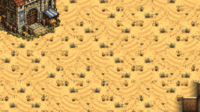
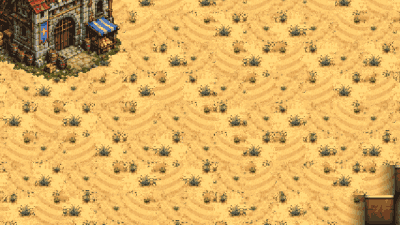

# Raptor and Spitter against the Musketeer line (a study)

The owner asked on 2026-10-28: "Raptors die hard to Musketeers, that is OK, because they should be supported by Spitters: I think Raptor + Spitter destroys Musketeers. Musketeers need cannon to deal with Spitter + Raptor, but I'm not sure. Remember the Raptor only uses biomass, and the Musketeer uses a secondary resource."

This is a study. No game number was changed. Version 0.15.16.

## The short answer

- At equal cost, on open ground, Raptors alone beat a Musketeer line. The Crown won 2 fights of 24.
- Adding Spitters does not make the wave stronger. It makes it weaker. Raptor + Spitter wins less often than Raptors alone, at every size and every mix.
- So the first guess is half right: the Brood beats Musketeers in the open, but the Raptors do it, not the Spitters.
- The second guess is right, and strongly. One Field Cannon in the line wins almost every open fight for the Crown, against Raptors alone and against every mix. It trades 3 to 10 times better than the Brood.
- At the Crown's own ramp, behind its Cottage wall and gate, the Musketeers win every fight even without a cannon. The Raptors do break the Gate in about 10 seconds, but then come through it a few at a time.
- Counting powder as worth more than gold makes the Crown's side look worse, never better.

## The setup

The tool is tools/study_raptor_spitter.gd. tools/study_raptor_spitter.sh runs whole groups, and tools/study/raptor_spitter_table.py makes the tables. The raw results are in docs/raptor_spitter/, one line of JSON per fight.

- The open field is the flattest, clearest stretch nearest the middle of Dune Sea: 34 tiles long and 19 wide, one level, no ramp.
- The Crown stands in two ranks, 24 pixels apart, on HOLD, as a player would leave a line. Guns stand 75 pixels behind the line, unlimbered before the fight.
- The Brood starts 15 tiles away and attack-moves onto the line. Raptors are in front and Spitters 110 pixels or more behind them. Idle creatures are sent on again, as a player keeps his wave at it.
- Each fight runs on 8 seeds (6 for the scan), with every unit's spot jittered. A fight ends when one side is gone, or after 3 minutes.
- The ramp variant is Greenhold. The Crown's computer plans its own Cottage wall at its main ramp (a Cottage, a Gate and a Palisade piece), and the study builds it. The Musketeers stand 3 tiles behind it on the high ground. The Brood comes from the ramp's foot and attack-moves to the Town Hall. Nobody repairs the wall.

### The research

The Crown has a mid-game kit: the Matchlock and the Socket Bayonet. The Crown computer researches both once it has 3 or 4 Musketeers. A "late" variant adds Armour (Guardsmen), the Flintlock and the Shot Pouch. Guns get no drills (no Prepared Charges, no Quadrant). The Brood has no research for these units.

### The prices

- A Raptor egg is 75 biomass for 3 Raptors: 25 each, 1 supply each.
- A Spitter egg is 90 biomass and 5 essence for 2 Spitters: 45 and 2.5 each, 1 supply each.
- A Musketeer is 60 gold and 10 powder, plus his kit's refit fees. The mid kit adds 11 gold: 71 gold and 10 powder. The late kit is 87 gold and 14 powder.
- A Field Cannon is 170 gold, plus its horse at 40: 210 gold, 4 supply, no powder.
- A Mortar is 145 gold and 20 powder, plus its horse: 185 gold and 20 powder, 3 supply.
- The research itself is not counted. It is paid once for the whole army.

### Equal cost, and what powder is worth

Armies are matched at face value: gold plus powder, biomass plus essence. The sizes are about 600, 1,200 and 2,000 a side. Raptor mixes are counted in whole eggs, so a Brood army is within about 5% of the Crown's.

Powder is scarcer than gold. A full Crown base makes about 1,140 gold and 120 powder a minute (Defs), so a powder can be worth 9.5 gold. The tables show three values for a powder (and for an essence): K = 1 (face value), K = 3, and K = 9.5 (the income ratio). The trade is what the Brood lost divided by what the Crown lost. Above 1, the Crown traded better.

## The results

The main fights, at 1,200 a side, 8 seeds each. "Crown wins" counts fights.

| Fight | Crown | Brood | Supply, Crown / Brood | Crown wins | Seconds | Trade at K=1 / 3 / 9.5 |
|---|---|---|---|---|---|---|
| A. Raptors only | 15 Musketeers | 48 Raptors | 15 / 48 | 2 of 8 | 11 | 0.67 / 0.54 / 0.33 |
| B. 3:1 by cost | 15 Musketeers | 36 Raptors, 6 Spitters | 15 / 42 | 4 of 8 | 27 | 1.20 / 0.98 / 0.64 |
| B. 2:1 | 15 Musketeers | 33 Raptors, 8 Spitters | 15 / 41 | 5 of 8 | 30 | 1.34 / 1.11 / 0.74 |
| B. 1:1 | 15 Musketeers | 24 Raptors, 12 Spitters | 15 / 36 | 4 of 8 | 37 | 1.20 / 1.01 / 0.70 |
| C. 1 cannon, against 3:1 | 12 Musketeers, 1 cannon | 36 Raptors, 6 Spitters | 16 / 42 | 7 of 8 | 14 | 2.66 / 2.21 / 1.48 |
| C. 1 cannon, against 1:1 | 12 Musketeers, 1 cannon | 24 Raptors, 12 Spitters | 16 / 36 | 8 of 8 | 17 | 3.61 / 3.04 / 2.15 |
| C. 2 cannons, against 3:1 | 10 Musketeers, 2 cannons | 36 Raptors, 6 Spitters | 18 / 42 | 8 of 8 | 12 | 9.75 / 8.02 / 5.27 |
| C. 2 cannons, against 1:1 | 10 Musketeers, 2 cannons | 24 Raptors, 12 Spitters | 18 / 36 | 8 of 8 | 15 | 4.44 / 3.75 / 2.64 |
| D. 1 cannon, against Raptors | 12 Musketeers, 1 cannon | 48 Raptors | 16 / 48 | 8 of 8 | 11 | 2.96 / 2.38 / 1.45 |
| Ramp, Raptors only (the Gate falls) | 15 Musketeers behind the wall | 48 Raptors | 15 / 48 | 8 of 8 | 15 | 2.96 / 2.38 / 1.45 |
| Ramp, 2:1 (the Gate falls) | 15 Musketeers behind the wall | 33 Raptors, 8 Spitters | 15 / 41 | 8 of 8 | 18 | 17.0 / 14.1 / 9.5 |
| Ramp, 1 cannon, 2:1 | 12 Musketeers, 1 cannon | 33 Raptors, 8 Spitters | 16 / 41 | 8 of 8 | 21 | 119 / 99 / 66 |

By size, open ground, Crown wins out of 8:

| Size | A. Raptors only | B. 3:1 | B. 2:1 | B. 1:1 | C. 1 cannon (3:1 / 1:1) | C. 2 cannons (3:1 / 1:1) | D. 1 cannon v Raptors |
|---|---|---|---|---|---|---|---|
| 600 | 0 | 4 | 8 | 4 | 8 / 8 | not run | 8 |
| 1,200 | 2 | 4 | 5 | 4 | 7 / 8 | 8 / 8 | 8 |
| 2,000 | 0 | 1 | 1 | 3 | 8 / 8 | 8 / 8 | 7 |

At 2,000, Raptors alone kill 25 Musketeers and keep 47% of their army. The 3:1 and 2:1 mixes also win, but keep only 12 to 17%.

The full table, with every resource lost and kept, is at the end.

### Where the line breaks even (the scan)

The 1,200 Brood mixes against 8 to 23 Musketeers, 6 seeds each. Crown wins out of 6:

| Musketeers (face cost) | 8 (648) | 11 (891) | 14 (1,134) | 17 (1,377) | 20 (1,620) | 23 (1,863) |
|---|---|---|---|---|---|---|
| 48 Raptors | 0 | 0 | 0 | 4 | 6 | 6 |
| 36 Raptors, 6 Spitters | 0 | 0 | 0 | 6 | 6 | 6 |
| 24 Raptors, 12 Spitters | 0 | 0 | 0 | 6 | 6 | 6 |

The line breaks even at about 15 or 16 Musketeers against any of the three. That is about 1,150 to 1,300 at face value. The switch is sharp: 14 Musketeers lose every time, 17 win almost every time. Past that point, the more Spitters the Brood has, the worse it trades. At 17 Musketeers the trade is 1.0 against Raptors alone, 2.0 against 3:1 and 2.9 against 1:1.

Counted in supply, the Brood needs 3 times the supply for the same fight: 48 Raptors against 15 or 16 Musketeers.

### The variants (1,200 a side)

| Variant | Crown wins (3:1 mix / 1:1 mix) | What it shows |
|---|---|---|
| Spitters leading, Raptors sent in when the Spitters start shooting | 8 / 7 of 8 | Worse for the Brood than Raptors first |
| Spread out (34 px apart instead of 18) | 8 / 7 of 8 | Worse for the Brood: the Raptors arrive a few at a time |
| A Mortar instead of a cannon | 2 / 4 of 8 | The Mortar does not help (minimum range 5 tiles, slow shells) |
| Late kit (12 Guardsmen, Flintlock, Pouch) | 5 / 8 of 8 | Better than the mid kit at the same cost |
| Late kit with 1 cannon | 8 / 8 of 8 | The cannon still decides it |
| Late kit against 48 Raptors | 5 of 8 | Armour helps a lot against Raptor bites |

## What it shows about the owner's two guesses

### Does Raptor + Spitter beat Musketeers at equal cost?

Yes in the open, but only just, and only at 2,000. At 600 and 1,200 it is a coin toss. Raptors alone do better in every case. The Spitters make the wave weaker, for four reasons the fights show:

- A Spitter reaches 150 pixels. A Musketeer reaches 190. The Spitter walks into the line's fire before it can shoot back.
- For the same price, Raptors do much more damage. 100 biomass buys 4 Raptors, about 27 damage a second. It buys about 2 Spitters, about 16 a second with the acid burn.
- Raptors run at 108 and Spitters at 68. The Raptors reach the line first and fight it alone. The Spitters arrive to finish a fight that is already won or lost.
- The acid strips 2 armour. A Musketeer has none. It only matters against Guardsmen, and even there it did not swing the fights.

### Does a cannon swing it back?

Yes, completely. One Field Cannon, about a sixth of the army's price, turns 2 to 5 Crown wins of 8 into 7 or 8 of 8. Two cannons trade 4 to 10 times better than the Brood. The round shot ploughs through the packed Raptors before they reach the line. In the GIF of fight C below, the wave is half gone before it touches the line.

### The best Brood ratio

Against a plain Musketeer line, the best mix is no Spitters at all: Raptors only. Of the mixes, 3:1 and 2:1 are close and better than 1:1 at the larger sizes. Against a line with a cannon, nothing in this study wins.

## What the resource difference changes

- A Raptor costs only biomass. A Musketeer's 10 powder is 12% of his face price. If powder is worth 3 gold, it is 30% of it. At the income ratio (9.5), it is more than half.
- So every trade gets worse for the Crown as powder gets dearer. Raptors alone go from 0.67 to 0.33. A 2:1 wave goes from 1.34 to 0.74.
- Spitters cost 5 essence an egg, which hardly changes anything.
- The Field Cannon costs no powder to buy (it uses powder to refill shots). So the cannon is also the Crown's cheap answer in powder: the C fights stay above 1.4 even at K = 9.5.
- Supply runs the other way. The Brood pays 3 supply for every Musketeer's 1. Near the supply cap, the Crown can field 3 times the army, and the scan shows 17 or more Musketeers win every time.

## Balance points for the owner to decide

Nothing was changed. These are the points the numbers raise.

1. The Spitter is not a support for the Raptor against Musketeers. It is outranged (150 against 190), slow, and does less damage for its cost. If Raptor + Spitter should beat a line, the Spitter needs a reason: more range than a musket, a cheaper egg, or an acid splash that hurts a packed line.
2. Raptors alone beat Musketeers in the open at equal cost. This is the opposite of "Raptors die hard to Musketeers". In real games the Raptors probably die hard because they meet walls, cannons or high ground, as in the ramp fights. Or they arrive in small groups.
3. The Field Cannon is a hard counter to every wave here. Design principle 1 asks for few, clear hard counters. A cannon needs a Foundry, a horse and spotters, and it is slow. That may be fair, but the Brood has no answer in these fights except not to attack a line with guns.
4. The Mortar is useless against a wave. That fits a siege piece.
5. The ramp wall gives a large defender's advantage: the Crown trades 3 to 17 times better behind it, without repairs. Design principle 2 says this advantage should fade by mid-game. At 1,200 a side, it does not, even though the Raptors break the Gate in about 10 seconds: the broken Gate is still a one-tile choke.
6. Supply: Raptors at 1 supply each mean a Brood army of the same price uses 3 times the supply. At the cap, the Crown wins.

## The new Brood

The new Brood's Raptor and Spitter are the same units (Defs.UNITS "raptor" and "spitter"). The E fights ran Raptors only for a new-Brood side, and gave exactly the A results: 0, 2 and 0 Crown wins of 8. The swamp would make them faster and heal them, but these fights are on open ground.

The new Brood cannot make Spitters yet. They wait for their father, the Spitter father (NB "later"; the Dilophosaurus art is in, the creature is not). Its Raptors also need the Tyrannosaur near the Mother to be fertilised. So today the new Brood's only answer to a Musketeer line is the Raptor flood. On the numbers above, that is its best answer anyway.

## Limits of the study

- Nobody micro-manages. The line stands on HOLD, the Brood attack-moves in one blob. A player would surround the line, pull hurt units, or fire the cannon at the blob's front.
- No Crown cavalry, no wagons, no healing, no veterancy carried between fights.
- Musketeers start with their 10 shots and cannot refill in the open field (no building or wagon near). The late kit's Pouch men start with 20.
- The fights are short (10 to 40 seconds), so one volley more or less matters. Results near the break-even point swing from seed to seed. A filmed rerun can differ from the headless one.
- In the ramp fights, the Raptors (alone, 3:1 and 2:1) broke the Gate in every fight, in about 10 seconds (300 health, armour 2; a bite still does 4). They then poured through and killed up to 9 of the 15 Musketeers, but lost everything. With a cannon, or with half the wave in Spitters, the Gate held. Nobody repaired it: with Labourers on it, it would hold longer.
- One map for the open field, one for the ramp.

## Pictures

docs/shots/raptor_spitter/:

- B_1200_21.gif: 15 Musketeers against 33 Raptors and 8 Spitters. The Raptors break the line, the Spitters finish it. The Brood wins with 4 Spitters left.
- C_1200_g1_31.gif: 12 Musketeers and a cannon against 36 Raptors and 6 Spitters. The round shot thins the wave on the way in. The Crown wins with 9 Musketeers and the gun.
- B_raptors_hit_line.jpg, B_spitters_finish.jpg, B_end.jpg: stills of the first fight.
- C_cannon_opens.jpg, C_line_holds.jpg, C_end.jpg: stills of the second.

## How to run it

    godot --headless --import
    tools/study_raptor_spitter.sh /tmp/rs 8 A B C D E V R
    tools/study_raptor_spitter.sh /tmp/rs 6 S
    python3 tools/study/raptor_spitter_table.py /tmp/rs/*.jsonl

One fight on film (a frame every half second):

    xvfb-run -a godot --rendering-driver opengl3 --resolution 1280x720 --fixed-fps 30 --script res://tools/study_raptor_spitter.gd -- only:C_1200_g1_31 seeds:1 film:/tmp/film

A long run of the S group once stopped after 86 fights (one empty result, then no progress). The last configs were run one by one. Each group runs in a fresh process in the shell script, so the others did not meet it.

## The full table

Values are averages over the seeds. "Crown left" and "Brood left" are what the survivors are worth, scaled by their health. Lost is gold / powder for the Crown, biomass / essence for the Brood.

| fight | Crown army | Brood army | supply C/B | Crown wins | time s | Crown lost (gold/powder) | Brood lost (bio/ess) | Crown left | Brood left | trade K=1 | K=3 | K=9.5 |
|---|---|---|---|---|---|---|---|---|---|---|---|---|
| A_600 | 7 musk (mid kit) = 497+70 | 24R + 0S = 600+0 | 7/24 | 0 of 8 | 11 | 497/70 | 388/0.0 | 0 | 160 | 0.68 | 0.55 | 0.33 |
| A_1200 | 15 musk (mid kit) = 1065+150 | 48R + 0S = 1200+0 | 15/48 | 2 of 8 | 11 | 1003/141 | 766/0.0 | 41 | 350 | 0.67 | 0.54 | 0.33 |
| A_2000 | 25 musk (mid kit) = 1775+250 | 81R + 0S = 2025+0 | 25/81 | 0 of 8 | 10 | 1775/250 | 909/0.0 | 0 | 958 | 0.45 | 0.36 | 0.22 |
| B_600_31 | 7 musk (mid kit) = 497+70 | 18R + 4S = 630+10 | 7/22 | 4 of 8 | 21 | 382/54 | 557/5.9 | 95 | 54 | 1.29 | 1.06 | 0.69 |
| B_600_21 | 7 musk (mid kit) = 497+70 | 15R + 4S = 555+10 | 7/19 | 8 of 8 | 19 | 240/34 | 555/10.0 | 223 | 0 | 2.07 | 1.72 | 1.16 |
| B_600_11 | 7 musk (mid kit) = 497+70 | 12R + 6S = 570+15 | 7/18 | 4 of 8 | 26 | 355/50 | 514/11.9 | 135 | 37 | 1.30 | 1.09 | 0.75 |
| B_1200_31 | 15 musk (mid kit) = 1065+150 | 36R + 6S = 1170+15 | 15/42 | 4 of 8 | 27 | 825/116 | 1119/12.2 | 189 | 22 | 1.20 | 0.98 | 0.64 |
| B_1200_21 | 15 musk (mid kit) = 1065+150 | 33R + 8S = 1185+20 | 15/41 | 5 of 8 | 30 | 754/106 | 1134/17.2 | 265 | 29 | 1.34 | 1.11 | 0.74 |
| B_1200_11 | 15 musk (mid kit) = 1065+150 | 24R + 12S = 1140+30 | 15/36 | 4 of 8 | 37 | 808/114 | 1078/26.6 | 261 | 36 | 1.20 | 1.01 | 0.70 |
| B_2000_31 | 25 musk (mid kit) = 1775+250 | 60R + 10S = 1950+25 | 25/70 | 1 of 8 | 37 | 1704/240 | 1648/10.6 | 67 | 244 | 0.85 | 0.69 | 0.44 |
| B_2000_21 | 25 musk (mid kit) = 1775+250 | 54R + 14S = 1980+35 | 25/68 | 1 of 8 | 30 | 1686/238 | 1603/14.1 | 82 | 336 | 0.84 | 0.69 | 0.44 |
| B_2000_11 | 25 musk (mid kit) = 1775+250 | 39R + 22S = 1965+55 | 25/61 | 3 of 8 | 37 | 1518/214 | 1796/45.6 | 259 | 135 | 1.06 | 0.90 | 0.63 |
| C_600_g1_31 | 5 musk + 1 cannon (mid kit) = 565+50 | 18R + 4S = 630+10 | 9/22 | 8 of 8 | 14 | 124/18 | 630/10.0 | 405 | 0 | 4.51 | 3.73 | 2.50 |
| C_600_g1_11 | 5 musk + 1 cannon (mid kit) = 565+50 | 12R + 6S = 570+15 | 9/18 | 8 of 8 | 20 | 195/28 | 570/15.0 | 282 | 0 | 2.63 | 2.21 | 1.56 |
| C_1200_g1_31 | 12 musk + 1 cannon (mid kit) = 1062+120 | 36R + 6S = 1170+15 | 16/42 | 7 of 8 | 14 | 381/50 | 1135/13.8 | 667 | 22 | 2.66 | 2.21 | 1.48 |
| C_1200_g1_11 | 12 musk + 1 cannon (mid kit) = 1062+120 | 24R + 12S = 1140+30 | 16/36 | 8 of 8 | 17 | 284/40 | 1140/30.0 | 737 | 0 | 3.61 | 3.04 | 2.15 |
| C_1200_g2_31 | 10 musk + 2 cannon (mid kit) = 1130+100 | 36R + 6S = 1170+15 | 18/42 | 8 of 8 | 12 | 106/15 | 1170/15.0 | 989 | 0 | 9.75 | 8.02 | 5.27 |
| C_1200_g2_11 | 10 musk + 2 cannon (mid kit) = 1130+100 | 24R + 12S = 1140+30 | 18/36 | 8 of 8 | 15 | 231/32 | 1140/30.0 | 893 | 0 | 4.44 | 3.75 | 2.64 |
| C_2000_g1_31 | 22 musk + 1 cannon (mid kit) = 1772+220 | 60R + 10S = 1950+25 | 26/70 | 8 of 8 | 13 | 497/70 | 1950/25.0 | 1230 | 0 | 3.48 | 2.86 | 1.88 |
| C_2000_g1_11 | 22 musk + 1 cannon (mid kit) = 1772+220 | 39R + 22S = 1965+55 | 26/61 | 8 of 8 | 16 | 506/71 | 1965/55.0 | 1312 | 0 | 3.50 | 2.96 | 2.10 |
| C_2000_g2_31 | 20 musk + 2 cannon (mid kit) = 1840+200 | 60R + 10S = 1950+25 | 28/70 | 8 of 8 | 12 | 302/42 | 1950/25.0 | 1567 | 0 | 5.74 | 4.72 | 3.10 |
| C_2000_g2_11 | 20 musk + 2 cannon (mid kit) = 1840+200 | 39R + 22S = 1965+55 | 28/61 | 8 of 8 | 14 | 328/46 | 1965/55.0 | 1555 | 0 | 5.39 | 4.56 | 3.24 |
| D_600_g1 | 5 musk + 1 cannon (mid kit) = 565+50 | 24R + 0S = 600+0 | 9/24 | 8 of 8 | 8 | 71/10 | 600/0.0 | 429 | 0 | 7.41 | 5.94 | 3.61 |
| D_1200_g1 | 12 musk + 1 cannon (mid kit) = 1062+120 | 48R + 0S = 1200+0 | 16/48 | 8 of 8 | 11 | 355/50 | 1200/0.0 | 627 | 0 | 2.96 | 2.38 | 1.45 |
| D_2000_g1 | 22 musk + 1 cannon (mid kit) = 1772+220 | 81R + 0S = 2025+0 | 26/81 | 7 of 8 | 12 | 993/132 | 1972/0.0 | 694 | 34 | 1.75 | 1.42 | 0.88 |
| E_600 | 7 musk (mid kit) = 497+70 | 24R + 0S = 600+0 | 7/24 | 0 of 8 | 11 | 497/70 | 388/0.0 | 0 | 160 | 0.68 | 0.55 | 0.33 |
| E_1200 | 15 musk (mid kit) = 1065+150 | 48R + 0S = 1200+0 | 15/48 | 2 of 8 | 11 | 1003/141 | 766/0.0 | 41 | 350 | 0.67 | 0.54 | 0.33 |
| E_2000 | 25 musk (mid kit) = 1775+250 | 81R + 0S = 2025+0 | 25/81 | 0 of 8 | 10 | 1775/250 | 909/0.0 | 0 | 958 | 0.45 | 0.36 | 0.22 |
| V_lead_31 (form lead, gap 18) | 15 musk (mid kit) = 1065+150 | 36R + 6S = 1170+15 | 15/42 | 8 of 8 | 16 | 470/66 | 1170/15.0 | 510 | 0 | 2.21 | 1.82 | 1.19 |
| V_spread_31 (form front, gap 34) | 15 musk (mid kit) = 1065+150 | 36R + 6S = 1170+15 | 15/42 | 8 of 8 | 17 | 444/62 | 1170/15.0 | 619 | 0 | 2.34 | 1.92 | 1.27 |
| V_mortar_31 | 12 musk + 1 mortar (mid kit) = 1037+140 | 36R + 6S = 1170+15 | 15/42 | 2 of 8 | 15 | 929/126 | 808/3.8 | 79 | 267 | 0.77 | 0.63 | 0.40 |
| V_late_31 | 12 musk (late kit) = 1044+168 | 36R + 6S = 1170+15 | 12/42 | 5 of 8 | 28 | 870/140 | 1108/11.6 | 136 | 42 | 1.11 | 0.89 | 0.55 |
| V_latecan_31 | 10 musk + 1 cannon (late kit) = 1080+140 | 36R + 6S = 1170+15 | 14/42 | 8 of 8 | 15 | 228/37 | 1170/15.0 | 828 | 0 | 4.47 | 3.59 | 2.27 |
| V_lead_11 (form lead, gap 18) | 15 musk (mid kit) = 1065+150 | 24R + 12S = 1140+30 | 15/36 | 7 of 8 | 22 | 586/82 | 1134/29.7 | 384 | 1 | 1.74 | 1.47 | 1.03 |
| V_spread_11 (form front, gap 34) | 15 musk (mid kit) = 1065+150 | 24R + 12S = 1140+30 | 15/36 | 7 of 8 | 23 | 506/71 | 1123/29.1 | 572 | 7 | 2.00 | 1.68 | 1.18 |
| V_mortar_11 | 12 musk + 1 mortar (mid kit) = 1037+140 | 24R + 12S = 1140+30 | 15/36 | 4 of 8 | 26 | 767/105 | 1028/23.8 | 231 | 40 | 1.21 | 1.02 | 0.71 |
| V_late_11 | 12 musk (late kit) = 1044+168 | 24R + 12S = 1140+30 | 12/36 | 8 of 8 | 26 | 576/93 | 1140/30.0 | 413 | 0 | 1.75 | 1.44 | 0.98 |
| V_latecan_11 | 10 musk + 1 cannon (late kit) = 1080+140 | 24R + 12S = 1140+30 | 14/36 | 8 of 8 | 17 | 261/42 | 1140/30.0 | 790 | 0 | 3.86 | 3.18 | 2.16 |
| V_late_raptors | 12 musk (late kit) = 1044+168 | 48R + 0S = 1200+0 | 12/48 | 5 of 8 | 16 | 870/140 | 1075/0.0 | 107 | 91 | 1.06 | 0.83 | 0.49 |
| R_raptors | 15 musk (mid kit) = 1065+150 | 48R + 0S = 1200+0 | 15/48 | 8 of 8 | 15 | 355/50 | 1200/0.0 | 693 | 0 | 2.96 | 2.38 | 1.45 | (wall pieces lost 1.0)
| R_31 | 15 musk (mid kit) = 1065+150 | 36R + 6S = 1170+15 | 15/42 | 8 of 8 | 17 | 98/14 | 1170/15.0 | 999 | 0 | 10.64 | 8.75 | 5.75 | (wall pieces lost 1.0)
| R_g1_31 | 12 musk + 1 cannon (mid kit) = 1062+120 | 36R + 6S = 1170+15 | 16/42 | 8 of 8 | 19 | 0/0 | 1170/15.0 | 1136 | 0 | inf | inf | inf | (wall pieces lost 0.0)
| R_21 | 15 musk (mid kit) = 1065+150 | 33R + 8S = 1185+20 | 15/41 | 8 of 8 | 18 | 62/9 | 1185/20.0 | 1040 | 0 | 17.00 | 14.09 | 9.47 | (wall pieces lost 1.0)
| R_g1_21 | 12 musk + 1 cannon (mid kit) = 1062+120 | 33R + 8S = 1185+20 | 16/41 | 8 of 8 | 21 | 9/1 | 1185/20.0 | 1095 | 0 | 119.01 | 98.61 | 66.27 | (wall pieces lost 0.0)
| R_11 | 15 musk (mid kit) = 1065+150 | 24R + 12S = 1140+30 | 15/36 | 8 of 8 | 23 | 80/11 | 1140/30.0 | 1030 | 0 | 12.84 | 10.83 | 7.63 | (wall pieces lost 0.0)
| R_g1_11 | 12 musk + 1 cannon (mid kit) = 1062+120 | 24R + 12S = 1140+30 | 16/36 | 8 of 8 | 21 | 124/18 | 1140/30.0 | 936 | 0 | 8.25 | 6.96 | 4.91 | (wall pieces lost 0.0)
| S_991_m8 | 8 musk (mid kit) = 568+80 | 48R + 0S = 1200+0 | 8/48 | 0 of 6 | 6 | 568/80 | 179/0.0 | 0 | 962 | 0.28 | 0.22 | 0.13 |
| S_991_m11 | 11 musk (mid kit) = 781+110 | 48R + 0S = 1200+0 | 11/48 | 0 of 6 | 8 | 781/110 | 317/0.0 | 0 | 800 | 0.36 | 0.29 | 0.17 |
| S_991_m14 | 14 musk (mid kit) = 994+140 | 48R + 0S = 1200+0 | 14/48 | 0 of 6 | 10 | 994/140 | 592/0.0 | 0 | 489 | 0.52 | 0.42 | 0.25 |
| S_991_m17 | 17 musk (mid kit) = 1207+170 | 48R + 0S = 1200+0 | 17/48 | 4 of 6 | 13 | 911/128 | 1071/0.0 | 222 | 89 | 1.03 | 0.83 | 0.50 |
| S_991_m20 | 20 musk (mid kit) = 1420+200 | 48R + 0S = 1200+0 | 20/48 | 6 of 6 | 12 | 674/95 | 1200/0.0 | 684 | 0 | 1.56 | 1.25 | 0.76 |
| S_991_m23 | 23 musk (mid kit) = 1633+230 | 48R + 0S = 1200+0 | 23/48 | 6 of 6 | 10 | 509/72 | 1200/0.0 | 1129 | 0 | 2.07 | 1.66 | 1.01 |
| S_31_m8 | 8 musk (mid kit) = 568+80 | 36R + 6S = 1170+15 | 8/42 | 0 of 6 | 8 | 568/80 | 225/0.0 | 0 | 893 | 0.35 | 0.28 | 0.17 |
| S_31_m11 | 11 musk (mid kit) = 781+110 | 36R + 6S = 1170+15 | 11/42 | 0 of 6 | 10 | 781/110 | 588/0.0 | 0 | 524 | 0.66 | 0.53 | 0.32 |
| S_31_m14 | 14 musk (mid kit) = 994+140 | 36R + 6S = 1170+15 | 14/42 | 0 of 6 | 32 | 994/140 | 998/5.4 | 0 | 119 | 0.88 | 0.72 | 0.45 |
| S_31_m17 | 17 musk (mid kit) = 1207+170 | 36R + 6S = 1170+15 | 17/42 | 6 of 6 | 16 | 521/73 | 1170/15.0 | 661 | 0 | 1.99 | 1.64 | 1.08 |
| S_31_m20 | 20 musk (mid kit) = 1420+200 | 36R + 6S = 1170+15 | 20/42 | 6 of 6 | 12 | 390/55 | 1170/15.0 | 1039 | 0 | 2.66 | 2.19 | 1.44 |
| S_31_m23 | 23 musk (mid kit) = 1633+230 | 36R + 6S = 1170+15 | 23/42 | 6 of 6 | 11 | 355/50 | 1170/15.0 | 1336 | 0 | 2.93 | 2.41 | 1.58 |
| S_11_m8 | 8 musk (mid kit) = 568+80 | 24R + 12S = 1140+30 | 8/36 | 0 of 6 | 9 | 568/80 | 329/0.0 | 0 | 763 | 0.51 | 0.41 | 0.25 |
| S_11_m11 | 11 musk (mid kit) = 781+110 | 24R + 12S = 1140+30 | 11/36 | 0 of 6 | 20 | 781/110 | 750/8.3 | 0 | 374 | 0.85 | 0.70 | 0.45 |
| S_11_m14 | 14 musk (mid kit) = 994+140 | 24R + 12S = 1140+30 | 14/36 | 0 of 6 | 45 | 994/140 | 1005/22.5 | 0 | 80 | 0.91 | 0.76 | 0.52 |
| S_11_m17 | 17 musk (mid kit) = 1207+170 | 24R + 12S = 1140+30 | 17/36 | 6 of 6 | 16 | 355/50 | 1140/30.0 | 880 | 0 | 2.89 | 2.44 | 1.72 |
| S_11_m20 | 20 musk (mid kit) = 1420+200 | 24R + 12S = 1140+30 | 20/36 | 6 of 6 | 14 | 284/40 | 1140/30.0 | 1193 | 0 | 3.61 | 3.04 | 2.15 |
| S_11_m23 | 23 musk (mid kit) = 1633+230 | 24R + 12S = 1140+30 | 23/36 | 6 of 6 | 12 | 225/32 | 1140/30.0 | 1506 | 0 | 4.56 | 3.85 | 2.71 |

In the ramp rows, "wall pieces lost" is how many of the Cottage, Gate and Palisade fell (1.0: the Gate fell every time).
