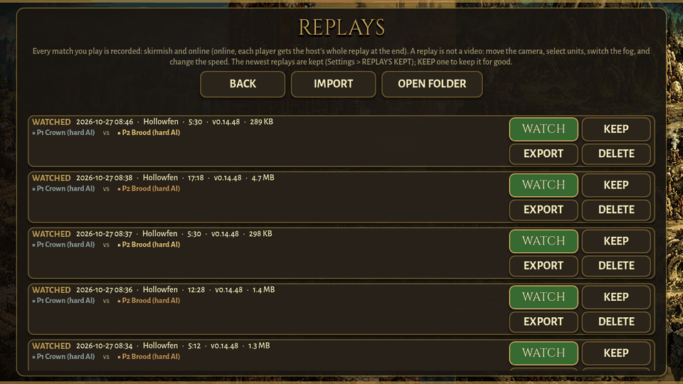
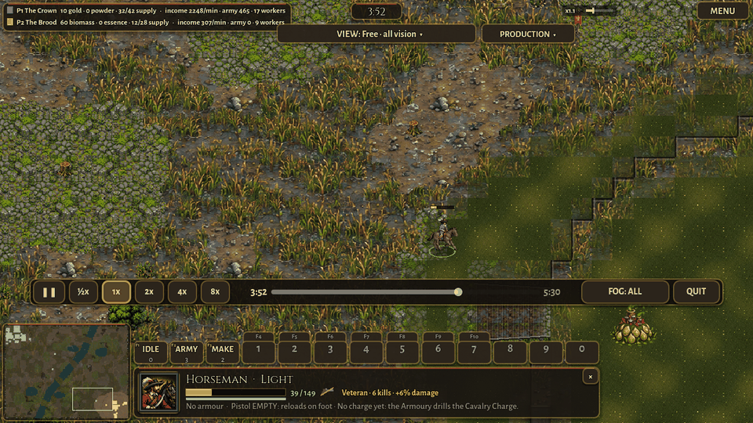
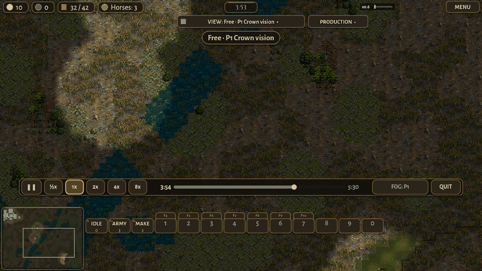
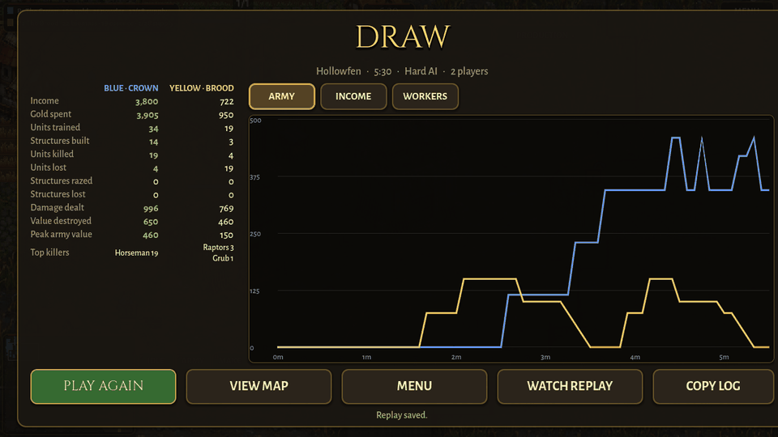

# Replays

Version 0.14.51. Every match is recorded, and the REPLAYS button on the main menu plays them back. (The branch had moved EDITOR into SETTINGS to make room; on merging, the owner chose to keep EDITOR on the main menu and put its buttons in two rows: ONLINE, SKIRMISH, REPLAYS on top; HOW TO PLAY, EDITOR, MATCH LOGS, SETTINGS below.)

## How it works

A replay is a record of what was on the map, a few times a second, and the game draws it again when you watch. It is not a video: when you watch you move the camera anywhere, select any unit or building, look through any player's fog, and change the speed.

The machine that runs the match records it. In a skirmish that is your own game. Online it is the host's game, which runs the real match for everyone. Five times a second it takes a picture of the whole match: every unit and building of every side, where it stands, its health, what it is doing, and its orders. It uses the same pictures the online mode already sends to a friend's game (scripts/net/net_snapshot.gd), except that nothing is left out for the fog. Every ten seconds the picture is whole (a keyframe); in between, only what changed is kept. The effects (shots, explosions, smoke), the chat, every player's resources and income, who is out and who won, and the camera of each human player go in as well.

Watching uses the online friend's mode too (scripts/net/net_puppet.gd): the game builds the same map from the same setup, but simulates nothing. Each unit is drawn and animated from the pictures, and it glides between two pictures, so five a second look smooth.

Why not StarCraft 2's kind of replay? StarCraft keeps only the players' commands and plays the whole match again, which needs the very same game version to come out the same; Blizzard keeps every old version for that. Holdfast changes its simulation several times a day, plays on browsers and phones whose arithmetic may differ, and even on one computer two runs of the same match do not stay the same (tools/test_determinism.gd drifts within 30 seconds), so a command replay would come out wrong after almost every update. A record of the pictures plays the same everywhere, on any later version.

## Online: each player gets the replay

The host records every side. When the match ends (a victory, a surrender, or the host leaving), the host sends the finished replay to each friend over the same connection, in parts of 192 KB (the relay takes messages of about 1 MB at most), and the end screen counts it up: "Sending it to your friend: 40%". It is never sent before the end, so nothing hidden by the fog reaches a friend during the match.

Meanwhile each friend records what it was sent itself, as a fallback. If the host's replay arrives, it replaces that one. If it doesn't (the friend left first, the connection broke), the friend keeps its own, marked YOUR VIEW ONLY: it shows only what that side saw, and the viewer opens under that side's fog.

Each friend also tells the host where its camera looks, twice a second, so the replay can follow any human player's camera.

## The file

A replay is one file in the game's own folder, user://replays/replay_2026-10-27_14-05-33.hfr (on the web, the browser's storage). A small file next to it, with the same name and .json, holds what the REPLAYS list shows (players, map, result, length, version, kept), so the list never opens the big files.

The .hfr file starts with HFR1, then records, each with a type, its size and the match times it covers. The game appends a record and closes the file every ten seconds, so if the game closes in the middle of a match (a crash, the phone killing it), the replay keeps everything up to the last ten seconds or so.

| Record | What it holds |
|---|---|
| Header | the setup to build the match from (map, seed, players with faction, colour, team and computer level), the game version, who recorded it, the date, and the names of the snapshot's fields (so another version can read the rows by name); a map of your own goes in whole |
| Chunk | one keyframe and the pictures after it, about ten seconds, packed with zstd |
| Events | the chat lines, who was out, and the end, with their times |
| Footer | how it ended: the winner, the length, a surrender; missing if the game closed first |

Inside a chunk, between keyframes, a unit that only moved, turned or was hurt is three small numbers (how far it moved, its health and its facing since its last picture), and a unit or building whose other values changed (an order, its work, production) keeps only the values that changed. That made the files about half the size of the plain pictures.

The newest 30 replays that you haven't marked KEEP are kept; older ones are deleted by themselves. Settings > REPLAYS KEPT changes the number (10 to 100). A replay marked KEEP is never deleted by itself.

## Sizes and costs

Measured with two Hard computers on Hollowfen (tools/test_replay.gd). A normal match has about 50 units at 5 minutes, 100 at 10 and 120 to 130 at 20. The big battle adds 100 soldiers a side in the middle of the map, kept topped up, half of them marching every 4 seconds: about 210 units on the map all the time (it ended at 17:19, when a hall fell: 4.8 MB; its 20-minute size is worked out from that rate).

| Match | 5 minutes | 10 minutes | 20 minutes |
|---|---|---|---|
| normal | 0.3 MB | 1.0 MB | 3.0 MB |
| big battle, about 210 units | 1.2 MB | 2.6 MB | about 5.5 MB |

So a normal 20-minute match is about 3 MB, a long big battle about 5.5 (275 KB a minute). The web keeps them in the browser's storage, which has room for many of these; 30 kept replays of normal matches is about 50 to 90 MB.

The recording costs, on this computer:

| Moment | Recording, ms per second of match | Share of the time |
|---|---|---|
| 5 minutes, 50 units | 4.6 | 0.5% |
| 10 to 20 minutes, 100 to 130 units | 12 to 17.5 | 1.2 to 1.8% |
| big battle, 210 units | 14 to 17 | 1.4 to 1.7% |

Most of it is building the pictures (the same work the online host does for its friends, 10 to 15 times a second); packing them small and writing the file are the rest. A phone is about four times slower, so the late game would cost it 5 to 7% at five pictures a second; the recorder measures its own cost on the device and takes fewer pictures when it would go over 3% of the time, down to three a second. So a phone in a big battle records about three pictures a second, and the viewer still glides between them. Online the host records once for everyone; a friend's own record (its view) costs about the same on its device.

Watching costs less than playing: nothing is simulated. A jump on the timeline takes 15 to 50 ms here in a normal match and 65 to 100 ms in the big battle (it starts from the keyframe before and runs the pictures forward), so on a phone a jump in a big battle takes about a third of a second.

## The controls

The viewer is the match's own screen as when you watch computers play, with the replay bar above the bottom panels.

| Control | What it does |
|---|---|
| play / pause | the pictures stand still while paused; the camera, the selection and the minimap still work |
| ½x 1x 2x 4x 8x | the speed (effects, sounds and animations run at it too) |
| the timeline | drag or click to jump to any moment; the time and the length are beside it |
| FOG: ALL / FOG: P1 ... | everything, or one player's fog, as that side saw it (the VIEW menu at the top has the same, and the director that follows a player's fights) |
| CAMERA: FREE / P1 ... | follow the recorded camera of a human player (the one who recorded it, and online every human); moving the camera yourself lets go |
| QUIT | back to the REPLAYS page (MENU at the top right has QUIT TO MENU too) |
| select | any unit or building: its card shows its health, orders and queue; no order can be given |
| top bar | every player's resources and supply, income per minute, army value and workers |

On a computer: Space pauses, + and - change the speed, Home goes back to the start. The chat lines come at their times, and the viewer says when a player is out and who won. The music, sounds and effects play as in the match.

The REPLAYS page lists the replays newest first: the result for the player who recorded it (VICTORY, DEFEAT, DRAW, WATCHED for computers only, UNFINISHED for a game that closed, LEFT EARLY), the date and time, the map, the length, the game version, the size, the players in their colours, team against team, and YOUR VIEW ONLY where it applies. Each has WATCH, KEEP, EXPORT and DELETE (asked twice). IMPORT brings in a replay file. On the web EXPORT is a download and IMPORT opens the browser's file picker; on a computer they are the system's save and open windows, and OPEN FOLDER shows the replays folder; on Android they use the system's file picker where the device offers one, else the page says where the files are. The end screen of every match says "Replay saved" and has WATCH REPLAY.

A replay from another version of the game still plays, with the note "recorded on v0.14.40: some things may look different". Its rows are read by the field names in its header, so a field added or removed since is no problem. A unit kind that no longer exists is drawn as a grey horse, and a building kind that no longer exists is left out. A replay whose map or faction is no longer in the game says so instead of playing.

## Tests

tools/test_replay.gd records a match between two computers, then plays it back and checks: at several moments, back and forth on the timeline, every unit is there with the same kind, team and health, and in the same place (within a few px; it measures 0.0 to 0.5 px); a jump back leaves no unit, body or shot from another time; pause holds the clock and 4x runs it four times as fast; one player's fog hides the other side's units out of sight; a unit can be selected but not ordered; a file cut in the middle (a crash) plays to its last whole chunk; a file stamped with another version, other field lists and a unit kind that is gone shows the note and still matches. It prints the size and the recorder's cost (secs:<n>, spawn:<n> for a big battle).

tools/test_online.gd now checks, at the end of a 1 vs 1, that the host sent its whole replay, that the friend got it (and dropped its own view), that it has both sides' units and both players' cameras, and in co-op that the friend's own view is kept and plays. tools/shot_replays.gd takes the pictures below.

## Pictures

## What is rough

A jump on the timeline starts from the keyframe before it, so bodies of units that died before that keyframe are not lying there, and the fog's "explored" ground starts over from the jump.

The viewer is one picture ahead: what a unit is doing (attacking, dying) shows about a fifth of a second early. Production bars and timers move in steps, five a second.

A friend who leaves before the end keeps only its own view: the host can't send a replay of a match still going. A friend whose side is out in co-op while its ally plays on has the same.

On a phone without a file picker, EXPORT and IMPORT only say where the files are.

A unit kind removed in a later version is a grey horse, not the real unit, and other changes since (a new picture, a changed animation) show the new way.

## What a later version could add

Small pictures of the map along the timeline (rewind thumbnails), and marks on it for fights and deaths, to find the big moments.

A production tab like StarCraft's observer: what each player is building and researching, from the buildings' queues that are already in the replay.

Sharing a replay with a link (through the relay or a small server), not only as a file, and watching a friend's match live with a delay.

A thinner keyframe (only what changed since the keyframe before) for smaller big-battle replays, and a chunk index at the end of the file, so a long replay opens without reading all of it.
