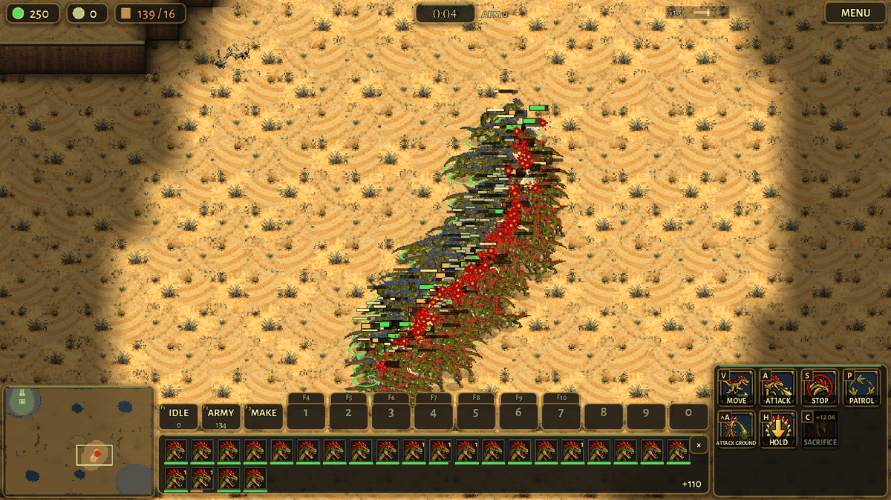

# Swarm performance: 200 Raptors a side (0.15.6)

The owner asked, on 2026-10-28: "Raptors cost one supply, so in theory we could have 200 Raptors in a 200-supply game.
Can the game render this safely with the FPS and stay playable? This is very important. Imagine a mirror match-up with
200 Raptors for each side. It's a hypothetical, but the game should be able to render this and not be a lag fest you
can't play."

## The short answer

- On a normal desktop computer: yes, now. A battle of 200 Raptors against 200 Raptors should play at about 60 frames a
  second or better for most of the fight.
- The worst moment is the few seconds when the two blobs crash together. There the frame rate dips, to roughly 20 to
  30 frames a second on a desktop. It recovers as the first Raptors fall.
- Before this work the same battle ran at about half the speed. The worst frames were about three times longer: a
  quarter of a second, a real freeze.
- On a phone, and in the web build, a 400-unit battle is still too heavy. It will stutter. That is what is left.
- These are estimates from a slow cloud processor with no graphics card: see "How it was measured".
- The game plays out exactly the same as before. Every test match gives the same result, unit for unit.

## How it was measured

- A new tool, tools/stress_swarm.gd, sets up huge armies on Dune Sea (a big open classic map, 110 x 80 tiles).
- tools/stress_swarm.sh runs every scenario and prints a table.
- Six scenarios, 30 seconds of play each:
  - idle: 200 Raptors a side standing in their bases.
  - walk: both armies walking across the map to the other base, straight through each other.
  - melee: the two 200-Raptor armies meeting in one big melee, in front of the camera.
  - offmelee: the same melee, with the camera far away.
  - grubs: 200 Grubs and 100 Raptors a side, the same melee in view.
  - muskets: 100 Musketeers a side trading fire, with THICK powder smoke (the default).
- The player's army is selected, as a player would have it: rings, health bars and the command card.
- The armies are made in one tick. Their timers are spread out, as an army made over minutes has them.
- Each frame is timed from one turn of the engine loop to the next. The time is split by the game's own profiler parts
  (scripts/prof.gd), as tools/perf_bench.gd does.
- "The battle" means the frames while both sides still have a tenth of their army.
- The machine: a cloud computer, one core of an Intel Xeon (Cascade Lake) at 2.8 GHz, no graphics card.
- A normal desktop of the last few years runs this game's code about 1.5 to 2 times faster on one core.
- Headless runs measure the game's side: the simulation, and the scripts that prepare the drawing.
- Rendered runs use a software renderer (llvmpipe, on xvfb). It draws on the processor. It is many times slower than
  any graphics card, so its drawing times are not what a player sees. They are shown for the draw call counts.
- "Before" is origin/main at 0.15.3. "After" is this branch (0.15.6, with origin/main of 0.15.5 merged in; the numbers were taken with 0.15.3 merged, before 0.15.4 and 0.15.5, which changed ramps and cliff edges, not units).

## The numbers: the game's side (headless)

Frames a second here are on the slow cloud core, with no drawing. "Game's work" is the time for one game tick: the game
runs 30 ticks a second, so a tick must take well under 16 ms for 60 frames a second.

| scenario | | fps avg | 1% low fps | worst frame ms | battle: fps avg | battle: 1% low fps | battle: worst ms | game's work ms a tick | units ms a tick |
|---|---|---|---|---|---|---|---|---|---|
| idle | before | 45 | 11 | 118 | - | - | - | 39.0 | 36.4 |
| idle | after | 85 | 22 | 57 | - | - | - | 17.6 | 14.6 |
| walk | before | 52 | 12 | 108 | - | - | - | 32.1 | 29.1 |
| walk | after | 63 | 15 | 85 | - | - | - | 25.2 | 21.6 |
| melee | before | 68 | 5 | 276 | 34 | 4 | 276 | 24.6 | 23.0 |
| melee | after | 122 | 14 | 102 | 65 | 12 | 102 | 11.8 | 10.1 |
| offmelee | before | 84 | 7 | 204 | 44 | 6 | 204 | 19.2 | 17.6 |
| offmelee | after | 133 | 17 | 77 | 73 | 15 | 77 | 10.6 | 8.8 |
| grubs | before | 27 | 3 | 450 | 22 | 3 | 450 | 66.3 | 63.9 |
| grubs | after | 48 | 9 | 143 | 41 | 9 | 143 | 33.4 | 30.5 |
| muskets | before | 108 | 20 | 73 | 109 | 20 | 73 | 12.6 | 11.5 |
| muskets | after | 137 | 29 | 39 | 137 | 29 | 39 | 9.7 | 8.5 |
| melee, phone profile | before | 72 | 5 | 297 | 34 | 4 | 297 | 23.6 | 22.3 |
| melee, phone profile | after | 120 | 13 | 100 | 61 | 12 | 100 | 12.3 | 10.7 |

- The 400-Raptor melee: the game's work halved, from 24.6 to 11.8 ms a tick. The battle went from 34 to 65 frames a
  second here. The worst frame went from 276 ms to 102 ms.
- On a desktop that is about 6 to 8 ms a tick on average: well under the 16 ms of a 60 Hz frame.
- At the moment of the clash, a tick still takes 50 to 80 ms here: about 30 to 50 ms on a desktop.
- The phone profile (Settings device "mobile") changes the controls and the HUD, not the game: the same numbers.
- The grubs scenario is 600 units, more than two 200-supply armies (300 supply a side). It halved too, but stays heavy.
- In the walk scenario the worst frame is a burst of paths for 400 units at once. The tool lifts the path queue's 6 ms
  limit so every run plays out the same; in a real match the queue spreads those paths over a few ticks.

## The numbers: drawing (software renderer)

Both rendered with the software renderer at 1600 x 900 (and once at 320 x 180, the same picture with few pixels).

| run | | fps avg | 1% low fps | worst ms | battle fps | draw calls a frame | renderer's time ms a frame |
|---|---|---|---|---|---|---|---|
| melee, 1600 x 900 | before | 5.7 | 2.5 | 461 | 5.1 | 984 | 124 |
| melee, 1600 x 900 | after | 5.9 | 3.3 | 439 | 5.4 | 984 | 125 |
| melee, 320 x 180 | before | 14.5 | 3.7 | 416 | 11.8 | 986 | 40 |
| melee, 320 x 180 | after | 16.8 | 6.9 | 154 | 14.4 | 986 | 39 |
| muskets, 1600 x 900 | before | 5.6 | 3.0 | 421 | 5.6 | 621 | 128 |
| muskets, 1600 x 900 | after | 6.0 | 3.8 | 331 | 6.0 | 620 | 119 |

- Here the software renderer is almost the whole frame: 120 ms at full size, 40 ms even at a tiny size. A graphics card
  does that work itself, so these frame rates say nothing about a real screen.
- What they do say: the drawing didn't get heavier, and the count of draw calls.
- With 400 Raptors on screen the game makes about 1,000 to 1,140 draw calls a frame. Each unit is its own: its shadow
  and bars, then its sprite with its own material (its team colour and veteran look).
- An estimate, not measured here: a desktop graphics card and its driver take that in a few ms a frame. A phone takes
  much longer: there, each draw call is expensive.
- The scripts that prepare the drawing (unit draw, HUD draw) are under 1 ms a frame.

## What was slow

- Looking for a target. Every unit looked at every unit within its sight, friends included, every third of a second.
  In a blob of 200 that is about 150 units each time.
- Pushing neighbours apart. Every unit looked at about 60 units in the grid cells round it to find the 2 or 3 close
  enough to push.
- The unit's tick itself: dozens of small checks, calls and dictionary look-ups for every unit 30 times a second.
- Changing a unit's picture. In a melee every Raptor turns several times a second, and each turn swapped its sprite
  strip: a texture, a mask and a few lookups by text.
- The command card with a big army selected. The MOUNT and LEAD buttons asked every selected man for the nearest free
  horse, among everyone near him. With 100 Musketeers selected that took 14 ms, four times a second.
- The replay's picture of the match: about 10 ms with 400 units, three to five times a second, on a tick's frame.
- The autosave every 15 seconds: up to 40 ms in one frame with 400 units.
- The turning gear bands: every unit asked whether it stood on a band, every tick, even far from any gear.

## What was fixed

- A packed unit grid. The units are kept in one list sorted by cell. Beside each are its place, team and radius at
  the start of the tick, in packed arrays. A search skips the units too far away without touching them.
- Units move during the tick, after the grid is made. The searches allow 7 px of that. A unit that moves farther, by
  itself or shoved by another (a tongue's pull, a charge, a Grub turning into a building), widens it for the rest of
  the tick. The searches find the same units, in the same order, as before. The grid checks every tick that no unit
  moved farther than it allowed without telling it: in the stress scenarios that never happened.
- Looking for a target looks only at enemies. It goes ring by ring out from the unit, and stops once no ring can hold
  anyone nearer than the best so far. The pick is the same unit as before, ties included.
- Pushing neighbours apart skips anyone who can't be close enough to push, from the packed places.
- The unit's tick: the kind's and the unit's flags are worked out once (is it air, a medic, a rider who strikes on the
  move...). Plain fields are checked before calling a function.
- Pictures: each sprite strip's texture, frame count and offset are looked up once. The veteran and horse masks are
  found by the texture, not by building a text. Units made on the same tick (an egg's three Raptors) no longer step
  their pictures on the same tick: half of them step on the other.
- A unit's view keeps a small margin before it changes, as the Labourer's has. In a melee, sprites no longer flick
  between two views when a unit turns by a hair.
- A big battle on screen, over about 160 units in view: the pictures step 10 times a second instead of 15. The frames
  keep their pace. Only the drawing changes.
- The MOUNT and LEAD buttons ask the horses on the map, not everyone near each man: 1.7 ms instead of 14.
- The replay's picture is taken on a frame with no game tick in it. The state is the same between ticks, so the
  picture is the same.
- The autosave takes the match's state at once, then writes its text a hundred units a frame. The file is the same,
  letter for letter (tools/test_save_job.gd). Leaving the game still saves at once.
- The gear bands: a unit far from every ring is answered at once.

## The game plays out the same

- The stress tool writes the whole state of the match every second: every unit's place, health and order.
- All six scenarios give the same file before and after, 22 snapshots each.
- melee and offmelee give the same file as each other: what is drawn doesn't change the game.
- tools/perf_bench.gd's trace, the same, before and after, over whole computer matches:
  - Greenhold, Crown against Brood, 8 minutes.
  - Ashford Crossing, Clockwork against Crown, 8 minutes, with the turning gears on.
  - Kestrel Rise, Clockwork mirror, 8 minutes.
  - The Sundered Realm, 8 players in 2 teams, 9 minutes, 332 units at the end.
- Tests: test_files, test_replay (all checks OK), test_online (63 checks OK), test_pathing (PASS), test_save_job (PASS),
  test_ai_placement, test_ai_scout, test_ai_swarm_freed, test_ai_wall_vs_rush, test_ai_army_response.
- test_ai_rush and test_ai_brood_army fail one check each, on origin/main too. test_ai_worker_safety fails one check
  now and then, on origin/main too: its computers play with sound, which goes by the clock.
- Replays and online play are unchanged: the same rows, the same fields. A replay's picture is taken a frame later
  than before, of the same state.

## What is left

- The clash. When two blobs of 200 meet, every unit fights, turns and looks for a target at once. A tick then costs 50
  to 80 ms here, about 30 to 50 ms on a desktop: a short dip, not a freeze. Most of it is now the unit tick's own
  small work, spread over hundreds of lines. The next step would be a lighter tick for units that only stand and
  fight.
- Walking armies. 400 units walking through each other still cost 25 ms a tick here, about 15 on a desktop.
- Drawing on phones. About 1,000 draw calls with 400 units on screen. Phones need batching: units sharing one
  material, the shadows and bars drawn in one pass, sprite strips in atlases. That touches the art pipeline.
- The phone's processor. Estimated, not measured here: a phone runs the game's code 3 to 5 times slower than a desktop,
  so a 400-unit battle would run at about 15 to 25 frames a second there. The web build, also estimated, runs the code
  about twice as slow as the desktop build. Neither was measured: no phone here, and no web export templates.
- The replay picture (10 ms with 400 units) and the autosave's capture (10 to 15 ms) are still single frames. They no
  longer land on a tick's frame, so on a desktop they fit in one.
- The computer's own thinking spikes (AI army 90 to 140 ms in an 8-player match) are not about swarms. They are
  worth their own look.

## How to run it

- godot --headless --fixed-fps 60 --script res://tools/stress_swarm.gd -- melee
- tools/stress_swarm.sh <outdir> (every scenario, and a table); add render for xvfb, mobile for the phone profile.
- Add trace:FILE to compare two versions: the files must be the same.
- The raw numbers of these runs are in docs/perf/swarm/.
