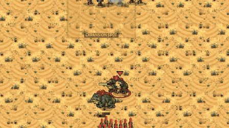

# The Mist Toad against the cannon, and the Musketeer's health (a study)

The owner asked on 2026-10-29: "The answer to cannons is the toad. But maybe we should reduce the Musketeer's life a bit. The Marine's life is 50, what is the Musketeer's?"

The Musketeer has 70 health and no armour. The Guardsman (the Musketeer with Armour) has 90 health and 1 armour.

This is a study. No game number was changed. Version 0.15.17. It extends the Raptor and Spitter study (docs/raptor_spitter_study.md), with the same tool, the same field and the same prices.

## The short answer

- Yes, the Toad answers the cannon. One Mist Toad laying FOG on the line turns a fight the Crown won 8 times of 8 into one it wins 0 to 2 times of 8. That is with one cannon, at 1,200 and at 2,000, against Raptors alone and against 3 Raptors to 1 Spitter.
- It is the FOG that does it, not the TONGUE. The fog covers the line and the gun behind it, and half of all their shots miss. The TONGUE alone wins only about half of the fights it is used in.
- Against two cannons the Toad does less. The guns reach 430 and often kill the Toad as it walks in. The Crown still wins most of those fights.
- The TONGUE does pull a Field Cannon. The cannon is 4 supply, and only 5 supply or more counts as heavy. The whole gun, crew and horse, is dragged about 180 pixels to the Toad's feet. It stays unlimbered and keeps firing, about one more shot, and then the Raptors kill it 4 times in 5.
- Cutting the Musketeer's health makes a weak unit weaker. At equal cost, Raptors already beat a Musketeer line in the open at 70 health. At 60 and 50 the line also loses to every Raptor and Spitter mix, and the line behind the wall starts to lose to Raptors alone.
- Cannons still decide the open fights at 60 health, and mostly at 50.
- Against the Clockwork, cutting to 60 is safe. Cutting to 50 loses one fight that matters: 2,000 a side against Clock Soldiers with their shields up, which the Clockwork then wins 8 times of 8.
- The recommendation: keep the Musketeer at 70. If anything changes, it is the Toad's fog, or which guns the TONGUE can pull.

## The setup

The tool is tools/study_raptor_spitter.gd, with four new groups: T (Toads against the cannon), H and HR (health, open field and ramp), HS (the break-even scan at each health) and X (Crown against Clockwork). tools/study_raptor_spitter.sh runs them, and with PER_CONFIG=1 each fight setting runs in its own process, two at a time, so a stalled run loses one row only. tools/study/raptor_spitter_table.py makes the tables. The raw results are in docs/toad_hp/, one line of JSON a fight.

The field is the same as before: the flat middle of Dune Sea. The Crown stands in two ranks on HOLD, guns 75 pixels behind. The enemy starts 15 tiles away and attack-moves in. Each row ran on 8 seeds, the scan on 6. A fight ends when one side is gone. Toads that stand back do not count as still fighting.

### The prices

- A Musketeer with the mid kit (Matchlock and Socket Bayonet) is 71 gold and 10 powder.
- A Field Cannon is 210 gold with its horse, 4 supply.
- A Raptor is 25 biomass. A Spitter is 45 biomass and 2.5 essence.
- A Mist Toad is 100 biomass and 25 essence, 3 supply. The Toads are paid for out of the same budget, so the wave has fewer Raptors. A wave with Toads costs up to 4% more than one without, because eggs come in whole numbers.
- A Clock Soldier is 70 cogs, 1 supply, and no Tension. That is all it costs.
- Research is not counted, as before. That includes SHIELD WALL for the Clock Soldier.
- Trades are shown with powder (and essence) worth 1, 3 and 9.5 gold, as before. The trade is what the enemy lost divided by what the Crown lost. Above 1, the Crown traded better.

### How the Toads play

The Toads play as a player would.

- A new Toad hatches with 75 energy (Defs TOAD start). FOG costs 50 and TONGUE costs 75. So a new Toad can cast one spell: FOG, or TONGUE.
- A full Toad has 150 energy. That is a Toad that waited about 50 seconds. It can cast FOG and then TONGUE.
- The Toads walk in front of the wave. The wave waits for them, and goes in when a Toad is 300 pixels from the line. That is just outside musket range.
- FOG goes on the middle of the Musketeer line, as the wave arrives. The fog bank is 96 pixels across each way. It covers most of a 15-man line and the gun behind it.
- TONGUE goes on the nearest gun once the fight is on: once the fog is down, or once the Raptors reach the line. Until then that Toad waits just outside musket range.
- Two Toads split the work: one fogs, one tongues. Two full Toads each cast twice: fog then tongue, and tongue then fog on the guns. With one gun, the second tongue goes for a Musketeer.
- When a Toad is done, it walks back out of the fight.

## T. Toads against the cannon

Crown wins out of 8, with the trade at face value in brackets. "3:1" is 3 Raptors to 1 Spitter by cost.

| Fight | no Toad | 1 Toad, FOG | 1 Toad, TONGUE | 2 Toads | 1 Toad, full energy | 2 Toads, full energy |
|---|---|---|---|---|---|---|
| 1200, 1 cannon, Raptors | 8 (2.8) | 0 (0.4) | 5 (1.1) | 0 (0.5) | 0 (0.4) | 0 (0.5) |
| 1200, 1 cannon, 3:1 | 8 (3.7) | 2 (0.7) | 5 (1.3) | 7 (1.2) | 0 (0.6) | 5 (1.0) |
| 1200, 2 cannons, Raptors | 8 (3.7) | 1 (0.7) | 7 (2.0) | 5 (1.3) | 1 (0.8) | 6 (1.4) |
| 1200, 2 cannons, 3:1 | 8 (7.8) | 7 (1.4) | 7 (3.4) | 7 (2.7) | 7 (1.3) | 8 (1.7) |
| 2000, 1 cannon, Raptors | 8 (2.0) | 0 (0.4) | 1 (0.6) | 0 (0.5) | 0 (0.4) | 1 (0.5) |
| 2000, 1 cannon, 3:1 | 8 (2.7) | 0 (0.4) | 7 (1.2) | 1 (0.6) | 0 (0.5) | 0 (0.6) |
| 2000, 2 cannons, Raptors | 8 (4.4) | 5 (1.1) | 6 (1.3) | 3 (0.7) | 5 (1.1) | 4 (0.9) |
| 2000, 2 cannons, 3:1 | 8 (7.0) | 8 (1.7) | 8 (2.3) | 7 (1.5) | 8 (1.7) | 4 (1.0) |

The "no Toad" rows match the earlier study: one or two cannons win every fight.

### What the FOG does

- The fog went down about 2.7 seconds after the wave set off, just before the line's first volley. So it covered the whole fight.
- Every shot fired from inside the fog, or into it, misses half the time. The line and the cannon behind it are both inside. So both shoot at half strength.
- The line also fires fewer shots, because it dies sooner. At 1,200 with one cannon, the line fired 33 musket shots against Raptors without a Toad, and 15 with one.
- Against Raptors alone with one cannon, the Brood lost about 450 of its 1,175 and kept the field.
- Against two cannons, the Toad was often killed walking in. At 2,000 with two cannons, the fog went down in only 2 or 3 fights of 8.
- Full energy hardly helps. The first fog does the work. A second spell comes when the fight is already decided.

### What the TONGUE does to a Field Cannon

Over all the Toad fights, the tongue went for a cannon 272 times.

- 247 times it pulled the gun in. 20 times the Toad was killed during the 3-second mark. 5 times the fight ended first.
- The cannon is not "heavy". The rule is 5 supply or more, or tagged massive, like the Steam Walker. A Field Cannon is 4 supply. So it is not staggered: it is dragged.
- The Field Cannon is one unit. Its crew and its horse are drawn on it, not separate men. So the tongue takes all of it: gun, crew and horse.
- It was dragged 182 pixels on average, to the Toad's feet. It was stunned for 0.9 seconds.
- It stays unlimbered. It does not stop firing. It fired about 1.3 more shots after the pull, at the enemies still far enough away (round shot cannot hit closer than 80 pixels).
- The Raptors then killed it 199 times of 247, about 6 seconds after the pull.
- The tongue on a Musketeer in the line mostly failed. It broke before the lash 29 times of 32.

The TONGUE alone wins about half the fights with one cannon at 1,200. It is a real answer, but a slower one: by the time the gun is pulled, it has already been firing for several seconds.

### Does the Toad answer the cannon?

Yes. One Toad, 125 resources, about a tenth of the wave, beats a line with one cannon almost every time. The FOG is the answer, more than the TONGUE. Two cannons are harder: the Toad must survive the walk in. A player who walks the Toad in behind the Raptors would do better than these Toads did.

It may be too strong. The earlier study called the cannon a hard counter. The fog is now a hard counter to the cannon, and to the line with it.

## H. The Musketeer's health

The same fights at 70 (as now), 60 and 50 health. The Guardsman would be scaled the same way, to 77 and 64. All of these fights use the mid kit, so no Guardsman took part.

Crown wins out of 8. In brackets, the trade at powder worth 1, 3 and 9.5.

| Fight | 70 health | 60 health | 50 health |
|---|---|---|---|
| A. 1,200: 15 Musketeers v 48 Raptors | 1 of 8 (0.68 / 0.54 / 0.33) | 0 of 8 (0.42 / 0.34 / 0.21) | 0 of 8 (0.41 / 0.33 / 0.20) |
| A. 2,000: 25 Musketeers v 81 Raptors | 0 of 8 (0.50 / 0.40 / 0.24) | 0 of 8 (0.38 / 0.30 / 0.18) | 0 of 8 (0.34 / 0.27 / 0.17) |
| B. 1,200: 15 v 36 Raptors + 6 Spitters | 4 of 8 (1.09 / 0.89 / 0.57) | 0 of 8 (0.57 / 0.46 / 0.28) | 0 of 8 (0.59 / 0.47 / 0.29) |
| B. 1,200: 15 v 24 Raptors + 12 Spitters | 4 of 8 (1.15 / 0.97 / 0.68) | 1 of 8 (0.82 / 0.68 / 0.47) | 0 of 8 (0.64 / 0.53 / 0.34) |
| C. 1,200: 12 + cannon v 3:1 | 8 of 8 (3.66 / 3.01 / 1.98) | 8 of 8 (2.93 / 2.41 / 1.58) | 8 of 8 (1.86 / 1.53 / 1.00) |
| C. 2,000: 22 + cannon v 3:1 | 8 of 8 (2.67 / 2.20 / 1.44) | 7 of 8 (1.79 / 1.47 / 0.97) | 6 of 8 (1.33 / 1.09 / 0.72) |
| D. 1,200: 12 + cannon v 48 Raptors | 8 of 8 (2.82 / 2.26 / 1.38) | 7 of 8 (2.02 / 1.63 / 1.01) | 6 of 8 (1.45 / 1.18 / 0.73) |
| Ramp: 15 v 48 Raptors | 8 of 8 (2.96 / 2.38 / 1.45) | 4 of 8 (1.10 / 0.89 / 0.54) | 4 of 8 (0.94 / 0.75 / 0.46) |
| Ramp: 15 v 3:1 | 8 of 8 (9.00 / 7.40 / 4.87) | 8 of 8 (5.09 / 4.18 / 2.75) | 8 of 8 (6.16 / 5.07 / 3.33) |
| Ramp: 15 v 1:1 | 8 of 8 (11.56 / 9.74 / 6.87) | 8 of 8 (7.70 / 6.50 / 4.58) | 8 of 8 (4.44 / 3.75 / 2.64) |
| Ramp: 12 + cannon v 3:1 | 8 of 8 (117 / 96 / 63) | 8 of 8 (117 / 96 / 63) | 8 of 8 (39 / 32 / 21) |

The 70 rows match the earlier study within a fight or so. The game changed a little between the two.

### The break-even count at each health

The 1,200 Brood mixes against 10 to 24 Musketeers, 6 seeds each. Crown wins out of 6.

| Brood mix | Health | 10 | 12 | 14 | 16 | 18 | 20 | 22 | 24 |
|---|---|---|---|---|---|---|---|---|---|
| 48 Raptors | 70 | 0 | 0 | 0 | 0 | 6 | 6 | 6 | 6 |
| 48 Raptors | 60 | 0 | 0 | 0 | 0 | 2 | 3 | 6 | 6 |
| 48 Raptors | 50 | 0 | 0 | 0 | 0 | 0 | 1 | 4 | 6 |
| 36 Raptors, 6 Spitters | 70 | 0 | 0 | 3 | 5 | 6 | 6 | 6 | 6 |
| 36 Raptors, 6 Spitters | 60 | 0 | 0 | 0 | 2 | 5 | 6 | 6 | 6 |
| 36 Raptors, 6 Spitters | 50 | 0 | 0 | 0 | 0 | 3 | 6 | 6 | 6 |
| 24 Raptors, 12 Spitters | 70 | 0 | 0 | 0 | 6 | 6 | 6 | 6 | 6 |
| 24 Raptors, 12 Spitters | 60 | 0 | 0 | 0 | 3 | 6 | 6 | 6 | 6 |
| 24 Raptors, 12 Spitters | 50 | 0 | 0 | 0 | 2 | 5 | 6 | 6 | 6 |

Where the line breaks even, against 1,200 of Brood:

| Brood mix | 70 health | 60 health | 50 health |
|---|---|---|---|
| 48 Raptors | 17 Musketeers (1,380) | 20 (1,620) | 21 or 22 (1,740) |
| 36 Raptors, 6 Spitters | 14 (1,130) | 17 (1,380) | 18 (1,460) |
| 24 Raptors, 12 Spitters | 15 (1,220) | 16 (1,300) | 17 (1,380) |

The cost is gold plus powder at face value.

### At what health do Raptor floods and Raptor + Spitter beat a Musketeer line?

- Raptors alone already beat the line at 70. They need only 1,200 to beat 1,380 of Musketeers. At 60 they beat 1,620. At 50 they beat 1,740.
- Raptor + Spitter is about even with the line at 70: 4 wins of 8 for each mix. At 60 and 50 it wins almost every time.
- So the answer is: Raptor + Spitter starts beating the line at 60. Raptors alone already do at 70.
- Behind the ramp wall, the line holds against every mix at every health. Against Raptors alone, it holds at 70 and drops to a coin toss at 60 and 50.

### How much do cannons still matter?

A great deal. With one cannon, the Crown wins:

- at 60 health: 8, 7 and 7 fights of 8 (C at 1,200, C at 2,000, D),
- at 50 health: 8, 6 and 6 of 8.

The trade falls with health, from about 3 to about 1.5. But the gun still decides the fight. So at 60 or 50 the Musketeer becomes a unit that only works next to a cannon. And the Toad's fog takes the cannon away (part T).

## X. Crown against Clockwork

Musketeers (mid kit) on HOLD in two ranks, against Clock Soldiers attack-moving in, at equal cost. "Shields" means SHIELD WALL is researched and the Clock Soldiers raise their shields by the Clockwork computer's own rule (ShieldWall.think): up when two or more shooters are near.

Crown wins out of 8. In brackets, the trade at powder worth 1 and 9.5.

| Fight | 70 health | 60 health | 50 health |
|---|---|---|---|
| 1200: 15 Musketeers v 17 Clock Soldiers | 8 of 8 (8.4 / 4.1) | 8 of 8 (6.2 / 3.0) | 8 of 8 (3.9 / 1.9) |
| 1200: 15 Musketeers v 17 Clock Soldiers, shields | 8 of 8 (2.3 / 1.1) | 8 of 8 (2.0 / 1.0) | 6 of 8 (1.2 / 0.6) |
| 1200: 12 Musketeers + cannon v 17 Clock Soldiers | 8 of 8 (7.3 / 3.6) | 8 of 8 (7.3 / 3.6) | 8 of 8 (5.9 / 2.9) |
| 1200: 12 Musketeers + cannon v 17 Clock Soldiers, shields | 8 of 8 (2.4 / 1.2) | 8 of 8 (2.4 / 1.2) | 5 of 8 (1.2 / 0.6) |
| 2000: 25 Musketeers v 29 Clock Soldiers | 8 of 8 (6.3 / 3.1) | 8 of 8 (5.3 / 2.6) | 8 of 8 (3.7 / 1.8) |
| 2000: 25 Musketeers v 29 Clock Soldiers, shields | 8 of 8 (1.6 / 0.8) | 7 of 8 (1.3 / 0.6) | 0 of 8 (0.6 / 0.3) |
| 2000: 22 Musketeers + cannon v 29 Clock Soldiers | 8 of 8 (7.4 / 3.6) | 8 of 8 (6.7 / 3.3) | 8 of 8 (5.4 / 2.6) |
| 2000: 22 Musketeers + cannon v 29 Clock Soldiers, shields | 8 of 8 (3.5 / 1.7) | 8 of 8 (2.9 / 1.4) | 8 of 8 (2.0 / 1.0) |

### What each health value does to Crown against Clockwork

- At 70, a Musketeer line crushes Clock Soldiers at equal cost: it trades 6 to 8 times better. With shields up, it still wins every fight, trading 1.6 to 2.4 times better.
- At 60, nothing changes in who wins. The trades fall a little. The one close fight is 2,000 against shields: 7 wins of 8.
- At 50, the line still beats bare Clock Soldiers every time. But against shields it starts to lose: 6 of 8 at 1,200, and 0 of 8 at 2,000. A cannon saves the 2,000 fight, but not the 1,200 one (5 of 8).
- So 60 does not break the matchup. 50 does, for an army of Clock Soldiers with SHIELD WALL.
- A side note: plain Clock Soldiers lose very badly to a Musketeer line at equal cost, at every health. Shields are what keep them in the fight. This study only has Clock Soldiers; the Clockwork's Springers, Jacks and other units were not tested.

## Recommendation, for the owner to decide

1. Keep the Musketeer at 70 health. The Marine comparison does not carry over: at 70 the Musketeer already loses to Raptors at equal cost in the open. Cutting him to 60 makes every Brood wave beat the line without a gun, and the ramp line starts to lose to Raptors. Cutting him to 50 also breaks the 2,000 fight against shielded Clock Soldiers.
2. If he must change, 60 is the safe value. It keeps Crown against Clockwork as it is, and the cannon still decides the open fights. But the Musketeer would then be a unit that only works beside a gun, and the Toad's fog takes the gun away.
3. The Toad already answers the cannon, and maybe too well. One Toad's FOG, about a tenth of the wave, flips a 1-cannon fight from 8 wins to 0 to 2. Design principle 1 asks for few hard counters, telegraphed. The fog bank is visible and has a 0.6-second cast, but the line on HOLD cannot step out of it. Possible changes to weigh: a lower miss chance (0.35 instead of 0.5), a smaller bank (radius 80), or a higher cost (75 energy, so a new Toad cannot fog at once). Or leave it, and let the player answer by moving the line out of the fog.
4. Decide whether the TONGUE should pull a Field Cannon. Its card says "heavy engines are only staggered", but the cannon (4 supply) is pulled whole, crew, horse and all, and then dies 4 times in 5. Setting TONGUE "heavy" to 4, or tagging the cannon and the Mortar as massive, would make them only staggered. That would make the TONGUE much weaker against guns, and leave the FOG as the answer.

## Pictures

docs/shots/toad_hp/:

- T_toads_vs_cannon.gif: 12 Musketeers and a cannon against 30 Raptors, 4 Spitters and 2 full Toads, 1,200 a side. The fog goes down on the line, the tongue marks the gun and drags it out to the Toads, and the Raptors eat it. A frame every half second, played at double speed.
- T_crosshair_on_gun.jpg: the tongue's crosshair on the cannon, and a second one on a Musketeer.
- T_tongue_out.jpg: the fog on the line, and the tongue out.
- T_gun_pulled.jpg: the cannon at the Toads' feet, among the Raptors, still unlimbered.
- T_end.jpg: the end. In this filmed run the Brood won with 3 Spitters and both Toads left.

## Limits of the study

- Nobody micro-manages the Crown. A player would step the line out of the fog, or shoot the Toad first. The Musketeers on HOLD cannot.
- The Toads walk in front of the wave. Against two cannons they are often shot on the way in. Walking them in behind the Raptors would help the Brood.
- The fights are short, so a volley more or less matters. Rows near the break-even point swing from seed to seed. A filmed rerun can end differently from the headless one.
- Health was changed on the spawned men only, in the tool. Nothing else about the Musketeer changed: not his price, his range or his damage.
- The Clockwork side has only Clock Soldiers, on open ground. No Winders, no gears, no Springers.
- One map for the open field, one for the ramp.

## How to run it

    godot --headless --import
    PER_CONFIG=1 tools/study_raptor_spitter.sh /tmp/th 8 T H HR X
    PER_CONFIG=1 tools/study_raptor_spitter.sh /tmp/th 6 HS
    python3 tools/study/raptor_spitter_table.py /tmp/th/*/*.jsonl

Running the same command again re-runs only the rows that came out short. Each fight setting runs in its own process, two at a time (JOBS), each stopped after 900 seconds (TIMEOUT).

One fight on film, closer in:

    xvfb-run -a godot --rendering-driver opengl3 --resolution 1280x720 --fixed-fps 30 --script res://tools/study_raptor_spitter.gd -- only:T_1200_g1_31_t2full seeds:1 zoom:1.5 film:/tmp/film

## The full table

Values are averages over the seeds. "Left" is what the survivors are worth, scaled by their health. Crown lost is gold / powder; enemy lost is biomass / essence, or cogs / Tension. The notes on Toad rows count the fogs laid, what each tongue did, the guns pulled and killed, the shots a gun fired after its pull, and the Toads lost (all per fight, or totals over the 8 seeds for the tongues).

| fight | Crown army | enemy army | supply C/E | Crown wins | time s | Crown lost (gold/powder) | enemy lost | Crown left | enemy left | trade K=1 | K=3 | K=9.5 | notes |
|---|---|---|---|---|---|---|---|---|---|---|---|---|---|
| T_1200_g1_31_t0 | 12 musk + 1 cannon (mid kit) = 1062+120 | 36R + 6S = 1170+15 | 16/42 | 8 of 8 | 14 | 284/40 | 1170/15.0 | 784 | 0 | 3.66 | 3.01 | 1.98 |  |
| T_1200_g1_31_t1fog | 12 musk + 1 cannon (mid kit) = 1062+120 | 33R + 6S + 1 toad (start energy, fog) = 1195+40 | 16/42 | 2 of 8 | 24 | 1001/119 | 764/4.1 | 30 | 315 | 0.69 | 0.57 | 0.38 | fogs 1.0; toads lost 0.0 |
| T_1200_g1_31_t1full | 12 musk + 1 cannon (mid kit) = 1062+120 | 33R + 6S + 1 toad (full energy) = 1195+40 | 16/42 | 0 of 8 | 20 | 1062/120 | 725/3.1 | 0 | 398 | 0.62 | 0.52 | 0.34 | fogs 1.0; cannon pulled 8; pulled guns killed 8 of 8; shots after pull 2.1; toads lost 0.1 |
| T_1200_g1_31_t1tongue | 12 musk + 1 cannon (mid kit) = 1062+120 | 33R + 6S + 1 toad (start energy, tongue) = 1195+40 | 16/42 | 5 of 8 | 33 | 752/88 | 1093/22.2 | 238 | 28 | 1.33 | 1.14 | 0.82 | fogs 0.0; cannon pulled 7; cannon unfinished 1; pulled guns killed 5 of 7; shots after pull 1.4; toads lost 0.4 |
| T_1200_g1_31_t2 | 12 musk + 1 cannon (mid kit) = 1062+120 | 30R + 4S + 2 toads (start energy) = 1130+60 | 16/40 | 7 of 8 | 31 | 690/79 | 919/9.4 | 256 | 146 | 1.21 | 1.02 | 0.70 | fogs 1.0; cannon pulled 8; pulled guns killed 5 of 8; shots after pull 1.4; toads lost 0.0 |
| T_1200_g1_31_t2full | 12 musk + 1 cannon (mid kit) = 1062+120 | 30R + 4S + 2 toads (full energy) = 1130+60 | 16/40 | 5 of 8 | 30 | 831/88 | 879/7.2 | 168 | 172 | 0.96 | 0.82 | 0.57 | fogs 2.0; cannon pulled 8; musketeer broken 6; musketeer pulled 2; pulled guns killed 8 of 8; shots after pull 1.4; toads lost 0.0 |
| T_1200_g1_r_t0 | 12 musk + 1 cannon (mid kit) = 1062+120 | 48R + 0S = 1200+0 | 16/48 | 8 of 8 | 11 | 373/52 | 1200/0.0 | 622 | 0 | 2.82 | 2.26 | 1.38 |  |
| T_1200_g1_r_t1fog | 12 musk + 1 cannon (mid kit) = 1062+120 | 42R + 0S + 1 toad (start energy, fog) = 1150+25 | 16/45 | 0 of 8 | 14 | 1062/120 | 447/0.0 | 0 | 546 | 0.38 | 0.31 | 0.20 | fogs 1.0; toads lost 0.0 |
| T_1200_g1_r_t1full | 12 musk + 1 cannon (mid kit) = 1062+120 | 42R + 0S + 1 toad (full energy) = 1150+25 | 16/45 | 0 of 8 | 15 | 1062/120 | 456/0.0 | 0 | 523 | 0.39 | 0.32 | 0.21 | fogs 1.0; cannon pulled 8; pulled guns killed 8 of 8; shots after pull 1.1; toads lost 0.0 |
| T_1200_g1_r_t1tongue | 12 musk + 1 cannon (mid kit) = 1062+120 | 42R + 0S + 1 toad (start energy, tongue) = 1150+25 | 16/45 | 5 of 8 | 20 | 744/94 | 944/0.0 | 233 | 132 | 1.13 | 0.92 | 0.58 | fogs 0.0; cannon pulled 8; pulled guns killed 3 of 8; shots after pull 1.1; toads lost 0.0 |
| T_1200_g1_r_t2 | 12 musk + 1 cannon (mid kit) = 1062+120 | 39R + 0S + 2 toads (start energy) = 1175+50 | 16/45 | 0 of 8 | 17 | 1062/120 | 603/3.1 | 0 | 405 | 0.51 | 0.43 | 0.29 | fogs 1.0; cannon pulled 8; pulled guns killed 8 of 8; shots after pull 1.1; toads lost 0.1 |
| T_1200_g1_r_t2full | 12 musk + 1 cannon (mid kit) = 1062+120 | 39R + 0S + 2 toads (full energy) = 1175+50 | 16/45 | 0 of 8 | 18 | 1062/120 | 606/0.0 | 0 | 416 | 0.51 | 0.43 | 0.28 | fogs 2.0; cannon pulled 8; musketeer broken 7; musketeer pulled 1; pulled guns killed 8 of 8; shots after pull 1.4; toads lost 0.0 |
| T_1200_g2_31_t0 | 10 musk + 2 cannon (mid kit) = 1130+100 | 36R + 6S = 1170+15 | 18/42 | 8 of 8 | 12 | 133/19 | 1170/15.0 | 969 | 0 | 7.80 | 6.42 | 4.22 |  |
| T_1200_g2_31_t1fog | 10 musk + 2 cannon (mid kit) = 1130+100 | 33R + 6S + 1 toad (start energy, fog) = 1195+40 | 18/42 | 7 of 8 | 28 | 718/94 | 1081/17.2 | 327 | 28 | 1.35 | 1.13 | 0.77 | fogs 1.0; toads lost 0.1 |
| T_1200_g2_31_t1full | 10 musk + 2 cannon (mid kit) = 1130+100 | 33R + 6S + 1 toad (full energy) = 1195+40 | 18/42 | 7 of 8 | 30 | 813/81 | 1138/29.7 | 232 | 12 | 1.31 | 1.16 | 0.90 | fogs 1.0; cannon pulled 8; pulled guns killed 8 of 8; shots after pull 1.5; toads lost 0.6 |
| T_1200_g2_31_t1tongue | 10 musk + 2 cannon (mid kit) = 1130+100 | 33R + 6S + 1 toad (start energy, tongue) = 1195+40 | 18/42 | 7 of 8 | 16 | 319/38 | 1160/38.8 | 790 | 25 | 3.36 | 2.96 | 2.26 | fogs 0.0; cannon pulled 1; cannon toad killed in windup 7; pulled guns killed 1 of 1; shots after pull 2.0; toads lost 1.0 |
| T_1200_g2_31_t2 | 10 musk + 2 cannon (mid kit) = 1130+100 | 30R + 4S + 2 toads (start energy) = 1130+60 | 18/40 | 7 of 8 | 19 | 336/40 | 976/30.6 | 715 | 56 | 2.67 | 2.34 | 1.77 | fogs 0.8; cannon pulled 6; cannon toad killed in windup 2; pulled guns killed 1 of 6; shots after pull 1.3; toads lost 0.9 |
| T_1200_g2_31_t2full | 10 musk + 2 cannon (mid kit) = 1130+100 | 30R + 4S + 2 toads (full energy) = 1130+60 | 18/40 | 8 of 8 | 39 | 564/42 | 1005/28.8 | 494 | 54 | 1.70 | 1.58 | 1.32 | fogs 1.4; cannon pulled 12; cannon toad killed in windup 2; pulled guns killed 10 of 12; shots after pull 0.2; toads lost 0.8 |
| T_1200_g2_r_t0 | 10 musk + 2 cannon (mid kit) = 1130+100 | 48R + 0S = 1200+0 | 18/48 | 8 of 8 | 9 | 284/40 | 1200/0.0 | 795 | 0 | 3.70 | 2.97 | 1.81 |  |
| T_1200_g2_r_t1fog | 10 musk + 2 cannon (mid kit) = 1130+100 | 42R + 0S + 1 toad (start energy, fog) = 1150+25 | 18/45 | 1 of 8 | 19 | 1060/98 | 775/0.0 | 49 | 202 | 0.67 | 0.57 | 0.39 | fogs 1.0; toads lost 0.0 |
| T_1200_g2_r_t1full | 10 musk + 2 cannon (mid kit) = 1130+100 | 42R + 0S + 1 toad (full energy) = 1150+25 | 18/45 | 1 of 8 | 22 | 1042/95 | 847/6.2 | 68 | 182 | 0.75 | 0.65 | 0.47 | fogs 1.0; cannon pulled 8; pulled guns killed 7 of 8; shots after pull 1.8; toads lost 0.2 |
| T_1200_g2_r_t1tongue | 10 musk + 2 cannon (mid kit) = 1130+100 | 42R + 0S + 1 toad (start energy, tongue) = 1150+25 | 18/45 | 7 of 8 | 16 | 505/64 | 1119/21.9 | 569 | 13 | 2.01 | 1.70 | 1.19 | fogs 0.0; cannon pulled 1; cannon toad killed in windup 5; cannon unfinished 2; pulled guns killed 0 of 1; shots after pull 0.0; toads lost 0.9 |
| T_1200_g2_r_t2 | 10 musk + 2 cannon (mid kit) = 1130+100 | 39R + 0S + 2 toads (start energy) = 1175+50 | 18/45 | 5 of 8 | 22 | 690/75 | 950/9.4 | 332 | 116 | 1.25 | 1.07 | 0.74 | fogs 0.9; cannon pulled 7; cannon unfinished 1; pulled guns killed 3 of 7; shots after pull 1.1; toads lost 0.4 |
| T_1200_g2_r_t2full | 10 musk + 2 cannon (mid kit) = 1130+100 | 39R + 0S + 2 toads (full energy) = 1175+50 | 18/45 | 6 of 8 | 16 | 620/72 | 928/9.4 | 425 | 148 | 1.35 | 1.14 | 0.78 | fogs 1.6; cannon pulled 13; cannon toad killed in windup 1; cannon unfinished 1; pulled guns killed 4 of 13; shots after pull 1.1; toads lost 0.4 |
| T_2000_g1_31_t0 | 22 musk + 1 cannon (mid kit) = 1772+220 | 60R + 10S = 1950+25 | 26/70 | 8 of 8 | 16 | 648/91 | 1950/25.0 | 1113 | 0 | 2.67 | 2.20 | 1.44 |  |
| T_2000_g1_31_t1fog | 22 musk + 1 cannon (mid kit) = 1772+220 | 57R + 10S + 1 toad (start energy, fog) = 1975+50 | 26/70 | 0 of 8 | 17 | 1772/220 | 834/0.0 | 0 | 954 | 0.42 | 0.34 | 0.22 | fogs 1.0; toads lost 0.0 |
| T_2000_g1_31_t1full | 22 musk + 1 cannon (mid kit) = 1772+220 | 57R + 10S + 1 toad (full energy) = 1975+50 | 26/70 | 0 of 8 | 17 | 1772/220 | 934/0.0 | 0 | 855 | 0.47 | 0.38 | 0.24 | fogs 1.0; cannon pulled 8; pulled guns killed 8 of 8; shots after pull 1.2; toads lost 0.0 |
| T_2000_g1_31_t1tongue | 22 musk + 1 cannon (mid kit) = 1772+220 | 57R + 10S + 1 toad (start energy, tongue) = 1975+50 | 26/70 | 7 of 8 | 37 | 1399/168 | 1836/22.8 | 346 | 72 | 1.19 | 1.00 | 0.69 | fogs 0.0; cannon pulled 8; pulled guns killed 8 of 8; shots after pull 1.0; toads lost 0.0 |
| T_2000_g1_31_t2 | 22 musk + 1 cannon (mid kit) = 1772+220 | 54R + 8S + 2 toads (start energy) = 1910+70 | 26/68 | 1 of 8 | 21 | 1719/212 | 1122/2.8 | 38 | 645 | 0.58 | 0.48 | 0.31 | fogs 1.0; cannon pulled 8; pulled guns killed 8 of 8; shots after pull 1.6; toads lost 0.0 |
| T_2000_g1_31_t2full | 22 musk + 1 cannon (mid kit) = 1772+220 | 54R + 8S + 2 toads (full energy) = 1910+70 | 26/68 | 0 of 8 | 20 | 1772/220 | 1143/3.4 | 0 | 648 | 0.58 | 0.47 | 0.30 | fogs 2.0; cannon pulled 8; musketeer broken 8; pulled guns killed 8 of 8; shots after pull 1.4; toads lost 0.1 |
| T_2000_g1_r_t0 | 22 musk + 1 cannon (mid kit) = 1772+220 | 81R + 0S = 2025+0 | 26/81 | 8 of 8 | 11 | 878/120 | 2025/0.0 | 799 | 0 | 2.03 | 1.64 | 1.00 |  |
| T_2000_g1_r_t1fog | 22 musk + 1 cannon (mid kit) = 1772+220 | 75R + 0S + 1 toad (start energy, fog) = 1975+25 | 26/78 | 0 of 8 | 15 | 1772/220 | 853/0.0 | 0 | 874 | 0.43 | 0.35 | 0.22 | fogs 1.0; toads lost 0.0 |
| T_2000_g1_r_t1full | 22 musk + 1 cannon (mid kit) = 1772+220 | 75R + 0S + 1 toad (full energy) = 1975+25 | 26/78 | 0 of 8 | 15 | 1772/220 | 741/0.0 | 0 | 953 | 0.37 | 0.30 | 0.19 | fogs 1.0; cannon pulled 8; pulled guns killed 8 of 8; shots after pull 1.1; toads lost 0.0 |
| T_2000_g1_r_t1tongue | 22 musk + 1 cannon (mid kit) = 1772+220 | 75R + 0S + 1 toad (start energy, tongue) = 1975+25 | 26/78 | 1 of 8 | 16 | 1745/216 | 1212/0.0 | 24 | 557 | 0.62 | 0.51 | 0.32 | fogs 0.0; cannon pulled 8; pulled guns killed 8 of 8; shots after pull 0.6; toads lost 0.0 |
| T_2000_g1_r_t2 | 22 musk + 1 cannon (mid kit) = 1772+220 | 69R + 0S + 2 toads (start energy) = 1925+50 | 26/75 | 0 of 8 | 16 | 1772/220 | 988/0.0 | 0 | 724 | 0.50 | 0.41 | 0.26 | fogs 1.0; cannon pulled 8; pulled guns killed 8 of 8; shots after pull 1.2; toads lost 0.0 |
| T_2000_g1_r_t2full | 22 musk + 1 cannon (mid kit) = 1772+220 | 69R + 0S + 2 toads (full energy) = 1925+50 | 26/75 | 1 of 8 | 17 | 1719/216 | 1019/0.0 | 33 | 689 | 0.53 | 0.43 | 0.27 | fogs 2.0; cannon pulled 8; musketeer broken 8; pulled guns killed 7 of 8; shots after pull 1.2; toads lost 0.0 |
| T_2000_g2_31_t0 | 20 musk + 2 cannon (mid kit) = 1840+200 | 60R + 10S = 1950+25 | 28/70 | 8 of 8 | 11 | 248/35 | 1950/25.0 | 1645 | 0 | 6.97 | 5.73 | 3.77 |  |
| T_2000_g2_31_t1fog | 20 musk + 2 cannon (mid kit) = 1840+200 | 57R + 10S + 1 toad (start energy, fog) = 1975+50 | 28/70 | 8 of 8 | 23 | 1030/145 | 1950/43.8 | 723 | 4 | 1.70 | 1.42 | 0.98 | fogs 0.2; toads lost 0.8 |
| T_2000_g2_31_t1full | 20 musk + 2 cannon (mid kit) = 1840+200 | 57R + 10S + 1 toad (full energy) = 1975+50 | 28/70 | 8 of 8 | 26 | 1020/132 | 1962/46.9 | 745 | 2 | 1.74 | 1.48 | 1.06 | fogs 0.2; cannon pulled 2; pulled guns killed 2 of 2; shots after pull 1.0; toads lost 0.9 |
| T_2000_g2_31_t1tongue | 20 musk + 2 cannon (mid kit) = 1840+200 | 57R + 10S + 1 toad (start energy, tongue) = 1975+50 | 28/70 | 8 of 8 | 20 | 780/99 | 1950/43.8 | 977 | 4 | 2.27 | 1.93 | 1.38 | fogs 0.0; cannon pulled 5; cannon toad killed in windup 3; pulled guns killed 3 of 5; shots after pull 1.0; toads lost 0.8 |
| T_2000_g2_31_t2 | 20 musk + 2 cannon (mid kit) = 1840+200 | 54R + 8S + 2 toads (start energy) = 1910+70 | 28/68 | 7 of 8 | 25 | 1089/128 | 1733/33.4 | 637 | 88 | 1.45 | 1.25 | 0.89 | fogs 1.0; cannon pulled 8; pulled guns killed 6 of 8; shots after pull 1.9; toads lost 0.6 |
| T_2000_g2_31_t2full | 20 musk + 2 cannon (mid kit) = 1840+200 | 54R + 8S + 2 toads (full energy) = 1910+70 | 28/68 | 4 of 8 | 41 | 1512/158 | 1648/26.2 | 289 | 138 | 1.00 | 0.87 | 0.63 | fogs 1.9; cannon pulled 15; pulled guns killed 15 of 15; shots after pull 2.0; toads lost 0.5 |
| T_2000_g2_r_t0 | 20 musk + 2 cannon (mid kit) = 1840+200 | 81R + 0S = 2025+0 | 28/81 | 8 of 8 | 9 | 399/56 | 2025/0.0 | 1369 | 0 | 4.44 | 3.56 | 2.17 |  |
| T_2000_g2_r_t1fog | 20 musk + 2 cannon (mid kit) = 1840+200 | 75R + 0S + 1 toad (start energy, fog) = 1975+25 | 28/78 | 5 of 8 | 16 | 1285/159 | 1616/15.6 | 474 | 254 | 1.13 | 0.94 | 0.63 | fogs 0.4; toads lost 0.6 |
| T_2000_g2_r_t1full | 20 musk + 2 cannon (mid kit) = 1840+200 | 75R + 0S + 1 toad (full energy) = 1975+25 | 28/78 | 5 of 8 | 16 | 1338/166 | 1609/15.6 | 408 | 255 | 1.08 | 0.90 | 0.60 | fogs 0.4; cannon pulled 3; pulled guns killed 3 of 3; shots after pull 1.0; toads lost 0.6 |
| T_2000_g2_r_t1tongue | 20 musk + 2 cannon (mid kit) = 1840+200 | 75R + 0S + 1 toad (start energy, tongue) = 1975+25 | 28/78 | 6 of 8 | 16 | 1197/154 | 1769/12.5 | 530 | 122 | 1.32 | 1.09 | 0.71 | fogs 0.0; cannon pulled 8; pulled guns killed 2 of 8; shots after pull 0.8; toads lost 0.5 |
| T_2000_g2_r_t2 | 20 musk + 2 cannon (mid kit) = 1840+200 | 69R + 0S + 2 toads (start energy) = 1925+50 | 28/75 | 3 of 8 | 20 | 1638/190 | 1284/3.1 | 101 | 411 | 0.70 | 0.59 | 0.38 | fogs 1.0; cannon pulled 8; pulled guns killed 6 of 8; shots after pull 1.9; toads lost 0.1 |
| T_2000_g2_r_t2full | 20 musk + 2 cannon (mid kit) = 1840+200 | 69R + 0S + 2 toads (full energy) = 1925+50 | 28/75 | 4 of 8 | 22 | 1566/176 | 1506/6.2 | 215 | 265 | 0.87 | 0.73 | 0.48 | fogs 1.9; cannon pulled 15; pulled guns killed 12 of 15; shots after pull 1.7; toads lost 0.2 |
| H_A1200_hp50 | 15 musk (mid kit, 50 hp) = 1065+150 | 48R + 0S = 1200+0 | 15/48 | 0 of 8 | 8 | 1065/150 | 503/0.0 | 0 | 585 | 0.41 | 0.33 | 0.20 |  |
| H_A1200_hp60 | 15 musk (mid kit, 60 hp) = 1065+150 | 48R + 0S = 1200+0 | 15/48 | 0 of 8 | 9 | 1065/150 | 516/0.0 | 0 | 568 | 0.42 | 0.34 | 0.21 |  |
| H_A1200_hp70 | 15 musk (mid kit, 70 hp) = 1065+150 | 48R + 0S = 1200+0 | 15/48 | 1 of 8 | 11 | 994/140 | 766/0.0 | 48 | 342 | 0.68 | 0.54 | 0.33 |  |
| H_A2000_hp50 | 25 musk (mid kit, 50 hp) = 1775+250 | 81R + 0S = 2025+0 | 25/81 | 0 of 8 | 8 | 1775/250 | 694/0.0 | 0 | 1189 | 0.34 | 0.27 | 0.17 |  |
| H_A2000_hp60 | 25 musk (mid kit, 60 hp) = 1775+250 | 81R + 0S = 2025+0 | 25/81 | 0 of 8 | 9 | 1775/250 | 766/0.0 | 0 | 1114 | 0.38 | 0.30 | 0.18 |  |
| H_A2000_hp70 | 25 musk (mid kit, 70 hp) = 1775+250 | 81R + 0S = 2025+0 | 25/81 | 0 of 8 | 11 | 1775/250 | 1006/0.0 | 0 | 910 | 0.50 | 0.40 | 0.24 |  |
| H_B1200_11_hp50 | 15 musk (mid kit, 50 hp) = 1065+150 | 24R + 12S = 1140+30 | 15/36 | 0 of 8 | 20 | 1065/150 | 769/9.4 | 0 | 310 | 0.64 | 0.53 | 0.34 |  |
| H_B1200_11_hp60 | 15 musk (mid kit, 60 hp) = 1065+150 | 24R + 12S = 1140+30 | 15/36 | 1 of 8 | 27 | 1021/144 | 938/18.8 | 38 | 165 | 0.82 | 0.68 | 0.47 |  |
| H_B1200_11_hp70 | 15 musk (mid kit, 70 hp) = 1065+150 | 24R + 12S = 1140+30 | 15/36 | 4 of 8 | 42 | 834/118 | 1072/26.2 | 207 | 33 | 1.15 | 0.97 | 0.68 |  |
| H_B1200_31_hp50 | 15 musk (mid kit, 50 hp) = 1065+150 | 36R + 6S = 1170+15 | 15/42 | 0 of 8 | 13 | 1065/150 | 714/0.9 | 0 | 399 | 0.59 | 0.47 | 0.29 |  |
| H_B1200_31_hp60 | 15 musk (mid kit, 60 hp) = 1065+150 | 36R + 6S = 1170+15 | 15/42 | 0 of 8 | 14 | 1065/150 | 695/0.9 | 0 | 392 | 0.57 | 0.46 | 0.28 |  |
| H_B1200_31_hp70 | 15 musk (mid kit, 70 hp) = 1065+150 | 36R + 6S = 1170+15 | 15/42 | 4 of 8 | 24 | 879/124 | 1080/10.0 | 139 | 77 | 1.09 | 0.89 | 0.57 |  |
| H_C1200_g1_31_hp50 | 12 musk + 1 cannon (mid kit, 50 hp) = 1062+120 | 36R + 6S = 1170+15 | 16/42 | 8 of 8 | 18 | 559/79 | 1170/15.0 | 445 | 0 | 1.86 | 1.53 | 1.00 |  |
| H_C1200_g1_31_hp60 | 12 musk + 1 cannon (mid kit, 60 hp) = 1062+120 | 36R + 6S = 1170+15 | 16/42 | 8 of 8 | 15 | 355/50 | 1170/15.0 | 693 | 0 | 2.93 | 2.41 | 1.58 |  |
| H_C1200_g1_31_hp70 | 12 musk + 1 cannon (mid kit, 70 hp) = 1062+120 | 36R + 6S = 1170+15 | 16/42 | 8 of 8 | 14 | 284/40 | 1170/15.0 | 784 | 0 | 3.66 | 3.01 | 1.98 |  |
| H_C2000_g1_31_hp50 | 22 musk + 1 cannon (mid kit, 50 hp) = 1772+220 | 60R + 10S = 1950+25 | 26/70 | 6 of 8 | 18 | 1206/162 | 1797/18.8 | 514 | 116 | 1.33 | 1.09 | 0.72 |  |
| H_C2000_g1_31_hp60 | 22 musk + 1 cannon (mid kit, 60 hp) = 1772+220 | 60R + 10S = 1950+25 | 26/70 | 7 of 8 | 18 | 958/131 | 1922/23.4 | 762 | 21 | 1.79 | 1.47 | 0.97 |  |
| H_C2000_g1_31_hp70 | 22 musk + 1 cannon (mid kit, 70 hp) = 1772+220 | 60R + 10S = 1950+25 | 26/70 | 8 of 8 | 16 | 648/91 | 1950/25.0 | 1113 | 0 | 2.67 | 2.20 | 1.44 |  |
| H_D1200_g1_hp50 | 12 musk + 1 cannon (mid kit, 50 hp) = 1062+120 | 48R + 0S = 1200+0 | 16/48 | 6 of 8 | 14 | 692/90 | 1134/0.0 | 284 | 35 | 1.45 | 1.18 | 0.73 |  |
| H_D1200_g1_hp60 | 12 musk + 1 cannon (mid kit, 60 hp) = 1062+120 | 48R + 0S = 1200+0 | 16/48 | 7 of 8 | 12 | 514/69 | 1178/0.0 | 457 | 16 | 2.02 | 1.63 | 1.01 |  |
| H_D1200_g1_hp70 | 12 musk + 1 cannon (mid kit, 70 hp) = 1062+120 | 48R + 0S = 1200+0 | 16/48 | 8 of 8 | 11 | 373/52 | 1200/0.0 | 622 | 0 | 2.82 | 2.26 | 1.38 |  |
| HR_11_hp50 | 15 musk (mid kit, 50 hp) = 1065+150 | 24R + 12S = 1140+30 | 15/36 | 8 of 8 | 24 | 231/32 | 1140/30.0 | 855 | 0 | 4.44 | 3.75 | 2.64 | wall pieces lost 0.0 |
| HR_11_hp60 | 15 musk (mid kit, 60 hp) = 1065+150 | 24R + 12S = 1140+30 | 15/36 | 8 of 8 | 22 | 133/19 | 1140/30.0 | 971 | 0 | 7.70 | 6.50 | 4.58 | wall pieces lost 0.0 |
| HR_11_hp70 | 15 musk (mid kit, 70 hp) = 1065+150 | 24R + 12S = 1140+30 | 15/36 | 8 of 8 | 23 | 89/12 | 1140/30.0 | 1025 | 0 | 11.56 | 9.74 | 6.87 | wall pieces lost 0.0 |
| HR_31_hp50 | 15 musk (mid kit, 50 hp) = 1065+150 | 36R + 6S = 1170+15 | 15/42 | 8 of 8 | 18 | 169/24 | 1170/15.0 | 921 | 0 | 6.16 | 5.07 | 3.33 | wall pieces lost 1.0 |
| HR_31_hp60 | 15 musk (mid kit, 60 hp) = 1065+150 | 36R + 6S = 1170+15 | 15/42 | 8 of 8 | 18 | 204/29 | 1170/15.0 | 864 | 0 | 5.09 | 4.18 | 2.75 | wall pieces lost 1.0 |
| HR_31_hp70 | 15 musk (mid kit, 70 hp) = 1065+150 | 36R + 6S = 1170+15 | 15/42 | 8 of 8 | 18 | 115/16 | 1170/15.0 | 984 | 0 | 9.00 | 7.40 | 4.87 | wall pieces lost 0.9 |
| HR_g1_31_hp50 | 12 musk + 1 cannon (mid kit, 50 hp) = 1062+120 | 36R + 6S = 1170+15 | 16/42 | 8 of 8 | 17 | 27/4 | 1170/15.0 | 1079 | 0 | 39.01 | 32.08 | 21.08 | wall pieces lost 0.1 |
| HR_g1_31_hp60 | 12 musk + 1 cannon (mid kit, 60 hp) = 1062+120 | 36R + 6S = 1170+15 | 16/42 | 8 of 8 | 17 | 9/1 | 1170/15.0 | 1096 | 0 | 117.04 | 96.24 | 63.25 | wall pieces lost 0.1 |
| HR_g1_31_hp70 | 12 musk + 1 cannon (mid kit, 70 hp) = 1062+120 | 36R + 6S = 1170+15 | 16/42 | 8 of 8 | 17 | 9/1 | 1170/15.0 | 1107 | 0 | 117.04 | 96.24 | 63.25 | wall pieces lost 0.1 |
| HR_raptors_hp50 | 15 musk (mid kit, 50 hp) = 1065+150 | 48R + 0S = 1200+0 | 15/48 | 4 of 8 | 17 | 941/132 | 1009/0.0 | 112 | 148 | 0.94 | 0.75 | 0.46 | wall pieces lost 1.0 |
| HR_raptors_hp60 | 15 musk (mid kit, 60 hp) = 1065+150 | 48R + 0S = 1200+0 | 15/48 | 4 of 8 | 16 | 843/119 | 1062/0.0 | 217 | 99 | 1.10 | 0.89 | 0.54 | wall pieces lost 1.0 |
| HR_raptors_hp70 | 15 musk (mid kit, 70 hp) = 1065+150 | 48R + 0S = 1200+0 | 15/48 | 8 of 8 | 15 | 355/50 | 1200/0.0 | 693 | 0 | 2.96 | 2.38 | 1.45 | wall pieces lost 1.0 |
| X_1200_g0_plain_hp50 | 15 musk (mid kit, 50 hp) = 1065+150 | 17 Clock Soldiers = 1190 cogs | 15/17 | 8 of 8 | 14 | 266/38 | 1190/0.0 | 782 | 0 | 3.92 | 3.14 | 1.91 |  |
| X_1200_g0_plain_hp60 | 15 musk (mid kit, 60 hp) = 1065+150 | 17 Clock Soldiers = 1190 cogs | 15/17 | 8 of 8 | 13 | 169/24 | 1190/0.0 | 892 | 0 | 6.19 | 4.96 | 3.02 |  |
| X_1200_g0_plain_hp70 | 15 musk (mid kit, 70 hp) = 1065+150 | 17 Clock Soldiers = 1190 cogs | 15/17 | 8 of 8 | 13 | 124/18 | 1190/0.0 | 961 | 0 | 8.40 | 6.73 | 4.10 |  |
| X_1200_g0_shield_hp50 | 15 musk (mid kit, 50 hp) = 1065+150 | 17 Clock Soldiers (shield wall) = 1190 cogs | 15/17 | 6 of 8 | 27 | 808/114 | 1094/0.0 | 169 | 44 | 1.19 | 0.95 | 0.58 |  |
| X_1200_g0_shield_hp60 | 15 musk (mid kit, 60 hp) = 1065+150 | 17 Clock Soldiers (shield wall) = 1190 cogs | 15/17 | 8 of 8 | 25 | 515/72 | 1190/0.0 | 416 | 0 | 2.03 | 1.63 | 0.99 |  |
| X_1200_g0_shield_hp70 | 15 musk (mid kit, 70 hp) = 1065+150 | 17 Clock Soldiers (shield wall) = 1190 cogs | 15/17 | 8 of 8 | 26 | 453/64 | 1190/0.0 | 519 | 0 | 2.30 | 1.85 | 1.12 |  |
| X_1200_g1_plain_hp50 | 12 musk + 1 cannon (mid kit, 50 hp) = 1062+120 | 17 Clock Soldiers = 1190 cogs | 16/17 | 8 of 8 | 12 | 178/25 | 1190/0.0 | 869 | 0 | 5.88 | 4.71 | 2.87 |  |
| X_1200_g1_plain_hp60 | 12 musk + 1 cannon (mid kit, 60 hp) = 1062+120 | 17 Clock Soldiers = 1190 cogs | 16/17 | 8 of 8 | 12 | 142/20 | 1190/0.0 | 892 | 0 | 7.35 | 5.89 | 3.58 |  |
| X_1200_g1_plain_hp70 | 12 musk + 1 cannon (mid kit, 70 hp) = 1062+120 | 17 Clock Soldiers = 1190 cogs | 16/17 | 8 of 8 | 13 | 142/20 | 1190/0.0 | 897 | 0 | 7.35 | 5.89 | 3.58 |  |
| X_1200_g1_shield_hp50 | 12 musk + 1 cannon (mid kit, 50 hp) = 1062+120 | 17 Clock Soldiers (shield wall) = 1190 cogs | 16/17 | 5 of 8 | 25 | 736/92 | 1032/0.0 | 268 | 102 | 1.25 | 1.02 | 0.64 |  |
| X_1200_g1_shield_hp60 | 12 musk + 1 cannon (mid kit, 60 hp) = 1062+120 | 17 Clock Soldiers (shield wall) = 1190 cogs | 16/17 | 8 of 8 | 22 | 435/61 | 1190/0.0 | 499 | 0 | 2.40 | 1.92 | 1.17 |  |
| X_1200_g1_shield_hp70 | 12 musk + 1 cannon (mid kit, 70 hp) = 1062+120 | 17 Clock Soldiers (shield wall) = 1190 cogs | 16/17 | 8 of 8 | 24 | 426/60 | 1190/0.0 | 585 | 0 | 2.45 | 1.96 | 1.19 |  |
| X_2000_g0_plain_hp50 | 25 musk (mid kit, 50 hp) = 1775+250 | 29 Clock Soldiers = 2030 cogs | 25/29 | 8 of 8 | 14 | 479/68 | 2030/0.0 | 1302 | 0 | 3.71 | 2.98 | 1.81 |  |
| X_2000_g0_plain_hp60 | 25 musk (mid kit, 60 hp) = 1775+250 | 29 Clock Soldiers = 2030 cogs | 25/29 | 8 of 8 | 14 | 337/48 | 2030/0.0 | 1527 | 0 | 5.28 | 4.23 | 2.57 |  |
| X_2000_g0_plain_hp70 | 25 musk (mid kit, 70 hp) = 1775+250 | 29 Clock Soldiers = 2030 cogs | 25/29 | 8 of 8 | 14 | 284/40 | 2030/0.0 | 1602 | 0 | 6.27 | 5.02 | 3.06 |  |
| X_2000_g0_shield_hp50 | 25 musk (mid kit, 50 hp) = 1775+250 | 29 Clock Soldiers (shield wall) = 2030 cogs | 25/29 | 0 of 8 | 26 | 1775/250 | 1216/0.0 | 0 | 552 | 0.60 | 0.48 | 0.29 |  |
| X_2000_g0_shield_hp60 | 25 musk (mid kit, 60 hp) = 1775+250 | 29 Clock Soldiers (shield wall) = 2030 cogs | 25/29 | 7 of 8 | 36 | 1384/195 | 1986/0.0 | 352 | 20 | 1.26 | 1.01 | 0.61 |  |
| X_2000_g0_shield_hp70 | 25 musk (mid kit, 70 hp) = 1775+250 | 29 Clock Soldiers (shield wall) = 2030 cogs | 25/29 | 8 of 8 | 32 | 1083/152 | 2030/0.0 | 666 | 0 | 1.64 | 1.32 | 0.80 |  |
| X_2000_g1_plain_hp50 | 22 musk + 1 cannon (mid kit, 50 hp) = 1772+220 | 29 Clock Soldiers = 2030 cogs | 26/29 | 8 of 8 | 12 | 328/46 | 2030/0.0 | 1474 | 0 | 5.42 | 4.35 | 2.64 |  |
| X_2000_g1_plain_hp60 | 22 musk + 1 cannon (mid kit, 60 hp) = 1772+220 | 29 Clock Soldiers = 2030 cogs | 26/29 | 8 of 8 | 12 | 266/38 | 2030/0.0 | 1579 | 0 | 6.68 | 5.36 | 3.26 |  |
| X_2000_g1_plain_hp70 | 22 musk + 1 cannon (mid kit, 70 hp) = 1772+220 | 29 Clock Soldiers = 2030 cogs | 26/29 | 8 of 8 | 13 | 240/34 | 2030/0.0 | 1601 | 0 | 7.43 | 5.96 | 3.62 |  |
| X_2000_g1_shield_hp50 | 22 musk + 1 cannon (mid kit, 50 hp) = 1772+220 | 29 Clock Soldiers (shield wall) = 2030 cogs | 26/29 | 8 of 8 | 22 | 888/125 | 2030/0.0 | 811 | 0 | 2.00 | 1.61 | 0.98 |  |
| X_2000_g1_shield_hp60 | 22 musk + 1 cannon (mid kit, 60 hp) = 1772+220 | 29 Clock Soldiers (shield wall) = 2030 cogs | 26/29 | 8 of 8 | 21 | 621/88 | 2030/0.0 | 1107 | 0 | 2.86 | 2.30 | 1.40 |  |
| X_2000_g1_shield_hp70 | 22 musk + 1 cannon (mid kit, 70 hp) = 1772+220 | 29 Clock Soldiers (shield wall) = 2030 cogs | 26/29 | 8 of 8 | 20 | 506/71 | 2030/0.0 | 1254 | 0 | 3.52 | 2.82 | 1.72 |  |
